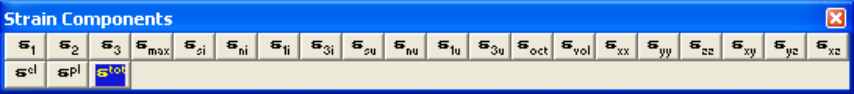

Ativa a barra de ferramentas de deformação – após a análise BEM no Map3D.

Esta barra de ferramentas oferece acesso rápido aos componentes de deformação.

Plot > Strain > E1 Deformação principal maior e1 Plot > Strain > E2 Deformação principal intermediária e2 Plot > Strain > E3 Deformação principal menor e3 Plot > Strain > Emax Deformação de cisalhamento máxima emax = ½( e3 - e3 )

Plot > Strain > Esi Deformação de cisalhamento máxima no plano esi Plot > Strain > Eni Deformação normal no plano eni Plot > Strain > E1i Deformação máxima no plano e1i Plot > Strain > E3i Deformação máxima no plano e3i Plot > Strain > Esu Deformação de cisalhamento máxima no plano ubíquo esu Plot > Strain > Enu Deformação normal no plano ubíquo enu Plot > Strain > E1u Deformação máxima no plano ubíquo e1u Plot > Strain > E3u Deformação máxima no plano ubíquo e3u Plot > Strain > Eoct Deformação de cisalhamento octaédrica eoct = 1/3 [(e1 - e2)² + (e2 - e3)² +(e3 - e1)²]½ Plot > Strain > Evol Deformação volumétrica evol = (e1 + e2 + e3) Plot > Strain > Exx Componente cartesiana de deformação exx Plot > Strain > Eyy Componente cartesiana de deformação eyy Plot > Strain > Ezz Componente cartesiana de deformação ezz Plot > Strain > Exy Componente cartesiana de deformação exy Plot > Strain > Eyz Componente cartesiana de deformação eyz Plot > Strain > Exz Componente cartesiana de deformação exz Plot > Strain > Value > Elastic eelastic Plot > Strain > Value > Plastic eplastic Plot > Strain > Value > Total etotal

Observações:

A barra de ferramentas de deformação só pode ser ativada após a etapa de construção do modelo - CAD

Etapas de análise do Map3D.

Qualquer um desses componentes pode ser adicionado à barra de ferramentas de contornos, se desejado

Tools > Configure Contouring Toolbar
