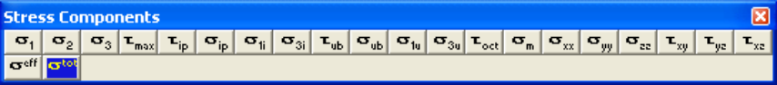

Ativa a barra de ferramentas de tensão – após a análise BEM no Map3D.

Esta barra de ferramentas oferece acesso rápido aos componentes de tensão.

Plot > Stress > S1 Tensão principal maior s1 Plot > Stress > S2 Tensão principal intermediária s2 Plot > Stress > S3 Tensão principal menor s3 Plot > Stress > Tmax Tensão de cisalhamento máxima ½(s1 - s3)

Plot > Stress > Tip Tensão de cisalhamento no plano tip Plot > Stress > Sip Tensão normal no plano sip Plot > Stress > S1i Tensão máxima no plano si1 Plot > Stress > S3i Tensão mínima no plano si3 Plot > Stress > Tub Tensão de cisalhamento no plano ubíquo tub Plot > Stress > Sub Tensão normal no plano ubíquo sub Plot > Stress > S1u Tensão máxima no plano ubíquo s1u Plot > Stress > S3u Tensão mínima no plano ubíquo s3u Plot > Stress > Toct Tensão de cisalhamento octaédrica toct = 1/3 [(s1 - s2)² + (s2 - s3)² +(s3 - s1)²]½ Plot > Stress > Smean Tensão média smean = 1/3 (s1 + s2 + s3)

Plot > Stress > Sxx Componente cartesiana de tensão sxx Plot > Stress > Syy Componente cartesiana de tensão syy Plot > Stress > Szz Componente cartesiana de tensão szz Plot > Stress > Txy Componente cartesiana de tensão txy Plot > Stress > Tyz Componente cartesiana de tensão tyz

Plot > Stress > Txz Componente cartesiana de tensão txz

Plot > Stress > Value > Seff Tensão efetiva seff

Plot > Stress > Value > Stotal Tensão total stotal

Observações:

A barra de ferramentas de tensão só pode ser ativada após a etapa de construção do modelo - CAD

Etapas de análise do Map3D

Qualquer um desses componentes pode ser adicionado à barra de ferramentas de contornos, se desejado

Tools > Configure Contouring Toolbar
