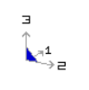
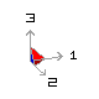

A orientação do estado de tensões principais no campo distante é indicada pelo ícone de orientação de tensões, localizado no canto superior direito da tela.

Na vista acima, o eixo s1 aponta principalmente para dentro da tela e um pouco para a direita, o eixo s2 aponta principalmente para a direita e um pouco para fora da tela, e o eixo s3 aponta diretamente para cima. Observe que o lado de trás do ícone está sombreado em azul.

Na vista acima, o eixo s1 aponta principalmente para a direita e um pouco para dentro da tela, o eixo s2 aponta principalmente para fora da tela e um pouco para a direita, e o eixo s3 aponta diretamente para cima. Observe que o interior do ícone está sombreado em vermelho.

Observe que o comprimento dos eixos é escalado de acordo com a magnitude dos componentes de tensão principal.

Os componentes de tensão principal pré-lavra são especificados em "CAD > Properties > Material Properties > Stress State".
