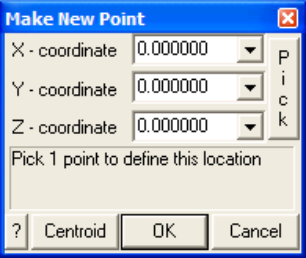

Cria um novo ponto de visualização. Consulte Visualization para ver uma descrição das rotinas de visualização disponíveis no Map3D.

Os pontos de visualização podem ser exibidos como esferas sombreadas por fonte de luz, com diâmetro e/ou cor variando conforme a magnitude, e contornados em um plano para exibir densidade etc.

Cada ponto pode ser marcado com uma série de:

- valores numéricos (por exemplo, cor, magnitude, orientação etc.)

- mensagens de texto

- nomes de arquivos (por exemplo, arquivos gráficos, documentos, planilhas etc.)

Ao clicar com o botão esquerdo em um ponto, a localização, a magnitude e a mensagem de texto são exibidas na barra de status.

Clicar com o botão direito em um ponto ativa o banco de dados visual (Visual Database). Este recurso pode ser usado para exibir um banco de dados com informações geológicas úteis, como teor, qualidade do maciço rochoso etc.

Ao ativar o recurso, o usuário é solicitado a informar as coordenadas do novo ponto de visualização.

Observe que, se um arquivo de visualização já estiver ativo, este novo ponto será adicionado ao arquivo. Se não houver nenhum arquivo de visualização ativo, o usuário será solicitado a abrir um, e este novo ponto será adicionado ao arquivo.

Coordenadas X, Y e Z - especifica as coordenadas do ponto de visualização.

Pick - ativa a mira do cursor, permitindo selecionar interativamente as coordenadas a partir do modelo.

Para auxiliar a seleção visual de pontos no modelo, todas as funções de snap estão disponíveis.

#### CAD > Snap

Depois de selecionadas, as coordenadas do ponto de visualização são exibidas na caixa de diálogo.

Centroid - ativa o cursor para que o usuário selecione uma entidade do modelo. As coordenadas serão calculadas no centro da entidade selecionada.

OK - conclui a edição das coordenadas e cria e exibe o ponto de visualização.

Depois que o ponto de visualização é criado, o usuário pode clicar com o botão direito no ponto para adicionar mensagens de texto e/ou nomes de arquivos.

- A mensagem de texto e o nome do arquivo são exibidos na barra de status, na parte inferior da tela, ao selecionar um evento com o botão esquerdo do mouse.

- Eles também podem ser editados ao selecionar um evento com o botão direito do mouse.

- Selecionar com o botão direito do mouse também permite exibir o arquivo, se o nome do arquivo tiver sido associado a um aplicativo (consulte a documentação do Windows sobre como "Associar um arquivo a um programa").
