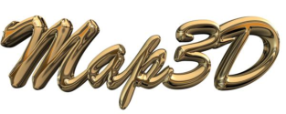

O Map3D é desenvolvido e mantido pelo Dr. Terry Wiles (support@map3d.com), da Map3D International Ltd. O desenvolvimento do Map3D começou no final da década de 1970 e, desde então, passou por muitas revisões importantes. Ele está disponível comercialmente desde 1990. O programa está em desenvolvimento constante e conta com o suporte de profissionais dedicados que atuam há mais de 50 anos em mecânica das rochas e modelagem numérica.

O programa é usado por centenas de empresas de mineração, engenharia civil e geotecnia, consultorias, centros de pesquisa e universidades em todo o mundo (incluindo Argentina, Armênia, Austrália, Áustria, Bélgica, Bolívia, Botsuana, Brasil, Bulgária, Burkina Faso, Canadá, China, Colômbia, República Democrática do Congo, República Dominicana, Equador, Egito, El Salvador, Eritreia, Finlândia, Gana, Grécia, Guatemala, Honduras, Índia, Indonésia, Irlanda, Itália, Japão, Cazaquistão, Coreia, Mali, México, Marrocos, Mongólia, Namíbia, Nicarágua, Papua-Nova Guiné, Peru, Filipinas, Portugal, Rússia, Arábia Saudita, África do Sul, Espanha, Suécia, Suíça, Tanzânia, Turquia, Reino Unido, EUA, Zâmbia e Zimbábue). O Map3D costuma ser exigido como pré-requisito em anúncios de emprego. A versão de demonstração (demo_version) é usada no mundo todo para ensinar aos estudantes os fundamentos da modelagem numérica e do CAD 3D.

Ele já foi usado em muitos projetos, incluindo projeto de minas subterrâneas e a céu aberto, avaliação da estabilidade de minas, projeto de repositórios de resíduos nucleares, simulações de propagação de fraturas, problemas de deslizamento de falhas, retroanálise de tensões in situ, projeto de pedreiras, estabilidade de taludes de cava, propagação de fraturas hidráulicas, rupturas de taludes de solo etc. A pesquisa e o desenvolvimento atuais concentram-se em procedimentos quantitativos de projeto, modelagem plástica 3D, simulação de suporte do terreno, avaliação do potencial de explosões de rocha (rockburst), simulação de discing e integração da modelagem com o monitoramento sísmico.

**Método dos elementos de contorno**: o Map3D é formulado com o eficientíssimo método indireto dos elementos de contorno e incorpora o uso simultâneo de elementos de força fictícia (FF), de descontinuidade de deslocamento (DD) e de elementos de contorno especiais e proprietários incorporados às versões de análise térmica, não linear e viscoplástica (versões do Map3D).

A pesquisa e o desenvolvimento dos últimos 50 anos permitiram superar muitas das supostas limitações do método dos elementos de contorno. O programa permite sequências de lavra em várias etapas, múltiplas zonas de material com diferentes propriedades e estados de tensão, e resposta descontínua da rocha com um número limitado de feições discretas. Tanto as zonas 3D quanto as zonas DD podem ter comportamento não linear e/ou plástico. Múltiplos planos de falha que se interceptam podem deslizar e se abrir de acordo com a resistência ao cisalhamento especificada pelo usuário. É possível simular a análise acoplada de tensões térmica/de fluidos em regime permanente. Problemas de fluência e relaxação em tempo real podem ser tratados com passos de tempo explícitos.

**Modelagem elástica versus plástica**: os defensores da modelagem plástica costumam atribuir a ela capacidades exclusivas em relação à modelagem elástica, como:

- Capacidade de prever a magnitude, a localização, o momento e a orientação do dano.

- Capacidade de simular a redistribuição de tensões devida à plastificação.

- Capacidade de acompanhar o dano acumulado com o avanço da lavra.

Embora o Map3D possa analisar a plasticidade 3D completa do maciço rochoso, ele também pode tratar todas essas supostas capacidades exclusivas da modelagem plástica usando modelagem elástica.

Isso é possível graças a novas ferramentas de análise incorporadas ao programa:

- Os modelos elásticos do Map3D são plenamente capazes de prever a magnitude, a localização, o momento e a orientação do dano por meio do cálculo do excesso de tensão.

- É possível avaliar três modos principais de ruptura:

   - Ruptura do maciço rochoso.

   - Ruptura do tipo falha no plano.

Fraqueza estruturalmente orientada em planos ubíquos (UB) (com até 3 famílias de juntas).

- A redistribuição de tensões pode ser simulada incorporando zonas amolecidas.

- Há uma nova funcionalidade para acompanhar o dano acumulado (excesso de tensão) em modelos elásticos: o dano é acompanhado com o avanço da lavra.

   - O valor máximo de excesso de tensão atingido durante o avanço da lavra é registrado e pode ser plotado à medida que as etapas de lavra progridem.

Tanto a primeira etapa de plastificação quanto as etapas de plastificação máxima são armazenadas e podem ser exibidas como números de trajetória.

Os novos recursos do MAP3D permitem tratar muitos comportamentos que antes só eram possíveis com modelagem não linear e plástica.

Isso é feito mantendo a facilidade de uso e as vantagens de desempenho computacional da modelagem elástica.

Esses recursos anulam, em grande parte, quaisquer vantagens oferecidas pela modelagem plástica.

Caso seja necessária uma simulação plástica:

- O Map3D Visco-Plastic oferece a capacidade de simular completamente a plastificação do maciço rochoso usando os mesmos arquivos de entrada do modelo.

- O Map3D Fault-Slip oferece a capacidade de simular completamente a plastificação por deslizamento de falhas usando os mesmos arquivos de entrada do modelo.

**Precisão do programa**: a precisão da solução é controlada por um procedimento de discretização automatizado. Os elementos podem ser concentrados automaticamente nas áreas de interesse de acordo com parâmetros controlados pelo usuário. Isso poupa o usuário do processo trabalhoso de discretizar manualmente o modelo, ao mesmo tempo que melhora a precisão e minimiza o tamanho do problema.

**Tamanho do problema**: o Map3D pode tratar mais de 24 milhões de graus de liberdade em um PC com poucos GB de espaço em disco. Embora problemas pequenos possam ser resolvidos em minutos, os maiores podem exigir uma noite ou alguns dias. Essa enorme eficiência é obtida com o agrupamento de matrizes. Isso permite especificar em detalhe a geometria de lavra existente de toda a mina e acrescentar novas lavras conforme necessário. Assim, o esforço para preparar e executar análises é muito reduzido, e a mina inteira pode ser considerada quando necessário.

**Multiprocessamento e múltiplos discos**: o Map3D oferece suporte completo ao processamento paralelo, de modo que os tempos de cálculo escalam linearmente com o número de processadores (processadores de 6 núcleos resolvem problemas 6 vezes mais rápido que os de um núcleo). Além disso, o programa tem funcionalidade integrada de discos sobrepostos, que permite que as taxas de leitura e gravação escalem linearmente com o número de discos (com 4 discos, a leitura e a gravação são 4 vezes mais rápidas que com um só).

**Pré-processamento**: um pacote CAD completo está incorporado ao Map3D, com diversos recursos para troca de dados com outros pacotes CAD. Muitos recursos, incluindo as funções automatizadas de contorno e extrusão, permitem construir modelos complexos com facilidade. Rotinas abrangentes de verificação de erros e de correção automática permitem usar quase qualquer geometria de modelo. Rotinas de interseção booleana corrigem conexões de blocos sobrepostas e incompatíveis sem intervenção do usuário. Há suporte completo à importação e exportação de arquivos de geometria nos formatos DXF ou PNT (ASCII).

**Pós-processamento**: está incluído um pacote de visualização completo, com centenas de funções de plotagem e exportação de dados. Plotagens definidas pelo usuário e exportações de dados selecionadas visualmente facilitam a interpretação e a elaboração de relatórios. Os dados podem ser exportados diretamente para o Excel e plotados automaticamente.

#### Por que usar o Map3D

O Map3D foi desenvolvido desde o início especificamente para aplicações de mineração. O programa foi projetado para que você obtenha respostas de alta precisão rapidamente e possa se dedicar à engenharia em vez da modelagem. Problemas grandes e complexos podem ser construídos facilmente com a interface CAD do próprio Map3D ou fora do programa e depois importados em diversos formatos. Nenhum outro programa consegue realizar as análises do Map3D no mesmo tempo (tempo de processamento, pré e pós-processamento), com o mesmo custo (muitas vezes mais barato) e com a mesma facilidade (o Map3D pode ser usado na mina para análises de rotina). Algumas das vantagens do Map3D são:

- Caminho de atualização prático entre análises elástica, de deslizamento de falhas, térmica/de fluxo de fluidos, não linear e viscoplástica (versões do Map3D) com a mesma interface

- Amplo programa de treinamento tanto na funcionalidade do programa quanto na interpretação detalhada de resultados de engenharia (consulte Treinamento em Map3D)

- Poderosa interface CAD integrada: não é necessário software de terceiros

- Construção fácil de formas 3D simples ou complexas.

- Problemas muito grandes resolvidos facilmente em um computador de mesa (24.000.000 de graus de liberdade)

- Recurso automatizado para gerar gráficos no Excel a partir de dados de contornos

- Plotagens de probabilidade de ruptura

- O recurso automatizado de interseção de blocos poupa o usuário do trabalho de construção manual

- Permite a colocação de enchimento

- Sequências de lavra em várias etapas

- Elementos de alta precisão (exige metade dos elementos para atingir o mesmo grau de precisão da maioria dos programas)

- Graças a procedimentos avançados de agrupamento, os tempos de processamento são muito curtos em comparação com outros programas

- Até 100 zonas de material diferentes

- Simulações viscoplásticas de deslizamento de falhas

- Lavra tabular com pilares em plastificação

- A discretização automatizada garante um grau de precisão consistente e fácil de controlar

- Poderoso visualizador de resultados integrado

- Manipulação fácil dos resultados para interpretar a ruptura do maciço rochoso, o deslizamento em planos de falha, os resultados em furos de sondagem orientados e o deslizamento ubíquo em planos de acamamento ou famílias de juntas.

- O banco de dados de visualização interativa integrado permite exibir dados sísmicos e gerar contornos a partir deles

- Plotagem de contornos de funções definidas pelo usuário

- Suporte do programa incluído

- Desenvolvimento e aprimoramentos contínuos há mais de 26 anos

- Incorporação de elementos de força fictícia e de descontinuidade de deslocamento (além de elementos especiais para fluxo térmico/de fluidos e plasticidade 3D).

- Elementos de ordem superior para problemas de flexão

- Grades planas, grades lineares e grades de pontos para visualizar resultados

- Critérios de ruptura isotrópicos e anisotrópicos

- Plotagens de RCF (Rock wall Condition Factor, fator de condição da parede rochosa)

- Solucionadores integrados acelerados, pré-condicionados e de gradiente conjugado trabalham em conjunto para soluções rápidas, confiáveis e precisas

- Recurso de importação/exportação de dados de entrada para outros programas CAD

- Recurso de importação/exportação de resultados de análise para outros programas

- Sem taxas de aquisição caras: o Map3D é licenciado anualmente

- Interface direta com o Deswik, que permite criar geometrias do Map3D, incluindo a especificação de nomes de blocos, cores e sequência de lavra do Map3D.

- Exportação direta para Excel, 3D-PDF, VRML e muito mais.

**Alguns usuários**: entre os usuários atuais e anteriores do Map3D estão: University of Toronto (Canada), Vale (formerly CRVD INCO Ontario) (Creighton Mine, Stobie Mine, Frood Mine, South Mine, Garson Mine, Levack Mine, Mines Research, Mines Technology - Methods & Design), INCO Manitoba (Canada), Noranda (Canada), CNG Softeck Co. (Korea), Anglo Gold (South Africa), Golder Associates (Canada and Australia), Placer Dome Western Area Joint Venture (South Africa), Mount Isa Mines (Australia), Brunswick Mining and Smelting (Canada), Goldcorp (Canada), Mincad Systems (Australia), Kanowna Belle Gold Mines (Australia), U. of British Columbia (Canada), U. of Western Australia, U. of New South Wales (Australia), Laval U. (Canada), McGill U. (Canada), Rock Mechanics Technology (England), Endeavor Mine (Australia), Australian Mining Consultants, Aur Resources (Canada), CSIR Division of Mining Technology (South Africa), Snowden Mining Industry Consultants (South Africa and Australia), Tara Mines (Ireland), Georock Inc. (Canada), Romec n.v. (Belgium), Agnico Eagle - Division Laronde (Canada), Queensland University (Australia), Geomechanics Research Centre Laurentian U. (Canada), Agnew Gold (Australia), Western Mining Corp. (Australia), Tao Lekoa Mine (South Africa), AngloGold Ashanti (South Africa and Australia), Kalgoorlie Consolidated Gold Mines (Australia), INWE Rock Engineering, Lourence Geotechnical (Australia), Western Deep Levels (South Mine, West Mine, Regional Office), Zinkgruvan Mining AB (Sweden), Elandsrand Gold Mine (South Africa), TWP Consulting (South Africa), Tshepong Mine (South Africa), CAMBIOR Inc. (Canada), Natural Resources Canada, Avmin Target Mine (South Africa), SRK Consulting (South Africa, Australia, Sweden), U. of Waterloo (Canada), St Ives Gold (Australia), Mine Geant Dormant (Canada), Normandy Jundee Operation (Australia), KULeuven - Unit Mining (Belgium), Leinster Nickel Operation (Australia), Doyon Mine (Canada), ISS International (South Africa), ISS Pacific (Australia), Musselwhite Mine (Canada), Finsch Diamond Mine (South Africa), Queen's University (Canada), Plutonic Gold Mine (Australia), Campbell Mine (Canada), JCI Travistock Colliery (South Africa), Strata Control Technology (Australia), Cayeli Bakir Isletmeleri A. S. (Turkey), Asker - Thabazimbi ISCOR (South Africa), Douglas Partners (Australia), U. of Queensland (Australia), Bambanani Mine (South Africa), Palabora Mining Company Ltd. (South Africa), Newcrest Mining Ltd. (Australia), Delft U. of Technology (The Netherlands), ANGLOVAAL (South Africa), Impala Platinum (South Africa), Battle Mountain Canada, Black Mountain (South Africa), Tsumeb - Otjihase Mine (Namibia), Kloof, Division of Kloof G.M. Co. Ltd. (South Africa), Rustenburg Platinum Mines Ltd. (South Africa), Savuka Mine (South Africa), BCL Botswana (Botswana), Terra Sancta (Australia), Mines Aurizon - Casa Berardi (Canada), Rockland Ltd. (Canada), Darlot Gold Mine (Australia), Forrestania Gold NL (Australia), WA Department of Minerals and Energy (Australia), Great Central Mines - Wiluna Gold (Australia), Central Mines Engineering Group - Inco Ltd (Canada), Kundana Gold (Australia), Henty Gold Mine - Goldfields Ltd. (Australia), Elura Mine (Australia), Western Australia School of Mines, Cannington - BHP World Minerals (Australia), WMC Olympic Dam Operations (Australia), BFP Consultants Pty Ltd (Australia), Julius Kruttschnitt Mineral Research Centre (Australia), Mountan U. of Leoben (Austria), CNR-C.S. Problemi Minerari (Italy), Japan Nuclear Development Institute (Japan), Lassonde Mineral Engineering (Canada), Coffey Geosciences Pty Ltd (Australia), Pajingo Joint Venture (Australia), TauTona Mine (South Africa), Bronzewing - McClure Gold Operations (Australia), Normandy Golden Grove Operation (Australia), McArther River Mining Pty Ltd (Australia), Boulby Mine - Cleveland Potash Limited (United Kingdom), AngloGold Ashanti Mineracao: Cuiaba (Brasil), Harmony Gold Mining Company Limited (Australia), Mirarco Mining Innovation (Canada), Northam Platinum Limited Zondereinde Division (South Africa), Open House Management Solutions (South Africa), Great Noligwa Mine (South Africa), Konkola Copper Mines (Zambia), Osborne Mines (Australia), Politecnico di Torino (Italy), Atomic Energy Canada, Ekati Diamond Mine (Canada), Musslewhite Mine (Canada), Cadia Holdings Ltd. (Australia), INGWE Rock Engineering (South Africa), Mountan University of Technology (Austria), Australian Centre for Geomechanics, Granites Gold Mine (Australia), Northparkes Mines (Australia), Basis Soft Inc. (Korea), Ritsumeikan University (Japan), Science & Technology Central South University (Changsha, Hunan China), Groundwork Consulting (Australia), LionOre Australia, MPI Mines (Australia), Lisheen Mine (Ireland), Northeastern University (Shengyang, Liaoning, P.R.China), Beck Arndt Engineering (Australia), La Mine Niobec (Canada), Second Avenue Subway (New York USA), Anglo Platinum (South Africa), Ressources MSV Inc. (Canada), Selwyn Operations (Australia), Newmont Australia Technical Services (Australia), Kigam - Geotechnical Engineering Division (Korea), Dempers and Seymour P/L (Australia), Cobar Management Pty Ltd (Australia), Big Bell Mining Operations (Australia), Auriongold Kalgoorlie Operations (Australia), Peak Gold Mines (Australia), Driefontein Consolidated (Pty) Ltd (South Africa), Newmont - Pajingo Joint Venture (Australia), AurionGold - Paddington Gold Pty Limited (Australia), Mincor Operations (Australia), Falconbridge Ltd. (Canada), Sons of Gwalia - Southern Cross Operations (Australia), E-Mining Technology S.A. (Chile), Beaconsfield Gold (Australia), MMG Rosebery Mine (Australia), Instituto Innovacion en Mineria y Metalurgia (Chile), IRSM of Chinese Academy of Sciences (China), Brently, Lucas & Associates (South Africa), Kirkland Lake Gold Inc.(Canada), Chelopech Mining AD (Bulgaria), Northwind Enterprises (Australia), Cameco Corporation (Canada), Barrick Goldstrike Mines (USA), Barrick Gold -Lawlers Gold Mine (Australia), RMIT - Faculty of Engineering (Australia), Perilya Broken Hill Ltd (Australia), Placer (PNG) - Porgera Joint Venture (Papua New Guinea), Codelco Chile - Division Andina (Chile), Codelco Chile - Division El Teniente (Chile), Codelco Chile - Division Norte (Chile), IM2 S.A. - Filial Codelco (Chile), Codelco Chile - Division Salvador, Geo-Engineering Technology Limitada (Chile), Xstrata Copper (Australia), Xstrata Nickel (Australia), Mining Geotechnical Solutions (Australia), Freeport McMoRan Copper & Gold (USA), Kopanang Gold Mine (South Africa), Seoul National University (Korea), Lawlers Gold Mine (Australia), Bendigo Mining Limited (Australia), Codelco, Gerencia Corporativa (Chile), Stawell Gold Mines (Australia), Samancor - Western Chrome Mines (South Africa), Mponeng Mine (South Africa), KMCL - Bulyanhulu Site (Tanzania), Ballarat Goldfields (Australia), Goldfields Mine Management (Australia), Dynatec Corporation (Canada), P.T. Freeport Indonesia, EKJV Management (Australia), BHPB Nickel West - Leinster Nickel Operation (Australia), Birla - Mt. Gordon (Australia), Ridgeway Project - Cadia Holdings (Australia), U. of South Australia, Sunrise Dam Gold Mine (Australia), Oxiana Golden Grove (Australia), Moab Khotsong Mine (South Africa), MIDD & MIDDindi Consulting (South Africa), Redco Ltda (Chile), Mining One Pty Ltd (Australia), Birla Nifty - Nifty Copper (Australia), Cracow Gold Mine (Australia), Beta-Hunt Mine (Australia), Universidad de Chile - Facultad de Ciencias Fisicas y Mathematicas, Geotechnical Consulting Pty Ltd (Australia), NVI Mining Ltd. Myra Falls (Australia), East Bolder Mine - Stillwater Mining (USA), Cambior - La Mine Geant-Dormant (Canada), University of Quebec Chicoutimia (Canada), New Gold Afton Project (Australia), A Karzulovic & Associates (Chile), Strata Engineering (Australia), Peter O'Bryan & Associates (Australia), Barrick Granny Smith (Australia), Xstrata Nickel - Raglan Mine (Canada), Genivar (Canada), President Steyn Gold Mine (South Africa), GFL Mining Services Limited (South Africa), Mopani Copper Mine (Zambia), Tau Lekoa Mine (South Africa), Stanford University Department of Geophysics (USA), Simon Fraser University - Department of Earth Sciences (Canada), Resolution Copper Company (Canada), North American Tungsten Corporation (Canada), Gold Fields Technical Services (South Africa), Maggie Hays - Lake Johnston Operations (Australia), Nickel West Cliffs Project - BHP Billiton (Australia), Ditton Geotechnical Services (Australia), GeoMech Services (Australia), Outokumpu Torino Works (Finland), Wardell Armstrong International Ltd (UK), Cosmos Nickel Project - Jubilee Mines NL (Australia), Long Nickel Project - Lighting Nickel Pty (Australia), RESPEC (USA), Xstrata Nickel - Craig Mine (Canada), Northern 3500 Orebody - Xstrata Copper (Australia), Xstrata Zinc - Mount Isa Mines (Australia), Goldfields - Beatrix 4 Shaft (South Africa), Omya Central Europe (Austria), Pyhasalmi Mine Oy (Finland), Outokumpu Torino Works (Finland), Mining One Pty Ltd (Australia), P.T. Newmont Tenggara (Indonesia), Peak Gold Mines (Australia), Argyle Diamond Mine (Australia), Bullant Gold Mine (Australia), Geosinergia Ingenieria y Medio Ambiente Ltd (Chile), Lonmin Platinum (South Africa), DERK Ingenieria y Geologia Ltda (Chile), Montana Exploradora de Guatemala S.A.(Guatemala), St. Barbara Limited (Australia), Boliden Mineral AB (Sweden), Vattenfall Power Consultant (Sweden), Lulea University of Technology (Sweden), LKAB Mining Technology (Sweden), Associacao Instituto Technologio Vale - ITV (Brasil), Mina San Rafael, S.A. - Mina El Escobal (Guatemala), Hecla - Lucky Friday Mine (USA), Kittila Mine - Agnico-Eagle Finland Oy (Finland), Central Institute of Mining and Fuel Research (India), Sibanye Gold (South Africa), Global Mine Design (UK), Eagle Mine LLC (USA), Newmont USA Limited - Leeville Operation (USA), Agnico Eagle Mines Limited (Mexico), NIOSH OMSHR Pittsburg Mining Research Division (USA), ARANZ Geo Limited (New Zealand), Thiess Pty Ltd (Australia), Glencore - Ernest Henry - Copper (Australia), Syama Mine, Society des Mines de Syama (Mali), Glencore Mount Isa Mines Ltd (Australia), La Mancha Resources - Frogs Leg Mine (Australia), Northern Star Resources Limited (Australia), Dundee Precious Metals - Kapan (Armenia), Minera Cuzcatlan (Mexico), Minera Candelaria (Chile), SVS Ingenieros (Chile), ENAMI CHILE (Chile), Kibali Gold Mine - Randgold Resources Ltd. (Democratic Republic of Congo), Unki Mines (Pvt) Ltd (Zimbabwe), Lady Loretta - Zinc Assets Australia (Australia), Salt Lake Mining Pty Ltd (Australia), Mt Carlton and Pajingo - Evolution Mining (Australia), NIOSH OMSHR Spokane Research Lab (USA), Rubicon Minerals Corporation (Canada), Les Mines Opinaca Ltee, Projet Eleonore (Canada), Lac des Iles Mine - North American Palladium (Canada), Pakalnis and Associates (Canada), Nyrstar - Langlois Mine (Canada), Mufulira Mine - Mopani Copper Mines Plc (Zambia), Black Mountain (South Africa), Bindura Nickel Corporation, Trojan Nickel Mine (Zimbabwe), Fosterville Gold Mine Pty Ltd (Australia), Ranger 3 Deeps - E.R.A. (Australia), Kazzinc Ltd (Kazakhstan), Independence Group - Jabiru - Jaguar Limited (Australia), MMG - Dugald River Mine (Australia), AuRico Gold Inc (Canada), Nyrstar Myra Falls Ltd (Canada), Universidad de Chile (Chile), GMT Ltda (Chile), MINSUR S.A. (Peru), AMEC Chile (Chile), Compania Minera El Toqui (Chile), Devourge Industries Ltd (Zambia), Assmang Manganese - Black Rock Mine Operation (South Africa), School of Engineering and ICT, U. of Tasmania (Australia), Primero Gold Canada Inc (Canada), AMEC Earth and Environmental (Canada), Mine Westwood - IAMGOLD (Canada), Stantec Inc (Canada), Knight Piesold Ltd (Canada), Osisko Mining Corporation (Canada), Kinross Gold Corporation - Technical Services (Canada), Silver Lake Resources, Daisy Milano Mine Site (Australia), Minerals and Metals Group, Golden Grove (Australia), South32 Cannington Pty Ltd (Australia), Morobe Mining, Nine Mile, Awilunga Estate (Papua New Guinea), Copper Mines of Tasmania (Australia), AngloGold Ashanti Mineracao: Cuiaba (Brasil), Mineracao Serra Grande (Brasil), Xstrata Zinc, Mine Matagami (Canada), St. Andrew Goldfields Ltd., Holt-Holloway Mine (Canada), Hecla Quebec - Casa Berardi (Canada), Barrick Cortez (USA), Barrick Gold Corp. - Hemlo Operations (Canada), ASDR Industries (Canada), Centre for Excellence in Mining Innovation (Canada), Two Rivers Platinum (Pty) Ltd (South Africa), Chibuluma Copper South Mine PLC (Zambia), Loulo Mine, Randgold Resources Limited (Zambia), Santiago University (Chile), Tomas Fernando Villegas Barba (Mexico), ACE [Arab Consulting Engineers] (Egypt), Growth & Intl Projects, GoldFields Australasia (Australia), Tritton Resources Pty Limited (Australia), Compania Minera San Geronimo (Chile), Jacobina Mineracao - Yamana Gold Inc (Brasil), FF GeoMechanics (Chile), Minera Florida Ltda (Chile), Minera Triton S.A. (Nicaragua), Minera Sierra Gorda SCM (Chile), Sociedad Minera El Brocal S.A.A. (Peru), GFI Mining SA (Pty) Ltd, Kloof Division (South Africa), Anglogold Ashanti - Obuasi Mine (Ghana), ARMgold/Harmony Freegold JV (South Africa), BCG Engineering Inc (Canada), University of New South Wales (Australia), Agnico-Eagle - Division Goldex (Canada), McArthur River Mine - Cameco Corporation (Canada), Thinkrox Inc (Canada), New Gold Inc., New Afton (Canada), Snap Lake Mine, De Beers Canada Inc (Canada), Mine Design Engineering (Canada), DB Operating Corporation (Canada), BCD Resources (Operations) NL - Tasmania Mine (Australia), Minera El Toqui (Chile), Capstone Gold S.A. (Mexico), Universidad De La Serena (Chile), Segala Mining Co SA (SEMICO SA) (Mali), Bariq Mining Limited (Saudi Arabia), TREM Rock Engineering (South Africa), U. of Saskatchewan, Civil & Geological Eng. (Canada), Call & Nicholas Inc (USA), LVI Geotechnical (Australia), Camborne School of Mines, U. of Exeter (UK), PUCOBRE (Chile), Compania Minera Dona Ines de Collahuasi (Chile), Compania Minera Nevada SpA (Chile), Mining Plus Pty Ltd (Australia), Flying Fox Mine - Forrestania Nickel Project (Australia), Oceana Gold Didipio Operations (Philippines), Sandfire Resources NL (Australia), MineGeoTech Pty Ltd (Australia), 2M Engineering (Indonesia), MINERA MILPO S.A.A  (Peru), Siga Ingenieria Y Consultores S.A. (Chile), Bluestone Mines Tasmania Joint Venture (Australia), Barrick (Australia Pacific) Yilgarn (Australia), Apex Gold Pty Ltd (Australia), Jennmar Australia Pty Ltd (Australia), Tecnologia Y Geociencias Limitada (Chile), Kazakhmys Services Limited (Kazakhstan), Cairo University - Faculty of Engineering (Egypt), Isa Ashari Qudraturrahman (CV PRJ) (Australia), Ezulwini Mine - First Uranium Corporation (South Africa), University of Pretoria (South Africa), Eldorado Gold Corporation (China), Carpentaria Gold - Ravenswood Operations (Australia), Anglo Coal Australia Pty Ltd (Australia), Eastplats Ltd - Crocodile River Mine (South Africa), Great Noligwa Mine (South Africa), Randfontein Estates - Harmony Gold Mining Co (South Africa), PipeFlo (South Africa), Haldeman Mining Company S.A. (Chile), ARCADIS CHILE S.A (Chile), Geomechanicos Consultores Ltda (Chile), Otter Juan Mine - Goldfields Mine Management (Australia), Straits Resources Limited (Australia), Halcrow Group Limited (Australia), Mine-concept Engineering Services (Canada), Diavik Diamond Mines Inc (Canada), Green Geotechnical Pty Ltd (Australia), Custom GeoEng Solutions Inc (Canada), Ingenieria de Rocas Limitada (Chile), BHP Billiton Energy Coal South Africa Ltd (South Africa), Luanshya Copper Mines Plc (Zambia), Brentley, Lucas & Associates Pty Ltd (South Africa), Oz Minerals (Australia), Rio Tinto - Technology and Innovation (USA), InnovExplo Inc (Canada), AMEC Foster Wheeler Americas (Canada), Geohart Consultants Pty Ltd (Australia), ROCKLAND LTD (Canada), Sudbury Integrated Nickel Operations, Glencore (Canada), East Boulder Mine - Stillwater Mining (USA), Breakwater Resources Ltd (Canada), School of Resources & Safety Eng - Central SU (China), Manxmin Pty. Ltd (Australia).

O Map3D é desenvolvido e mantido por:

Dr. Terry D. Wiles Map3D International Ltd. E-mail: support@map3d.com Site: [www.map3d.com](https://www.map3d.com)

O Map3D é licenciado, não vendido. O uso do Map3D ocorre por meio de um contrato de licença, controlado por uma chave de proteção temporal. O programa normalmente é licenciado anualmente, mas licenças de vários anos podem ser negociadas com antecedência.

As vendas e o suporte são fornecidos pela Map3D International Ltd e por uma rede de agentes no mundo todo, localizados na Austrália, Brasil, Canadá, Chile, China, Índia, Indonésia, Cazaquistão e África do Sul (www.map3d.com/how_to_buy).
