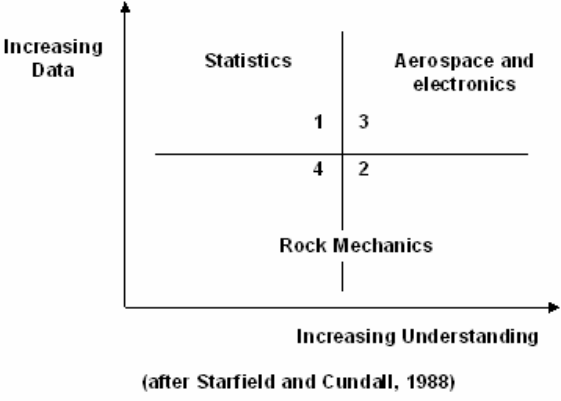
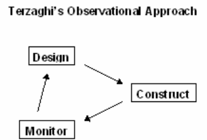
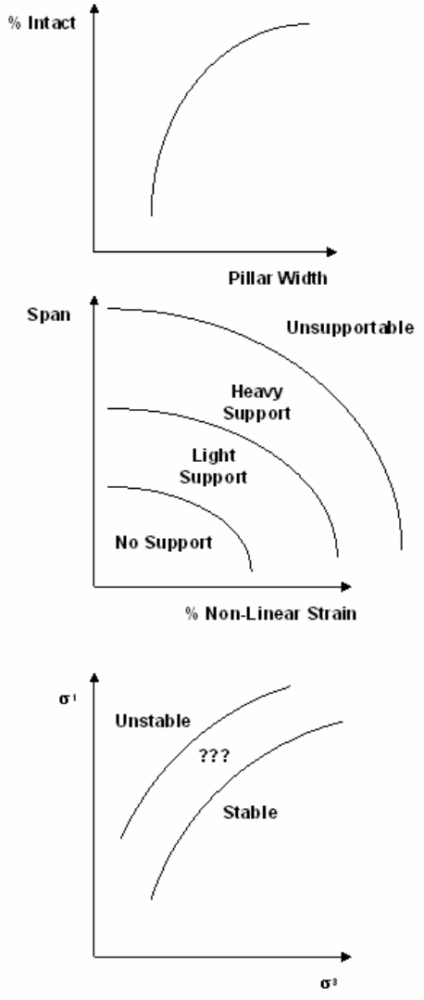
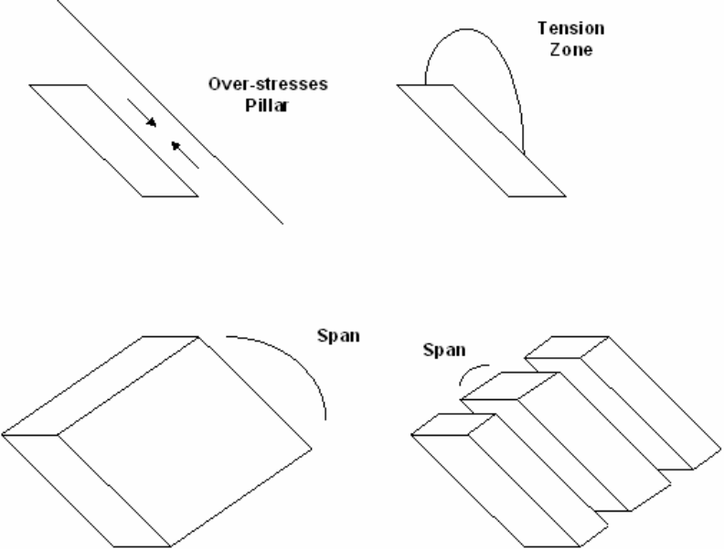
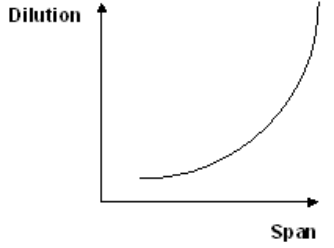
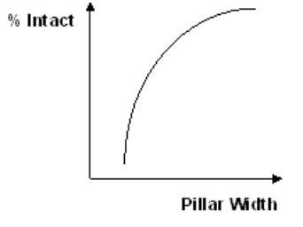
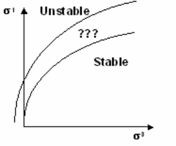
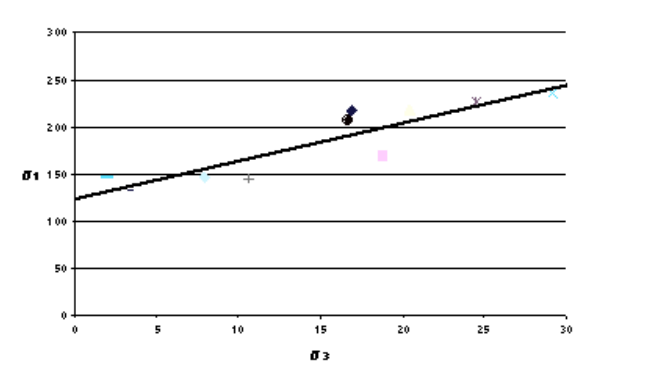

O objetivo simples da modelagem numérica é prever (com precisão e confiabilidade) como o maciço rochoso responderá à lavra. Especificamos as condições de carregamento e a geometria (que pode incluir diques, falhas, acamamento etc.), exigimos equilíbrio e continuidade, supomos que se aplica elasticidade e/ou não linearidade e, então, resolvemos essas equações para obter tensões, deformações, deslocamentos etc. em todo o maciço rochoso.

Examinando os resultados da análise de tensões, podemos identificar, por exemplo, locais sobretensionados ou em plastificação. Podemos determinar quais locais precisam de suporte e que tipo de suporte é adequado etc.

O objetivo final é saber quais problemas esperar, bem como quando e onde eles ocorrerão. Isso permite comparar layouts e sequências de lavra alternativos e desenvolver estratégias para lidar com os problemas quando ocorrerem. Evitam-se interrupções inesperadas da produção. É possível estabelecer valores de projeto concretos para os requisitos de suporte, larguras específicas de pilares, alturas aceitáveis de realces etc. Em resumo, a modelagem é uma ferramenta que ajuda você a projetar sua mina. Embora a modelagem numérica seja razoavelmente simples, interpretar os resultados é um desafio muito maior. A modelagem numérica para previsões em maciços rochosos não é uma ciência exata. Sempre haverá características do maciço rochoso que não foram previstas ou compreendidas.

A citação a seguir, de Starfield e Cundall (1988), sugere várias razões para isso.

_Os modelos de mecânica das rochas pertencem à classe dos "problemas com dados limitados": raramente se sabe o suficiente sobre as características e o comportamento do maciço rochoso para modelá-lo sem ambiguidade. Consequentemente, não é possível usar modelos em mecânica das rochas da forma convencional (como na engenharia elétrica ou aeroespacial), sendo necessário adotar uma metodologia própria e adequada para a modelagem em mecânica das rochas._

Os problemas costumam ser mal formulados, o que dificulta a interpretação dos resultados e gera a dúvida persistente sobre se o problema correto foi ou não modelado. O projeto do modelo deve ser orientado pelas perguntas que o modelo deve responder, e não pelos detalhes do sistema modelado. Isso ajuda a simplificar e controlar o modelo.

Um modelo é uma simplificação da realidade, não uma imitação dela. É uma ferramenta intelectual que precisa ser projetada ou escolhida para uma tarefa específica. O problema fundamental é a questão da resolução. Teme-se simplificar demais o problema.

É inútil esperar algum dia ter dados suficientes para modelar maciços rochosos da forma convencional (como na engenharia elétrica ou aeroespacial). À medida que se inclui cada vez mais detalhe, perde-se o controle intelectual do modelo, que se torna menos eficaz em vez de mais.

#### Qual é a abordagem convencional para aplicar a modelagem numérica ao projeto de mina?

Na maioria das outras disciplinas de engenharia (engenharia elétrica ou aeroespacial), a modelagem numérica normalmente se baseia em prever a resposta a partir de propriedades dos materiais medidas em laboratório. Isso geralmente funciona bem quando os materiais, a geometria e as condições de carregamento são bem conhecidos.

Por outro lado, o método convencional para aplicar a modelagem numérica ao projeto de mina baseia-se na "abordagem observacional de projeto de Terzaghi".

Inicialmente (ou seja, antes da lavra), você pode realizar estudos paramétricos. Pode comparar projetos alternativos e identificar fatores importantes que afetam a estabilidade. Pode descobrir que certas orientações são mais favoráveis que outras ou que certas sequências são melhores escolhas. Pode fazer uma estimativa geral do custo-benefício do aumento da produção em comparação com o aumento dos requisitos de manutenção e suporte.

Saber que tipo de problemas esperar e quais locais são particularmente suscetíveis é certamente uma informação útil, pois permite desenvolver estratégias para lidar com os problemas caso ocorram. Mas, se você quiser usar a modelagem para estabelecer valores de projeto concretos para os requisitos de suporte, larguras específicas de pilares, alturas aceitáveis de realces e custos reais, precisará ter confiança na precisão de suas previsões.

Por exemplo, não faria sentido especificar um pilar de 1,2 m de largura com base em uma previsão do modelo se você não tivesse ideia de quão confiável é essa previsão. Você nunca permitiria que pessoas passassem sob uma testa com base em resultados de modelagem que indicassem que ela é segura, a menos que também confiasse na confiabilidade das previsões.

É fundamental conhecer a confiabilidade de uma previsão para avaliar o risco e fundamentar decisões de custo-benefício.

Vale a pena refletir um momento sobre essa afirmação. Não consigo pensar em nenhum exemplo em que previsões de confiabilidade desconhecida tenham algum valor. Você pode admitir que a confiabilidade da sua previsão é baixa e que o erro pode chegar a ±100%; ou pode ter evidências de que a confiabilidade é muito alta e que o erro é inferior a ±10%. Qualquer pessoa em posição de tomar decisões precisa saber disso para ponderar em suas análises de custo-benefício.

Considere estas duas perguntas:

Se você tivesse prova demonstrável de que as previsões do modelo são 99% confiáveis (erro de ±1%), por que não as usaria?

Se você tivesse prova demonstrável de que as previsões do modelo são 1% confiáveis (erro de ±99%), por que as usaria?

O cerne da questão é realmente a confiabilidade! Precisamos saber quão confiáveis são nossas previsões, ou não teremos nada (Wiles 2006 e Wiles 2007).

Então, como obter projetos confiáveis? A solução é a mesma abordagem de projeto, testada e comprovada, que todos os engenheiros usam. O procedimento usado para estabelecer a confiabilidade é chamado de "abordagem observacional de projeto de Terzaghi" (Terzaghi e Peck, 1967):

- Definir algum tipo de layout inicial de mina: estudos paramétricos.

- Iniciar a lavra.

- Monitorar a resposta do maciço rochoso, normalmente de forma visual.

- Reprojetar com base no comportamento observado: calibração do modelo.

Esse processo constitui a calibração do modelo. Usando ou não a modelagem, essa é basicamente a abordagem que todos usamos para projetar nossas minas.

_O projeto com base nas hipóteses mais desfavoráveis é inevitavelmente antieconômico, mas nenhum outro procedimento dá ao projetista, antes da construção, a garantia de que a estrutura apoiada no solo não desenvolverá defeitos imprevistos. No entanto, se o projeto permitir modificações durante a construção, podem-se obter economias importantes projetando com base nas possibilidades mais prováveis, e não nas mais desfavoráveis. As lacunas nas informações disponíveis são preenchidas projetando durante a construção, e o projeto é modificado de acordo com as constatações. Essa base de projeto pode ser chamada de procedimento observacional._

_Para usar o procedimento observacional em obras de terra, dois requisitos devem ser atendidos. Primeiro, a presença e as características gerais das zonas fracas devem ser reveladas pelos resultados da investigação do subsolo antes da construção. Segundo, devem ser tomadas providências especiais para obter informações quantitativas sobre as características indesejáveis dessas zonas durante a construção, antes que seja tarde demais para modificar o projeto de acordo com as constatações. Esses requisitos só puderam ser atendidos quando a mecânica da interação entre solo e água foi claramente compreendida e foram desenvolvidos meios adequados de observação. Dependendo da natureza do projeto, os dados necessários para aplicar o procedimento observacional são obtidos medindo poropressões e níveis piezométricos; cargas e tensões; deslocamentos horizontais, verticais e angulares; e vazão de percolação._

Embora este texto seja antigo, as ideias são sólidas. Aplicá-las à previsão da resposta do maciço rochoso por modelagem numérica leva às seguintes recomendações:

1) Antes de começar, tenha clareza sobre por que está construindo um modelo e quais perguntas está tentando responder. Formule hipóteses sobre os possíveis resultados da modelagem e as decisões que serão tomadas em consequência. Se você não conseguir tomar essas decisões antes de modelar, provavelmente também não conseguirá depois. Alguns exemplos de como isso pode ser feito:

   - A largura do pilar será selecionada com base em, no máximo, 50% de plastificação ao longo da seção transversal do pilar.

   - O enchimento deve ser concluído antes que seja prevista uma diluição de 10%.

   - Será necessário recondicionar o terreno quando as deformações não lineares excederem 1% de deformação.

   - Haverá instabilidade de longo prazo do terreno quando o sobretensionamento elástico exceder 1,6 vez a resistência.

- 2) Use o modelo o mais cedo possível no projeto para gerar dados e compreensão. Muitas vezes, os modelos podem ajudar você a entender o que está acontecendo.

3) Procure a mecânica que controla o problema. Tente identificar mecanismos importantes, modos de deformação e modos de ruptura prováveis. Use o modelo para realizar "experimentos numéricos" que esclareçam ideias conflitantes sobre o que está acontecendo em campo. Alguns exemplos de mecânica de controle:

- A plastificação por compressão do pilar da capa, formado entre os realces e a falha da capa, é a causa da diluição.

- A falta de confinamento da capa é a causa da diluição.

- O vão excessivo é a causa da diluição.

4) Use o modelo mais simples possível que permita a ocorrência dos mecanismos importantes (2D, 3D, elástico, plástico, falhas, água, calor, dinâmica etc.). Implemente esse modelo e verifique se ele está de acordo com suas expectativas; caso contrário, identifique a deficiência (no modelo ou nas suas expectativas) e faça os ajustes.

- Embora a análise bidimensional possa ser aplicável no início da lavra, com razões de extração muito baixas, e no fim da lavra, com razões de extração muito altas, geralmente é necessária uma análise tridimensional.

- O deslizamento em uma falha fraca pode dominar a redistribuição de tensões, exigindo simulações de deslizamento de falhas.

- A plastificação de pilares pode ser responsável por uma redistribuição significativa de tensões, exigindo análise não linear.

5) Depois de aprender tudo o que puder com modelos simples, você pode executar modelos mais complexos e detalhados para refinar a precisão e explorar os aspectos da geologia e da resposta do maciço rochoso negligenciados nos modelos simples.

6) Desenvolva tendências simples a partir dos resultados para uso em projeto. Avalie a sensibilidade dessas tendências aos diversos parâmetros adotados no modelo. A estatística pode ser útil aqui para definir a confiabilidade das previsões. Algumas tendências úteis que podem ser apresentadas:

- Volume de diluição em função do vão.

- Porcentagem do pilar intacto em função da largura do pilar.

· Estabilidade do terreno em função do estado de tensões previsto.

7) Monitore a resposta do maciço rochoso à medida que a escavação avança. Verifique se a resposta observada concorda suficientemente com os resultados previstos. Refaça a modelagem quando necessário, à medida que surgirem novas informações e avançar a compreensão da mecânica. Quão bem funciona essa abordagem?

O valor dessa abordagem é que, à medida que a lavra avança, você aprende quão confiável (ou não confiável) é seu modelo. Observe que, tradicionalmente, a resposta do maciço rochoso é observada visualmente e muitas vezes complementada por instrumentos esparsamente distribuídos. Observando a resposta do maciço rochoso, com o tempo você literalmente passa a ver quando o modelo funciona e quando não funciona. Você aprende quais características precisam ser incluídas no modelo (por exemplo, planos de falha, litologia, condições de carregamento etc.). Você não só aprende a usar o modelo para prever a resposta do maciço rochoso, como também ganha confiança nas previsões e reconhece situações em que elas são questionáveis.

Em resumo, você aprende quão confiáveis (ou não confiáveis) são suas previsões.

Depois de estabelecer a confiabilidade, você está em condições de refinar seu projeto. Um modelo bem calibrado permite vislumbrar o futuro: prever como o maciço rochoso responderá.

Quando aplicado corretamente, esse procedimento é extremamente valioso. Você pode reduzir pilares e modificar o projeto com confiança, deixando minério apenas onde é necessário. Evita interrupções inesperadas na produção. Pode lavrar com confiança.

Para reforçar esse conceito, vamos considerar um exemplo real: múltiplas rupturas violentas de pilares ocorridas ao longo de vários anos de lavra. Para cada ruptura, foi executado um modelo numérico para determinar o estado de tensões no momento e no local da ruptura. Se plotarmos todas essas previsões de tensão em um gráfico de s1 versus s3, obtemos o seguinte:

Essa figura mostra que há uma forte correlação entre o estado de tensões no momento de cada ruptura e um critério de resistência linear. O coeficiente de correlação desses dados é 0,90. Dito de outra forma: se você calcular a diferença entre o estado de tensões de cada pilar e a reta de melhor ajuste e depois tirar a média desses erros, verá que o erro médio na previsão de s1 é de aproximadamente 17 MPa. Isso resulta em um coeficiente de variação de apenas ±9%.

Fica evidente que, neste exemplo específico, essa abordagem pode funcionar muito bem: o estado de tensões previsto pela modelagem numérica é um indicador muito confiável do momento e do local das rupturas de pilares. Certamente, não se esperaria que pilares com estados de tensão bem abaixo da reta de melhor ajuste (mais de 17 MPa) rompessem. Da mesma forma, seria de esperar que pilares bem acima (mais de 17 MPa) da reta de melhor ajuste já tivessem rompido em alguma etapa de lavra anterior.

Vale perguntar se isso é realmente uma aplicação da abordagem observacional de projeto de Terzaghi. De fato, é. Os operadores da mina testaram muitas modificações diferentes no layout ao longo dos anos deste estudo. As mudanças testadas foram orientadas pelo tipo de resposta observada no subsolo. Inicialmente, descobriram que, embora não pudessem evitar as rupturas de pilares, podiam exercer considerável controle sobre o momento da sequência de lavra em que elas ocorriam. Por fim, descobriram que, aplicando condicionamento do terreno, podiam desencadear as rupturas de pilares nos momentos mais convenientes para eles.

Implementação da modelagem no processo de projeto de mina

#### Quais são as deficiências dessa abordagem?

Essa abordagem apresenta algumas deficiências importantes. Em primeiro lugar, são necessárias muitas passagens pelo ciclo lavrar/monitorar/reprojetar para saber quão confiáveis são as previsões do modelo. Isso exige tempo, mão de obra e dedicação contínua (muitas idas ao subsolo). Monitorar a resposta do maciço rochoso não é tarefa trivial. Podem ser necessários vários anos até estabelecer a confiabilidade com alguma segurança. Só você pode decidir se o esforço se justifica, ou seja, se vale a pena levá-lo adiante.

Há outras limitações menos óbvias. Pode haver feições geológicas que não podem ser caracterizadas adequadamente para a modelagem. Por exemplo, muitas vezes os detalhes da localização, forma, extensão e condição de várias falhas não são conhecidos o suficiente para serem incluídos com precisão em um modelo numérico. A exclusão dessas feições pode invalidar os resultados do modelo. Com a aplicação correta da abordagem observacional de projeto de Terzaghi, você pode constatar que as previsões do modelo não são confiáveis e ficar diante de uma situação imprevisível (pelo menos no que diz respeito ao seu modelo atual). "Entra geologia, sai geologia."

Por fim, se as condições locais, como tensões pré-lavra, litologia ou fraturamento, variarem rapidamente de um local para outro, pode ser inviável monitorar com resolução suficiente para identificar os efeitos dessas feições variáveis. Há exemplos de modelagem em que essas condições variáveis foram consideradas. As análises de tensões resultantes produziram previsões com concordância notável com as deformações observadas. Pelo menos nesses casos, isso demonstra que a variabilidade dos resultados se deve a mudanças nas condições locais, e não a erros do modelo.

Esse tipo de variação normalmente não é considerado e aparece como grande dispersão nas previsões, reduzindo sua confiabilidade.

Embora a abordagem observacional de Terzaghi seja sólida, ela pode servir apenas para demonstrar a falta de confiabilidade que você realmente tem.

Claramente, gostaríamos de encontrar uma forma de contornar esses problemas:

- Gostaríamos de encurtar o ciclo de calibração.

- Também gostaríamos de caracterizar as feições geológicas bem o suficiente para incorporá-las à modelagem numérica.

- Por fim, gostaríamos de reduzir a dispersão e desenvolver um modelo de alta confiabilidade.

Como vamos superar essas deficiências? Uma linha de pesquisa promissora é a integração da modelagem numérica com o monitoramento sísmico: o Map3Di.
