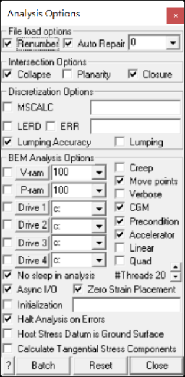

Configura opções que controlam diversas operações do programa.

#### File Load Options:

Analysis > Options > Renumber Renumera as superfícies para que o volume seja positivo (durante o carregamento do arquivo). Analysis > Options > Auto Repair Tenta reparar o modelo preenchendo lacunas, excluindo duplicatas etc. (durante o carregamento do arquivo).

#### Intersection Options:

Analysis > Options > Collapse Mescla superfícies adjacentes (durante a análise de interseções).

Analysis > Options > Planarity Subdivide quadriláteros não planares em triângulos (durante a análise de interseções).

Analysis > Options > Closure Realiza a verificação de fechamento e sobreposição e resolve interseções booleanas (durante a análise de interseções).

#### Discretization Options:

Analysis > Options > MSCALC Calcula resultados em pontos definidos pelo usuário (durante a análise BEM do Map3D).

Analysis > Options > LERD Calcula a taxa de liberação de energia e a rigidez do sistema de carregamento (durante a análise BEM do Map3D).

Analysis > Options > ERR Calcula a taxa de liberação de energia e a rigidez do sistema de carregamento (durante a análise BEM do Map3D).

Analysis > Options > Lumping Accuracy

Analysis > Options > Lumping Pré-calcula o tamanho da matriz de coeficientes (durante a análise de discretização).

#### Map3D BEM Analysis Options:

Analysis > Options > V-ram Armazena parte da matriz de coeficientes na RAM virtual (durante a análise BEM do Map3D).

Analysis > Options > P-ram Armazena parte da matriz de coeficientes na RAM física (durante a análise BEM do Map3D). Analysis > Options > Drive 1 Especifica as unidades temporárias primárias para a matriz de coeficientes (durante a análise BEM do Map3D).

Analysis > Options > Drive 2 Especifica a unidade temporária secundária para a matriz de coeficientes (durante a análise BEM do Map3D).

Analysis > Options > Drive 3 Especifica a terceira unidade temporária para a matriz de coeficientes (durante a análise BEM do Map3D).

Analysis > Options > Drive 4 Especifica a quarta unidade temporária para a matriz de coeficientes (durante a análise BEM do Map3D).

Analysis > Options > Creep Realiza análise de fluência elasto-visco-plástica.

Analysis > Options > Move Points Move pontos de campo muito próximos das superfícies de contorno (durante a análise BEM do Map3D).

Analysis > Options > Verbose Grava todos os vetores de solução e resultados dos pontos de campo no arquivo de log (durante a análise BEM do Map3D).

Analysis > Options > CGM Usa o solucionador de gradiente conjugado (durante a análise BEM do Map3D).

Analysis > Options > Precondition Precondiciona a matriz (durante a análise BEM do Map3D). Analysis > Options > Accelerate Usa o acelerador de matriz (durante a análise BEM do Map3D). Analysis > Options > Linear Usa elementos de contorno de ordem superior (durante a análise BEM do Map3D).

Analysis > Options > Quad Usa elementos de contorno de ordem superior (durante a análise BEM do Map3D).

Analysis > Options > Threads = 8  indica o número de threads atualmente ativas.

Analysis > Options > Nosleep in analysis Usa as rotinas de E/S assíncrona do Windows (durante a análise BEM do Map3D).

Analysis > Options > Async I/O Usa as rotinas de E/S assíncrona do Windows (durante a análise BEM do Map3D).

Analysis > Options > Zero Strain Placement Quando um novo material é atribuído a um bloco com CAD > Edit > Entity Properties, esses materiais são inicializados com o estado de tensões especificado em CAD > Properties > Material Properties.

Analysis > Options > Initialization Inicializa o modelo para que a análise continue de onde uma análise anterior terminou.

Analysis > Options > Halt on Errors Inicializa o modelo para que a análise continue de onde uma análise anterior terminou.

Analysis > Options > Host Stress Datum is Ground Surface Trata o datum como a superfície do terreno, de modo que as superfícies acima do datum recebam um estado de tensões nulo.

Analysis > Options > Calculate Tangential Stress Components Nas análises elásticas, as tensões tangenciais não são calculadas, a menos que solicitadas. Isso ocorre porque elas não são necessárias para o processo de solução e exigem tempo de análise adicional. Esses valores são calculados por padrão durante a análise plástica.

#### Miscellaneous Options:

Analysis > Options > Batch Configura a fila de lotes de análise.

Analysis > Options > Reset
