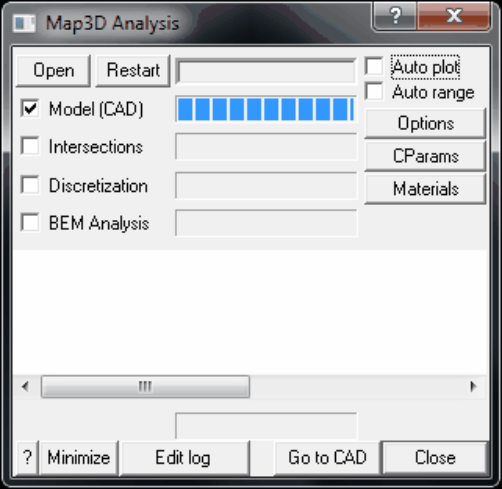

Abre a caixa de diálogo Map3D Analysis, que controla todas as funções de análise de tensões.

Analysis > Open Carrega um modelo a partir de um arquivo.

Analysis > Restart Reinicia uma análise que foi abortada ou interrompida por queda de energia ou travamento do sistema operacional.

Analysis > Model (CAD) Carrega um modelo a partir de um arquivo.

Analysis > Intersections Realiza a análise de contatos e interseções.

Analysis > Discretization Discretização de blocos e grades.

Analysis > BEM Analysis Análise BEM do Map3D.

Analysis > Auto Plot Plota automaticamente as componentes de superfície selecionadas à medida que a análise BEM do Map3D avança.

Analysis > Auto Range Modifica automaticamente a faixa de contornos à medida que a análise BEM do Map3D avança.

Analysis > Options Configura opções que controlam diversas operações do programa.

Analysis > Cparams Modifica os parâmetros de controle da análise durante a análise.

Analysis > Materials Modifica as propriedades dos materiais durante a análise.

Analysis > Minimize Minimiza a exibição gráfica durante a análise.

Analysis > Edit log Edita o arquivo de log. O arquivo de log registra todas as mensagens escritas na janela de mensagens.

Analysis > Go to CAD Vai para a etapa de construção e edição do modelo.

Analysis > Close Fecha a caixa de diálogo.

Analysis > Spawn Results Inicia outra instância do Map3D e carrega os resultados da primeira etapa de lavra. Isso é útil para ver os resultados das etapas já concluídas enquanto as etapas seguintes estão sendo analisadas.

Analysis > Suspend Suspende ou pausa a análise em execução.

Analysis > Resume Retoma a análise suspensa.
