## 5.5.1.1 Bloco

Constrói um bloco do tipo FF (Fictitious Force) totalmente tridimensional. Eles são usados para escavações 3D, zonas de material alternativo (zonas de minério ou diques) e zonas preenchidas. As superfícies do bloco serão subdivididas em elementos de contorno em uma etapa posterior do programa. No Map3D Non-Linear, essas zonas podem escoar e se comportar de forma não linear.

Vários blocos podem ser combinados para criar formas 3D complexas. A rotina FFLoop ( CAD > Build > FF Loop) pode ser usada para extrudar uma série de blocos FF 3D a partir de um plano de piso ou de uma seção, e pode ser usada para interpolar entre vários planos de piso ou seções.

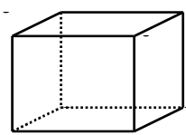

Quando a rotina é iniciada, o usuário é solicitado a selecionar os primeiros 4 cantos que definem um lado (p. ex., a base) de um bloco de 6 faces. Depois que esses são informados, o usuário é solicitado a informar 4 cantos adicionais (cantos 5, 6, 7 e 8) que definem o lado oposto do bloco (p. ex., o topo).

Os cantos podem ser ordenados no sentido horário ou anti-horário, desde que a base e o topo sejam informados na mesma ordem, com os cantos do lado superior 5, 6, 7 e 8 posicionados diretamente acima dos cantos do lado inferior 1, 2, 3 e 4.

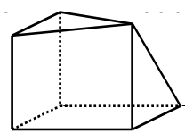

Qualquer um dos cantos pode ser repetido para definir formas de 3 lados e cunhas.

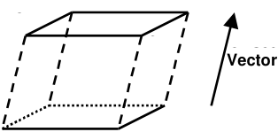

Depois que a base é definida (cantos 1, 2, 3 e 4), os cantos restantes (5, 6, 7 e 8) podem ser gerados por deslocamento ou extrusão

#### CAD > Build > Offset Remaining

As coordenadas dos cantos podem ser digitadas pelo teclado

#### CAD > Build > Enter Point

selecionadas por desenho à mão livre, capturadas de outras entidades (outros blocos ou linhas de construção) ou digitalizadas

#### CAD > Digitizer Setup > Activate

Uma grande variedade de ferramentas de desenho está disponível para ajudar a selecionar visualmente pontos do modelo

#### CAD > Snap

Os cantos podem ser desmarcados com

#### CAD > Build > Undo Point

Os cantos podem ser reselecionados com

#### CAD > Build > Redo Point

O bloco é considerado completo quando o oitavo canto é informado ou quando o usuário seleciona

Ao concluir a construção do bloco, você será solicitado a informar as propriedades do bloco. Isso permite especificar diversos parâmetros, incluindo a cor do bloco e a sequência de lavra.

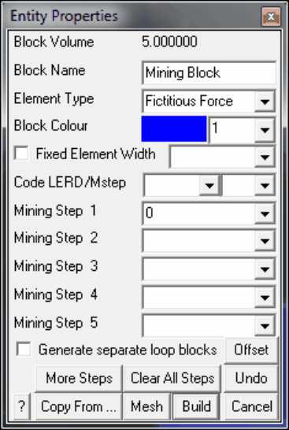

Block Volume - exibe o volume do bloco.

Block Name - especifica um nome descritivo para o bloco.

Element Type - especifica o tipo de elemento de contorno que será usado para o bloco.

- Fictitious Force - elementos FF devem ser usados para feições tridimensionais, como escavações, zonas de material alternativo, realces preenchidos etc.

- Displacement Discontinuity - elementos DD devem ser usados para escavações tabulares, fraturas e planos de falha.

- Elementos inativos podem ser usados para exibir feições incluídas apenas para fins de visualização e que não serão usadas na análise de tensões propriamente dita.

Block Colour - especifica o número de cor que será usado para exibir o bloco.

Especifica o número de cor que será atribuído a cada botão. Há um total de 10 cores disponíveis para exibição. Elas são numeradas respectivamente

de 1 a 10, de 11 a 20, de 21 a 30 etc.,

de modo que a mesma cor é exibida para os números

1, 11, 21..., 2, 22, 32..., 3, 23, 33..., etc.

Fixed Element Width - especifica a largura de elemento definida pelo usuário.

Este parâmetro pode ser usado para forçar uma discretização uniforme nas entidades selecionadas. Deve-se ter extremo cuidado ao especificar este valor, pois um valor pequeno pode facilmente levar a um tamanho de problema enorme.

Em geral, esta opção não deve ser usada (desmarcada) e a discretização deve ficar a cargo dos parâmetros _AL_ e _AG_ . Estes últimos concentram elementos somente onde os resultados da análise são solicitados, otimizando o uso de elementos e minimizando o tamanho do problema. Para uma discussão adicional, consulte

#### CAD > Properties Control Parameters

Este parâmetro também pode ser usado para evitar a criação de superfícies com lados maiores que este valor durante a análise de interseções. Nenhuma superfície cujo comprimento de lado exceda esta dimensão será colapsada

#### Analysis > Options > Collapse

Durante o processo de discretização, qualquer superfície cujo comprimento de lado exceda esta dimensão será subdividida para evitar superfícies com lados maiores que este valor.

Para um exemplo do uso deste parâmetro, consulte Tabular Mining Example

Matl_Code LERD/MStep - especifica o código de material que será substituído no bloco para o cálculo de LERD/LSS.

A primeira caixa é para o código de material.

A segunda caixa serve para especificar o número da etapa de lavra em que o cálculo deve ser feito. Se esta caixa for deixada em branco, o cálculo de LERD será feito para todas as etapas.

#### Analysis > Options > LERD/LSS.

- Mining Step n - especifica o código de material que será usado para este bloco na etapa de lavra n. No exemplo acima, o bloco não existe na etapa 1, tem o material nº 2 (minério) inserido na etapa 2, é escavado na etapa 3 (o código de material 0 significa escavar) e, por fim, na etapa 4 o material nº 5 (aterro) é inserido. Quando você usa um número de material positivo, o material é colocado no bloco com o estado de tensões inicial especificado e então pode se deformar de acordo com as propriedades elásticas/plásticas definidas para esse número de material. Quando você usa um número de material negativo, o material é colocado no bloco com o estado de tensões inicial especificado, mas o estado de tensões é mantido nesses valores independentemente das deformações, fornecendo assim uma condição de contorno de tensões.

More Steps - permite especificar etapas de lavra adicionais.

Clear All Steps - limpa todas as etapas de lavra (1-100).

Undo - desmarca o último ponto informado e retorna à rotina de construção do bloco

#### CAD > Build > Undo Point

Copy From… - permite selecionar outro bloco do qual copiar as propriedades da entidade.

Mesh - constrói o bloco com as superfícies subdivididas em partes menores no espaçamento de grade de bloco especificado.

Build - conclui a construção do bloco e o insere no banco de dados do modelo.

Depois de concluída esta operação, você tem uma última chance de desfazê-la e remover este bloco do banco de dados do modelo selecionando

#### CAD > Build > Undo Build

Cancel aborta a construção do bloco.

Observe que é possível criar blocos de volume zero, por exemplo, especificando um vetor de deslocamento de comprimento zero. Isso permite aos usuários construir superfícies FF individuais, se desejarem. Embora seja permitido, isso não é recomendado, pois pode levar a volumes não fechados.

Blocos FF podem ser colapsados em planos DD a qualquer momento simplesmente alterando o tipo de elemento

#### CAD > Edit > Entity Properties

Nesse caso, a base do bloco (o lado definido pelos cantos 1, 2, 3 e 4) se tornará o plano DD e os demais lados do bloco serão descartados.

Notes:

Devem ser usados números de cor diferentes para representar agrupamentos lógicos de blocos (p. ex., para diferentes níveis, seções ou unidades lógicas de lavra, como desenvolvimento, realces etc.). Essas cores são definíveis pelo usuário

#### Tools > Custom Colours

Todos os blocos com o mesmo número de cor serão combinados automaticamente pelo Map3D em formas complexas únicas.

Como é fácil ativar e desativar a exibição de números de cor de bloco específicos

#### View > Hide Block Colours

isso oferece um método eficiente para trabalhar com dados de modelos complexos.

Para uma discussão sobre aspectos da construção de modelos, consulte:

#### Model Building and Editing

Para tutoriais de construção de modelos, consulte:

#### Model Building Tutorials

Pressionar a barra de espaço ativa automaticamente a última função de construção usada.

## 5.5.1.2 FF Loop

Constrói blocos do tipo FF (Fictitious Force) totalmente tridimensionais. Eles são usados para escavações 3D, zonas de material alternativo (zonas de minério ou diques) e zonas preenchidas. As superfícies do bloco serão subdivididas em elementos de contorno em uma etapa posterior do programa. No Map3D Non-Linear, essas zonas podem escoar e se comportar de forma não linear.

Alguns exemplos que demonstram esta rotina podem ser encontrados em Model Building Tutorials. Consulte especificamente

- Video demo of FFLoop model building with multiple loops

- Video demo of FFLoop model simplification using slicing

- FFLoop Drift Example

- FFLoop Stope Example

- Bulk Mining Example

#### FFLoops

Quando a rotina é iniciada, o usuário é solicitado a selecionar os cantos que definem o perímetro de uma série de plantas ou seções. O sentido em que você percorre cada laço não é relevante. Podem ser definidos simultaneamente quantos laços se desejar. O número de pontos não precisa ser o mesmo em cada laço. Os pontos inicial e final de cada laço (p. ex., os pontos 1 e 11 no primeiro laço e os pontos 12 e 22 no segundo) devem estar no mesmo local para definir uma série de laços fechados.

#### Snap > Trace

Pontos individuais podem ser selecionados um de cada vez, ou todos os pontos ao longo de um segmento de linha de construção podem ser selecionados usando a função de snap CAD > Snap > Trace CLoop.

#### Snap > Win

Pontos individuais podem ser selecionados um de cada vez, ou todos os pontos ao longo de várias linhas de construção podem ser selecionados usando a função de snap CAD > Snap > Window.

#### Close

A rotina FFLoop é considerada concluída quando uma das duas condições a seguir é atendida:

- o usuário seleciona pela terceira vez o último ponto do laço (ou seja, o ponto nº 22)

- CAD > Build > FFLoop

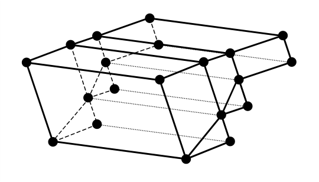

Os laços serão então subdivididos em uma série de elementos FF de 3 ou 4 lados. Essas superfícies serão subdivididas em elementos de contorno em uma etapa posterior do programa. A rotina que faz essa subdivisão procura cantos próximos uns dos outros; portanto, o usuário deve ter o cuidado de definir o laço de modo que as conexões sejam diretas. No exemplo acima, recomenda-se que os pontos 4 e 5 sejam selecionados ou gerados.

#### Guide Lines

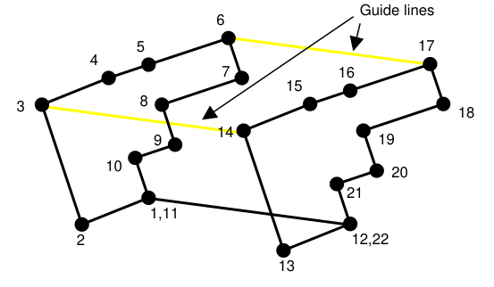

Para formas mais complexas, podem ser definidas linhas-guia (mostradas em amarelo) que forçam a subdivisão dos lados ao longo dessas linhas. Elas são definidas simplesmente como linhas de construção. Para um exemplo, consulte [https://www.map3d.com/ffloop.htm](https://www.map3d.com/ffloop.htm). As linhas-guia não devem se interceptar nem se cruzar.

#### Extrusion using Offset

Depois que o primeiro laço fechado é informado, os pontos restantes podem ser gerados deslocando os pontos restantes com CAD > Build > Offset Remaining

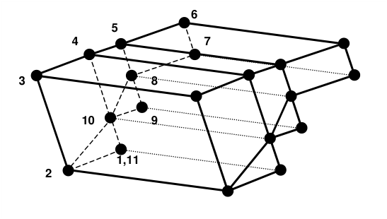

#### Miscellaneous

As coordenadas dos cantos podem ser digitadas pelo teclado

#### CAD > Build > Enter Point

selecionadas por desenho à mão livre, capturadas de outras entidades (outros blocos ou linhas de construção) ou digitalizadas

#### CAD > Digitizer Setup > Activate

Uma grande variedade de ferramentas de desenho está disponível para ajudar a selecionar visualmente pontos do modelo

#### CAD > Snap

Os cantos podem ser desmarcados com

#### CAD > Build > Undo Point

Os cantos podem ser reselecionados com

#### CAD > Build > Redo Point

Ao concluir a construção do bloco, você será solicitado a informar as propriedades do bloco. Isso permite especificar diversos parâmetros, incluindo a cor do bloco e a sequência de lavra.

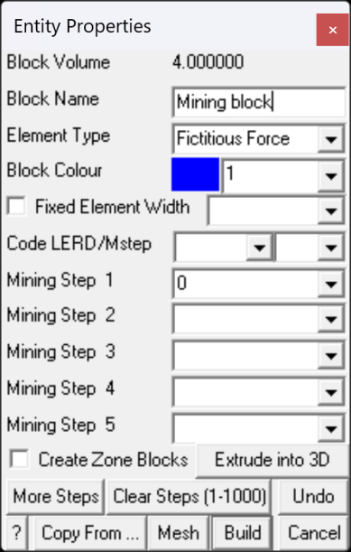

Block Volume - exibe o volume do bloco.

Block Name - especifica um nome descritivo para o bloco.

Element Type - especifica o tipo de elemento de contorno que será usado para o bloco.

- Fictitious Force - elementos FF devem ser usados para feições tridimensionais, como escavações, zonas de material alternativo, realces preenchidos etc.

- Displacement Discontinuity - elementos DD devem ser usados para escavações tabulares, fraturas e planos de falha.

- Elementos inativos podem ser usados para exibir feições incluídas apenas para fins de visualização e que não serão usadas na análise de tensões propriamente dita.

Block Colour - especifica o número de cor que será usado para exibir o bloco.

Especifica o número de cor que será atribuído a cada botão. Há um total de 10 cores disponíveis para exibição. Elas são numeradas respectivamente

de 1 a 10, de 11 a 20, de 21 a 30 etc.,

de modo que a mesma cor é exibida para os números

1, 11, 21..., 2, 22, 32..., 3, 23, 33..., etc.

Fixed Element Width - especifica a largura de elemento definida pelo usuário.

Este parâmetro pode ser usado para forçar uma discretização uniforme nas entidades selecionadas. Deve-se ter extremo cuidado ao especificar este valor, pois um valor pequeno pode facilmente levar a um tamanho de problema enorme.

Em geral, esta opção não deve ser usada (desmarcada) e a discretização deve ficar a cargo dos parâmetros _AL_ e _AG_ . Estes últimos concentram elementos somente onde os resultados da análise são solicitados, otimizando o uso de elementos e minimizando o tamanho do problema. Para uma discussão adicional, consulte

#### CAD > Properties Control Parameters

Este parâmetro também pode ser usado para evitar a criação de superfícies com lados maiores que este valor durante a análise de interseções. Nenhuma superfície cujo comprimento de lado exceda esta dimensão será colapsada

#### Analysis > Options > Collapse

Durante o processo de discretização, qualquer superfície cujo comprimento de lado exceda esta dimensão será subdividida para evitar superfícies com lados maiores que este valor.

Para um exemplo do uso deste parâmetro, consulte Tabular Mining Example

Matl_Code LERD/MStep - especifica o código de material que será substituído no bloco para o cálculo de LERD/LSS.

A primeira caixa é para o código de material.

A segunda caixa serve para especificar o número da etapa de lavra em que o cálculo deve ser feito. Se esta caixa for deixada em branco, o cálculo de LERD será feito para todas as etapas.

#### Analysis > Options > LERD/LSS.

- Mining Step n - especifica o código de material que será usado para este bloco na etapa de lavra n. No exemplo acima, o bloco não existe na etapa 1, tem o material nº 2 (minério) inserido na etapa 2, é escavado na etapa 3 (o código de material 0 significa escavar) e, por fim, na etapa 4 o material nº 5 (aterro) é inserido. Quando você usa um número de material positivo, o material é colocado no bloco com o estado de tensões inicial especificado e então pode se deformar de acordo com as propriedades elásticas/plásticas definidas para esse número de material. Quando você usa um número de material negativo, o material é colocado no bloco com o estado de tensões inicial especificado, mas o estado de tensões é mantido nesses valores independentemente das deformações, fornecendo assim uma condição de contorno de tensões.

Create Zone Blocks - se você estiver construindo blocos de vários laços, pode especificar se serão criadas ou não interfaces entre cada bloco, de modo que cada um possa ser tratado como uma unidade de lavra separada. A cada uma dessas subseções será atribuído um número de cor diferente para facilitar ocultá-las/exibi-las ao visualizar com Hide Block Colours. Se você não especificar esta opção, será criado um único bloco grande.

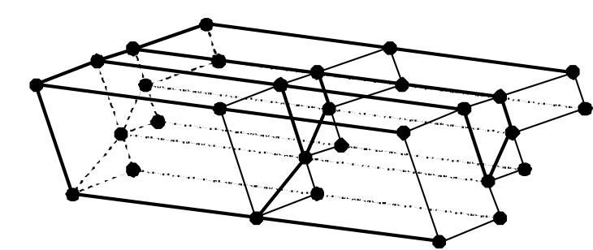

Extrude into 3D - permite deslocar um laço plano para extrudar o bloco em uma forma 3D. Esta operação também pode ser feita com Extrude/Offset Remaining.

More Steps - permite especificar etapas de lavra adicionais.

Clear All Steps - limpa todas as etapas de lavra (1-1000).

Undo - desmarca o último ponto informado e retorna à rotina de construção do bloco

#### CAD > Build > Undo Point

Copy From… - permite selecionar outro bloco do qual copiar as propriedades da entidade.

Mesh - constrói o bloco com as superfícies subdivididas em partes menores no espaçamento de grade de bloco especificado.

Build - conclui a construção do bloco e o insere no banco de dados do modelo.

Depois de concluída esta operação, você tem uma última chance de desfazê-la e remover este bloco do banco de dados do modelo selecionando

#### CAD > Build > Undo Build

Cancel aborta a construção do bloco.

Observe que é possível criar blocos de volume zero, por exemplo, especificando um vetor de deslocamento de comprimento zero. Isso permite aos usuários construir superfícies FF individuais, se desejarem. Embora seja permitido, isso não é recomendado, pois pode levar a volumes não fechados.

Blocos FF podem ser colapsados em planos DD a qualquer momento simplesmente alterando o tipo de elemento

#### CAD > Edit > Entity Properties

Nesse caso, a base do bloco (o lado definido pelos cantos 1, 2, 3 e 4) se tornará o plano DD e os demais lados do bloco serão descartados.

Notes:

Devem ser usados números de cor diferentes para representar agrupamentos lógicos de blocos (p. ex., para diferentes níveis, seções ou unidades lógicas de lavra, como desenvolvimento, realces etc.). Essas cores são definíveis pelo usuário

#### Tools > Custom Colours

Todos os blocos com o mesmo número de cor serão combinados automaticamente pelo Map3D em formas complexas únicas.

Como é fácil ativar e desativar a exibição de números de cor de bloco específicos

#### View > Hide Block Colours

isso oferece um método eficiente para trabalhar com dados de modelos complexos.

Para uma discussão sobre aspectos da construção de modelos, consulte:

#### Model Building and Editing

Para tutoriais de construção de modelos, consulte:

#### Model Building Tutorials

Pressionar a barra de espaço ativa automaticamente a última função de construção usada.

## 5.5.1.3 DD Loop

Constrói blocos do tipo DD (Displacement Discontinuity). Eles são usados para lavra tabular, camadas finas ou planos de falha. Em todas as versões do Map3D, essas zonas podem escoar e se comportar de forma não linear. Vários DD podem ser combinados para criar formas complexas com deslocamentos e ondulações.

Alguns exemplos que demonstram esta rotina podem ser encontrados em Model Building Tutorials. Consulte especificamente

- Video demo of DDLoop model building with sub-parallel lines

- Video demo of DDLoop model building with interior loops

- DDLoop Pillar Example

- Tabular Mining Example

#### DDLoop

Quando a rotina é iniciada, o usuário é solicitado a selecionar uma série de laços que definem o perímetro das zonas desejadas. O sentido em que você percorre cada laço não é relevante. Os pontos inicial e final de cada laço (p. ex., os pontos 1 e 11, ou 12 e 22) devem estar no mesmo local para definir laços fechados.

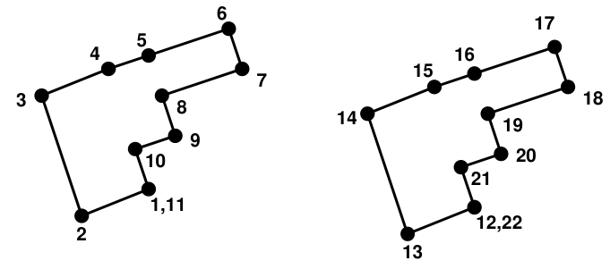

#### Snap > Trace

Pontos individuais podem ser selecionados um de cada vez, ou todos os pontos ao longo de um segmento de linha de construção podem ser selecionados usando a função de snap CAD > Snap > Trace CLoop.

#### Snap > Win

Pontos individuais podem ser selecionados um de cada vez, ou todos os pontos ao longo de várias linhas de construção podem ser selecionados usando a função de snap CAD > Snap > Window.

#### Close

A rotina DDLoop é considerada concluída quando uma das duas condições a seguir é atendida:

- o usuário seleciona pela terceira vez o último ponto do laço (ou seja, o ponto nº 12,22)

- CAD > Build > DDLoop

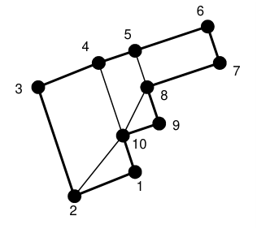

Os laços serão então subdivididos em uma série de elementos DD de 3 ou 4 lados. Essas superfícies serão subdivididas em elementos de contorno em uma etapa posterior do programa. A rotina que faz essa subdivisão procura cantos próximos uns dos outros; portanto, o usuário deve ter o cuidado de definir o laço de modo que as conexões sejam diretas. No exemplo acima, recomenda-se que os pontos 4 e 5 sejam selecionados ou gerados.

A função de construção Mesh (veja abaixo) pode ser usada para construir o bloco com as superfícies subdivididas em partes menores no espaçamento de grade de bloco especificado. Esta rotina gera os pontos internos necessários para manter elementos bem formados.

#### Guide Lines

Várias zonas internas podem ser traçadas simultaneamente definindo linhas-guia (mostradas em amarelo).

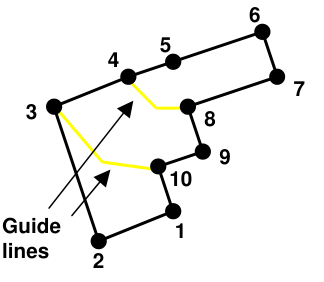

Elas são definidas simplesmente como linhas de construção. Para um exemplo, consulte [https://www.map3d.com/t.htm](https://www.map3d.com/t.htm). As linhas-guia devem atravessar o laço de perímetro de borda a borda. Podem ser definidas várias linhas-guia que se interceptam, definindo assim várias zonas.

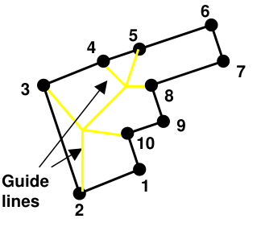

#### Interior Zones

Várias zonas internas (p. ex., pilares) podem ser definidas traçando sua periferia, como mostrado abaixo. O sentido em que você percorre a zona interna não é relevante. Podem ser definidas dessa forma quantas zonas internas se desejar.

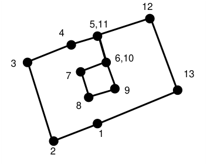

Alternativamente, essas zonas internas podem ser construídas de forma conveniente traçando o perímetro externo ( CAD > Snap > Trace CLoop) e usando linhas-guia para definir as formas internas desejadas.

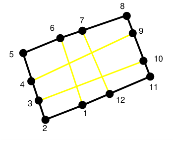

Create Zone Blocks - se você estiver construindo planos DD de vários laços, pode especificar se serão criadas ou não interfaces entre cada subseção, de modo que cada uma possa ser tratada como um grupo separado de DDPlanes. A cada uma dessas subseções será atribuído um número de cor diferente para facilitar ocultá-las/exibi-las ao visualizar com Hide Block Colours. Se você não especificar esta opção, será criado um único grupo grande de DDPlanes.

#### Extrusion using Offset

Depois que pelo menos dois pontos são informados, os pontos restantes podem ser gerados deslocando os pontos restantes com CAD > Build > Offset Remaining

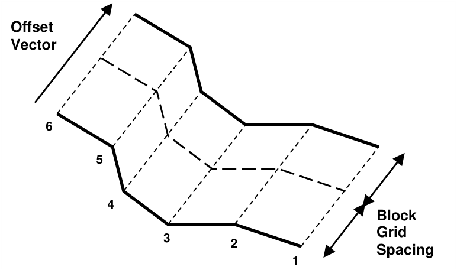

Observe também que elementos DD podem ser extrudados em zonas FF simplesmente alterando o tipo de elemento de DD para FF.

#### Miscellaneous

As coordenadas dos cantos podem ser digitadas pelo teclado

#### CAD > Build > Enter Point

selecionadas por desenho à mão livre, capturadas de outras entidades (outros blocos ou linhas de construção) ou digitalizadas

#### CAD > Digitizer Setup > Activate

Uma grande variedade de ferramentas de desenho está disponível para ajudar a selecionar visualmente pontos do modelo

#### CAD > Snap

Os cantos podem ser desmarcados com

#### CAD > Build > Undo Point

Os cantos podem ser reselecionados com

#### CAD > Build > Redo Point

Ao concluir a construção do bloco, você será solicitado a informar as propriedades do bloco. Isso permite especificar diversos parâmetros, incluindo a cor do bloco e a sequência de lavra.

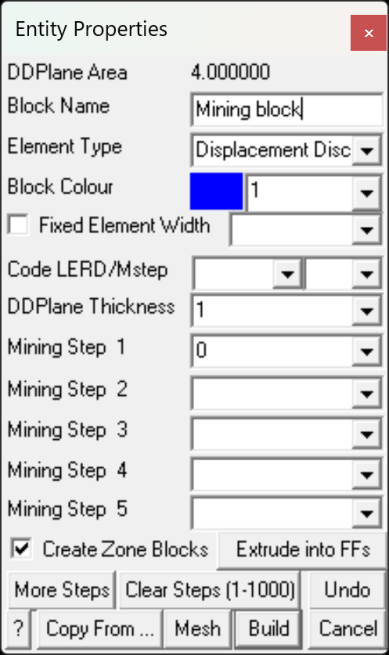

DDPlane Area - exibe a área combinada de todos os DDPlanes incluídos no DDLoop.

Block Name - especifica um nome descritivo para o bloco.

Element Type - especifica o tipo de elemento de contorno que será usado para o bloco.

- Displacement Discontinuity - elementos do tipo DD devem ser usados para escavações tabulares, fraturas e planos de falha.

- Fictitious Force - elementos do tipo FF devem ser usados para feições tridimensionais, como escavações, zonas de material alternativo, realces preenchidos etc.

- Elementos inativos podem ser usados para exibir feições incluídas apenas para fins de visualização e que não serão usadas na análise de tensões propriamente dita.

Block Colour - especifica o número de cor que será usado para exibir o bloco.

Especifica o número de cor que será atribuído a cada botão. Há um total de 10 cores disponíveis para exibição. Elas são numeradas respectivamente

de 1 a 10, de 11 a 20, de 21 a 30 etc.,

de modo que a mesma cor é exibida para os números

1, 11, 21..., 2, 22, 32..., 3, 23, 33..., etc.

Fixed Element Width - especifica a largura de elemento definida pelo usuário.

Este parâmetro pode ser usado para forçar uma discretização uniforme nas entidades selecionadas. Deve-se ter extremo cuidado ao especificar este valor, pois um valor pequeno pode facilmente levar a um tamanho de problema enorme.

Em geral, esta opção não deve ser usada (desmarcada) e a discretização deve ficar a cargo dos parâmetros _AL_ e _AG_ . Estes últimos concentram elementos somente onde os resultados da análise são solicitados, otimizando o uso de elementos e minimizando o tamanho do problema. Para uma discussão adicional, consulte

#### CAD > Properties Control Parameters

Este parâmetro também pode ser usado para evitar a criação de superfícies com lados maiores que este valor durante a análise de interseções. Nenhuma superfície cujo comprimento de lado exceda esta dimensão será colapsada

#### Analysis > Options > Collapse

Durante o processo de discretização, qualquer superfície cujo comprimento de lado exceda esta dimensão será subdividida para evitar superfícies com lados maiores que este valor.

Para um exemplo do uso deste parâmetro, consulte Tabular Mining Example

Matl_Code LERD/MStep - especifica o código de material que será substituído no bloco para o cálculo de LERD/LSS.

A primeira caixa é para o código de material.

A segunda caixa serve para especificar o número da etapa de lavra em que o cálculo deve ser feito. Se esta caixa for deixada em branco, o cálculo de LERD será feito para todas as etapas.

#### Analysis > Options > LERD/LSS.

#### Analysis > Options > LERD/LSS

DDPlane Thickness - especifica a espessura do material inserido no elemento DD (ou seja, argila de falha, largura da camada, largura de lavra ou altura do pilar).

O deslocamento normal (fechamento) da feição quando preenchida será limitado a essa espessura. Além disso, o deslocamento normal (fechamento) e o deslocamento de cisalhamento (ride) são divididos pela espessura para determinar a deformação que ocorre no material de preenchimento

Fault-Gouge in DD planes

Backfill-Hyperbolic in DD planes Equilibrated-Gouge in DD planes

Mohr-Coulomb in DD planes

Este parâmetro deve ser especificado nas mesmas unidades usadas para especificar as coordenadas (p. ex., metros ou pés).

- Mining Step n - especifica o código de material que será usado para este bloco na etapa de lavra n. No exemplo acima, o bloco não existe na etapa 1, tem o material nº 2 (minério) inserido na etapa 2, é escavado na etapa 3 (o código de material 0 significa escavar) e, por fim, na etapa 4 o material nº 5 (aterro) é inserido. Quando você usa um número de material positivo, o material é colocado no bloco com o estado de tensões inicial especificado e então pode se deformar de acordo com as propriedades elásticas/plásticas definidas para esse número de material. Quando você usa um número de material negativo, o material é colocado no bloco com o estado de tensões inicial especificado, mas o estado de tensões é mantido nesses valores independentemente das deformações, fornecendo assim uma condição de contorno de tensões.

Extrude into FFs - permite extrudar um plano DD em um bloco FF. Será solicitado o vetor de extrusão

More Steps - permite especificar etapas de lavra adicionais.

Clear All Steps - limpa todas as etapas de lavra (1-1000).

Undo - desmarca o último ponto informado e retorna à rotina de construção do bloco

#### CAD > Build > Undo Point

Copy From… - permite selecionar outro bloco do qual copiar as propriedades da entidade.

Mesh - constrói o bloco com as superfícies subdivididas em partes menores no espaçamento de grade de bloco especificado. Esta rotina gera os pontos internos necessários para manter elementos bem formados.

Build - conclui a construção do bloco e o insere no banco de dados do modelo.

Depois de concluída esta operação, você tem uma última chance de desfazê-la e remover este bloco do banco de dados do modelo selecionando

#### CAD > Build > Undo Build

Cancel aborta a construção do bloco.

Observe que é possível criar blocos de volume zero, por exemplo, especificando um vetor de deslocamento de comprimento zero. Isso permite aos usuários construir superfícies FF individuais, se desejarem. Embora seja permitido, isso não é recomendado, pois pode levar a volumes não fechados.

Blocos DD podem ser extrudados em blocos FF 3D a qualquer momento simplesmente alterando o tipo de elemento

#### CAD > Edit > Entity Properties

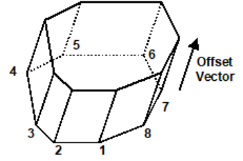

Nesse caso, os cantos 1 a 8 definem a base do bloco. O topo e os lados são gerados automaticamente durante o processo de extrusão.

Observe que é possível criar blocos de volume zero, por exemplo, especificando um vetor de deslocamento de comprimento zero. Isso permite aos usuários construir superfícies FF individuais, se desejarem. Embora seja permitido, isso não é recomendado, pois pode levar a volumes não fechados.

Notes:

Devem ser usados números de cor diferentes para representar agrupamentos lógicos de blocos (p. ex., para diferentes níveis, seções ou unidades lógicas de lavra, como desenvolvimento, realces etc.). Essas cores são definíveis pelo usuário

#### Tools > Custom Colours

Todos os blocos com o mesmo número de cor serão combinados automaticamente pelo Map3D em formas complexas únicas.

Como é fácil ativar e desativar a exibição de números de cor de bloco específicos

#### View > Hide Block Colours

isso oferece um método eficiente para trabalhar com dados de modelos complexos.

Para uma discussão sobre aspectos da construção de modelos, consulte:

#### Model Building and Editing

Para tutoriais de construção de modelos, consulte:

#### Model Building Tutorials

Pressionar a barra de espaço ativa automaticamente a última função de construção usada.

## 5.5.1.4 Tunnel

Constrói um túnel (bloco do tipo FF - Fictitious Force). É usado para construir um túnel 3D extrudando uma seção transversal ao longo do traçado do túnel. As superfícies do túnel serão subdivididas em elementos de contorno em uma etapa posterior do programa.

#### Tunnel

A construção do túnel ocorre em três etapas:

- 1) Selecionar o perfil do túnel;

- 2) Selecionar o ponto de referência do túnel;

- 3) Selecionar o traçado/layout do túnel.

**Stage 1 - Tunnel Profile**

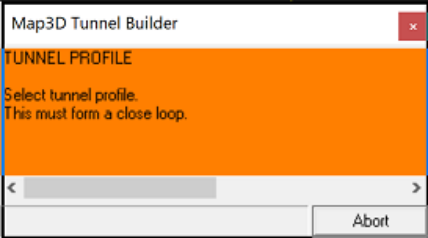

Quando a rotina é iniciada, o usuário é solicitado a selecionar um perfil de túnel:

- ele deve formar um laço fechado

- pode ser construído em qualquer orientação desejada (x-y, y-z, x-z ou qualquer orientação definida pelo usuário) `o` observe que, se o perfil for construído no plano x-y, a direção y será usada como para cima `o` caso contrário, se o perfil for construído no plano y-z ou x-z, a direção z será usada como para cima

- ao selecioná-lo, lembre-se de que esse perfil de túnel será extrudado afastando-se do seu ponto de vista (como mostram as setas vermelhas abaixo)

- pode ser selecionado como uma série de pontos, de forma semelhante a como se selecionam linhas de construção CAD > Build > Construction Lines

- alternativamente, uma forma predefinida com linhas de construção pode ser selecionada usando, por exemplo, CAD > Snap > Trace CLoop

- todas as funções de snap e de construção podem ser usadas durante a seleção do perfil, incluindo CAD > Build > Offset Remaining

Aqui um perfil de túnel é mostrado em verde. As setas vermelhas mostram a direção em que o túnel será extrudado durante a etapa 3 - traçado/layout do túnel.

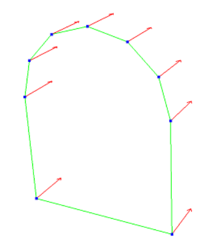

O Map3D detectará um perfil de túnel completo quando o laço for fechado. Você será então direcionado para a etapa 2 - ponto de referência do túnel.

**Stage 2 - Tunnel Reference Point**

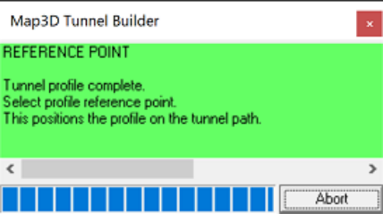

O ponto de referência do túnel representa a localização no perfil do túnel que será usada para posicionar o perfil no traçado/layout do túnel.

Abaixo, o canto inferior direito foi selecionado como ponto de referência.

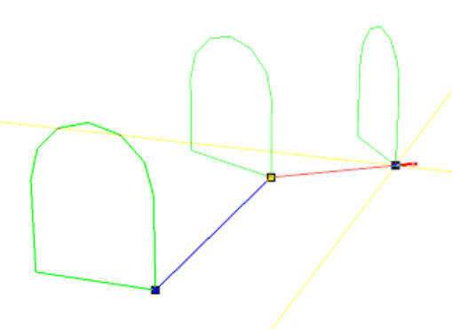

Ao selecionar o ponto de referência, você será direcionado para a etapa 3 - traçado/layout do túnel.

Observe que, se o ponto de referência errado for selecionado, basta desfazer a seleção usando CAD > Build > Undo Build ou pressionando a tecla Escape.

**Stage 3 - Tunnel Path/Layout**

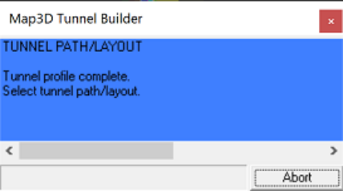

O traçado/layout do túnel já pode ser selecionado:

- o perfil selecionado acima será extrudado ao longo do traçado/layout

- o traçado/layout pode ser selecionado de forma semelhante a como se selecionam linhas de construção CAD > Build > Construction Lines

- alternativamente, o traçado/layout pode ser selecionado ao longo de um conjunto de linhas de construção predefinidas

- laços de túnel fechados são aceitáveis

- traçados de túnel inclinados são aceitáveis

- todas as funções de snap e de construção podem ser usadas durante a seleção do perfil, incluindo CAD > Build > Offset Remaining

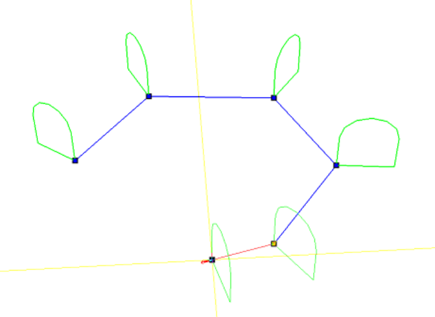

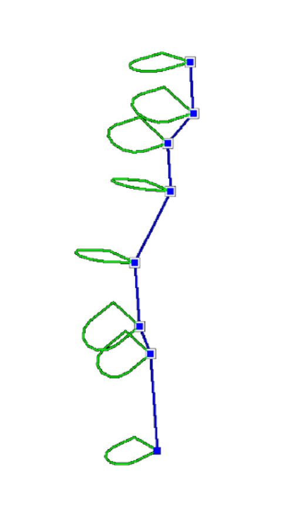

Acima, à esquerda, os dois primeiros pontos do traçado foram escolhidos no plano horizontal (inclinação ou declive menor que 45°); portanto, o túnel é extrudado como uma galeria horizontal, com a seção orientada verticalmente, como mostrado. À direita, os dois primeiros pontos do traçado são escolhidos no plano vertical (inclinação ou declive maior que 45°); portanto, o túnel é extrudado como um poço vertical, com a seção orientada quase horizontalmente, como mostrado.

O traçado/layout do túnel é considerado completo quando uma das duas condições a seguir é atendida:

- o usuário seleciona pela segunda vez o último ponto

- CAD > Build > Tunnel

Depois de concluído, o túnel será construído como mostrado abaixo.

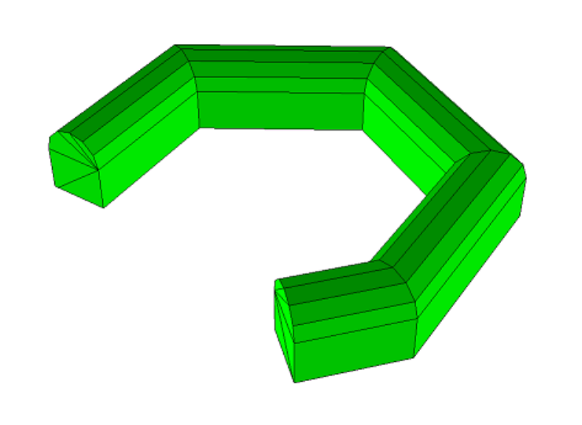

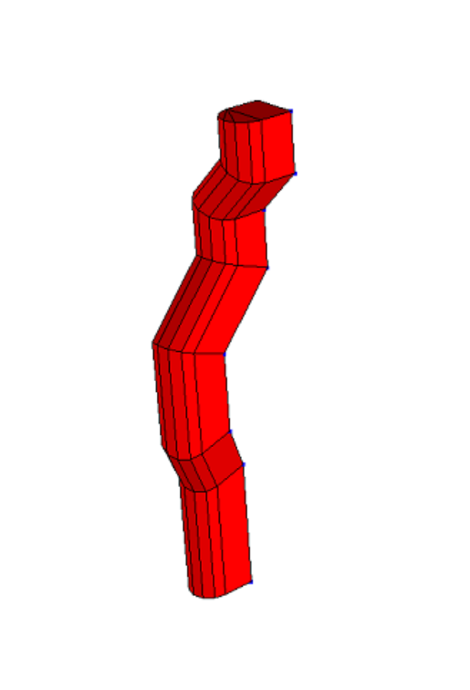

#### Miscellaneous

As coordenadas dos cantos podem ser digitadas pelo teclado

#### CAD > Build > Enter Point

selecionadas por desenho à mão livre, capturadas de outras entidades (outros blocos ou linhas de construção) ou digitalizadas

#### CAD > Digitizer Setup > Activate

Uma grande variedade de ferramentas de desenho está disponível para ajudar a selecionar visualmente pontos do modelo

#### CAD > Snap

Os cantos podem ser desmarcados com

#### CAD > Build > Undo Point

Os cantos podem ser reselecionados com

#### CAD > Build > Redo Point

Ao concluir a construção do bloco, você será solicitado a informar as propriedades do bloco. Isso permite especificar diversos parâmetros, incluindo a cor do bloco e a sequência de lavra.

Block Volume - exibe o volume do bloco.

Block Name - especifica um nome descritivo para o bloco.

Element Type - especifica o tipo de elemento de contorno que será usado para o bloco.

- Fictitious Force - elementos FF devem ser usados para feições tridimensionais, como escavações, zonas de material alternativo, realces preenchidos etc.

- Elementos inativos podem ser usados para exibir feições incluídas apenas para fins de visualização e que não serão usadas na análise de tensões propriamente dita.

Block Colour - especifica o número de cor que será usado para exibir o bloco.

Especifica o número de cor que será atribuído a cada botão. Há um total de 10 cores disponíveis para exibição. Elas são numeradas respectivamente

de 1 a 10, de 11 a 20, de 21 a 30 etc.,

de modo que a mesma cor é exibida para os números

1, 11, 21..., 2, 22, 32..., 3, 23, 33..., etc.

Fixed Element Width - especifica a largura de elemento definida pelo usuário.

Este parâmetro pode ser usado para forçar uma discretização uniforme nas entidades selecionadas. Deve-se ter extremo cuidado ao especificar este valor, pois um valor pequeno pode facilmente levar a um tamanho de problema enorme.

Em geral, esta opção não deve ser usada (desmarcada) e a discretização deve ficar a cargo dos parâmetros _AL_ e _AG_ . Estes últimos concentram elementos somente onde os resultados da análise são solicitados, otimizando o uso de elementos e minimizando o tamanho do problema. Para uma discussão adicional, consulte

#### CAD > Properties Control Parameters

Este parâmetro também pode ser usado para evitar a criação de superfícies com lados maiores que este valor durante a análise de interseções. Nenhuma superfície cujo comprimento de lado exceda esta dimensão será colapsada

#### Analysis > Options > Collapse

Durante o processo de discretização, qualquer superfície cujo comprimento de lado exceda esta dimensão será subdividida para evitar superfícies com lados maiores que este valor.

Para um exemplo do uso deste parâmetro, consulte Tabular Mining Example

Matl_Code LERD/MStep - especifica o código de material que será substituído no bloco para o cálculo de LERD/LSS.

A primeira caixa é para o código de material.

A segunda caixa serve para especificar o número da etapa de lavra em que o cálculo deve ser feito. Se esta caixa for deixada em branco, o cálculo de LERD será feito para todas as etapas.

#### Analysis > Options > LERD/LSS.

- Mining Step n - especifica o código de material que será usado para este bloco na etapa de lavra n. No exemplo acima, o bloco não existe na etapa 1, tem o material nº 2 (minério) inserido na etapa 2, é escavado na etapa 3 (o código de material 0 significa escavar) e, por fim, na etapa 4 o material nº 5 (aterro) é inserido. Quando você usa um número de material positivo, o material é colocado no bloco com o estado de tensões inicial especificado e então pode se deformar de acordo com as propriedades elásticas/plásticas definidas para esse número de material. Quando você usa um número de material negativo, o material é colocado no bloco com o estado de tensões inicial especificado, mas o estado de tensões é mantido nesses valores independentemente das deformações, fornecendo assim uma condição de contorno de tensões.

Generate Separate Loop Blocks - você pode especificar se serão criadas ou não interfaces entre cada bloco, de modo que cada um possa ser tratado como uma unidade de lavra separada (como mostrado abaixo). Se você não especificar esta opção, será criado um único bloco grande.

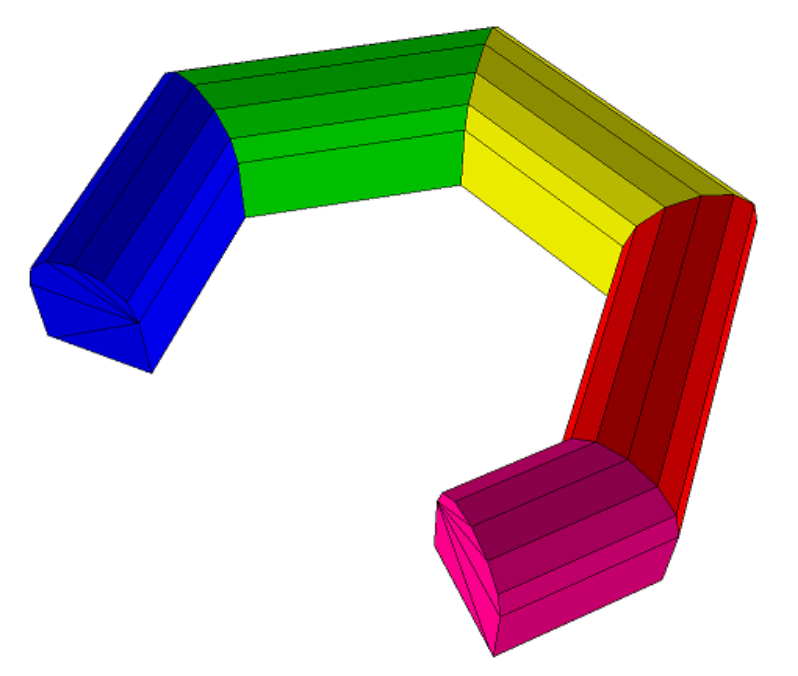

More Steps - permite especificar etapas de lavra adicionais.

Clear All Steps - limpa todas as etapas de lavra (1-100).

Undo - desmarca o último ponto informado e retorna à rotina de construção do túnel

#### CAD > Build > Undo Point

Copy From… - permite selecionar outro bloco do qual copiar as propriedades da entidade.

Mesh - constrói o bloco com as superfícies subdivididas em partes menores no espaçamento de grade de bloco especificado.

Build - conclui a construção do bloco e o insere no banco de dados do modelo.

Depois de concluída esta operação, você tem uma última chance de desfazê-la e remover este bloco do banco de dados do modelo selecionando

#### CAD > Build > Undo Build

Cancel aborta a construção do bloco.

Notes:

Devem ser usados números de cor diferentes para representar agrupamentos lógicos de blocos (p. ex., para diferentes níveis, seções ou unidades lógicas de lavra, como desenvolvimento, realces etc.). Essas cores são definíveis pelo usuário

#### Tools > Custom Colours

Todos os blocos com o mesmo número de cor serão combinados automaticamente pelo Map3D em formas complexas únicas.

Como é fácil ativar e desativar a exibição de números de cor de bloco específicos

#### View > Hide Block Colours

isso oferece um método eficiente para trabalhar com dados de modelos complexos.

Para uma discussão sobre aspectos da construção de modelos, consulte:

#### Model Building and Editing

Para tutoriais de construção de modelos, consulte:

#### Model Building Tutorials

Pressionar a barra de espaço ativa automaticamente a última função de construção usada.

## 5.5.1.5 Grid Plane

Constrói um plano de grade. Os resultados da análise (tensões, deformações e deslocamentos) são calculados nesses planos de grade. Cada plano de grade será subdividido em uma etapa posterior do programa.

Esta função usa a mesma funcionalidade de construção que CAD > Build > DDLoop

Observe que grades lineares podem ser criadas com

CAD > Build > Grid Line.

Quando a rotina é iniciada, o usuário é solicitado a selecionar um laço fechado de cantos que definem o perímetro do plano de grade. O plano de grade é considerado completo quando o último canto selecionado coincide com o primeiro ou quando o usuário seleciona o botão da barra de ferramentas para construir GPlane

CAD > Build > Grid Plane

**Snap > Trace**

Pontos individuais podem ser selecionados um de cada vez, ou todos os pontos ao longo de um segmento de linha de construção podem ser selecionados usando a função de snap CAD > Snap > Trace CLoop.

#### Snap > Win

Pontos individuais podem ser selecionados um de cada vez, ou todos os pontos ao longo de várias linhas de construção podem ser selecionados usando a função de snap CAD > Snap > Window.

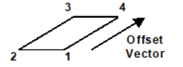

Depois que pelo menos dois pontos são informados, os pontos restantes podem ser gerados por deslocamento

#### CAD > Build > Offset Remaining

As coordenadas dos cantos podem ser digitadas pelo teclado

#### CAD > Build > Enter Point

selecionadas por desenho à mão livre, capturadas de outras entidades (outros blocos ou linhas de construção) ou digitalizadas

#### CAD > Digitizer Setup > Activate

Uma grande variedade de ferramentas de desenho está disponível para ajudar a selecionar visualmente pontos do modelo

#### CAD > Snap

Os cantos podem ser desmarcados com

#### CAD > Build > Undo Point

Os cantos podem ser reselecionados com

#### CAD > Build > Redo Point

Ao concluir a construção do plano de grade, o usuário é solicitado a informar as propriedades. Isso permite especificar um nome para o plano de grade.

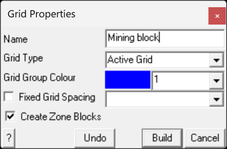

Name - especifica um nome descritivo para a grade.

Grid Type - especifica se você quer que a grade seja ativa (usada na análise de tensões) ou inativa (não usada na análise de tensões).

Fixed Grid Spacing - especifica o espaçamento de grade definido pelo usuário.

Este parâmetro pode ser usado para forçar uma discretização uniforme nas grades selecionadas. Deve-se ter extremo cuidado ao especificar este valor, pois um valor pequeno pode facilmente levar a um tamanho de problema enorme.

Em geral, esta opção não deve ser usada (desmarcada) e a discretização deve ficar a cargo do parâmetro _AG_ . Este último concentra elementos somente onde os resultados da análise são solicitados, otimizando o uso de elementos e minimizando o tamanho do problema.

#### CAD > Properties Control Parameters

Create Zone Blocks - se você estiver construindo planos de grade de vários laços, pode especificar se serão criadas ou não interfaces entre cada subseção, de modo que cada uma possa ser tratada como um grupo separado de GPlanes. A cada uma dessas subseções será atribuído um número de cor diferente para facilitar ocultá-las/exibi-las ao visualizar com Hide Grid Colours. Se você não especificar esta opção, será criado um único grupo grande de GPlanes.

Undo - desmarca o último ponto informado e retorna à rotina de construção da grade

#### CAD > Build > Undo Point

Build - conclui a construção da grade e a insere no banco de dados do modelo.

Depois de concluída esta operação, você tem uma última chance de desfazê-la e remover esta grade do banco de dados do modelo selecionando

#### CAD > Build > Undo Build

Cancel - aborta a construção da grade.

Para exemplos do uso de planos de grade de pontos de campo, consulte:

#### Model Building Tutorials

Pressionar a barra de espaço ativa automaticamente a última função de construção usada.

## 5.5.1.6 Grid Line

Constrói uma linha de grade. Os resultados da análise (tensões, deformações e deslocamentos) são calculados nessas linhas de grade. Cada linha de grade será subdividida em uma etapa posterior do programa.

#### CAD > Build > Construction Lines

Esta função usa a mesma funcionalidade de construção que

#### CAD > Build > Grid Plane.

Observe que planos de grade podem ser criados com

**2**

**1**

Quando a rotina é iniciada, o usuário é solicitado a selecionar vários cantos que definem pontos ao longo da linha de grade.

A linha de grade é considerada completa quando o último canto é selecionado duas vezes ou quando o usuário seleciona

CAD > Build > Grid Line

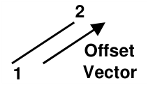

Depois que o primeiro ponto é informado, o ponto restante pode ser gerado por deslocamento

#### CAD > Build > Offset Remaining

As coordenadas dos cantos podem ser digitadas pelo teclado

#### CAD > Build > Enter Point

selecionadas por desenho à mão livre, capturadas de outras entidades (outros blocos ou linhas de construção) ou digitalizadas

#### CAD > Digitizer Setup > Activate

Uma grande variedade de ferramentas de desenho está disponível para ajudar a selecionar visualmente pontos do modelo

#### CAD > Snap

Os cantos podem ser desmarcados com

#### CAD > Build > Undo Point

Os cantos podem ser reselecionados com

#### CAD > Build > Redo Point

Ao concluir a construção do plano de grade, o usuário é solicitado a informar as propriedades. Isso permite especificar um nome para a linha de grade.

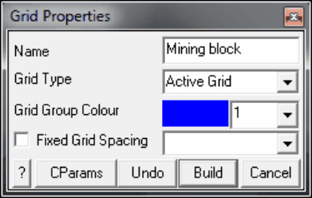

Name - especifica um nome descritivo para a grade.

Grid Type - especifica se você quer que a grade seja ativa (usada na análise de tensões) ou inativa (não usada na análise de tensões).

Fixed Grid Spacing - especifica o espaçamento de grade definido pelo usuário.

Este parâmetro pode ser usado para forçar uma discretização uniforme nas grades selecionadas. Deve-se ter extremo cuidado ao especificar este valor, pois um valor pequeno pode facilmente levar a um tamanho de problema enorme.

Em geral, esta opção não deve ser usada (desmarcada) e a discretização deve ficar a cargo do parâmetro _AG_ . Este último concentra elementos somente onde os resultados da análise são solicitados, otimizando o uso de elementos e minimizando o tamanho do problema.

#### CAD > Properties Control Parameters

Undo - desmarca o último ponto informado e retorna à rotina de construção da grade

#### CAD > Build > Undo Point

Build - conclui a construção da grade e a insere no banco de dados do modelo.

Depois de concluída esta operação, você tem uma última chance de desfazê-la e remover esta grade do banco de dados do modelo selecionando

#### CAD > Build > Undo Build

Cancel - aborta a construção da grade.

Para exemplos do uso de planos de grade de pontos de campo, consulte:

#### Model Building Tutorials

Pressionar a barra de espaço ativa automaticamente a última função de construção usada.

## 5.5.1.7 Construction Lines

Constrói linhas de construção. Elas se destinam a representar os contornos de lavra e são usadas como auxílio para construir o modelo. As linhas de construção geralmente são digitalizadas a partir de desenhos ou importadas de outros pacotes CAD.

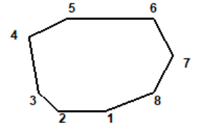

Quando a rotina é iniciada, o usuário é solicitado a selecionar uma série de cantos que definem o perímetro da zona desejada. A linha de construção é considerada completa quando o primeiro canto é repetido ou quando o usuário seleciona

CAD > Build > Construction Lines

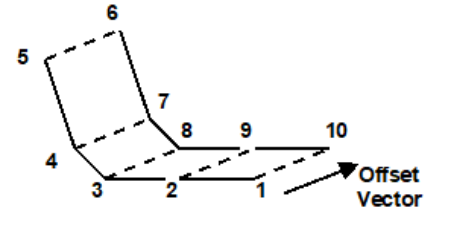

Depois que pelo menos dois pontos são informados, os pontos restantes podem ser gerados por deslocamento

#### CAD > Build > Offset Remaining

As coordenadas dos cantos podem ser digitadas pelo teclado

#### CAD > Build > Enter Point

selecionadas por desenho à mão livre, capturadas de outras entidades (outros blocos ou linhas de construção) ou digitalizadas

#### CAD > Digitizer Setup > Activate

Uma grande variedade de ferramentas de desenho está disponível para ajudar a selecionar visualmente pontos do modelo

#### CAD > Snap

Os cantos podem ser desmarcados com

#### CAD > Build > Undo Point

Os cantos podem ser reselecionados com

#### CAD > Build > Redo Point

Ao concluir a construção do bloco, o usuário é solicitado a informar as propriedades. Isso permite especificar a cor da linha de construção.

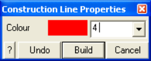

Colour - especifica o número de cor que será usado para exibir a linha de construção. Há um total de 10 cores disponíveis para exibição. Elas são numeradas respectivamente

de 1 a 10, de 11 a 20, de 21 a 30 etc.,

de modo que a mesma cor é exibida para os números

1, 11, 21..., 2, 22, 32..., 3, 23, 33..., etc.

Undo - desmarca o último ponto informado e retorna à rotina de construção da linha de construção.

#### CAD > Build > Undo Point

Build - conclui a construção da grade e a insere no banco de dados do modelo.

Depois de concluída esta operação, você tem uma última chance de desfazê-la e remover esta grade do banco de dados do modelo selecionando

#### CAD > Build > Undo Build

Cancel - aborta a construção da linha.

Notes

Devem ser usados números de cor diferentes para representar agrupamentos lógicos de linhas de construção (p. ex., para diferentes níveis, seções ou unidades lógicas de lavra, como desenvolvimento, realces etc.). Essas cores são definíveis pelo usuário

#### Tools > Custom Colours

Como é fácil ativar e desativar a exibição de números de cor de linha de construção específicos

#### View > Hide Block Colours

isso oferece um método eficiente para trabalhar com dados complexos de linhas de construção.

Para exemplos do uso de linhas de construção na construção de modelos, consulte:

#### Model Building Tutorials

Pressionar a barra de espaço ativa automaticamente a última função de construção usada.

## 5.5.1.8 Enter Point

As coordenadas dos cantos podem ser digitadas pelo teclado durante a construção das seguintes entidades:

#### CAD > Build > Block

CAD > Build > FF Loop

CAD > Build > DD Loop

CAD > Build > Tunnel

CAD > Build > Grid Plane

#### CAD > Build > Grid Line

#### CAD > Build > Construction Lines

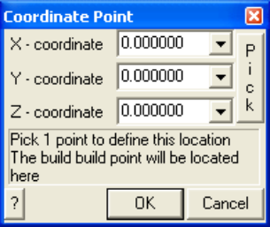

X, Y and Z – coordinate especificam as coordenadas do ponto.

Pick - ativa a cruz do cursor para selecionar de forma interativa o ponto a partir do modelo.

Para ajudar a selecionar visualmente pontos do modelo, todas as funções de snap estão disponíveis.

#### CAD > Snap

Depois de selecionadas, as coordenadas do ponto são exibidas na caixa de diálogo.

## 5.5.1.9 Extrude/Offset Remaining

Extruda uma entidade parcialmente construída para ajudar a gerar os pontos restantes durante a construção das seguintes entidades:

#### CAD > Build > Block

CAD > Build > FF Loop

CAD > Build > DD Loop

CAD > Build > Tunnel

CAD > Build > Grid Plane

CAD > Build > Grid Line

#### CAD > Build > Construction Lines

X, Y and Z – offset especificam as componentes do vetor de deslocamento. Todas as entidades selecionadas serão movidas por essa quantidade.

Pick - ativa a cruz do cursor para selecionar de forma interativa o vetor de deslocamento a partir do modelo. Isso requer selecionar dois pontos para definir esse vetor.

Length, Plunge and Direction - especificam as componentes do vetor de deslocamento. Todas as entidades selecionadas serão movidas por essa quantidade.

Norm - ativa o cursor para selecionar de forma interativa uma superfície à qual tornar o vetor de deslocamento normal. Isso requer selecionar dois pontos para definir esse vetor. Depois de selecionadas, as componentes do vetor de deslocamento são exibidas na caixa de diálogo.

Para ajudar a selecionar visualmente pontos do modelo, todas as funções de snap estão disponíveis.

#### CAD > Snap

Depois de selecionadas, as componentes do vetor de deslocamento são exibidas na caixa de diálogo.

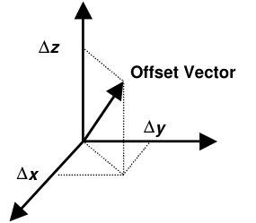

Por exemplo, se você construiu a base de um bloco 3D (pontos 1, 2, 3 e 4) e deseja gerar os pontos restantes (5, 6, 7 e 8) a um metro de elevação acima da base, basta informar o vetor de deslocamento como (0,0,1).

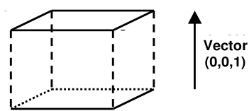

Observe que é possível criar blocos de volume zero, por exemplo, especificando um vetor de deslocamento de comprimento zero. Isso permite aos usuários construir superfícies FF individuais, se desejarem. Embora seja permitido, isso não é recomendado, pois pode levar a volumes não fechados.

## 5.5.1.10 Undo Point

Durante a construção de um bloco, os pontos são selecionados em sequência. Isso permite desmarcar pontos durante a construção das seguintes entidades:

CAD > Build > Block

CAD > Build > FF Loop

CAD > Build > DD Loop

CAD > Build > Tunnel

CAD > Build > Grid Plane

CAD > Build > Grid Line

CAD > Build > Construction Lines

Qualquer ponto desmarcado pode ser reselecionado com

#### CAD > Build > Redo Point

Depois de concluída a construção do bloco, você pode desfazê-la e remover este bloco do banco de dados do modelo selecionando (são suportados 10 níveis de desfazer/refazer)

#### CAD > Build > Undo Build

Em seguida, você pode refazer a construção do bloco. Isso permite repetir qualquer operação de malha de teste.

CAD > Build > Undo Redo

## 5.5.1.11 Redo Point

Durante a construção de um bloco, os pontos são selecionados em sequência. Isso permite reselecionar quaisquer pontos que tenham sido desmarcados durante a construção das seguintes entidades:

CAD > Build > Block

CAD > Build > FF Loop

CAD > Build > DD Loop

CAD > Build > Tunnel

CAD > Build > Grid Plane

CAD > Build > Grid Line

CAD > Build > Construction Lines

Os pontos podem ser desmarcados com

#### CAD > Build > Undo Point

Depois de concluída a construção do bloco, você pode desfazê-la e remover este bloco do banco de dados do modelo selecionando (são suportados 10 níveis de desfazer/refazer)

#### CAD > Build > Undo Build

Em seguida, você pode refazer a construção do bloco. Isso permite repetir qualquer operação de malha de teste.

CAD > Build > Undo Redo

## 5.5.1.12 Undo Build

Durante a construção de um bloco, os pontos são selecionados em sequência. Isso permite desmarcar pontos durante a construção das seguintes entidades:

CAD > Build > Block

CAD > Build > FF Loop

CAD > Build > DD Loop

CAD > Build > Tunnel

CAD > Build > Grid Plane

CAD > Build > Grid Line

CAD > Build > Construction Lines

Qualquer ponto desmarcado pode ser reselecionado com

#### CAD > Build > Redo Point

Depois de concluída a construção do bloco, você pode desfazê-la e remover este bloco do banco de dados do modelo selecionando (são suportados 10 níveis de desfazer/refazer)

#### CAD > Build > Undo Build

Em seguida, você pode refazer a construção do bloco. Isso permite repetir qualquer operação de malha de teste.

CAD > Build > Undo Redo

## 5.5.1.13 Redo Build

Durante a construção de um bloco, os pontos são selecionados em sequência. Isso permite reselecionar quaisquer pontos que tenham sido desmarcados durante a construção das seguintes entidades:

CAD > Build > Block

CAD > Build > FF Loop

CAD > Build > DD Loop

CAD > Build > Tunnel

CAD > Build > Grid Plane

CAD > Build > Grid Line

CAD > Build > Construction Lines

Os pontos podem ser desmarcados com

CAD > Build > Undo Point

Depois de concluída a construção do bloco, você pode desfazê-la e remover este bloco do banco de dados do modelo selecionando (são suportados 10 níveis de desfazer/refazer)

#### CAD > Build > Undo Build

Em seguida, você pode refazer a construção do bloco. Isso permite repetir qualquer operação de malha de teste.

CAD > Build > Undo Redo
