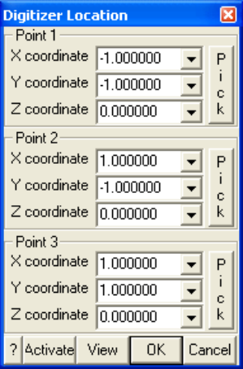

Configura o digitalizador.

O plano de digitalização é escalado, posicionado e orientado de forma única especificando 3 pontos no desenho a ser digitalizado.

O procedimento é o seguinte:

1. selecione 3 pontos no desenho,

2. informe as coordenadas de cada ponto,

3. em seguida, selecione os pontos com o cursor do digitalizador.

4. Pick ativa o cursor do digitalizador para permitir a seleção de cada ponto.

CAD > Digitizer > Activate ativa ou desativa o digitalizador para selecionar pontos de um desenho. Esse botão pode ser colocado na barra de ferramentas CAD com Tools > CAD Toolbar > Configure.

View: reposiciona a vista para que você possa ver o plano do digitalizador sobreposto ao modelo.

Há suporte para qualquer digitalizador que possa ser configurado para controlar os movimentos do cursor no modo absoluto (ou seja, com correspondência de um para um entre o movimento do digitalizador e a posição do cursor). A maioria dos digitalizadores novos vem com drivers próprios que oferecem esse suporte. Uma alternativa é usar o seguinte software, compatível com a maioria dos digitalizadores:

Virtual Tablet Interface Digitizer Technology Company 16541 Redmond Way, Suite 195C Redmond, Washington USA 98052 Tel: 206 868 3246 Fax: 206 885 7704
