## 5.5.4.1 Propriedades de entidades

Edita o tipo de bloco, a cor, a sequência de lavra etc.

Esta rotina pode ser iniciada clicando no botão ou simplesmente clicando com o botão direito em qualquer entidade. Ao iniciar esta rotina, você será primeiro solicitado a montar uma lista das entidades que deseja editar

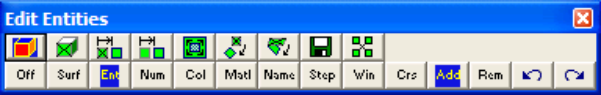

- Se Tools > Shift-key Selection estiver marcada, você deve manter pressionada a tecla Shift para fazer seleções múltiplas.

- Por padrão, as entidades selecionadas são adicionadas à lista; porém, se a tecla Ctrl for mantida pressionada, as entidades selecionadas serão removidas da lista.

- Enquanto mantém pressionada a tecla Shift ou Ctrl, você pode arrastar para abrir uma janela de interseção.

- O uso desta barra de ferramentas é detalhado em Build A List of Entities for Editing

- Pressionar a barra de espaço ativa automaticamente a última função de edição usada.

- Manter a tecla Alt pressionada ao clicar com o botão direito repete automaticamente a última função de edição usada.

Depois de selecionar as entidades desejadas, você pode escolher qualquer um dos botões de edição:

CAD > Edit > Entity Properties Edit block type, colour, mining sequence, CAD > Edit > Erase Entities Erase selected entities, CAD > Edit > Move Entities Move selected entities, CAD > Edit > Copy Entities Copy selected entities, CAD > Edit > Scale Entities Scale selected entities, CAD > Edit > Rotate Azimuth Rotate the azimuth of selected entities, CAD > Edit > Rotate Dip Rotate the dip of selected entities,

CAD > Edit > Dump to File Dump selected entities to a file,

CAD > Edit > Group Group selected entities into a single block,

- clicar duas vezes em qualquer vértice para executar a função destacada,

- clicar com o botão direito para ver uma lista de opções.

Se algum dos campos da caixa de diálogo indicar "Variable", é porque alguns dos blocos selecionados têm propriedades diferentes nesse campo. Se você quiser deixar essas propriedades como estão (ou seja, diferentes para cada bloco), deixe o campo como "Variable". Se quiser alterar o valor desse campo para todos os blocos selecionados, informe o valor desejado.

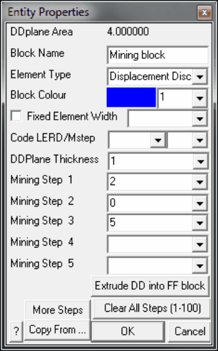

Block Volume - se você selecionou apenas blocos FF, será exibido o volume total combinado dos blocos. Se você selecionou apenas blocos FF, será exibido o volume total combinado dos blocos.

DDPlane Area - se você selecionou apenas blocos DD, exibe a área combinada de todos os DDPlanes incluídos no DDLoop.

Block Name - especifica um nome descritivo para o bloco.

Element Type - especifica o tipo de elemento de contorno que será usado para o bloco.

- Displacement Discontinuity - elementos do tipo DD devem ser usados para escavações tabulares, fraturas e planos de falha.

- Fictitious Force - elementos do tipo FF devem ser usados para feições tridimensionais, como escavações, zonas de material alternativo, realces preenchidos etc.

- Elementos inativos podem ser usados para exibir feições incluídas apenas para fins de visualização e que não serão usadas na análise de tensões propriamente dita.

- Observe que elementos do tipo DD podem ser convertidos em GPlanes.

Block Colour - especifica o número de cor que será usado para exibir o bloco.

- Especifica o número de cor que será atribuído a cada botão. Há um total de 10 cores disponíveis para exibição. Elas são numeradas respectivamente

- de 1 a 10,

de 11 a 20,

de 21 a 30 etc.,

- de modo que a mesma cor é exibida para os números 1, 11, 21...,

- 2, 22, 32...,

- 3, 23, 33..., etc.

Fixed Element Width - especifica a largura de elemento definida pelo usuário.

- Este parâmetro pode ser usado para forçar uma discretização uniforme nas entidades selecionadas. Deve-se ter extremo cuidado ao especificar este valor, pois um valor pequeno pode facilmente levar a um tamanho de problema enorme.

- Em geral, esta opção não deve ser usada (desmarcada) e a discretização deve ficar a cargo dos parâmetros _AL_ e _AG_ . Estes últimos concentram elementos somente onde os resultados da análise são solicitados, otimizando o uso de elementos e minimizando o tamanho do problema. Para uma discussão adicional, consulte

CAD > Properties Control Parameters

- Este parâmetro também pode ser usado para evitar a criação de superfícies com lados maiores que este valor durante a análise de interseções. Nenhuma superfície cujo comprimento de lado exceda esta dimensão será colapsada

#### Analysis > Options > Collapse

- Durante o processo de discretização, qualquer superfície cujo comprimento de lado exceda esta dimensão será subdividida para evitar superfícies com lados maiores que este valor.

- Para um exemplo do uso deste parâmetro, consulte Tabular Mining Example

Matl_Code LERD/MStep - especifica o código de material que será substituído no bloco para o cálculo de LERD/LSS.

A primeira caixa é para o código de material.

A segunda caixa serve para especificar o número da etapa de lavra em que o cálculo deve ser feito. Se esta caixa for deixada em branco, o cálculo de LERD será feito para todas as etapas.

#### Analysis > Options > LERD/LSS.

DDPlane Thickness - especifica a espessura do material inserido no elemento DD (ou seja, argila de falha, largura da camada, largura de lavra ou altura do pilar).

- O deslocamento normal (fechamento) da feição quando preenchida será limitado a essa espessura. Além disso, o deslocamento normal (fechamento) e o deslocamento de cisalhamento (ride) são divididos pela espessura para determinar a deformação que ocorre no material de preenchimento

Mohr-Coulomb in DD planes

Fault-Gouge in DD planes Backfill-Hyperbolic in DD planes

- Este parâmetro deve ser especificado nas mesmas unidades usadas para especificar as coordenadas (p. ex., metros ou pés).

Mining Step n - especifica o código de material que será usado para este bloco na etapa de lavra n.

- No exemplo acima, o bloco não existe na etapa 1, tem o material nº 2 (minério) inserido na etapa 2, é escavado na etapa 3 (o código de material 0 significa escavar) e, por fim, na etapa 4 o material nº 5 (aterro) é inserido.

- Quando você usa um número de material positivo, o material é colocado no bloco com o estado de tensões inicial especificado e então pode se deformar de acordo com as propriedades elásticas/plásticas definidas para esse número de material.

- Quando você usa um número de material negativo, o material é colocado no bloco com o estado de tensões inicial especificado, mas o estado de tensões é mantido nesses valores independentemente das deformações, fornecendo assim uma condição de contorno de tensões.

Extrude DD into FF blocks - permite extrudar um plano DD em um bloco FF. Será solicitado o vetor de extrusão

More Steps - permite especificar etapas de lavra adicionais.

Clear All Steps - limpa todas as etapas de lavra (1-100).

Copy From… - permite selecionar outro bloco do qual copiar as propriedades da entidade.

OK - conclui a edição dos blocos e aplica as propriedades que foram alteradas.

Cancel - aborta a edição de blocos.

Depois de concluída qualquer operação de edição, você tem uma chance de desfazer as modificações selecionando

#### Undo

Você também pode restaurar o mesmo conjunto de seleção e modificar novamente o mesmo conjunto de entidades selecionando

#### Redo

Blocos DD podem ser extrudados em blocos FF 3D simplesmente alterando o tipo de elemento de Displacement Discontinuity para Fictitious Force.

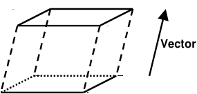

Nesse caso, os cantos 1 a 4 definem a base do bloco. O topo e os lados são gerados automaticamente durante o processo de extrusão. Blocos FF podem ser colapsados em planos DD alterando o tipo de elemento de Fictitious Force para Displacement Discontinuity. Nesse caso, a base do bloco (o lado definido pelos cantos 1, 2, 3 e 4) se tornará o plano DD e os demais lados do bloco serão descartados.

Observe que é possível criar blocos de volume zero, por exemplo, especificando um vetor de deslocamento de comprimento zero. Isso permite aos usuários construir superfícies FF individuais, se desejarem. Embora seja permitido, isso não é recomendado, pois pode levar a volumes não fechados.

Notas

Devem ser usados números de cor diferentes para representar agrupamentos lógicos de blocos (p. ex., para diferentes níveis, seções ou unidades lógicas de lavra, como desenvolvimento, realces etc.). Essas cores são definíveis pelo usuário

#### Tools > Custom Colours

Todos os blocos com o mesmo número de cor serão combinados automaticamente pelo Map3D em formas complexas únicas.

Como é fácil ativar e desativar a exibição de números de cor de bloco específicos

#### View > Hide Block Colours

isso oferece um método eficiente para trabalhar com dados de modelos complexos.

Você pode ajustar o tempo de clique duplo usando

#### Tools > Double Click Time

Para uma discussão sobre aspectos da construção de modelos, consulte:

#### Model Building and Editing

Para tutoriais de construção de modelos, consulte:

Model Building Tutorials

## 5.5.4.2 Apagar entidades

Apaga as entidades selecionadas.

Esta rotina pode ser iniciada clicando no botão ou simplesmente clicando com o botão direito em qualquer entidade. Ao iniciar esta rotina, você será primeiro solicitado a montar uma lista das entidades que deseja editar

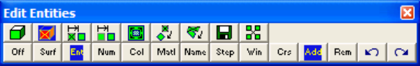

- Se Tools > Shift-key Selection estiver marcada, você deve manter pressionada a tecla Shift para fazer seleções múltiplas.

- Por padrão, as entidades selecionadas são adicionadas à lista; porém, se a tecla Ctrl for mantida pressionada, as entidades selecionadas serão removidas da lista.

- Enquanto mantém pressionada a tecla Shift ou Ctrl, você pode arrastar para abrir uma janela de interseção.

- O uso desta barra de ferramentas é detalhado em Build A List of Entities for Editing

- Pressionar a barra de espaço ativa automaticamente a última função de edição usada.

- Manter a tecla Alt pressionada ao clicar com o botão direito repete automaticamente a última função de edição usada.

Depois de selecionar as entidades desejadas, você pode escolher qualquer um dos botões de edição:

CAD > Edit > Entity Properties Edit block type, colour, mining sequence, CAD > Edit > Erase Entities Erase selected entities, CAD > Edit > Move Entities Move selected entities, CAD > Edit > Copy Entities Copy selected entities,

CAD > Edit > Scale Entities Scale selected entities,

CAD > Edit > Rotate Azimuth Rotate the azimuth of selected entities, CAD > Edit > Rotate Dip Rotate the dip of selected entities, CAD > Edit > Dump to File Dump selected entities to a file,

CAD > Edit > Group Group selected entities into a single block,

- clicar duas vezes em qualquer vértice para executar a função destacada,

- clicar com o botão direito para ver uma lista de opções.

Depois de concluída qualquer operação de edição, você tem uma chance de desfazer as modificações selecionando

#### Undo

Você também pode restaurar o mesmo conjunto de seleção e modificar novamente o mesmo conjunto de entidades selecionando

#### Redo

Você pode ajustar o tempo de clique duplo usando

Tools > Double Click Time

## 5.5.4.3 Mover entidades

Move as entidades selecionadas.

Esta rotina pode ser iniciada clicando no botão ou simplesmente clicando com o botão direito em qualquer entidade. Ao iniciar esta rotina, você será primeiro solicitado a montar uma lista das entidades que deseja editar

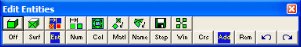

- Se Tools > Shift-key Selection estiver marcada, você deve manter pressionada a tecla Shift para fazer seleções múltiplas.

- Por padrão, as entidades selecionadas são adicionadas à lista; porém, se a tecla Ctrl for mantida pressionada, as entidades selecionadas serão removidas da lista.

- Enquanto mantém pressionada a tecla Shift ou Ctrl, você pode arrastar para abrir uma janela de interseção.

- O uso desta barra de ferramentas é detalhado em Build A List of Entities for Editing

- Pressionar a barra de espaço ativa automaticamente a última função de edição usada.

- Manter a tecla Alt pressionada ao clicar com o botão direito repete automaticamente a última função de edição usada.

Depois de selecionar as entidades desejadas, você pode escolher qualquer um dos botões de edição:

CAD > Edit > Entity Properties Edit block type, colour, mining sequence, CAD > Edit > Erase Entities Erase selected entities, CAD > Edit > Move Entities Move selected entities, CAD > Edit > Copy Entities Copy selected entities,

CAD > Edit > Scale Entities Scale selected entities, CAD > Edit > Rotate Azimuth Rotate the azimuth of selected entities, CAD > Edit > Rotate Dip Rotate the dip of selected entities, CAD > Edit > Dump to File Dump selected entities to a file, CAD > Edit > Group Group selected entities into a single block,

- clicar duas vezes em qualquer vértice para executar a função destacada,

- clicar com o botão direito para ver uma lista de opções.

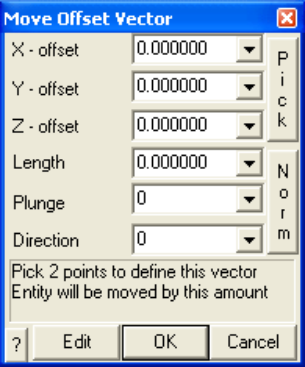

X, Y and Z – offset especificam as componentes do vetor de deslocamento. Todas as entidades selecionadas serão movidas por essa quantidade.

Pick - ativa a cruz do cursor para selecionar de forma interativa o vetor de deslocamento a partir do modelo. Isso requer selecionar dois pontos para definir esse vetor.

Length, Plunge and Direction - especificam as componentes do vetor de deslocamento. Todas as entidades selecionadas serão movidas por essa quantidade.

Norm - ativa o cursor para selecionar de forma interativa uma superfície à qual tornar o vetor de deslocamento normal.

Para ajudar a selecionar visualmente pontos do modelo, todas as funções de snap estão disponíveis.

#### CAD > Snap

Depois de selecionadas, as componentes do vetor de deslocamento são exibidas na caixa de diálogo.

Edit - conclui a edição e chama a edição das propriedades de entidade dos blocos selecionados.

OK - conclui a edição do vetor de deslocamento e move os blocos selecionados.

Cancel - aborta o movimento de entidades.

Depois de concluída qualquer operação de edição, você tem uma chance de desfazer as modificações selecionando

#### Undo

Você também pode restaurar o mesmo conjunto de seleção e modificar novamente o mesmo conjunto de entidades selecionando

#### Redo

Você pode ajustar o tempo de clique duplo usando

Tools > Double Click Time

## 5.5.4.4 Copiar entidades

Copia as entidades selecionadas.

Esta rotina pode ser iniciada clicando no botão ou simplesmente clicando com o botão direito em qualquer entidade. Ao iniciar esta rotina, você será primeiro solicitado a montar uma lista das entidades que deseja editar

- Se Tools > Shift-key Selection estiver marcada, você deve manter pressionada a tecla Shift para fazer seleções múltiplas.

- Por padrão, as entidades selecionadas são adicionadas à lista; porém, se a tecla Ctrl for mantida pressionada, as entidades selecionadas serão removidas da lista.

- Enquanto mantém pressionada a tecla Shift ou Ctrl, você pode arrastar para abrir uma janela de interseção.

- O uso desta barra de ferramentas é detalhado em Build A List of Entities for Editing

- Pressionar a barra de espaço ativa automaticamente a última função de edição usada.

- Manter a tecla Alt pressionada ao clicar com o botão direito repete automaticamente a última função de edição usada.

Depois de selecionar as entidades desejadas, você pode escolher qualquer um dos botões de edição:

CAD > Edit > Entity Properties Edit block type, colour, mining sequence, CAD > Edit > Erase Entities Erase selected entities, CAD > Edit > Move Entities Move selected entities, CAD > Edit > Copy Entities Copy selected entities, CAD > Edit > Scale Entities Scale selected entities, CAD > Edit > Rotate Azimuth Rotate the azimuth of selected entities, CAD > Edit > Rotate Dip Rotate the dip of selected entities, CAD > Edit > Dump to File Dump selected entities to a file, CAD > Edit > Group Group selected entities into a single block,

- clicar duas vezes em qualquer vértice para executar a função destacada,

- clicar com o botão direito para ver uma lista de opções.

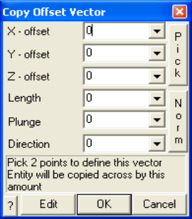

X, Y and Z – offset especificam as componentes do vetor de deslocamento. Todas as entidades selecionadas serão copiadas para o local especificado por esse deslocamento.

Pick - ativa a cruz do cursor para selecionar de forma interativa o vetor de deslocamento a partir do modelo. Isso requer selecionar dois pontos para definir esse vetor.

Length, Plunge and Direction - especificam as componentes do vetor de deslocamento. Todas as entidades selecionadas serão copiadas para o local especificado por esse deslocamento.

Norm - ativa o cursor para selecionar de forma interativa uma superfície à qual tornar o vetor de deslocamento normal.

Para ajudar a selecionar visualmente pontos do modelo, todas as funções de snap estão disponíveis.

#### CAD > Snap

Depois de selecionadas, as componentes do vetor de deslocamento são exibidas na caixa de diálogo.

Edit - conclui a edição e chama a edição das propriedades de entidade dos blocos selecionados.

OK - conclui a edição do vetor de deslocamento e move os blocos selecionados.

Cancel - aborta o movimento de entidades.

Depois de concluída qualquer operação de edição, você tem uma chance de desfazer as modificações selecionando

#### Undo

Você também pode restaurar o mesmo conjunto de seleção e modificar novamente o mesmo conjunto de entidades selecionando

#### Redo

Você pode ajustar o tempo de clique duplo usando

Tools > Double Click Time

## 5.5.4.5 Escalonar entidades

Escalona as entidades selecionadas.

Esta rotina pode ser iniciada clicando no botão ou simplesmente clicando com o botão direito em qualquer entidade. Ao iniciar esta rotina, você será primeiro solicitado a montar uma lista das entidades que deseja editar

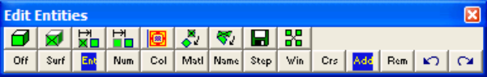

- Se Tools > Shift-key Selection estiver marcada, você deve manter pressionada a tecla Shift para fazer seleções múltiplas.

- Por padrão, as entidades selecionadas são adicionadas à lista; porém, se a tecla Ctrl for mantida pressionada, as entidades selecionadas serão removidas da lista.

- Enquanto mantém pressionada a tecla Shift ou Ctrl, você pode arrastar para abrir uma janela de interseção.

- O uso desta barra de ferramentas é detalhado em Build A List of Entities for Editing

- Pressionar a barra de espaço ativa automaticamente a última função de edição usada.

- Manter a tecla Alt pressionada ao clicar com o botão direito repete automaticamente a última função de edição usada.

Depois de selecionar as entidades desejadas, você pode escolher qualquer um dos botões de edição:

CAD > Edit > Entity Properties Edit block type, colour, mining sequence, CAD > Edit > Erase Entities Erase selected entities, CAD > Edit > Move Entities Move selected entities, CAD > Edit > Copy Entities Copy selected entities, CAD > Edit > Scale Entities Scale selected entities,

CAD > Edit > Rotate Azimuth Rotate the azimuth of selected entities, CAD > Edit > Rotate Dip Rotate the dip of selected entities, CAD > Edit > Dump to File Dump selected entities to a file, CAD > Edit > Group Group selected entities into a single block,

- clicar duas vezes em qualquer vértice para executar a função destacada,

- clicar com o botão direito para ver uma lista de opções.

X, Y and Z – coordinates especificam as coordenadas do centro de escalonamento. Durante o escalonamento, esse ponto permanece fixo. Todos os demais pontos são movidos para obter o escalonamento desejado.

Pick - ativa a cruz do cursor para selecionar de forma interativa o centro de rotação a partir do modelo.

Para ajudar a selecionar visualmente pontos do modelo, todas as funções de snap estão disponíveis.

CAD > Snap

Depois de selecionadas, as componentes do centro de escalonamento são exibidas na caixa de diálogo.

Centroid - calcula o centro de todas as entidades selecionadas.

OK - conclui a edição das coordenadas e solicita os fatores de escala.

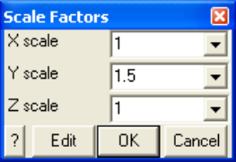

X, Y and Z - scale especifica o fator pelo qual as entidades serão escalonadas. Abaixo, o bloco é escalonado 1,5 vez na direção y.

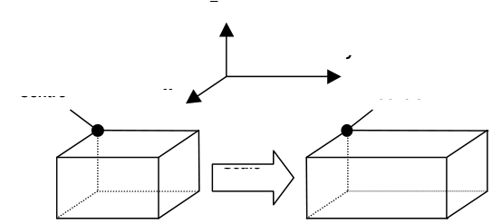

Edit - conclui a edição e chama a edição das propriedades de entidade dos blocos selecionados.

OK - conclui a edição dos fatores de escala e escalona as entidades selecionadas.

Cancel - aborta o escalonamento de entidades.

Depois de concluída qualquer operação de edição, você tem uma chance de desfazer as modificações selecionando

#### Undo

Você também pode restaurar o mesmo conjunto de seleção e modificar novamente o mesmo conjunto de entidades selecionando

Redo

Você pode ajustar o tempo de clique duplo usando

Tools > Double Click Time

## 5.5.4.6 Girar azimute

Gira o azimute das entidades selecionadas.

Esta rotina pode ser iniciada clicando no botão ou simplesmente clicando com o botão direito em qualquer entidade. Ao iniciar esta rotina, você será primeiro solicitado a montar uma lista das entidades que deseja editar

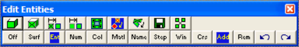

- Se Tools > Shift-key Selection estiver marcada, você deve manter pressionada a tecla Shift para fazer seleções múltiplas.

- Por padrão, as entidades selecionadas são adicionadas à lista; porém, se a tecla Ctrl for mantida pressionada, as entidades selecionadas serão removidas da lista.

- Enquanto mantém pressionada a tecla Shift ou Ctrl, você pode arrastar para abrir uma janela de interseção.

- O uso desta barra de ferramentas é detalhado em Build A List of Entities for Editing

- Pressionar a barra de espaço ativa automaticamente a última função de edição usada.

- Manter a tecla Alt pressionada ao clicar com o botão direito repete automaticamente a última função de edição usada.

Depois de selecionar as entidades desejadas, você pode escolher qualquer um dos botões de edição:

CAD > Edit > Entity Properties Edit block type, colour, mining sequence, CAD > Edit > Erase Entities Erase selected entities, CAD > Edit > Move Entities Move selected entities, CAD > Edit > Copy Entities Copy selected entities, CAD > Edit > Scale Entities Scale selected entities, CAD > Edit > Rotate Azimuth Rotate the azimuth of selected entities, CAD > Edit > Rotate Dip Rotate the dip of selected entities, CAD > Edit > Dump to File Dump selected entities to a file, CAD > Edit > Group Group selected entities into a single block,

- clicar duas vezes em qualquer vértice para executar a função destacada,

- clicar com o botão direito para ver uma lista de opções.

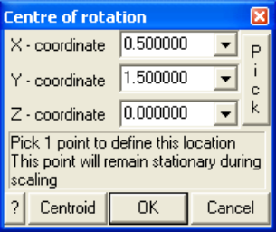

X, Y and Z – coordinates especificam as coordenadas do centro de rotação.

Pick - ativa a cruz do cursor para selecionar de forma interativa o centro de rotação a partir do modelo.

Para ajudar a selecionar visualmente pontos do modelo, todas as funções de snap estão disponíveis.

#### CAD > Snap

Depois de selecionadas, as componentes do centro de escalonamento são exibidas na caixa de diálogo.

Centroid - calcula o centro de todas as entidades selecionadas.

OK - conclui a edição das coordenadas e solicita os fatores de escala.

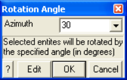

- Azimuth - especifica o ângulo (em graus) pelo qual você quer girar as entidades selecionadas. · A rotação ocorre no plano X-Y; portanto, todas as linhas verticais permanecem verticais.

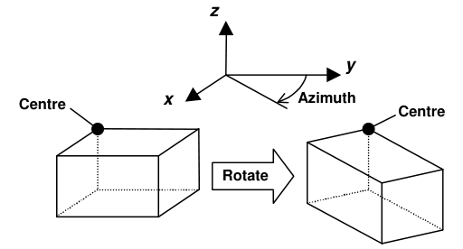

Edit - conclui a edição e chama a edição das propriedades de entidade dos blocos selecionados.

OK - conclui a edição do azimute e gira as entidades selecionadas.

Cancel - aborta a rotação de entidades.

Depois de concluída qualquer operação de edição, você tem uma chance de desfazer as modificações selecionando

Undo

Você também pode restaurar o mesmo conjunto de seleção e modificar novamente o mesmo conjunto de entidades selecionando

Redo

Você pode ajustar o tempo de clique duplo usando

Tools > Double Click Time

## 5.5.4.7 Girar mergulho

Gira o mergulho das entidades selecionadas.

Esta rotina pode ser iniciada clicando no botão ou simplesmente clicando com o botão direito em qualquer entidade. Ao iniciar esta rotina, você será primeiro solicitado a montar uma lista das entidades que deseja editar

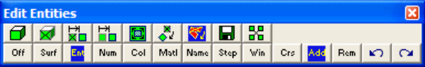

- Se Tools > Shift-key Selection estiver marcada, você deve manter pressionada a tecla Shift para fazer seleções múltiplas.

- Por padrão, as entidades selecionadas são adicionadas à lista; porém, se a tecla Ctrl for mantida pressionada, as entidades selecionadas serão removidas da lista.

- Enquanto mantém pressionada a tecla Shift ou Ctrl, você pode arrastar para abrir uma janela de interseção.

- O uso desta barra de ferramentas é detalhado em Build A List of Entities for Editing

- Pressionar a barra de espaço ativa automaticamente a última função de edição usada.

- Manter a tecla Alt pressionada ao clicar com o botão direito repete automaticamente a última função de edição usada.

Depois de selecionar as entidades desejadas, você pode escolher qualquer um dos botões de edição:

CAD > Edit > Entity Properties Edit block type, colour, mining sequence, CAD > Edit > Erase Entities Erase selected entities, CAD > Edit > Move Entities Move selected entities, CAD > Edit > Copy Entities Copy selected entities, CAD > Edit > Scale Entities Scale selected entities, CAD > Edit > Rotate Azimuth Rotate the azimuth of selected entities, CAD > Edit > Rotate Dip Rotate the dip of selected entities,

CAD > Edit > Slice Entities Slice selected entities,

CAD > Edit > Dump to File Dump selected entities to a file, CAD > Edit > Group Group selected entities into a single block,

- clicar duas vezes em qualquer vértice para executar a função destacada,

- clicar com o botão direito para ver uma lista de opções.

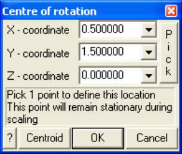

X, Y and Z – coordinates especificam as coordenadas do centro de rotação.

Pick - ativa a cruz do cursor para selecionar de forma interativa o centro de rotação a partir do modelo.

Para ajudar a selecionar visualmente pontos do modelo, todas as funções de snap estão disponíveis.

#### CAD > Snap

Depois de selecionadas, as componentes do centro de escalonamento são exibidas na caixa de diálogo.

Centroid - calcula o centro de todas as entidades selecionadas.

OK - conclui a edição das coordenadas e solicita os fatores de escala.

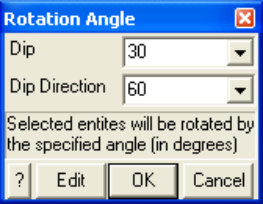

Dip - especifica o ângulo (em graus) pelo qual você quer girar as entidades selecionadas.

Dip Direction - especifica o azimute (em graus) em que o mergulho deve ocorrer. A direção de mergulho está a 90° da direção do plano de mergulho.

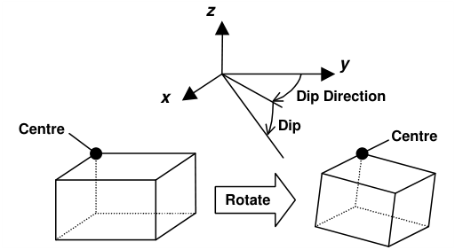

Edit - conclui a edição e chama a edição das propriedades de entidade dos blocos selecionados.

OK - conclui a edição do mergulho e da direção de mergulho e gira as entidades selecionadas.

Cancel - aborta a rotação de entidades.

Depois de concluída qualquer operação de edição, você tem uma chance de desfazer as modificações selecionando

#### Undo

Você também pode restaurar o mesmo conjunto de seleção e modificar novamente o mesmo conjunto de entidades selecionando

#### Redo

Você pode ajustar o tempo de clique duplo usando

#### Tools > Double Click Time

## 5.5.4.8 Seccionar entidades

Secciona entidades.

Todas as entidades podem ser seccionadas, incluindo blocos FF, planos DD, planos de grade, linhas de grade e linhas de construção.

Video Demo of Model_Simplification_Using_Slicing

Esta rotina pode ser iniciada clicando no botão ou simplesmente clicando com o botão direito em qualquer entidade. Ao iniciar esta rotina, você será primeiro solicitado a montar uma lista das entidades que deseja editar

- Se Tools > Shift-key Selection estiver marcada, você deve manter pressionada a tecla Shift para fazer seleções múltiplas.

- Por padrão, as entidades selecionadas são adicionadas à lista; porém, se a tecla Ctrl for mantida pressionada, as entidades selecionadas serão removidas da lista.

- Enquanto mantém pressionada a tecla Shift ou Ctrl, você pode arrastar para abrir uma janela de interseção.

- O uso desta barra de ferramentas é detalhado em Build A List of Entities for Editing

- Pressionar a barra de espaço ativa automaticamente a última função de edição usada.

- Manter a tecla Alt pressionada ao clicar com o botão direito repete automaticamente a última função de edição usada.

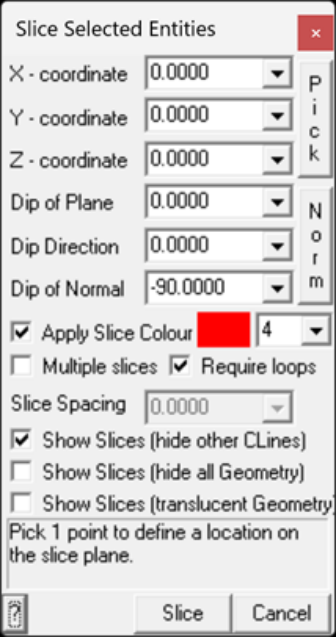

X, Y and Z – coordinate especificam um ponto do plano de seção/corte.

Pick - ativa a cruz do cursor para selecionar o ponto de forma interativa.

Dip of Plane, Dip Direction and Normal - especificam a orientação do plano de seção/corte.

Norm - ativa o cursor para selecionar de forma interativa uma superfície à qual tornar o plano de seção paralelo. O mergulho e a direção de mergulho do plano serão definidos normais à superfície selecionada.

Apply Slice Colour - quando marcada, especifica o número de cor a ser atribuído às CLines criadas durante a seção; caso contrário, será usada a cor do objeto seccionado.

Multiple Slices - especifica que várias seções devem ser criadas no espaçamento de seção indicado.

Require Loops - as seções podem ser linhas simples ou, opcionalmente, formar laços fechados.

Slice Spacing - especifica o espaçamento opcional para várias seções.

Show Slices (hide other CLines) - ocultará automaticamente todas as CLines preexistentes e exibirá as seções de CLine recém-criadas.

Slice Spacing (hide all Geometry) - ocultará automaticamente toda a geometria preexistente e exibirá as seções de CLine recém-criadas.

Slice Spacing (translucent Geometry) - definirá automaticamente toda a geometria preexistente como translúcida e exibirá as seções de CLine recém-criadas.

- Há várias opções de "View > Hide" disponíveis para controlar a exibição das diversas entidades, incluindo:

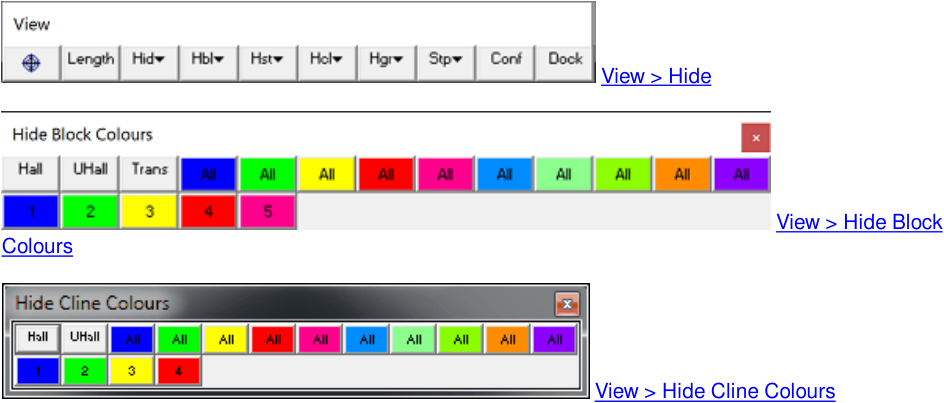

Para ajudar a selecionar visualmente pontos do modelo, todas as funções de snap estão disponíveis.

#### CAD > Snap

Depois de selecionadas, as componentes do vetor de deslocamento são exibidas na caixa de diálogo.

Slice - executa a operação de seção/corte para os blocos selecionados.

Cancel - aborta a seção de entidades.

Depois de concluída qualquer operação de edição, você tem uma chance de desfazer as modificações selecionando

Undo

Você também pode restaurar o mesmo conjunto de seleção e modificar novamente o mesmo conjunto de entidades selecionando

Redo

Você pode ajustar o tempo de clique duplo usando

Tools > Double Click Time

## 5.5.4.9 Exportar para arquivo

Exporta as entidades selecionadas para um arquivo.

Esta rotina pode ser iniciada clicando no botão ou simplesmente clicando com o botão direito em qualquer entidade. Ao iniciar esta rotina, você será primeiro solicitado a montar uma lista das entidades que deseja exportar

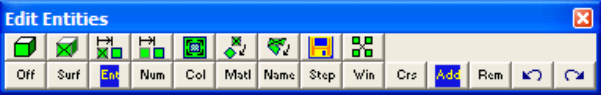

- Se Tools > Shift-key Selection estiver marcada, você deve manter pressionada a tecla Shift para fazer seleções múltiplas.

- Por padrão, as entidades selecionadas são adicionadas à lista; porém, se a tecla Ctrl for mantida pressionada, as entidades selecionadas serão removidas da lista.

- Enquanto mantém pressionada a tecla Shift ou Ctrl, você pode arrastar para abrir uma janela de interseção.

- O uso desta barra de ferramentas é detalhado em Build A List of Entities for Editing

- Pressionar a barra de espaço ativa automaticamente a última função de edição usada.

- Manter a tecla Alt pressionada ao clicar com o botão direito repete automaticamente a última função de edição usada.

Depois de selecionar as entidades desejadas, você pode escolher qualquer um dos botões de edição:

CAD > Edit > Entity Properties Edit block type, colour, mining sequence, CAD > Edit > Erase Entities Erase selected entities, CAD > Edit > Move Entities Move selected entities, CAD > Edit > Copy Entities Copy selected entities, CAD > Edit > Scale Entities Scale selected entities, CAD > Edit > Rotate Azimuth Rotate the azimuth of selected entities, CAD > Edit > Rotate Dip Rotate the dip of selected entities, CAD > Edit > Dump to File Dump selected entities to a file,

CAD > Edit > Group Group selected entities into a single block,

- clicar duas vezes em qualquer vértice para executar a função destacada,

- clicar com o botão direito para ver uma lista de opções.

Você pode ajustar o tempo de clique duplo usando

Tools > Double Click Time

## 5.5.4.10 Agrupar entidades

Agrupa as entidades selecionadas em um único bloco. Esta é uma opção avançada que só deve ser usada por usuários experientes.

Às vezes pode ser necessário apagar ou construir superfícies individuais e depois agrupá-las para formar um único bloco. Esta função agrupa entidades para formar um bloco fechado contínuo a partir de superfícies individuais. Observe que, ao usar esta operação, o usuário deve garantir que as superfícies agrupadas formem um envelope fechado e contínuo, sem superfícies internas. A presença de superfícies internas pode causar erros.

A função de agrupar foi implementada para permitir que usuários avançados apaguem alguns elementos de superfície e os reconstruam. Também é útil para unir superfícies trazidas de pacotes CAD. Observe que o usuário deve garantir que não haja superfícies internas e que as superfícies agrupadas formem de fato um envelope fechado e contínuo.

Esta rotina pode ser iniciada clicando no botão ou simplesmente clicando com o botão direito em qualquer entidade. Ao iniciar esta rotina, você será primeiro solicitado a montar uma lista das entidades que deseja agrupar

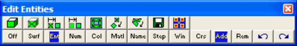

- Se Tools > Shift-key Selection estiver marcada, você deve manter pressionada a tecla Shift para fazer seleções múltiplas.

- Por padrão, as entidades selecionadas são adicionadas à lista; porém, se a tecla Ctrl for mantida pressionada, as entidades selecionadas serão removidas da lista.

- Enquanto mantém pressionada a tecla Shift ou Ctrl, você pode arrastar para abrir uma janela de interseção.

- O uso desta barra de ferramentas é detalhado em Build A List of Entities for Editing

- Pressionar a barra de espaço ativa automaticamente a última função de edição usada.

- Manter a tecla Alt pressionada ao clicar com o botão direito repete automaticamente a última função de edição usada.

Depois de selecionar as entidades desejadas, você pode escolher qualquer um dos botões de edição:

CAD > Edit > Entity Properties Edit block type, colour, mining sequence, CAD > Edit > Erase Entities Erase selected entities, CAD > Edit > Move Entities Move selected entities, CAD > Edit > Copy Entities Copy selected entities, CAD > Edit > Scale Entities Scale selected entities, CAD > Edit > Rotate Azimuth Rotate the azimuth of selected entities, CAD > Edit > Rotate Dip Rotate the dip of selected entities,

CAD > Edit > Dump to File Dump selected entities to a file,

CAD > Edit > Group Group selected entities into a single block,

- clicar duas vezes em qualquer vértice para executar a função destacada,

- clicar com o botão direito para ver uma lista de opções.

Se algum dos campos da caixa de diálogo indicar "Variable", é porque algumas das superfícies selecionadas têm propriedades diferentes nesse campo. Para agrupar as entidades selecionadas em um único bloco, todas as superfícies devem ter as mesmas configurações em todos os campos. Use CAD > Edit > Entity Properties para isso.

Depois de concluída qualquer operação de edição, você tem uma chance de desfazer as modificações selecionando

#### Undo

Você também pode restaurar o mesmo conjunto de seleção e modificar novamente o mesmo conjunto de entidades selecionando

#### Redo

Você pode ajustar o tempo de clique duplo usando

#### Tools > Double Click Time

## 5.5.4.11 Esticar vértices

Adiciona um deslocamento aos vértices selecionados.

Esta rotina pode ser iniciada clicando no botão ou simplesmente clicando com o botão direito em qualquer vértice. Ao iniciar esta rotina, você será primeiro solicitado a montar uma lista dos vértices que deseja esticar

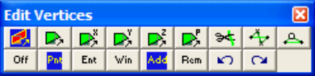

- Se Tools > Shift-key Selection estiver marcada, você deve manter pressionada a tecla Shift para fazer seleções múltiplas.

- Por padrão, as entidades selecionadas são adicionadas à lista; porém, se a tecla Ctrl for mantida pressionada, as entidades selecionadas serão removidas da lista.

- Enquanto mantém pressionada a tecla Shift ou Ctrl, você pode arrastar para abrir uma janela de interseção.

- O uso desta barra de ferramentas é detalhado em Build A List of Vertices for Editing

- Pressionar a barra de espaço ativa automaticamente a última função de edição usada.

- Manter a tecla Alt pressionada ao clicar com o botão direito repete automaticamente a última função de edição usada.

Depois de selecionar as entidades desejadas, você pode escolher qualquer um dos botões de edição:

CAD > Edit > Stretch Vertices CAD > Edit > Move Vertices to Point CAD > Edit > Move Vertices to X CAD > Edit > Move Vertices to Y CAD > Edit > Move Vertices to Z CAD > Edit > Move Vertices to Plane CAD > Edit > Subdivide Construction Lines CAD > Edit > Smooth Construction Lines CAD > Edit > Remove Construction Vertex

- clicar duas vezes em qualquer vértice para executar a função destacada,

- clicar com o botão direito para ver uma lista de opções.

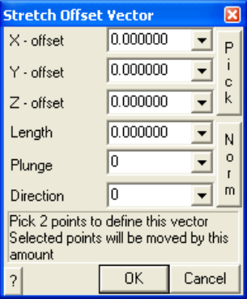

X, Y and Z – offset especificam as componentes do vetor de estiramento.

- Todos os vértices selecionados serão movidos para o local especificado por esse deslocamento.

- Isso requer selecionar dois pontos para definir esse vetor.

- Depois de selecionadas, as componentes do vetor de deslocamento são exibidas na caixa de diálogo.

Pick ativa a cruz do cursor para selecionar de forma interativa o vetor de deslocamento a partir do modelo. Isso requer selecionar dois pontos para definir esse vetor.

Length, Plunge and Direction - especificam as componentes do vetor de deslocamento. Todos os vértices selecionados serão movidos por essa quantidade.

Norm - ativa o cursor para selecionar de forma interativa uma superfície à qual tornar o vetor de deslocamento normal.

Para ajudar a selecionar visualmente pontos do modelo, todas as funções de snap estão disponíveis.

#### CAD > Snap

Depois de selecionadas, as componentes do vetor de deslocamento são exibidas na caixa de diálogo.

OK - conclui a edição do vetor de deslocamento e estica os vértices selecionados.

Cancel - aborta o estiramento de vértices.

Depois de concluída qualquer operação de edição, você tem uma chance de desfazer as modificações selecionando

#### Undo

Você também pode restaurar o mesmo conjunto de seleção e modificar novamente o mesmo conjunto de entidades selecionando

#### Redo

Você pode ajustar o tempo de clique duplo usando

#### Tools > Double Click Time

## 5.5.4.12 Mover vértices para um ponto

Move os vértices selecionados para um ponto.

Esta rotina pode ser iniciada clicando no botão ou simplesmente clicando com o botão direito em qualquer vértice. Ao iniciar esta rotina, você será primeiro solicitado a montar uma lista dos vértices que deseja mover.

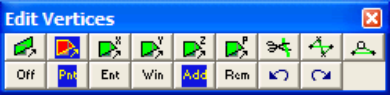

- Se Tools > Shift-key Selection estiver marcada, você deve manter pressionada a tecla Shift para fazer seleções múltiplas.

- Por padrão, as entidades selecionadas são adicionadas à lista; porém, se a tecla Ctrl for mantida pressionada, as entidades selecionadas serão removidas da lista.

- Enquanto mantém pressionada a tecla Shift ou Ctrl, você pode arrastar para abrir uma janela de interseção.

- O uso desta barra de ferramentas é detalhado em Build A List of Vertices for Editing

- Pressionar a barra de espaço ativa automaticamente a última função de edição usada.

- Manter a tecla Alt pressionada ao clicar com o botão direito repete automaticamente a última função de edição usada.

Depois de selecionar as entidades desejadas, você pode escolher qualquer um dos botões de edição:

CAD > Edit > Stretch Vertices CAD > Edit > Move Vertices to Point CAD > Edit > Move Vertices to X CAD > Edit > Move Vertices to Y CAD > Edit > Move Vertices to Z CAD > Edit > Move Vertices to Plane CAD > Edit > Subdivide Construction Lines CAD > Edit > Smooth Construction Lines CAD > Edit > Remove Construction Vertex

- clicar duas vezes em qualquer vértice para executar a função destacada,

- clicar com o botão direito para ver uma lista de opções.

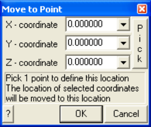

X, Y and Z – coordinate especificam as coordenadas do ponto. Todos os vértices selecionados serão movidos para esse ponto.

Pick - ativa a cruz do cursor para selecionar de forma interativa o ponto a partir do modelo.

Para ajudar a selecionar visualmente pontos do modelo, todas as funções de snap estão disponíveis.

#### CAD > Snap

Depois de selecionadas, as componentes do vetor de deslocamento são exibidas na caixa de diálogo.

OK - conclui a edição do vetor de deslocamento e estica os vértices selecionados.

Cancel - aborta o estiramento de vértices.

Depois de concluída qualquer operação de edição, você tem uma chance de desfazer as modificações selecionando

#### Undo

Você também pode restaurar o mesmo conjunto de seleção e modificar novamente o mesmo conjunto de entidades selecionando

Redo

Você pode ajustar o tempo de clique duplo usando

#### Tools > Double Click Time

## 5.5.4.13 Mover vértices para X

Move a coordenada X dos vértices selecionados.

Esta rotina pode ser iniciada clicando no botão ou simplesmente clicando com o botão direito em qualquer vértice. Ao iniciar esta rotina, você será primeiro solicitado a montar uma lista dos vértices que deseja mover.

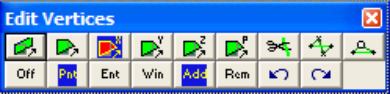

- Se Tools > Shift-key Selection estiver marcada, você deve manter pressionada a tecla Shift para fazer seleções múltiplas.

- Por padrão, as entidades selecionadas são adicionadas à lista; porém, se a tecla Ctrl for mantida pressionada, as entidades selecionadas serão removidas da lista.

- Enquanto mantém pressionada a tecla Shift ou Ctrl, você pode arrastar para abrir uma janela de interseção.

- O uso desta barra de ferramentas é detalhado em Build A List of Vertices for Editing

- Pressionar a barra de espaço ativa automaticamente a última função de edição usada.

- Manter a tecla Alt pressionada ao clicar com o botão direito repete automaticamente a última função de edição usada.

Depois de selecionar as entidades desejadas, você pode escolher qualquer um dos botões de edição:

CAD > Edit > Stretch Vertices CAD > Edit > Move Vertices to Point CAD > Edit > Move Vertices to X CAD > Edit > Move Vertices to Y CAD > Edit > Move Vertices to Z

CAD > Edit > Move Vertices to Plane

CAD > Edit > Subdivide Construction Lines CAD > Edit > Smooth Construction Lines

CAD > Edit > Remove Construction Vertex

- clicar duas vezes em qualquer vértice para executar a função destacada,

- clicar com o botão direito para ver uma lista de opções.

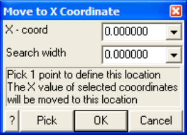

X – coordinate especifica a coordenada X do ponto. A coordenada X de todos os vértices selecionados (ou seja, os vértices da lista) será movida para esse valor.

Search width todas as coordenadas que estejam a uma distância igual à largura de busca do valor de coordenada x especificado serão movidas, mesmo que não estejam na lista.

Pick ativa a cruz do cursor para selecionar de forma interativa o ponto a partir do modelo. Para ajudar a selecionar visualmente pontos do modelo, todas as funções de snap estão disponíveis

Para ajudar a selecionar visualmente pontos do modelo, todas as funções de snap estão disponíveis.

#### CAD > Snap

Depois de selecionadas, as componentes do vetor de deslocamento são exibidas na caixa de diálogo.

OK - conclui a edição do vetor de deslocamento e estica os vértices selecionados.

Cancel - aborta o estiramento de vértices.

Depois de concluída qualquer operação de edição, você tem uma chance de desfazer as modificações selecionando

#### Undo

Você também pode restaurar o mesmo conjunto de seleção e modificar novamente o mesmo conjunto de entidades selecionando

#### Redo

Você pode ajustar o tempo de clique duplo usando

#### Tools > Double Click Time

## 5.5.4.14 Mover vértices para Y

Move a coordenada Y dos vértices selecionados.

Esta rotina pode ser iniciada clicando no botão ou simplesmente clicando com o botão direito em qualquer vértice. Ao iniciar esta rotina, você será primeiro solicitado a montar uma lista dos vértices que deseja mover.

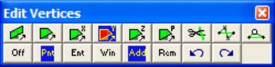

- Se Tools > Shift-key Selection estiver marcada, você deve manter pressionada a tecla Shift para fazer seleções múltiplas.

- Por padrão, as entidades selecionadas são adicionadas à lista; porém, se a tecla Ctrl for mantida pressionada, as entidades selecionadas serão removidas da lista.

- Enquanto mantém pressionada a tecla Shift ou Ctrl, você pode arrastar para abrir uma janela de interseção.

- O uso desta barra de ferramentas é detalhado em Build A List of Vertices for Editing

- Pressionar a barra de espaço ativa automaticamente a última função de edição usada.

- Manter a tecla Alt pressionada ao clicar com o botão direito repete automaticamente a última função de edição usada.

Depois de selecionar as entidades desejadas, você pode escolher qualquer um dos botões de edição:

CAD > Edit > Stretch Vertices CAD > Edit > Move Vertices to Point CAD > Edit > Move Vertices to X CAD > Edit > Move Vertices to Y CAD > Edit > Move Vertices to Z CAD > Edit > Move Vertices to Plane CAD > Edit > Subdivide Construction Lines CAD > Edit > Smooth Construction Lines CAD > Edit > Remove Construction Vertex

- clicar duas vezes em qualquer vértice para executar a função destacada,

- clicar com o botão direito para ver uma lista de opções.

Y – coordinate especifica a coordenada Y do ponto. A coordenada Y de todos os vértices selecionados (ou seja, os vértices da lista) será movida para esse valor.

Search width todas as coordenadas que estejam a uma distância igual à largura de busca do valor de coordenada y especificado serão movidas, mesmo que não estejam na lista.

Pick ativa a cruz do cursor para selecionar de forma interativa o ponto a partir do modelo. Para ajudar a selecionar visualmente pontos do modelo, todas as funções de snap estão disponíveis

Para ajudar a selecionar visualmente pontos do modelo, todas as funções de snap estão disponíveis.

#### CAD > Snap

Depois de selecionadas, as componentes do vetor de deslocamento são exibidas na caixa de diálogo.

OK - conclui a edição do vetor de deslocamento e estica os vértices selecionados.

Cancel - aborta o estiramento de vértices.

Depois de concluída qualquer operação de edição, você tem uma chance de desfazer as modificações selecionando

#### Undo

Você também pode restaurar o mesmo conjunto de seleção e modificar novamente o mesmo conjunto de entidades selecionando

Redo

Você pode ajustar o tempo de clique duplo usando

Tools > Double Click Time

## 5.5.4.15 Mover vértices para Z

Move a coordenada Z dos vértices selecionados.

Esta rotina pode ser iniciada clicando no botão ou simplesmente clicando com o botão direito em qualquer vértice. Ao iniciar esta rotina, você será primeiro solicitado a montar uma lista dos vértices que deseja mover.

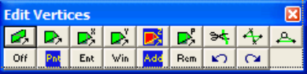

- Se Tools > Shift-key Selection estiver marcada, você deve manter pressionada a tecla Shift para fazer seleções múltiplas.

- Por padrão, as entidades selecionadas são adicionadas à lista; porém, se a tecla Ctrl for mantida pressionada, as entidades selecionadas serão removidas da lista.

- Enquanto mantém pressionada a tecla Shift ou Ctrl, você pode arrastar para abrir uma janela de interseção.

- O uso desta barra de ferramentas é detalhado em Build A List of Vertices for Editing

- Pressionar a barra de espaço ativa automaticamente a última função de edição usada.

- Manter a tecla Alt pressionada ao clicar com o botão direito repete automaticamente a última função de edição usada.

Depois de selecionar as entidades desejadas, você pode escolher qualquer um dos botões de edição:

CAD > Edit > Stretch Vertices CAD > Edit > Move Vertices to Point CAD > Edit > Move Vertices to X CAD > Edit > Move Vertices to Y

CAD > Edit > Move Vertices to Z

CAD > Edit > Move Vertices to Plane

CAD > Edit > Subdivide Construction Lines

CAD > Edit > Smooth Construction Lines

CAD > Edit > Remove Construction Vertex

- clicar duas vezes em qualquer vértice para executar a função destacada,

- clicar com o botão direito para ver uma lista de opções.

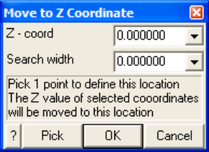

Z – coordinate especifica a coordenada Z do ponto. A coordenada Z de todos os vértices selecionados (ou seja, os vértices da lista) será movida para esse valor.

Search width todas as coordenadas que estejam a uma distância igual à largura de busca do valor de coordenada z especificado serão movidas, mesmo que não estejam na lista.

Pick ativa a cruz do cursor para selecionar de forma interativa o ponto a partir do modelo. Para ajudar a selecionar visualmente pontos do modelo, todas as funções de snap estão disponíveis

Para ajudar a selecionar visualmente pontos do modelo, todas as funções de snap estão disponíveis.

#### CAD > Snap

Depois de selecionadas, as componentes do vetor de deslocamento são exibidas na caixa de diálogo.

OK - conclui a edição do vetor de deslocamento e estica os vértices selecionados.

Cancel - aborta o estiramento de vértices.

Depois de concluída qualquer operação de edição, você tem uma chance de desfazer as modificações selecionando

#### Undo

Você também pode restaurar o mesmo conjunto de seleção e modificar novamente o mesmo conjunto de entidades selecionando

#### Redo

Você pode ajustar o tempo de clique duplo usando

#### Tools > Double Click Time

## 5.5.4.16 Mover vértices para um plano

Move os vértices selecionados para um plano. Os vértices são movidos na direção normal ao plano (ou em uma direção especificada pelo usuário).

Esta rotina pode ser iniciada clicando no botão ou simplesmente clicando com o botão direito em qualquer vértice. Ao iniciar esta rotina, você será primeiro solicitado a montar uma lista dos vértices que deseja mover.

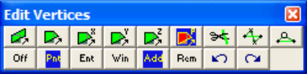

- Se Tools > Shift-key Selection estiver marcada, você deve manter pressionada a tecla Shift para fazer seleções múltiplas.

- Por padrão, as entidades selecionadas são adicionadas à lista; porém, se a tecla Ctrl for mantida pressionada, as entidades selecionadas serão removidas da lista.

- Enquanto mantém pressionada a tecla Shift ou Ctrl, você pode arrastar para abrir uma janela de interseção.

- O uso desta barra de ferramentas é detalhado em Build A List of Vertices for Editing

- Pressionar a barra de espaço ativa automaticamente a última função de edição usada.

- Manter a tecla Alt pressionada ao clicar com o botão direito repete automaticamente a última função de edição usada.

Depois de selecionar as entidades desejadas, você pode escolher qualquer um dos botões de edição:

CAD > Edit > Stretch Vertices CAD > Edit > Move Vertices to Point CAD > Edit > Move Vertices to X CAD > Edit > Move Vertices to Y CAD > Edit > Move Vertices to Z CAD > Edit > Move Vertices to Plane CAD > Edit > Subdivide Construction Lines CAD > Edit > Smooth Construction Lines CAD > Edit > Remove Construction Vertex

- clicar duas vezes em qualquer vértice para executar a função destacada,

- clicar com o botão direito para ver uma lista de opções.

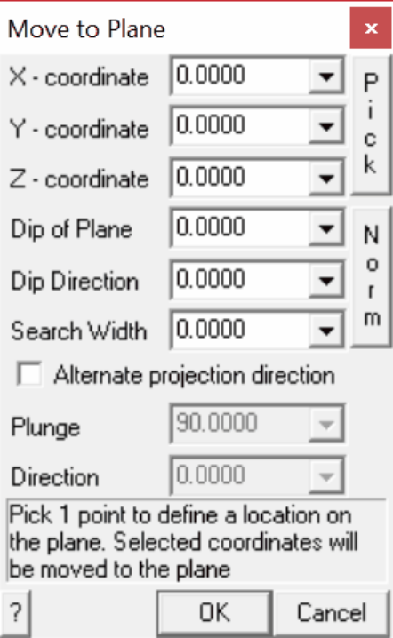

X Y Z – coordinate especificam as coordenadas de qualquer ponto do plano.

Pick ativa a cruz do cursor para selecionar de forma interativa, a partir do modelo, as coordenadas x y z do ponto do plano. Para ajudar a selecionar visualmente pontos do modelo, todas as funções de snap estão disponíveis

Dip of Plane especifica o mergulho do plano (positivo para baixo, em graus).

Dip Direction especifica o azimute do vetor de mergulho (graus).

Norm - ativa o cursor para selecionar de forma interativa uma superfície à qual tornar o plano paralelo. O mergulho e a direção de mergulho do plano serão definidos normais à superfície selecionada.

Search width todas as coordenadas que estejam a uma distância igual à largura de busca do plano especificado serão movidas, mesmo que não estejam na lista.

Alternate projection direction - se não estiver marcada, todos os pontos serão projetados no plano selecionado na direção normal ao plano. Se estiver marcada, o usuário pode especificar a direção de projeção desejada.

Plunge - direção de projeção especificada pelo usuário.

Direction - direção de projeção especificada pelo usuário.

Para ajudar a selecionar visualmente pontos do modelo, todas as funções de snap estão disponíveis.

#### CAD > Snap

Depois de selecionadas, as componentes do vetor de deslocamento são exibidas na caixa de diálogo.

OK - conclui a edição do vetor de deslocamento e estica os vértices selecionados.

Cancel - aborta o estiramento de vértices.

Depois de concluída qualquer operação de edição, você tem uma chance de desfazer as modificações selecionando

#### Undo

Você também pode restaurar o mesmo conjunto de seleção e modificar novamente o mesmo conjunto de entidades selecionando

Redo

Você pode ajustar o tempo de clique duplo usando

Tools > Double Click Time

## 5.5.4.17 Subdividir arestas

#### CAD > Edit > Remove

Insere vértices em arestas de blocos ou de linhas de construção (veja também Construction Vertex).

Esta rotina pode ser iniciada clicando no botão ou simplesmente clicando com o botão direito em qualquer aresta. Ao iniciar esta rotina, você será primeiro solicitado a montar uma lista dos locais onde deseja inserir vértices.

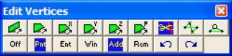

- Se Tools > Shift-key Selection estiver marcada, você deve manter pressionada a tecla Shift para fazer seleções múltiplas.

- Por padrão, as entidades selecionadas são adicionadas à lista; porém, se a tecla Ctrl for mantida pressionada, as entidades selecionadas serão removidas da lista.

- Enquanto mantém pressionada a tecla Shift ou Ctrl, você pode arrastar para abrir uma janela de interseção.

- O uso desta barra de ferramentas é detalhado em Build A List of Vertices for Editing

- Pressionar a barra de espaço ativa automaticamente a última função de edição usada.

- Manter a tecla Alt pressionada ao clicar com o botão direito repete automaticamente a última função de edição usada.

Depois de selecionar as entidades desejadas, você pode escolher qualquer um dos botões de edição:

CAD > Edit > Stretch Vertices CAD > Edit > Move Vertices to Point CAD > Edit > Move Vertices to X CAD > Edit > Move Vertices to Y

#### CAD > Edit > Move Vertices to Z

CAD > Edit > Move Vertices to Plane

CAD > Edit > Subdivide Construction Lines

CAD > Edit > Smooth Construction Lines

CAD > Edit > Remove Construction Vertex

- clicar duas vezes em qualquer vértice para executar a função destacada,

- clicar com o botão direito para ver uma lista de opções.

Depois de concluída qualquer operação de edição, você tem uma chance de desfazer as modificações selecionando

#### Undo

Você também pode restaurar o mesmo conjunto de seleção e modificar novamente o mesmo conjunto de entidades selecionando

#### Redo

Você pode ajustar o tempo de clique duplo usando

#### Tools > Double Click Time

Notas:

- A localização de todos os pontos ao longo das linhas de construção pode ser vista definindo o parâmetro View > Render > Cline dot radius.

- Antes de usar esta função de suavização de traçado, as linhas de construção devem ser limpas com a função CAD > Pack and Renumber Clines.

- Você pode ajustar o tempo de clique duplo usando Tools > Double Click Time.

## 5.5.4.18 Suavizar linhas de construção

Suaviza as linhas de construção eliminando vértices de esquina (veja também Construction Vertex).

#### CAD > Edit > Remove

Esta rotina pode ser iniciada clicando no botão ou simplesmente clicando com o botão direito em qualquer vértice. Ao iniciar esta rotina, você será primeiro solicitado a montar uma lista dos vértices que deseja suavizar.

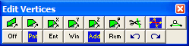

- Se Tools > Shift-key Selection estiver marcada, você deve manter pressionada a tecla Shift para fazer seleções múltiplas.

- Por padrão, as entidades selecionadas são adicionadas à lista; porém, se a tecla Ctrl for mantida pressionada, as entidades selecionadas serão removidas da lista.

- Enquanto mantém pressionada a tecla Shift ou Ctrl, você pode arrastar para abrir uma janela de interseção.

- O uso desta barra de ferramentas é detalhado em Build A List of Vertices for Editing

- Pressionar a barra de espaço ativa automaticamente a última função de edição usada.

- Manter a tecla Alt pressionada ao clicar com o botão direito repete automaticamente a última função de edição usada.

Depois de selecionar as entidades desejadas, você pode escolher qualquer um dos botões de edição:

CAD > Edit > Stretch Vertices

CAD > Edit > Move Vertices to Point CAD > Edit > Move Vertices to X CAD > Edit > Move Vertices to Y CAD > Edit > Move Vertices to Z CAD > Edit > Move Vertices to Plane CAD > Edit > Subdivide Construction Lines CAD > Edit > Smooth Construction Lines CAD > Edit > Remove Construction Vertex

- clicar duas vezes em qualquer vértice para executar a função destacada,

- clicar com o botão direito para ver uma lista de opções.

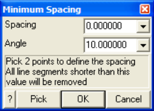

O valor de Spacing limita o espaço mínimo entre pontos. Por exemplo, se Spacing foi especificado como 2 m e o comprimento do traçado entre os pontos 4 e 5 na figura a seguir era de 1,5 m, o ponto 4 seria removido e substituído por uma linha reta entre os pontos 3 e 5.

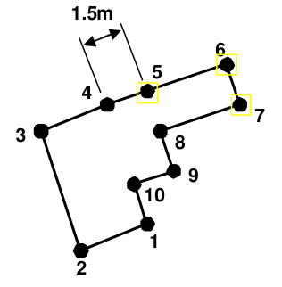

Um valor zero para este parâmetro indica que ele não será usado.

O valor de Angle limita o ângulo mínimo entre segmentos de linha sucessivos. Por exemplo, se Angle foi especificado como 10° e a direção do segmento de linha 3-4 diferia em 7° da direção do

segmento de linha 4-5 na figura a seguir, o ponto 4 seria removido e substituído por uma linha reta entre os pontos 3 e 5.

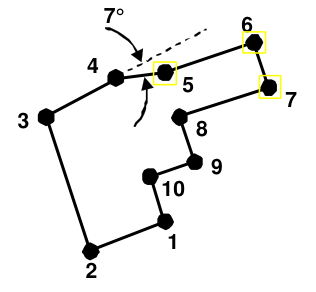

Um valor zero para este parâmetro indica que ele não será usado.

OK - conclui a edição do vetor de deslocamento e estica os vértices selecionados.

Cancel - aborta o estiramento de vértices.

Depois de concluída qualquer operação de edição, você tem uma chance de desfazer as modificações selecionando

#### Undo

Você também pode restaurar o mesmo conjunto de seleção e modificar novamente o mesmo conjunto de entidades selecionando

#### Redo

Você pode ajustar o tempo de clique duplo usando

#### Tools > Double Click Time

Notas:

- A localização de todos os pontos ao longo das linhas de construção pode ser vista definindo o parâmetro View > Render > Cline dot radius.

- Antes de usar esta função de suavização de traçado, as linhas de construção devem ser limpas com a função CAD > Pack and Renumber Clines.

- Você pode ajustar o tempo de clique duplo usando Tools > Double Click Time.

## 5.5.4.19 Remover vértice de linha de construção

Suaviza as linhas de construção eliminando vértices de esquina individuais (veja também Construction Lines).

#### CAD > Edit > Smooth

Esta rotina pode ser iniciada clicando no botão ou simplesmente clicando com o botão direito em qualquer vértice. Ao iniciar esta rotina, você será primeiro solicitado a montar uma lista dos vértices que deseja remover.

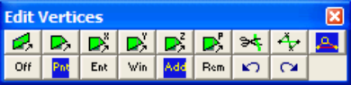

- Se Tools > Shift-key Selection estiver marcada, você deve manter pressionada a tecla Shift para fazer seleções múltiplas.

- Por padrão, as entidades selecionadas são adicionadas à lista; porém, se a tecla Ctrl for mantida pressionada, as entidades selecionadas serão removidas da lista.

- Enquanto mantém pressionada a tecla Shift ou Ctrl, você pode arrastar para abrir uma janela de interseção.

- O uso desta barra de ferramentas é detalhado em Build A List of Vertices for Editing

- Pressionar a barra de espaço ativa automaticamente a última função de edição usada.

- Manter a tecla Alt pressionada ao clicar com o botão direito repete automaticamente a última função de edição usada.

Depois de selecionar as entidades desejadas, você pode escolher qualquer um dos botões de edição:

CAD > Edit > Stretch Vertices CAD > Edit > Move Vertices to Point CAD > Edit > Move Vertices to X CAD > Edit > Move Vertices to Y CAD > Edit > Move Vertices to Z CAD > Edit > Move Vertices to Plane CAD > Edit > Subdivide Construction Lines CAD > Edit > Smooth Construction Lines CAD > Edit > Remove Construction Vertex

- clicar duas vezes em qualquer vértice para executar a função destacada,

- clicar com o botão direito para ver uma lista de opções.

Depois de concluída qualquer operação de edição, você tem uma chance de desfazer as modificações selecionando

#### Undo

Você também pode restaurar o mesmo conjunto de seleção e modificar novamente o mesmo conjunto de entidades selecionando

#### Redo

Você pode ajustar o tempo de clique duplo usando

#### Tools > Double Click Time

Notas:

- A localização de todos os pontos ao longo das linhas de construção pode ser vista definindo o parâmetro View > Render > Cline dot radius.

- Antes de usar esta função de suavização de traçado, as linhas de construção devem ser limpas com a função CAD > Pack and Renumber Clines.

- Você pode ajustar o tempo de clique duplo usando Tools > Double Click Time.
