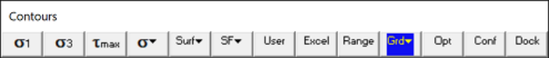
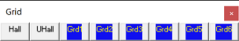
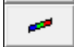

Seleciona uma grade de pontos de campo para visualização.

Essa rotina pode ser iniciada clicando no botão da barra de ferramentas de contornos

Essa barra de ferramentas pode ser colocada na orientação vertical arrastando-a contra a borda direita ou esquerda da janela principal.

Ela pode voltar à orientação horizontal arrastando-a contra a borda superior ou inferior da janela principal.

Os resultados da análise (tensões, deformações e deslocamentos) podem ser representados por contornos nas superfícies dos elementos e nas grades de pontos de campo.

Com o OpenGL ativado (Tools > OpenGL), todas as grades podem ser exibidas ao mesmo tempo. Sem o OpenGL, apenas duas grades podem ser exibidas ao mesmo tempo.

Hide All: oculta todas as grades.

Unhide All: exibe todas as grades.

O usuário pode construir vários planos de grade de pontos de campo com

CAD > Build > Grid Plane

CAD > Build > Grid Line

Se desejar, botões individuais de seleção de grade podem ser colocados na barra de ferramentas de visualização com

Tools > View Toolbar Configure
