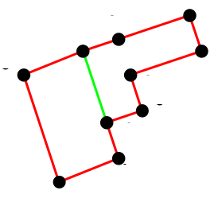

Compacta e renumera todas as linhas de construção.

Pontos de coordenadas muito próximos entre si são mesclados. Os vértices de linhas de construção que compartilham a mesma localização usarão o mesmo número de ponto de coordenadas e, portanto, se moverão juntos em qualquer operação de edição de coordenadas (Cad > Edit). Este recurso é útil para eliminar pequenas lacunas e sobreposições entre linhas de construção adjacentes.

Todos os segmentos de linhas de construção da mesma cor que puderem ser ligados serão unidos para formar linhas contínuas entre pontos de interseção.

**6**

Neste exemplo, serão formados 3 segmentos de linha, compostos pelos seguintes agrupamentos de pontos

- Segmento de linha 1:  10, 1, 2, 3, 4.

- Segmento de linha 2:  4, 5, 6, 7, 8, 9, 10.

- Segmento de linha 3:  4, 10.

Ao iniciar esta função, você será solicitado a especificar um raio de busca para a compactação

Radius: este valor é usado para mesclar pontos próximos entre si. Um valor zero para este parâmetro indica que ele não será usado; em vez disso, o Map3D mesclará pontos que estejam dentro de um raio de busca de 1/1000 do comprimento da aresta em relação à linha. Tenha extremo cuidado ao especificar um valor diferente de zero para este parâmetro, pois valores grandes podem causar mais problemas do que resolvem ao mesclar pontos demais.

Os números de coordenadas não usados são removidos da lista de coordenadas.

Esta função deve ser usada antes da função CAD > Edit > Smooth Construction lines.

Esta função deve ser usada antes da função CAD > Snap > Trace Cline Snap.

As linhas de construção podem ser descompactadas com a função CAD > Unpack Clines.
