## 5.5.2.1 Nenhum

Desativa o snap. Nenhuma caixa de seleção é exibida na interseção da cruz do cursor.

Os pontos serão selecionados no local indicado pela cruz do cursor. Este modo é útil para desenho à mão livre ou digitalização. Ao digitalizar, os três valores de coordenadas são obtidos em escala a partir do desenho. Já no desenho à mão livre, apenas duas das coordenadas podem ser localizadas e a terceira deve vir da base de snap

CAD > Snap > Cursor/Grid Base

Esta é a configuração recomendada durante a digitalização.

## 5.5.2.2 Aresta mais próxima

Captura a aresta mais próxima.

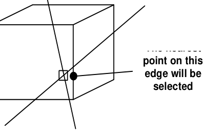

Se a caixa de seleção estiver sobre o canto de uma entidade, esse canto será selecionado.

Caso contrário, será selecionado o ponto mais próximo da aresta mais próxima.

A caixa de seleção deve estar sobre uma entidade ou linha de construção.

## 5.5.2.3 Canto mais próximo

Captura o canto mais próximo.

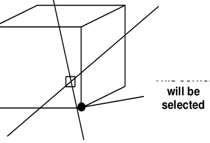

O canto mais próximo da caixa de seleção será selecionado.

A caixa de seleção deve estar sobre uma entidade ou linha de construção.

## 5.5.2.4 Superfície mais próxima

Captura sobre a superfície.

Se a caixa de seleção estiver sobre o canto de uma entidade, esse canto será selecionado.

Se a caixa de seleção estiver sobre uma aresta, será selecionado o ponto mais próximo dessa aresta.

Caso contrário, será selecionado o ponto mais próximo da superfície.

A caixa de seleção deve estar sobre uma entidade ou linha de construção.

## 5.5.2.5 Ponto médio da linha

Captura o ponto médio da aresta selecionada.

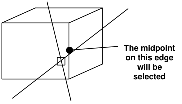

Se a caixa de seleção estiver sobre o canto de uma entidade, esse canto será selecionado.

Caso contrário, será selecionado o ponto médio da aresta mais próxima.

A caixa de seleção deve estar sobre uma entidade ou linha de construção.

## 5.5.2.6 Snap tangente

Força o cursor a ficar tangente à aresta selecionada.

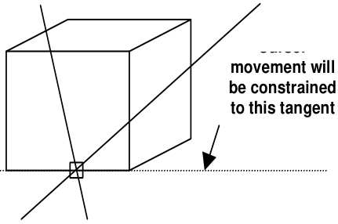

A aresta mais próxima da caixa de seleção será selecionada. A caixa de seleção deve estar sobre uma entidade ou linha de construção.

Depois de selecionada, todo movimento do cursor ficará restrito à tangente definida pela aresta selecionada. Agora é possível selecionar pontos em qualquer lugar ao longo dessa tangente.

Assim que um ponto é selecionado, o snap tangente é cancelado automaticamente. O snap tangente pode ser cancelado a qualquer momento pressionando a tecla Escape (Esc) ou clicando com o botão direito do mouse.

Para selecionar pontos em espaçamento regular ao longo da linha tangente, o snap tangente pode ser usado em conjunto com qualquer um dos seguintes:

CAD > Snap > Grid Snap Captura em uma grade retangular.

CAD > Snap > X-Gird Snap Captura na aresta selecionada em espaçamento regular de grade em X.

CAD > Snap > Y-Grid Snap Captura na aresta selecionada em espaçamento regular de grade em Y.

CAD > Snap > Z-Grid Snap Captura na aresta selecionada em espaçamento regular de grade em Z.

## 5.5.2.7 Snap de interseção

Captura a interseção da aresta selecionada com uma tangente.

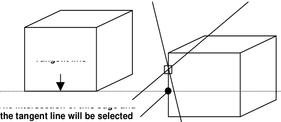

Como esta função opera em 3D completo, a tangente pode passar acima ou abaixo da aresta selecionada sem de fato cruzá-la. Nesse caso, será escolhido o ponto da aresta selecionada mais próximo da linha tangente.

Esta convenção deve ser enfatizada. O ponto de interseção não será selecionado na linha tangente: será selecionado na linha de interseção.

Usar este recurso é um processo de duas etapas. Ao clicar no botão Intersect Snap, você será solicitado da seguinte forma:

1. Primeiro, selecione uma linha tangente.

2. Depois, selecione a aresta com a qual deseja cruzar a tangente. O ponto será selecionado nesta linha.

A aresta mais próxima da caixa de seleção será selecionada.

A caixa de seleção deve estar sobre uma entidade ou linha de construção.

Esta função pode ser usada para localizar pontos na interseção da tangente com o prolongamento da aresta selecionada.

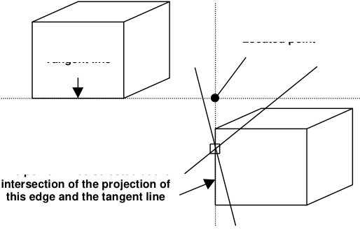

Assim que um ponto é selecionado, o snap de interseção é cancelado automaticamente. O snap de interseção pode ser cancelado a qualquer momento pressionando a tecla Escape (Esc) ou clicando com o botão direito do mouse.

Para um exemplo do uso do snap de interseção na construção de modelos, consulte

Tabular Mining

## 5.5.2.8 Snap de rastreamento de linha de construção

Captura cantos selecionados ao longo de um segmento de linha de construção. Este modo de snap pode ser usado como método rápido para construir DDLoops ( CAD > Build > DDLoop), FFLoops ( CAD > Build >

FFLoop), túneis ( CAD > Build > Tunnel e CAD > Build > GPlanes).

Para usar este modo de snap, basta selecionar os pontos inicial e final ao longo do segmento de linha de construção desejado e todos os pontos intermediários serão selecionados automaticamente. Por exemplo, se você selecionar os pontos 4 e 9, os pontos 5, 6, 7 e 8 serão selecionados automaticamente. Observe que, se você selecionar o mesmo ponto duas vezes, todo o laço será selecionado.

**6**

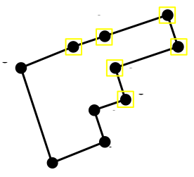

Notas:

A localização de todos os pontos ao longo das linhas de construção pode ser vista definindo o parâmetro View > Render > Cline dot radius.

Antes de usar este modo de snap de rastreamento, as linhas de construção devem ser limpas com a função CAD > Pack and Renumber Clines.

A função CAD > Edit > Smooth Construction Lines também pode ser usada para ajudar a limpar as linhas de construção.

## 5.5.2.9 Snap de rastreamento de laço de construção

Captura todos os cantos ao longo de um segmento de linha de construção. Este modo de snap pode ser usado como método rápido para construir DDLoops ( CAD > Build > DDLoop), FFLoops ( CAD > Build > FFLoop), túneis ( CAD > Build > Tunnel e CAD > Build > GPlanes).

Para usar este modo de snap, basta selecionar um único ponto do segmento de linha de construção desejado e todos os pontos dessa linha serão selecionados automaticamente. Por exemplo, se você selecionar o ponto 4, os pontos 5, 6, 7, 8, 1, 2 e 3 serão selecionados automaticamente.

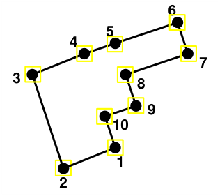

Notas:

A localização de todos os pontos ao longo das linhas de construção pode ser vista definindo o parâmetro View > Render > Cline dot radius.

Antes de usar este modo de snap de rastreamento, as linhas de construção devem ser limpas com a função CAD > Pack and Renumber Clines.

A função CAD > Edit > Smooth Construction Lines também pode ser usada para ajudar a limpar as linhas de construção.

## 5.5.2.10 Janela de pontos

Seleciona cantos usando uma janela.

Este modo de snap pode ser usado como método rápido para construir DDLoops ( CAD > Build > DDLoop), FFLoops ( CAD > Build > FFLoop), túneis ( CAD > Build > Tunnel), CLines ( CAD >

Build > CLines) e GLines ( CAD > Build > GLines).

Embora este modo de snap seja usado com mais frequência para selecionar vários pontos ao longo de CLines, os cantos podem estar localizados em todos os tipos de elementos, incluindo: elementos FF, elementos DD, GPlanes, GLines e CLines.

- Video Demo of FFLoop Model Building

- Video Demo of DDLoop model buiding

- Video Demo of Model_Simplification_Using_Slicing

Na figura acima, se você selecionar um ou mais pontos antes de selecionar uma janela, os pontos da janela serão adicionados aos pontos existentes, começando pelo ponto previamente selecionado mais próximo. Por exemplo, se você selecionasse o ponto 3 antes de selecionar uma janela e depois usasse uma janela incluindo os pontos 4, 5 e 6, esses pontos seriam adicionados nessa ordem.

Alternativamente, se você selecionasse o ponto 3 antes de selecionar uma janela e depois usasse uma janela incluindo os pontos 1, 2 e 10, esses pontos seriam adicionados na ordem 2, 1 e depois 10.

Na figura acima, se você não selecionar nenhum ponto antes de selecionar uma janela, os pontos da janela serão selecionados a partir de locais o mais distantes possível entre si.

Por exemplo, se você selecionasse uma janela sobre todos os pontos, como os pontos 2 e 6 são os mais distantes entre si, os pontos seriam selecionados como 2, 3, 4, 5, 6, 7, 8, 9, 10, 1, 2.

Como este exemplo forma um laço fechado, os pontos são selecionados dessa forma.

CAD > Build > DDLoop).

Isso forma um laço adequado para a construção de um DDLoop (

Na figura acima, se você selecionar o ponto 1 antes de selecionar uma janela e depois usar uma janela incluindo todos os pontos, todos os pontos serão selecionados como mostrado: 1, 2, 3, 4, 5, 6, 7, 8, 9, 10, 11, 1, 12, 13, 14, 15, 16, 17, 18, 19, 20, 21, 22, 12.

Isso forma dois laços adequados para a construção de um FFLoop ( CAD > Build > FFLoop). Alternativamente, se você selecionasse o ponto 3 antes de selecionar uma janela e depois usasse uma janela incluindo os pontos 1, 2 e 10, esses pontos seriam adicionados na ordem 2, 1 e depois 10.

Notas:

A localização de todos os pontos ao longo das linhas de construção pode ser vista definindo o parâmetro View > Render > Cline dot radius.

Antes de usar este modo de snap de rastreamento, as linhas de construção devem ser limpas com a função CAD > Pack and Renumber Clines.

A função CAD > Edit > Smooth Construction Lines também pode ser usada para ajudar a limpar as linhas de construção.

## 5.5.2.11 Snap em grade retangular

Captura em uma grade retangular. Nenhuma caixa de seleção é exibida na interseção da cruz do cursor.

Todo movimento do cursor ficará restrito aos pontos da grade.

A grade pode ser orientada nos planos X-Y, Y-Z ou X-Z, com qualquer espaçamento e localização desejados. Para configurar esses parâmetros, use

CAD > Snap > Cursor/Grid Setup configura o espaçamento e a orientação do cursor/grade.

Para um exemplo do uso do modo de snap em grade na construção de modelos, consulte

Freehand Sketching - Room and Pillar.

## 5.5.2.12 Snap em grade circular

Captura em uma grade cilíndrica. Nenhuma caixa de seleção é exibida na interseção da cruz do cursor.

Todo movimento do cursor ficará restrito aos pontos da grade.

A grade pode ser orientada nos planos X-Y, Y-Z ou X-Z, com qualquer espaçamento e localização desejados. Para configurar esses parâmetros, use

CAD > Snap > Cursor/Grid Setup configura o espaçamento e a orientação do cursor/grade.

## 5.5.2.13 Snap em grade X

Captura em um espaçamento de grade em x.

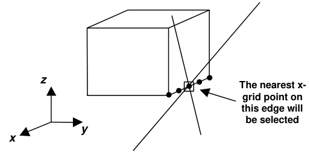

Se a caixa de seleção estiver sobre o canto de uma entidade, esse canto será selecionado.

Caso contrário, será selecionado o ponto mais próximo, no espaçamento de grade em x, da aresta mais próxima.

A caixa de seleção deve estar sobre uma entidade ou linha de construção.

Como os valores da coordenada x ficam restritos ao espaçamento de grade X prescrito, os valores das coordenadas y e z são calculados a partir da equação da linha selecionada.

O espaçamento e a localização da grade são definidos clicando uma segunda vez no botão X-Grid Snap ou usando

CAD > Snap > Cursor/Grid Setup configura o espaçamento e a orientação do cursor/grade.

O snap em grade X pode ser usado em conjunto com qualquer um dos seguintes:

CAD > Snap > None Desativa o snap.

CAD > Snap > Edge Captura a aresta mais próxima.

CAD > Snap > Tangent Snap Força o cursor a ficar tangente à aresta selecionada.

## 5.5.2.14 Snap em grade Y

Captura em um espaçamento de grade em y.

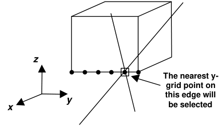

Se a caixa de seleção estiver sobre o canto de uma entidade, esse canto será selecionado.

Caso contrário, será selecionado o ponto mais próximo, no espaçamento de grade em y, da aresta mais próxima.

A caixa de seleção deve estar sobre uma entidade ou linha de construção.

Como os valores da coordenada y ficam restritos ao espaçamento de grade em y prescrito, os valores das coordenadas x e z são calculados a partir da equação da linha selecionada.

O espaçamento e a localização da grade são definidos clicando uma segunda vez no botão Y-Grid Snap ou usando

CAD > Snap > Cursor/Grid Setup configura o espaçamento e a orientação do cursor/grade.

O snap em grade Y pode ser usado em conjunto com qualquer um dos seguintes:

CAD > Snap > None Desativa o snap.

CAD > Snap > Edge Captura a aresta mais próxima.

CAD > Snap > Tangent Snap Força o cursor a ficar tangente à aresta selecionada.

## 5.5.2.15 Snap em grade Z

Captura em um espaçamento de grade em z.

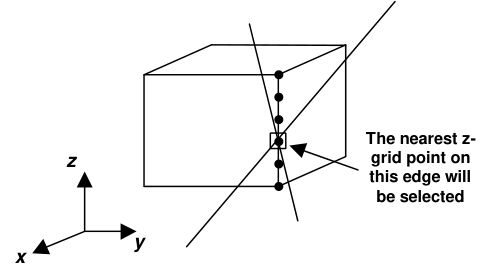

Se a caixa de seleção estiver sobre o canto de uma entidade, esse canto será selecionado.

Caso contrário, será selecionado o ponto mais próximo, no espaçamento de grade em y, da aresta mais próxima.

A caixa de seleção deve estar sobre uma entidade ou linha de construção.

Como os valores da coordenada z ficam restritos ao espaçamento de grade Z prescrito, os valores das coordenadas x e y são calculados a partir da equação da linha selecionada.

O espaçamento e a localização da grade são definidos clicando uma segunda vez no botão Z-Grid Snap ou usando

CAD > Snap > Cursor/Grid Setup configura o espaçamento e a orientação do cursor/grade.

O snap em grade Z pode ser usado em conjunto com qualquer um dos seguintes:

CAD > Snap > None Desativa o snap.

CAD > Snap > Edge Captura a aresta mais próxima.

CAD > Snap > Tangent Snap Força o cursor a ficar tangente à aresta selecionada.

## 5.5.2.16 Configuração do cursor/grade

Configura a localização, o espaçamento e a orientação do cursor/grade.

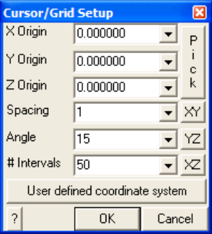

X, Y and Z Origin - especifica as coordenadas do centro da grade.

Pick - ativa a cruz do cursor para selecionar de forma interativa a base do cursor/grade a partir do

modelo.

Spacing - especifica a distância entre os pontos da grade.

Angle - especifica o ângulo (em graus) entre os raios da grade cilíndrica.

#### Intervals - especifica o número de pontos da grade que serão exibidos.

CAD > Snap > XY Cursor - restringe a cruz do cursor e a grade de snap ao plano X-Y.

CAD > Snap > YZ Cursor - restringe a cruz do cursor e a grade de snap ao plano Y-Z.

CAD > Snap > XZ Cursor - restringe a cruz do cursor e a grade de snap ao plano X-Z.

CAD > Snap > User defined Cursor - restringe a cruz do cursor e a grade de snap ao plano definido pelo usuário.

O sistema de coordenadas definido pelo usuário só está ativo com o snap em grade retangular e circular ( CAD > Snap > Grid Snap e CAD > Snap > Cylinder Snap).

O plano definido pelo usuário é especificado por seu mergulho (j), sua direção de mergulho (J) e seu cabeceio (a), de modo que:

- Pnt on X - O eixo x local ( _x'_ ) é definido ao longo da direção do plano. Um ponto sobre este eixo pode ser selecionado com esta função.

- Pnt on Y - O eixo y local ( _y'_ ) é definido no sentido do mergulho. Um ponto sobre este eixo pode ser selecionado com esta função.

- O eixo z local é perpendicular ao plano.

- Norm - ativa o cursor para selecionar de forma interativa uma superfície à qual tornar paralelo o plano UCS local. O mergulho e a direção de mergulho do plano serão definidos normais à superfície selecionada.

- Rake - permite a rotação de X' em torno do eixo z local.

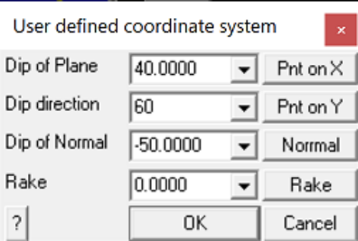

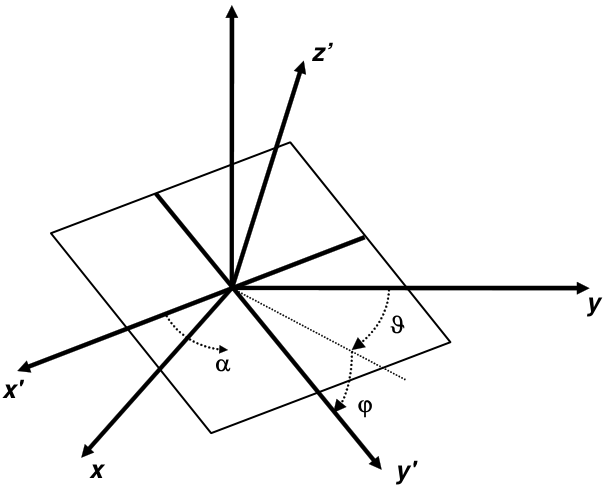

Para um exemplo do uso do modo de snap em grade na construção de modelos, consulte Freehand Sketching - Room and Pillar.
