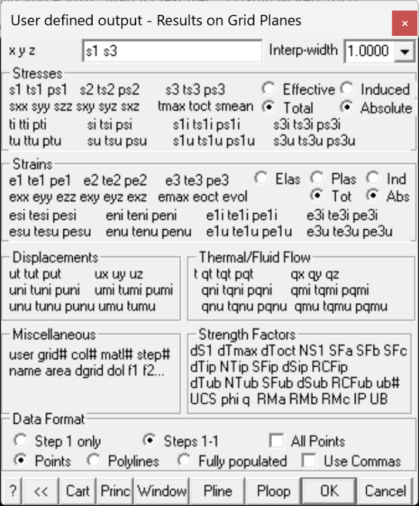
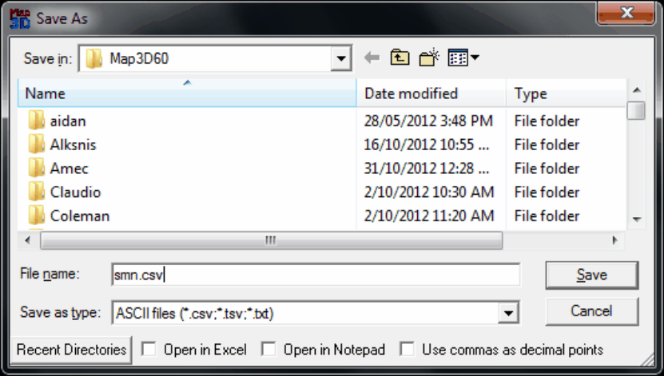
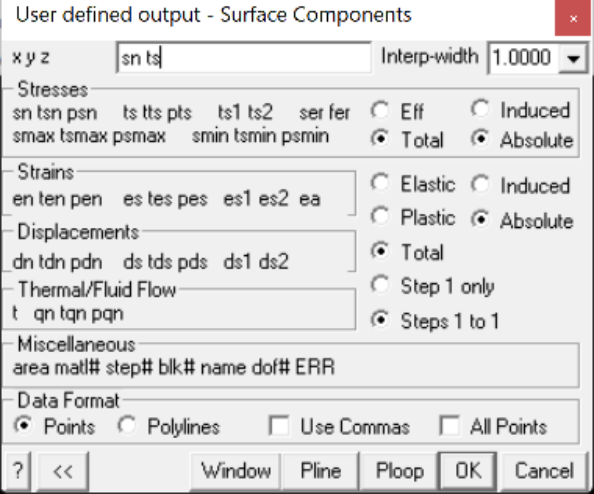
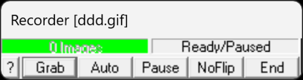

## 5.1.23.1 Copiar tela para a área de transferência

Envia um bitmap da tela para a área de transferência do Windows. Essa imagem pode ser colada em outros aplicativos.

Como normalmente o fundo da tela é preto e os contornos dos elementos são brancos, você pode querer selecionar

File > Output > Copy Screen (B&W flipped)

para trocar essas duas cores.

## 5.1.23.2 Copiar tela (P&B invertido)

Envia um bitmap da tela para um arquivo PNG (Portable Network Graphics - *.PNG), GIF (Compuserve Graphics Interchange Format) ou BMP (bitmap independente de dispositivo do Windows *.BMP), com as cores do fundo da tela e dos contornos dos elementos trocadas. Esse arquivo pode ser carregado em outros softwares para apresentação e impressão de relatórios.

Para mais detalhes, consulte

File > Output > PNG, GIF or BMP image

## 5.1.23.3 Imagem de tela PNG, GIF, JPEG, BMP ou TIFF

Envia um bitmap da tela para um arquivo PNG (Portable Network Graphics - *.PNG), GIF (CompuServe Graphics Interchange Format), BMP (bitmap independente de dispositivo do Windows *.BMP) ou TIFF (tagged image file format). Esse arquivo pode ser carregado em outros softwares para apresentação e impressão de relatórios.

Como normalmente o fundo da tela é preto e os contornos dos elementos são brancos, você pode querer selecionar

File > Output > PNG, GIF, JPEG, BMP or TIFF (B&W flipped)

para trocar essas duas cores.

Esses arquivos podem ser exibidos com File > Image Viewer

O formato BMP é um formato de arquivo gráfico amplamente suportado (pela maioria dos navegadores web, processadores de texto e programas de desenho). A principal vantagem do formato BMP é o suporte a todas as cores exibidas. Infelizmente, como não há compressão, esses arquivos podem ser muito grandes (1 MB ou mais cada).

O formato PNG é um formato de arquivo gráfico amplamente suportado (pela maioria dos navegadores web, processadores de texto e programas de desenho). As principais vantagens do formato PNG são a excelente compressão sem perdas (normalmente 1% do tamanho de um arquivo BMP) e o suporte a todas as cores exibidas. Para detalhes sobre animação, consulte File > Output > Image Recorder.

O formato GIF é o formato de arquivo gráfico mais amplamente suportado. As principais vantagens do formato GIF são a excelente compressão sem perdas (normalmente 1% do tamanho de um arquivo BMP) e a capacidade de animação. Infelizmente, o GIF só suporta 256 cores de exibição. Dependendo do que é exibido, o Map3D pode usar até 512 cores e, portanto, o GIF pode não reproduzir as imagens de tela em todas as cores

O formato GIF foi implementado usando a especificação Versão 89a ©1987,1988,1989,1990 Copyright CompuServe Incorporated, Columbus, Ohio.

Este software usa a biblioteca de imagens de código aberto FreeImage. Consulte [http://freeimage.sourceforge.net](http://freeimage.sourceforge.net) para mais detalhes. O FreeImage é usado sob a (GNU GPL ou FIPL), versão (versão da licença).

## 5.1.23.4 PNG, GIF, JPEG, BMP ou TIFF (P&B invertido)

Envia um bitmap da tela para um arquivo PNG (Portable Network Graphics - *.PNG), GIF (Compuserve Graphics Interchange Format) ou BMP (bitmap independente de dispositivo do Windows *.BMP), com as cores do fundo da tela e dos contornos dos elementos trocadas. Esse arquivo pode ser carregado em outros softwares para apresentação e impressão de relatórios.

Para mais detalhes, consulte

File > Output > PNG, JPEG, GIF, BMP or TIFF image

## 5.1.23.5 Imagem de tela DXF

Envia uma imagem de tela para um arquivo (*.DXF) no formato de intercâmbio de desenhos do AutoCAD. É um formato vetorial que pode ser importado em muitos pacotes de software para renderização posterior.

## 5.1.23.6 Imagem de tela PNT

Envia uma imagem de tela para um arquivo (*.PNT), um arquivo de dados ASCII universal com a extensão ".PNT". O formato PNT é útil para trocar dados brutos de modelo com outros softwares CAD. É um formato vetorial que pode ser importado em muitos pacotes de software para renderização posterior.

## 5.1.23.7 Imagem de tela OBJ

Envia uma imagem de tela para um arquivo (*.OBJ) no formato Wavefront. É útil para trocar dados de modelo com outros softwares CAD e de modelagem de realidade virtual. É um formato vetorial que pode ser importado em muitos pacotes de software para renderização posterior.

## 5.1.23.8 Imagem de tela WRL

Envia uma imagem de tela para um arquivo (*.WRL) no formato VRML. O VRML é útil para trocar dados de modelo com outros softwares CAD e de modelagem de realidade virtual. É um formato vetorial que pode ser importado em muitos pacotes de software para renderização posterior.

## 5.1.23.9 Imagem de tela 3D-PDF

Envia uma imagem de tela para um arquivo no formato PDF (3D). O PDF 3D pode ser visualizado em 3D completo com o Adobe Reader.

## 5.1.23.10 Componentes de grade selecionadas

Exporta as componentes de grade selecionadas para um arquivo de texto (*.txt) em um formato controlado pelo usuário.

Por padrão, todos os pontos de todas as grades são exportados. Se você quiser exportar apenas um conjunto selecionado de pontos, use a função de janela definida abaixo.

Depois de selecionar os dados desejados e clicar em OK, você será solicitado a informar um nome de arquivo para salvar os dados. Você pode selecionar CSV (dados separados/delimitados por vírgulas), TSV (dados separados/delimitados por tabulações) ou TXT (dados separados/delimitados por espaços). Também é possível especificar que o arquivo seja aberto automaticamente no Excel ou no Bloco de Notas (Notepad). Observe que você não deve usar arquivos CSV com vírgulas como separador decimal.

#### Stresses:

s1 ts1 ps1 tensão principal maior s1, sua direção e seu caimento (plunge).

s2 ts2 ps2 tensão principal intermediária s2, sua direção e seu caimento.

s3 ts3 ps3 tensão principal menor s3, sua direção e seu caimento. sxx syy szz sxy syz sxz componentes cartesianas da tensão. tmax tensão de cisalhamento máxima tmax = ½ ( s1 - s3 ) toct tensão de cisalhamento octaédrica toct = ¹/3 [( s1 - s2 )² + ( s2 - s3 )² +( s3 - s1 )²]½ smean tensão média smean = ¹/3 ( s1 + s2 + s3 )

ti tti pti tensão de cisalhamento máxima no plano da grade, sua direção e seu caimento. si tsi psi tensão normal no plano da grade, sua direção e seu caimento. s1i ts1i ps1i tensão máxima tangencial ao plano da grade, sua direção e seu caimento. s3i ts3i ps3i tensão mínima tangencial ao plano da grade, sua direção e seu caimento. tu ttu ptu tensão de cisalhamento máxima no plano ubíquo, sua direção e seu caimento. su tsu psu tensão normal ao plano ubíquo, sua direção e seu caimento. s1u ts1u ps1u tensão máxima tangencial ao plano ubíquo, sua direção e seu caimento. s3u ts3u ps3u tensão mínima tangencial ao plano ubíquo, sua direção e seu caimento. A orientação do plano ubíquo é especificada em

Plot > Strength Factors > Ubiquitous Parameters

Effective/Total componentes da tensão efetiva ou da tensão total. Estas opções só são usadas no Map3D Thermal-Fluid Flow, pois esse código permite calcular distribuições de poropressão em regime permanente. Induced/Absolute A tensão induzida é a tensão sem a contribuição da tensão pré-lavra. Representa a variação de tensão desde a condição pré-lavra. A tensão absoluta é a tensão incluindo a contribuição da tensão pré-lavra.

#### Strains:

e1 te1 pe1 deformação principal maior e1, sua direção e seu caimento. e2 te2 pe2 deformação principal intermediária e2, sua direção e seu caimento.

e3 te3 pe3 deformação principal menor e3, sua direção e seu caimento. exx eyy ezz exy eyz exz componentes cartesianas da deformação. emax deformação de cisalhamento máxima emax = ½ ( e1 - e3 ) eoct deformação de cisalhamento octaédrica eoct = ¹/3 [( e1 - e2 )² + ( e2 - e3 )² +( e3 - e1 )²]½ evol deformação volumétrica evol = ( e1 + e2 + e3 ) esi tesi pesi deformação de cisalhamento máxima no plano da grade, sua direção e seu caimento. eni teni peni deformação normal no plano da grade, sua direção e seu caimento. e1i te1i pe1i deformação máxima tangencial ao plano da grade, sua direção e seu caimento. e3i te3i pe3i deformação mínima tangencial ao plano da grade, sua direção e seu caimento. esu tesu pesu deformação de cisalhamento máxima no plano ubíquo, sua direção e seu caimento. enu tenu penu deformação normal ao plano ubíquo, sua direção e seu caimento. e1u te1u pe1u deformação máxima tangencial ao plano ubíquo, sua direção e seu caimento. e3u te3u pe3u deformação mínima tangencial ao plano ubíquo, sua direção e seu caimento. Elastic/Plastic/Total componentes da deformação elástica, plástica ou total. Estas opções só são usadas no Map3D Non-Linear, pois esse código permite calcular deformações não lineares. Induced/Absolute A deformação induzida é a deformação sem a contribuição pré-lavra. Representa a variação de deformação desde a condição pré-lavra. A deformação absoluta é a deformação incluindo a contribuição da deformação pré-lavra.

#### Displacements:

ut tut put deslocamento total, sua direção e seu caimento. ux uy uz componentes cartesianas do deslocamento. uni tuni puni deslocamento normal ao plano da grade, sua direção e seu caimento. umi tumi pumi deslocamento máximo tangencial ao plano da grade, sua direção e seu caimento. unu tunu punu deslocamento normal ao plano ubíquo, sua direção e seu caimento. umu tumu pumu deslocamento máximo tangencial ao plano ubíquo, sua direção e seu caimento.

#### Flow:

t temperatura/carga hidráulica.

qt tqt pqt fluxo total, sua direção e seu caimento. qx qy qz componentes cartesianas do fluxo. qni tqni pqni deslocamento normal ao plano da grade, sua direção e seu caimento. qmi tqmi pqmi deslocamento máximo tangencial ao plano da grade, sua direção e seu caimento. qnu tqnu pqnu deslocamento normal ao plano ubíquo, sua direção e seu caimento. qmu tqmu pqmu deslocamento máximo tangencial ao plano ubíquo, sua direção e seu caimento.

#### Strength:

- ds1 tensão principal maior excedente Ds1 = s1 - ( _UCS_ + _q_ s3 )

- dtmax tensão de cisalhamento máxima excedente Dtmax = ½(s1 - s3) - [ _UCS_ + ½(s1+s3) ( _q_ -1) ]/( _q_ +1) = [s1 - ( _UCS_ + _q_ s3) ]/( _q_ +1)

- dtoct tensão de cisalhamento octaédrica excedente Dtoct = toct - [ _UCS_ + ( _q_ –1) smean ] Ö(2) /( _q_ +2)

- NS1 probabilidade usando a distribuição normal N(Ds1 /std)

- SFA Resistência/Tensão pode ser determinado como ( _UCS_ + _q_ s3 )/ s1

- SFB Resistência/Tensão pode ser determinado como ( _UCS_ + _q_ s3 - s3 )/(s1 - s3)

- SFC Resistência/Tensão pode ser determinado como [ _UCS_ + ½(s1+s3) ( _q_ -1) ]/[ ½(s1 - s3)( _q_ +1) ]

- dTip tensão de cisalhamento excedente no plano Dtip = tip - [ Cohesion + sip tan(j) ]

- NTip probabilidade usando a distribuição normal N(Dtip /std)

- SFip Resistência/Tensão pode ser determinado como [ Cohesion + sip tan(j) ] / tip

- dSip tensão excedente na parede no plano Dsip = [ 3 s1i - s3i ] - UCS

- RCFip fator de condição da rocha (Rock Condition Factor) para a tensão na parede no plano RCFip = [ 3 s1i - s3i ]/UCS

- dTub tensão de cisalhamento excedente no plano ubíquo Dtub

- NTub probabilidade usando a distribuição normal N(Dtub /std)

- SFub Resistência/Tensão pode ser determinado como [ Cohesion + sub tan(j) ] / tub

- dSub tensão excedente na parede no plano ub Dsub = [ 3 s1ub - s3ub ] - UCS

- RCFub fator de condição da rocha para a tensão na parede no plano ub RCFip = [ 3 s1ub - s3ub ]/UCS

- UB# Plota o número do conjunto UB (1, 2 ou 3) que tem o maior valor de Dtub

- _UCS phi q_ Parâmetros de resistência de Mohr-Coulomb definidos com Plot > Strength Factors > Rockmass Strength Parameters; observe que esses parâmetros só estão definidos se você especificou o critério de resistência de Mohr-Coulomb ou de Druker-Prager

- _sc_ Parâmetro de resistência de Hoek-Brown definido com Plot > Strength Factors > Rockmass Strength Parameters; observe que esse parâmetro só está definido se você especificou o critério de resistência de Hoek-Brown

#### Miscellaneous:

user Valor definido pelo usuário.

grid# o número da grade onde o ponto está localizado. matl# o número do material dentro do qual o ponto está localizado. O material da rocha encaixante (host) é o material número 1. Em problemas em que vários materiais são usados, os resultados podem ser calculados em uma zona de material alternativo.

step# o número da etapa de lavra. name o nome da grade. area a área da célula da grade adjacente ao ponto selecionado. dgrid distância à superfície mais próxima a partir de cada ponto de grade. dol distância à grade mais próxima _Dgrid_ dividida pelo espaçamento da grade _Lgrid_ . f1 f2... parâmetros de material definidos pelo usuário. Podem ser definidos com Plot > Properties > Material Properties > User defined Parameters.

#### Data Format:

Os dados de pontos serão gravados como uma série de pontos, com um ponto por linha:

- x1 y1 z1 values1 x2 y2 z2 values2 x3 y3 z3 values3 x4 y4 z4 values4

onde xi yi zi representam as coordenadas de cada ponto,

valuesi representa os valores da lista de componentes selecionadas pelo usuário em cada ponto. Os valores definidos pelo usuário serão listados como uma linha de comentário (ou seja, uma linha que começa com um asterisco "*") no início do arquivo.

Os dados de polilinhas serão gravados como uma série de polilinhas em formato de arquivo PNT

- x1 y1 z1 3 values1 x2 y2 z2 2 values2 x3 y3 z3 2 values3 x4 y4 z4 2 values4

onde xi yi zi representam as coordenadas de cada ponto,

- 3 indica que este ponto é o início de uma nova linha,

- 2 indica que este ponto é a continuação da mesma linha,

valuesi representa os valores da lista de componentes selecionadas pelo usuário em cada canto da polilinha. Os valores definidos pelo usuário serão listados como uma linha de comentário (ou seja, uma linha que começa com um asterisco "*") no início do arquivo.

Fully Populated: os dados serão gravados de modo que todos fiquem em uma grade de tamanho regular.

Use Commas: os dados serão gravados com vírgulas no lugar de pontos decimais.

#### Other:

&lt;&lt;    para reduzir a caixa de diálogo a tamanho pequeno

>>    para ampliar a caixa de diálogo a tamanho grande Cartesian   configura a saída das componentes cartesianas da tensão. Principal   configura a saída das componentes de tensão principal. Window   ativa uma janela de seleção gráfica.

- Você será solicitado a selecionar os dois cantos da janela clicando uma vez com o mouse em cada um.

- Somente os pontos de grade contidos na janela serão incluídos na exportação.

- Se você não usar esta função, todos os pontos de todas as grades são exportados.

- Para ver a localização dos pontos de contorno reais, ative a exibição de trajetórias (Plot > Options > Trajectories). Os pontos de contorno ficam onde as trajetórias são desenhadas.

Polyline   ativa um polígono de seleção gráfico. Você será solicitado a selecionar uma série de cantos para definir um polígono, clicando uma vez com o mouse em cada um:

- Você deve manter pressionada a tecla Shift enquanto seleciona esses pontos.

- Se você definir uma forma poligonal fechada, os pontos de contorno contidos no polígono serão incluídos.

- Se você definir uma forma poligonal aberta, será incluída uma série de pontos ao longo da polilinha.

- Para ver a localização dos pontos de contorno reais, ative a exibição de trajetórias (Plot > Options > Trajectories). Os pontos de contorno ficam onde as trajetórias são desenhadas.

- Janelas retangulares simples podem ser definidas mantendo pressionada a tecla Shift e arrastando para abrir uma janela (igual ao botão Window).

## 5.1.23.11 Componentes de superfície selecionadas

Exporta as componentes de superfície selecionadas para um arquivo de texto (*.txt) em um formato controlado pelo usuário.

Por padrão, todos os pontos de todas as superfícies são exportados. Se você quiser exportar apenas um conjunto selecionado de pontos, use a função de janela definida abaixo.

Depois de selecionar os dados desejados e clicar em OK, você será solicitado a informar um nome de arquivo para salvar os dados. Você pode selecionar CSV (dados separados/delimitados por vírgulas), TSV (dados separados/delimitados por tabulações) ou TXT (dados separados/delimitados por espaços).

Também é possível especificar que o arquivo seja aberto automaticamente no Excel ou no Bloco de Notas (Notepad). Observe que você não deve usar arquivos CSV com vírgulas como separador decimal.

#### Stresses:

sn tsn psn tensão normal à superfície, sua direção e seu caimento.

ts tts pts tensão de cisalhamento máxima no plano da superfície, sua direção e seu caimento. ts1 ts2   componentes da tensão de cisalhamento no plano da superfície. ts1 é paralela ao primeiro lado (ou seja, o lado definido por x1 y1 z1 – x2 y2 z2). ts2 é perpendicular a ts1 na direção do segundo lado (ou seja, o lado definido por x2 y2 z2 – x3 y3 z3).

ser erro de tensão superficial. Solucionadores iterativos funcionam determinando o erro da solução atual de cada equação simultânea e, em seguida, reduzindo esses erros por um processo de aproximações sucessivas. Este parâmetro indica o erro de cada uma das equações.

fer erro do critério de ruptura. Este parâmetro só é usado em análises de fluência não lineares (incluindo deslizamento de falhas e não linearidade de materiais 3D). Este parâmetro deve estar sempre próximo de zero, a menos que alguma viscosidade tenha sido especificada e o problema se torne não linear. Neste último caso, a fluência viscosa pode permitir estados de tensão acima do critério de ruptura, indicando falta de equilíbrio estático. Este parâmetro indica a tensão viscosa de cada uma das equações.

smax tsmax psmax tensão tangencial máxima, sua direção e seu caimento. smin tsmin psmin tensão tangencial mínima, sua direção e seu caimento. Effective/Total – componentes da tensão efetiva ou da tensão total. Estas opções só são usadas no Map3D Thermal-Fluid Flow, pois esse código permite calcular distribuições de poropressão em regime permanente.

#### Strains:

en ten pen deformação na direção normal à superfície, sua direção e seu caimento. Este parâmetro só é usado em planos DD e é calculado como o deslocamento normal (fechamento) dividido pela espessura. es tes pes deformação de cisalhamento máxima no plano da superfície, sua direção e seu caimento. Este parâmetro só é usado em planos DD e é calculado como o deslocamento de cisalhamento (ride) dividido pela espessura. es1 es2   componentes da deformação de cisalhamento no plano da superfície. es1 é paralela ao primeiro lado (ou seja, o lado definido por x1 y1 z1 – x2 y2 z2). es2 é perpendicular a es1 na direção do segundo lado (ou seja, o lado definido por x2 y2 z2 – x3 y3 z3).

#### Displacements:

dn tdn pdn deslocamento normal (fechamento) na direção normal à superfície, sua direção e seu caimento. Este parâmetro só é usado em planos DD. Observe que o valor elástico, plástico ou total pode ser especificado.

ds tds pds deslocamento de cisalhamento máximo (ride) no plano da superfície, sua direção e seu caimento. Este parâmetro só é usado em planos DD. Observe que o valor elástico, plástico ou total pode ser especificado.

ds1 ds2   componentes do deslocamento de cisalhamento (ride) no plano da superfície. ds1 é paralela ao primeiro lado (ou seja, o lado definido por x1 y1 z1 – x2 y2 z2). ds2 é perpendicular a ds1 na direção do segundo lado (ou seja, o lado definido por x2 y2 z2 – x3 y3 z3). Elastic/Plastic/Total componentes da deformação/deslocamento elástico, plástico ou total. Estas opções só são usadas para planos DD.

#### Miscellaneous:

area   a área da superfície. matl# o número do material atribuído à superfície. step# o número da etapa de lavra. blk#   o número do bloco. name   o nome da superfície do bloco. dof#   o número do grau de liberdade.

#### Data Format

Os dados de pontos serão gravados como uma série de pontos, com um ponto por linha.

x1 y1 z1 values1 x2 y2 z2 values2 x3 y3 z3 values3 x4 y4 z4 values4

onde xi yi zi representam as coordenadas de cada ponto,

valuesi representa os valores da lista de componentes selecionadas pelo usuário em cada ponto. Os valores definidos pelo usuário serão listados como uma linha de comentário (ou seja, uma linha que começa com um asterisco "*") no início do arquivo.

Os dados de polilinhas serão gravados como uma série de polilinhas em formato de arquivo PNT x1 y1 z1 3 values1 x2 y2 z2 2 values2 x3 y3 z3 2 values3 x4 y4 z4 2 values4

onde xi yi zi representam as coordenadas de cada ponto,

3 indica que este ponto é o início de uma nova linha,

2 indica que este ponto é a continuação da mesma linha,

valuesi representa os valores da lista de componentes selecionadas pelo usuário em cada canto da polilinha. Os valores definidos pelo usuário serão listados como uma linha de comentário (ou seja, uma linha que começa com um asterisco "*") no início do arquivo.

Se a análise BEM linear (Analysis > Options > Linear) não foi selecionada, valuesi só estão disponíveis nos centros dos elementos e, portanto, só serão fornecidos para o primeiro ponto. Se a análise BEM linear foi selecionada, os valores estão disponíveis em cada canto e, portanto, serão fornecidos para todos os pontos.

#### Other

&lt;&lt;    para reduzir a caixa de diálogo a tamanho pequeno >>    para ampliar a caixa de diálogo a tamanho grande Window   ativa uma janela de seleção gráfica.

- Você será solicitado a selecionar os dois cantos da janela clicando uma vez com o mouse em cada um.

- Somente os pontos de grade contidos na janela serão incluídos na exportação.

- Se você não usar esta função, todos os pontos de todas as grades são exportados.

- Para ver a localização dos pontos de contorno reais, ative a exibição de trajetórias (Plot > Options > Trajectories). Os pontos de contorno ficam onde as trajetórias são desenhadas.

Polyline   ativa um polígono de seleção gráfico. Você será solicitado a selecionar uma série de cantos para definir um polígono, clicando uma vez com o mouse em cada um:

- Você deve manter pressionada a tecla Shift enquanto seleciona esses pontos.

- Se você definir uma forma poligonal fechada, os pontos de contorno contidos no polígono serão incluídos.

- Se você definir uma forma poligonal aberta, será incluída uma série de pontos ao longo da polilinha.

- Para ver a localização dos pontos de contorno reais, ative a exibição de trajetórias (Plot > Options > Trajectories). Os pontos de contorno ficam onde as trajetórias são desenhadas.

- Janelas retangulares simples podem ser definidas mantendo pressionada a tecla Shift e arrastando para abrir uma janela (igual ao botão Window).

Use Commas: os dados serão gravados com vírgulas no lugar de pontos decimais.

## 5.1.23.12 Gravador de TIFF/GIF animado

Grava várias imagens sequenciais em arquivos PNG, GIF, BMP ou TIFF individuais.

Muitos programas de apresentação permitem construir animações simples exibindo uma sequência de imagens. O gravador de imagens do Map3D permite gravar várias capturas de tela em arquivos PNG, GIF, BMP ou TIFF individuais.

O gravador de TIFF/GIF animado salva várias imagens no mesmo arquivo TIFF ou GIF. Essas imagens podem ser reproduzidas em um visualizador de imagens capaz de exibir TIFFs ou GIFs animados (como o Map3D Image Viewer, a maioria dos navegadores de internet, o Visualizador de Fotos do Windows etc.).

O Image Recorder cria várias imagens em arquivos separados. Depois de selecionar File > Output > Image Recorder, você será solicitado a especificar um nome de arquivo para salvar a animação. Os nomes dos arquivos de imagem serão gerados acrescentando o número da imagem ao nome de arquivo que você especificar (p. ex., name0001.png, name0002.png, name0003.png ...).

A caixa de diálogo do gravador fornece informações sobre a animação atual e permite controlar a gravação e especificar as opções de animação.

O número atual de imagens da animação é exibido junto com o status do gravador. Os vários estados de status incluem:

Ready/Paused – o arquivo de animação está aberto e pronto para gravar. Pressione Grab ou Auto para adicionar uma imagem.

Capturing Image – uma imagem está sendo adicionada à animação.

Ready/Auto Capture - as imagens exibidas serão adicionadas automaticamente à animação à medida que você atualiza a tela.

Recorder Off – o arquivo de animação está fechado e não está pronto para gravar.

Grab – adiciona à animação a imagem exibida atualmente.

Auto – adiciona automaticamente à animação as imagens exibidas à medida que você atualiza a tela. Isso inclui todas as operações de rotação, translação e plotagem que você realizar.

Pause – desativa o modo automático.

Flipped/NoFlip – alterna a inversão de fundo e primeiro plano (normalmente preto e branco).

End – interrompe o gravador e fecha o arquivo de animação.

#### Notes:

Imagens adicionais podem ser acrescentadas a uma sequência de imagens existente marcando File > Output > Image Recorder > Append Images ao selecionar o nome de arquivo da sequência de animação.

As operações de rotação e translação podem ser repetidas automaticamente digitando n# antes de selecionar a operação. Por exemplo, para produzir uma exibição animada de uma plotagem de tensões, especifique o seguinte

Plot > Options > Persist

Plot > Stress > Sigma:1

View > Rotation Increment > 10

Selecione o botão Auto

Digite 35#

Selecione girar para a direita (na barra de ferramentas de rotação ou com a tecla Page Down).

Será criada uma série de arquivos numerados de name001 a name036. Eles podem ser importados em software de apresentação para animação e exibição.

Os contornos de tensão que mudam à medida que a lavra avança podem ser exibidos capturando uma série de plotagens conforme a etapa de lavra é avançada.
