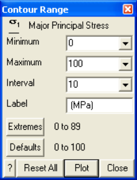

Especifica a faixa de contornos (mínimo, máximo, intervalo...) do contorno plotado atualmente. Esta rotina pode ser iniciada clicando no botão ou simplesmente clicando com o botão direito em qualquer contorno.

**abe u te a**

Acima, a faixa de contornos é mostrada na orientação horizontal. Isso pode ser alterado para a orientação vertical marcando Plot Options > Vertical Legend.

Minimum: especifica o valor inferior da faixa de contornos.

Maximum: especifica o valor superior da faixa de contornos.

Interval: especifica o intervalo dos contornos. O intervalo pode ser maior que 1/10 do máximo menos o mínimo, mas não menor.

Label: especifica o rótulo do contorno.

Extremes: indica os extremos inferior e superior detectados para este parâmetro. Este botão ajusta a faixa de contornos para esses valores.

Defaults: indica a faixa de contornos inferior e superior padrão para este parâmetro. Este botão ajusta a faixa de contornos para esses valores.

Reset All: redefine as faixas de todos os parâmetros de plotagem para os valores padrão.

Plot: regenera a plotagem de contornos.

O mínimo da faixa de contornos não precisa necessariamente ser menor que o máximo. Por exemplo, ao plotar contornos de fatores de resistência, pode ser desejável definir o mínimo como 2 e o máximo como 1, para que fatores de resistência próximos de um apareçam em vermelho.
