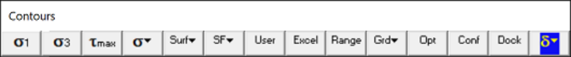
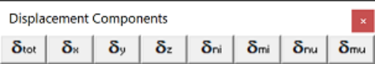
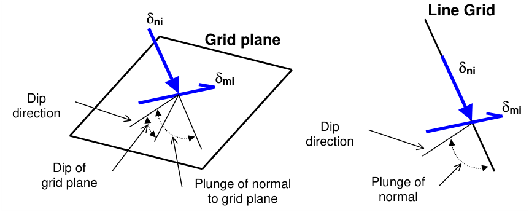
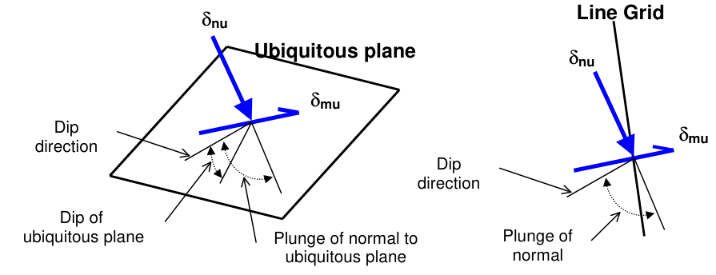

## 5.3.3.1 Deslocamento total

Gera contornos dos deslocamentos.

Essas componentes podem ser acessadas pela barra de ferramentas Displacement Components, da seguinte forma:

Esta barra de ferramentas pode ser alterada para a orientação vertical arrastando-a contra a borda direita ou esquerda da janela principal.

Ela pode voltar à orientação horizontal arrastando-a contra a borda superior ou inferior da janela principal.

Ao selecionar o botão da barra de ferramentas Contours, a barra de ferramentas Displacement Components é ativada. Você pode adicionar este botão à barra de ferramentas Contours usando o botão de configuração.

Esta barra de ferramentas oferece acesso rápido às componentes do deslocamento.

Plot > Displacement > dtotal = ( dx² + dy² + dz² )½ Deslocamento total   gera contornos do deslocamento total Plot > Displacement > dx Deslocamento X   gera contornos da componente x do deslocamento Plot > Displacement > dy Deslocamento Y   gera contornos da componente y do deslocamento Plot > Displacement > dz Deslocamento Z   gera contornos da componente z do deslocamento

Para calcular os deslocamentos no plano, o estado de deslocamento em cada ponto do plano da grade é reorientado para determinar o deslocamento máximo paralelo ao plano da grade e o deslocamento normal ao plano. Observe que dni é orientado normal ao plano da grade e paralelo à direção de uma grade linear.

Plot > Displacement > dni Normal no plano   gera contornos da componente do deslocamento normal ao plano da grade.

Plot > Displacement > dmi Máximo no plano   gera contornos do deslocamento máximo tangencial ao plano da grade.

Para calcular os deslocamentos do plano ubíquo nº 1, o estado de deslocamento em cada ponto do plano da grade é reorientado para determinar o deslocamento máximo paralelo ao plano ubíquo nº 1 e o deslocamento normal ao plano. Observe que dmi não é orientado normal ao plano da grade.

Plot > Displacement > dnu Normal ao plano ubíquo   gera contornos da componente do deslocamento normal ao plano ubíquo.

Plot > Displacement > dmu Máximo no plano ubíquo   gera contornos do deslocamento máximo tangencial ao plano ubíquo.

- a direção de mergulho é medida positiva no sentido horário a partir do eixo y.

- o mergulho do plano é medido positivo para baixo a partir da horizontal (ou seja, a direção de mergulho).

- o caimento da normal é medido positivo para baixo (ou seja, negativo para cima) a partir da horizontal.

Notas:

A barra de ferramentas de deslocamento só pode ser ativada após a etapa de construção do modelo (CAD)

Etapas de análise do Map3D.

A orientação do plano de cisalhamento ubíquo é definida com

Plot > Strength Factors > Ubiquitous Parameters

A faixa de contornos é definida com

#### Plot > Range

Esta componente pode ser adicionada à barra de ferramentas de contornos, se desejado

Tools > Configure Contouring Toolbar > Displacement

Pode ser útil adicionar o botão

More Displacement Components

à barra de ferramentas de contornos para acessar rapidamente todas as componentes do deslocamento.
