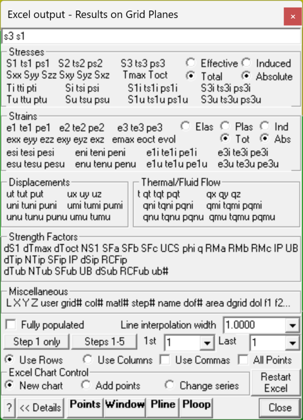

Plota no Excel as componentes de grade especificadas.

É preciso contornar os resultados de grade para poder selecioná-los no gráfico do Excel (p. ex., Plot > Stress > s1 Major Principal Stress).

O primeiro parâmetro será usado como eixo x do gráfico (ou seja, a abscissa). Os parâmetros adicionais definirão os eixos y do gráfico (ou seja, as séries ou ordenadas). Vários parâmetros de eixos y podem ser especificados.

Dois tipos de gráficos do Excel podem ser criados:

- pontos de contorno selecionados.

- uma série de pontos ao longo de uma polilinha.

Se você plotar "s3 s1", "si ti" ou "su tu", o Map3D fornecerá informações sobre a reta de melhor ajuste (por regressão linear), incluindo:

- Intercepto

- Inclinação

- ângulo de atrito

- desvio padrão

- coeficiente de variação

Fully populated   Especifica que todos os pontos de contorno ausentes serão gerados por interpolação.

- Esta opção se aplica apenas à plotagem de pontos de contorno selecionados (Points, Window e polilinha fechada).

- Esta opção não se aplica à plotagem sobre uma polilinha aberta.

- O Map3D calcula os resultados em uma grade esparsa para economizar tempo de análise.

- Para ver a localização dos pontos de contorno reais, ative a exibição de trajetórias (Plot > Options > Trajectories).

- Com esta opção desmarcada, somente os pontos de contorno reais serão incluídos no gráfico.

- Com esta opção marcada, todos os pontos de contorno ausentes serão incluídos no gráfico.

Line interpolation width   Especifica o espaçamento desejado com que os pontos de contorno serão gerados por interpolação.

- Esta opção se aplica apenas à plotagem sobre uma polilinha aberta.

- Esta opção não se aplica à plotagem de pontos de contorno selecionados.

- Se Line interpolation width for zero, somente as extremidades da polilinha aberta serão plotadas.

- Caso contrário, serão gerados pontos ao longo da polilinha por interpolação no Line interpolation width especificado.

Step # only   Especifica que somente os resultados da etapa # serão exportados (# é a etapa de lavra carregada exibida atualmente).

Steps 1-5   Especifica que os resultados de todas as etapas serão exportados.

   - Observe que isso pode levar um tempo considerável em grandes conjuntos de dados; portanto, tenha paciência e aguarde o Map3D percorrer todas as etapas.

- 1st/Last   Especifica que os resultados de todas as etapas, da primeira (1st) à última (Last), inclusive, serão exportados.

   - Observe que isso pode levar um tempo considerável em grandes conjuntos de dados; portanto, tenha paciência e aguarde o Map3D percorrer todas as etapas.

Use Commas   Especifica que os resultados exportados para o Excel usarão vírgulas no lugar de pontos decimais no formato dos números.

Use Rows   Ao exportar várias etapas de lavra (veja Steps 1-5 acima), os resultados aparecerão em linhas cumulativas.

Use Columns   Ao exportar várias etapas de lavra (veja Steps 1-5 acima), os resultados aparecerão em colunas cumulativas.

- Observe que pode ser conveniente especificar All Points para garantir que não faltem pontos entre as linhas correspondentes.

All Points   Especifica que todos os pontos serão exportados para o Excel, incluindo os pontos dentro das escavações.

Restart Excel   Se o Map3D perder a comunicação com o Excel, é preciso reiniciar o Excel (Restart Excel) para restabelecer a comunicação.

Points   ativa a seleção gráfica de pontos individuais.

- O ponto mais próximo do ponto selecionado será plotado.

- Para ver a localização dos pontos de contorno reais, ative a exibição de trajetórias (Plot > Options > Trajectories). Os pontos de contorno ficam onde as trajetórias são desenhadas.

Window   ativa uma janela de seleção retangular.

- Você será solicitado a selecionar os dois cantos da janela clicando uma vez com o mouse em cada um.

- Somente os pontos de grade contidos na janela serão incluídos no gráfico.

- Para ver a localização dos pontos de contorno reais, ative a exibição de trajetórias (Plot > Options > Trajectories). Os pontos de contorno ficam onde as trajetórias são desenhadas.

Pline (open)   ativa um polígono de seleção gráfico.

- Você pode selecionar dois pontos para definir um único segmento de linha.

- Se você mantiver pressionada a tecla Shift, vários segmentos de linha poderão ser selecionados.

- Você pode especificar o espaçamento desejado com que os pontos de contorno serão gerados por interpolação usando o parâmetro Line interpolation width.

- Pode ser útil sobrepor uma grade regular aos contornos (Plot > Options > Grid Lines) para ajudar a escolher a localização da polilinha.

- Se Line interpolation width for zero, somente as extremidades da polilinha aberta serão plotadas.

- Se você definir uma polilinha aberta, será plotada uma série de pontos ao longo da polilinha.

- Se você definir uma forma poligonal fechada, os pontos de contorno contidos no polígono serão plotados.

Pline (closed)   ativa um polígono de seleção gráfico.

- Você deve manter pressionada a tecla Shift para que vários segmentos de linha possam ser selecionados.

- Uma forma poligonal fechada é definida fechando a polilinha ao selecionar o ponto inicial.

- Se você definir uma forma poligonal fechada, os pontos de contorno contidos no polígono serão plotados.

- Se você definir uma polilinha aberta, será plotada uma série de pontos ao longo da polilinha.

- Para ver a localização dos pontos de contorno reais, ative a exibição de trajetórias (Plot > Options > Trajectories). Os pontos de contorno ficam onde as trajetórias são desenhadas.

Ploop (closed)   é igual a Pline (closed), exceto que a polilinha será fechada automaticamente para formar um laço fechado.

- Você deve manter pressionada a tecla Shift para que vários segmentos de linha possam ser selecionados.

#### Excel Chart Control:

New chart - cria um novo gráfico do Excel.

Extend existing chart - adiciona dados ao gráfico do Excel existente. Todos os parâmetros de plotagem devem ser os mesmos usados anteriormente.

Change series - altera ou adiciona novas séries a um gráfico do Excel existente. Somente o primeiro parâmetro de plotagem deve ser o mesmo. Parâmetros de plotagem adicionais podem ser especificados conforme desejado.

#### Stresses:

s1 ts1 ps1 tensão principal maior s1, sua direção e seu caimento (plunge).

s2 ts2 ps2 tensão principal intermediária s2, sua direção e seu caimento. s3 ts3 ps3 tensão principal menor s3, sua direção e seu caimento. sxx syy szz sxy syz sxz componentes cartesianas da tensão. tmax tensão de cisalhamento máxima tmax = ½ ( s1 - s3 ) toct tensão de cisalhamento octaédrica toct = ¹/3 [( s1 - s2 )² + ( s2 - s3 )² +( s3 - s1 )²]½ smean tensão média smean = ¹/3 ( s1 + s2 + s3 ) ti tti pti tensão de cisalhamento máxima no plano da grade, sua direção e seu caimento. si tsi psi tensão normal no plano da grade, sua direção e seu caimento. s1i ts1i ps1i tensão máxima tangencial ao plano da grade, sua direção e seu caimento. s3i ts3i ps3i tensão mínima tangencial ao plano da grade, sua direção e seu caimento. tu ttu ptu tensão de cisalhamento máxima no plano ubíquo, sua direção e seu caimento. su tsu psu tensão normal ao plano ubíquo, sua direção e seu caimento. s1u ts1u ps1u tensão máxima tangencial ao plano ubíquo, sua direção e seu caimento. s3u ts3u ps3u tensão mínima tangencial ao plano ubíquo, sua direção e seu caimento. A orientação do plano ubíquo é especificada em

Plot > Strength Factors > Ubiquitous Parameters

Effective/Total componentes da tensão efetiva ou da tensão total. Estas opções só são usadas no Map3D Thermal-Fluid Flow, pois esse código permite calcular distribuições de poropressão em regime permanente. Induced/Absolute componentes da tensão induzida ou da tensão absoluta (ou seja, a tensão sem a contribuição da tensão pré-lavra).

#### Strains:

e1 te1 pe1 deformação principal maior e1, sua direção e seu caimento. e2 te2 pe2 deformação principal intermediária e2, sua direção e seu caimento. e3 te3 pe3 deformação principal menor e3, sua direção e seu caimento. exx eyy ezz exy eyz exz componentes cartesianas da deformação. emax deformação de cisalhamento máxima emax = ½ ( e1 - e3 ) eoct deformação de cisalhamento octaédrica eoct = ¹/3 [( e1 - e2 )² + ( e2 - e3 )² +( e3 - e1 )²]½ evol deformação volumétrica evol = ( e1 + e2 + e3 ) esi tesi pesi deformação de cisalhamento máxima no plano da grade, sua direção e seu caimento. eni teni peni deformação normal no plano da grade, sua direção e seu caimento. e1i te1i pe1i deformação máxima tangencial ao plano da grade, sua direção e seu caimento. e3i te3i pe3i deformação mínima tangencial ao plano da grade, sua direção e seu caimento. esu tesu pesu deformação de cisalhamento máxima no plano ubíquo, sua direção e seu caimento. enu tenu penu deformação normal ao plano ubíquo, sua direção e seu caimento. e1u te1u pe1u deformação máxima tangencial ao plano ubíquo, sua direção e seu caimento. e3u te3u pe3u deformação mínima tangencial ao plano ubíquo, sua direção e seu caimento. Elastic/Plastic/Total componentes da deformação elástica, plástica ou total. Estas opções só são usadas no Map3D Non-Linear, pois esse código permite calcular deformações não lineares. Induced/Absolute componentes da deformação induzida ou da deformação absoluta (ou seja, sem a contribuição da tensão pré-lavra).

#### Displacements:

ut tut put deslocamento total, sua direção e seu caimento. ux uy uz componentes cartesianas do deslocamento. uni tuni puni deslocamento normal ao plano da grade, sua direção e seu caimento. umi tumi pumi deslocamento máximo tangencial ao plano da grade, sua direção e seu caimento. unu tunu punu deslocamento normal ao plano ubíquo, sua direção e seu caimento. umu tumu pumu deslocamento máximo tangencial ao plano ubíquo, sua direção e seu caimento.

#### Flow:

t temperatura/carga hidráulica.

qt tqt pqt fluxo total, sua direção e seu caimento. qx qy qz componentes cartesianas do fluxo. qni tqni pqni deslocamento normal ao plano da grade, sua direção e seu caimento. qmi tqmi pqmi deslocamento máximo tangencial ao plano da grade, sua direção e seu caimento. qnu tqnu pqnu deslocamento normal ao plano ubíquo, sua direção e seu caimento. qmu tqmu pqmu deslocamento máximo tangencial ao plano ubíquo, sua direção e seu caimento.

#### Strength:

· ds1 tensão principal maior excedente Ds1 = s1 - ( _UCS_ + _q_ s3 )

- dtmax tensão de cisalhamento máxima excedente Dtmax = ½(s1 - s3) - [ _UCS_ + ½(s1+s3) ( _q_ -1) ]/( _q_ +1) = [s1 - ( _UCS_ + _q_ s3) ]/( _q_ +1)

- dtoct tensão de cisalhamento octaédrica excedente Dtoct = toct - [ _UCS_ + ( _q_ –1) smean ] Ö(2) /( _q_ +2)

- NS1 probabilidade usando a distribuição normal N(Ds1 /std)

- SF-A Resistência/Tensão pode ser determinado como ( _UCS_ + _q_ s3 )/ s1

- SF-B Resistência/Tensão pode ser determinado como ( _UCS_ + _q_ s3 - s3 )/(s1 - s3)

- SF-C Resistência/Tensão pode ser determinado como [ _UCS_ + ½(s1+s3) ( _q_ -1) ]/[ ½(s1 - s3)( _q_ +1) ]

- dTip tensão de cisalhamento excedente no plano Dtip = tip - [ Cohesion + sip tan(j) ]

- NTip probabilidade usando a distribuição normal N(Dtip /std)

- SFip Resistência/Tensão pode ser determinado como [ Cohesion + sip tan(j) ] / tip

- dSip tensão excedente na parede no plano Dsip = [ 3 s1i - s3i ] - UCS

- RCFip fator de condição da rocha (Rock Condition Factor) para a tensão na parede no plano RCFip = [ 3 s1i - s3i ]/UCS

- dTub tensão de cisalhamento excedente no plano ubíquo Dtub

- NTub probabilidade usando a distribuição normal N(Dtub /std)

- SFub Resistência/Tensão pode ser determinado como [ Cohesion + sub tan(j) ] / tub

- dSub tensão excedente na parede no plano ub Dsub = [ 3 s1ub - s3ub ] - UCS

- RCFub fator de condição da rocha para a tensão na parede no plano ub RCFip = [ 3 s1ub - s3ub ]/UCS

- UB# Plota o número do conjunto UB (1, 2 ou 3) que tem o maior valor de Dtub

#### Miscellaneous:

L  comprimento ao longo de uma linha. Use o comando Polyline para selecionar a linha desejada.

X  valor da coordenada. Y  valor da coordenada. Z  valor da coordenada. user valor definido pelo usuário.

grid# o número da grade onde o ponto está localizado. col# o número da cor atribuída à grade onde o ponto está localizado.

matl# o número do material dentro do qual o ponto está localizado. O material da rocha encaixante (host) é o material número 1. Em problemas em que vários materiais são usados, os resultados podem ser calculados em uma zona de material alternativo.

step# o número da etapa de lavra. name o nome atribuído à grade onde o ponto está localizado.

dof#   um número único que especifica o local de armazenamento do ponto no banco de dados do Map3D. area a área do segmento associado ao ponto selecionado no GPlane. dgrid distância à superfície mais próxima a partir de cada ponto de grade. dol distância à grade mais próxima _Dgrid_ dividida pelo espaçamento da grade _Lgrid_ .

f1 f2... parâmetros de material definidos pelo usuário. Podem ser definidos com Plot > Properties > Material Properties > User defined Parameters.
