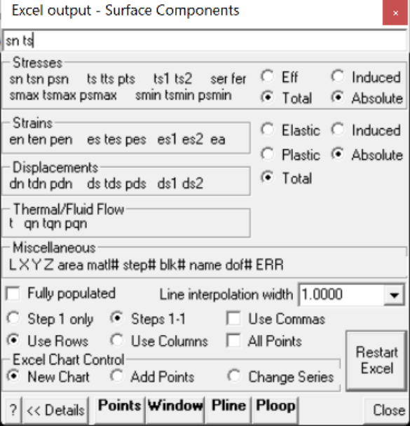

Plota no Excel as componentes de superfície especificadas.

É preciso contornar os resultados de superfície para poder selecioná-los no gráfico do Excel (p. ex., Plot > Surface Components > Ts Shear Stress).

O primeiro parâmetro será usado como eixo x do gráfico (ou seja, a abscissa). Os parâmetros adicionais definirão os eixos y do gráfico (ou seja, as séries ou ordenadas). Vários parâmetros de eixos y podem ser especificados.

Dois tipos de gráficos do Excel podem ser criados:

- pontos de contorno selecionados.

- uma série de pontos ao longo de uma polilinha.

A plotagem no Excel por meio do Map3D é feita pelo suplemento Map3D.xla

- Esta rotina é carregada automaticamente quando o Map3D inicia o Excel.

- Você deve permitir que esta macro seja executada para que as rotinas de plotagem do Map3D funcionem.

Fully populated   Especifica que todos os pontos de contorno ausentes serão gerados por interpolação.

- Esta opção se aplica apenas à plotagem de pontos de contorno selecionados (Points, Window e polilinha fechada).

- Esta opção não se aplica à plotagem sobre uma polilinha aberta.

- O Map3D calcula os resultados em uma grade esparsa para economizar tempo de análise.

- Para ver a localização dos pontos de contorno reais, ative a exibição de trajetórias (Plot > Options > Trajectories).

- Com esta opção desmarcada, somente os pontos de contorno reais serão incluídos no gráfico.

- Com esta opção marcada, todos os pontos de contorno ausentes serão incluídos no gráfico.

Line interpolation width   Especifica o espaçamento desejado com que os pontos de contorno serão gerados por interpolação.

- Esta opção se aplica apenas à plotagem sobre uma polilinha aberta.

- Esta opção não se aplica à plotagem de pontos de contorno selecionados.

- Se Line interpolation width for zero, somente as extremidades da polilinha aberta serão plotadas.

- Caso contrário, serão gerados pontos ao longo da polilinha por interpolação no Line interpolation width especificado.

Step # only   Especifica que somente os resultados da etapa # serão exportados (# é a etapa de lavra carregada exibida atualmente).

Steps 1-5   Especifica que os resultados de todas as etapas serão exportados.

- Observe que isso pode levar um tempo considerável em grandes conjuntos de dados; portanto, tenha paciência e aguarde o Map3D percorrer todas as etapas.

Use Commas   Especifica que os resultados exportados para o Excel usarão vírgulas no lugar de pontos decimais no formato dos números.

Restart Excel   Se o Map3D perder a comunicação com o Excel, é preciso reiniciar o Excel (Restart Excel) para restabelecer a comunicação.

Points   ativa a seleção gráfica de pontos individuais.

- O ponto mais próximo do ponto selecionado será plotado.

- Para ver a localização dos pontos de contorno reais, ative a exibição de trajetórias (Plot > Options > Trajectories). Os pontos de contorno ficam onde as trajetórias são desenhadas.

Window   ativa uma janela de seleção retangular.

- Você será solicitado a selecionar os dois cantos da janela clicando uma vez com o mouse em cada um.

- Somente os pontos de grade contidos na janela serão incluídos no gráfico.

- Para ver a localização dos pontos de contorno reais, ative a exibição de trajetórias (Plot > Options > Trajectories). Os pontos de contorno ficam onde as trajetórias são desenhadas.

Polyline (closed)   ativa um polígono de seleção gráfico.

- Você deve manter pressionada a tecla Shift para que vários segmentos de linha possam ser selecionados.

- Uma forma poligonal fechada é definida fechando a polilinha ao selecionar o ponto inicial.

- Se você definir uma forma poligonal fechada, os pontos de contorno contidos no polígono serão plotados.

- Se você definir uma polilinha aberta, será plotada uma série de pontos ao longo da polilinha.

- Para ver a localização dos pontos de contorno reais, ative a exibição de trajetórias (Plot > Options > Trajectories). Os pontos de contorno ficam onde as trajetórias são desenhadas.

Polyline (open)   ativa um polígono de seleção gráfico.

- Você pode selecionar dois pontos para definir um único segmento de linha.

- Se você mantiver pressionada a tecla Shift, vários segmentos de linha poderão ser selecionados.

- Você pode especificar o espaçamento desejado com que os pontos de contorno serão gerados por interpolação usando o parâmetro Line interpolation width.

- Pode ser útil sobrepor uma grade regular aos contornos (View > Render > Grid Lines) para ajudar a escolher a localização da polilinha.

- Se Line interpolation width for zero, somente as extremidades da polilinha aberta serão plotadas.

- Se você definir uma polilinha aberta, será plotada uma série de pontos ao longo da polilinha.

- Se você definir uma forma poligonal fechada, os pontos de contorno contidos no polígono serão plotados.

#### Excel Chart Control:

New chart - cria um novo gráfico do Excel.

Extend existing chart - adiciona dados ao gráfico do Excel existente. Todos os parâmetros de plotagem devem ser os mesmos usados anteriormente.

Change series - altera ou adiciona novas séries a um gráfico do Excel existente. Somente o primeiro parâmetro de plotagem deve ser o mesmo. Parâmetros de plotagem adicionais podem ser especificados conforme desejado.

#### Stresses:

sn tsn psn tensão normal à superfície, sua direção e seu caimento (plunge).

ts tts pts tensão de cisalhamento máxima no plano da superfície, sua direção e seu caimento. ts1 ts2   componentes da tensão de cisalhamento no plano da superfície. ts1 é paralela ao primeiro lado (ou seja, o lado definido por x1 y1 z1 – x2 y2 z2). ts2 é perpendicular a ts1 na direção do segundo lado (ou seja, o lado definido por x2 y2 z2 – x3 y3 z3).

ser erro de tensão superficial. Solucionadores iterativos funcionam determinando o erro da solução atual de cada equação simultânea e, em seguida, reduzindo esses erros por um processo de aproximações sucessivas. Este parâmetro indica o erro de cada uma das equações.

fer erro do critério de ruptura. Este parâmetro só é usado em análises de fluência não lineares (incluindo deslizamento de falhas e não linearidade de materiais 3D). Este parâmetro deve estar sempre próximo de zero, a menos que alguma viscosidade tenha sido especificada e o problema se torne não linear. Neste último caso, a fluência viscosa pode permitir estados de tensão acima do critério de ruptura, indicando falta de equilíbrio estático. Este parâmetro indica a tensão viscosa de cada uma das equações.

smax tsmax psmax tensão tangencial máxima, sua direção e seu caimento. smin tsmin psmin tensão tangencial mínima, sua direção e seu caimento. Effective/Total – componentes da tensão efetiva ou da tensão total. Estas opções só são usadas no Map3D Thermal-Fluid Flow, pois esse código permite calcular distribuições de poropressão em regime permanente. Induced/Absolute componentes da tensão induzida ou da tensão absoluta (ou seja, a tensão sem a contribuição da tensão pré-lavra).

#### Strains:

en ten pen deformação na direção normal à superfície, sua direção e seu caimento. Este parâmetro só é usado em planos DD e é calculado como o deslocamento normal (fechamento) dividido pela espessura. es tes pes deformação de cisalhamento máxima no plano da superfície, sua direção e seu caimento. Este parâmetro só é usado em planos DD e é calculado como o deslocamento de cisalhamento (ride) dividido pela espessura.

es1 es2   componentes da deformação de cisalhamento no plano da superfície. es1 é paralela ao primeiro lado (ou seja, o lado definido por x1 y1 z1 – x2 y2 z2). es2 é perpendicular a es1 na direção do segundo lado (ou seja, o lado definido por x2 y2 z2 – x3 y3 z3).

Elastic/Plastic/Total componentes da deformação elástica, plástica ou total. Estas opções são usadas para planos DD no Map3D Fault-Slip e também no Map3D Non-Linear, pois esse código permite calcular deformações não lineares.

Induced/Absolute componentes da deformação induzida ou da deformação absoluta (ou seja, sem a contribuição da tensão pré-lavra).

#### Displacements:

dn tdn pdn deslocamento normal (fechamento) na direção normal à superfície, sua direção e seu caimento. Este parâmetro só é usado em planos DD. Observe que o valor elástico, plástico ou total pode ser especificado.

ds tds pds deslocamento de cisalhamento máximo (ride) no plano da superfície, sua direção e seu caimento. Este parâmetro só é usado em planos DD. Observe que o valor elástico, plástico ou total pode ser especificado.

ds1 ds2   componentes do deslocamento de cisalhamento (ride) no plano da superfície. ds1 é paralela ao primeiro lado (ou seja, o lado definido por x1 y1 z1 – x2 y2 z2). ds2 é perpendicular a ds1 na direção do segundo lado (ou seja, o lado definido por x2 y2 z2 – x3 y3 z3).

#### Miscellaneous:

L  comprimento ao longo de uma linha. Use o comando Polyline para selecionar a linha desejada. X  valor da coordenada. Y  valor da coordenada. Z  valor da coordenada. area   a área da superfície. matl# o número do material atribuído à superfície. step# o número da etapa de lavra. blk#   o número do bloco. name o nome do bloco. dof#   o número do grau de liberdade. ERR   gráfico da taxa de liberação de energia.
