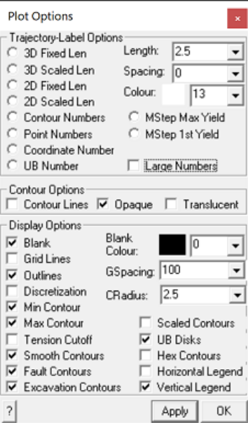

Configura as opções da plotagem de contornos.

Esta rotina pode ser iniciada clicando no botão ou simplesmente clicando com o botão direito em qualquer contorno.

Esta barra de ferramentas pode ser alterada para a orientação vertical arrastando-a contra a borda direita ou esquerda da janela principal.

Ela pode voltar à orientação horizontal arrastando-a contra a borda superior ou inferior da janela principal.

#### Trajectory-Label Options:

- 3D Fixed Length – exibe indicadores de orientação 3D de comprimento fixo.

O indicador é construído como um vetor 3D com uma ponta de seta na extremidade que aponta para longe de você (ou seja, para dentro da tela). Isso permite determinar se o vetor está mergulhando para longe ou na sua direção. Vetores que aparecem como pontos apontam diretamente para dentro ou para fora da tela.

Se você orientar a vista de modo a olhar ao longo da borda de uma grade, verá os vetores saindo e entrando no plano de contornos.

O comprimento dos vetores é definido com o parâmetro TLength:.

A densidade dos vetores é definida com o parâmetro TSpacing:.

- 3D Scaled Length – exibe indicadores de orientação 3D de comprimento escalonado.

O indicador é construído como descrito acima.

O comprimento dos vetores é escalonado pela magnitude da tensão, de modo que, se a magnitude for igual ao mínimo da faixa de contornos, o vetor é desenhado com comprimento zero. Se a magnitude for igual ao máximo da faixa de contornos, o vetor é desenhado com o comprimento especificado pelo parâmetro TLength:.

- 2D Fixed Length – exibe indicadores de orientação 2D de comprimento fixo.

O indicador é construído como uma projeção 2D do vetor 3D real, no plano da grade.

O comprimento dos vetores é definido com o parâmetro TLength:.

A densidade dos vetores é definida com o parâmetro TSpacing:.

- 2D Scaled Length – exibe indicadores de orientação 2D de comprimento escalonado.

O indicador é construído como descrito acima.

O indicador é construído como uma projeção 2D do vetor 3D real, no plano da grade.

O comprimento dos vetores é escalonado pela magnitude da tensão, de modo que, se a magnitude for igual ao mínimo da faixa de contornos, o vetor é desenhado com comprimento zero. Se a magnitude for igual ao máximo da faixa de contornos, o vetor é desenhado com o comprimento especificado pelo parâmetro TLength:.

- Contour Numbers – exibe números de contorno sobre os contornos. O número corresponde à magnitude do contorno em cada ponto.

- Point Numbers – exibe números de ponto sobre os contornos. O número corresponde ao número de registro de cada ponto.

- Coordinate Numbers – exibe números de coordenadas sobre os contornos. O número corresponde às coordenadas x,y,z de cada ponto.

- UB Number – exibe sobre os contornos o número do conjunto de juntas ubíquas (1, 2 ou 3) com a máxima tensão de cisalhamento excedente. Veja Ubiquitous Parameters

- MStep Max Yield – exibe a etapa em que ocorre a máxima tensão excedente. Veja Accumulated Damage

- MStep 1st Yield – exibe a etapa em que ocorre o primeiro escoamento. Veja Accumulated Damage

- Large Numbers – exibe os números em tamanho grande ou pequeno.

- Length – define o comprimento com que os indicadores de orientação serão desenhados. Se este parâmetro for muito pequeno, os vetores de trajetória ficarão pequenos demais para serem vistos. Se for muito grande, os vetores de trajetória se sobreporão e tornarão a exibição confusa.

- Spacing – define o espaçamento entre indicadores de orientação ou números adjacentes. Se este parâmetro for zero, as trajetórias serão desenhadas em todos os pontos da grade. Em grades finamente discretizadas, os vetores de trajetória podem ficar concentrados demais e difíceis de distinguir. Valores maiores deste parâmetro resultam em menos símbolos de trajetória desenhados.

- Colour – define a cor com que as trajetórias são desenhadas.

#### Contour Options:

- Contour Lines – desenha linhas entre as cores dos contornos. Essas linhas ajudam a destacar o limite entre diferentes intervalos de contorno e são particularmente úteis para apresentações em preto e branco.

- Opaque – desenha os contornos com cores opacas. Se esta opção e a opção translúcida estiverem ambas desmarcadas, somente linhas de contorno (ou seja, sem contornos coloridos) serão desenhadas.

- Translucent - desenha os contornos com cores translúcidas. Se esta opção e a opção opaca estiverem ambas desmarcadas, somente linhas de contorno (ou seja, sem contornos coloridos) serão desenhadas.

#### Display Options:

- Blank – quando marcada, os contornos são ocultados onde o plano da grade atravessa blocos de escavação. Isso é útil para identificar a extensão das escavações quando partes do modelo foram ocultadas. Também é útil para gerar seções 2D, pois a localização das escavações fica claramente visível.

Blank Colour: - define a cor usada para a ocultação.

Grid Lines – os contornos são desenhados com linhas em intervalos regulares da grade. O intervalo desejado é definido com o parâmetro Spacing:.

Outlines – são desenhados contornos ao redor das bordas da grade. Ao usar várias grades, talvez você não queira ver esses contornos.

Discretization – a discretização da grade é sobreposta aos contornos.

Min Contour – quando desmarcada, os contornos abaixo do mínimo da faixa de contornos não são desenhados. Isso é útil para exibir contornos em que apenas a parte superior da faixa é importante.

Por exemplo, ao exibir componentes de deformação não linear ou tensões excedentes, muitas vezes é útil deixar visíveis apenas as partes dos contornos diferentes de zero.

Se o parâmetro desejado tiver valor negativo, basta trocar o máximo e o mínimo da faixa de contornos ou plotar o valor absoluto do parâmetro.

Max Contour – quando desmarcada, os contornos acima do máximo da faixa de contornos não são desenhados.

- Tension Cutoff Symbol – quando marcada, um símbolo especial de tração será plotado em qualquer local onde o estado de tensões esteja abaixo do limite de tração especificado. Esta opção só é usada em plotagens de fatores de resistência.

- Smooth Contours – se você não marcou a opção de análise linear, os resultados só são calculados no centro de cada elemento de contorno e as plotagens de contornos de valores superficiais parecerão muito quadriculadas. Esta opção suaviza esses contornos para facilitar a interpretação.

Se você marcou a opção de análise linear, os resultados são calculados nos cantos dos elementos. Como não é necessária suavização, esta opção é ignorada.

Esta opção não tem efeito sobre plotagens de grades.

Fault contours – os contornos são desenhados nas superfícies de falha. Essas são superfícies DD com tipo de material fault-gouge (argila de falha).

Excavation contours – os contornos são desenhados nas superfícies de escavação. Essas são superfícies FF ou DD com tipo de material 0.

Scalled Contours – exibe os contornos como uma superfície topográfica.

A altura normal ao plano é escalonada pela magnitude da tensão, de modo que, se a magnitude for igual ao mínimo da faixa de contornos, a altura é desenhada com comprimento zero. Se a magnitude for igual ao máximo da faixa de contornos, o vetor é desenhado com o comprimento especificado pelo parâmetro CRadius:.

Para grades lineares, é escalonado o raio do tubo.

UB disks – alterna a exibição entre a plotagem de contornos plana e discos que representam a orientação do plano UB. Para mais informações, veja UB-Plane Parameters.

Hex contours – na versão Visco-Plastic do Map3D, isso habilita a exibição de valores calculados em nós internos.

Horizontal Legend - orienta horizontalmente a legenda dos intervalos de contorno.

Vertical Banner - orienta verticalmente a legenda dos intervalos de contorno.

GSpacing: - define o intervalo da grade.

CRadius - define o raio para o contorno de grades lineares.

#### Miscellaneous:

Apply – regenera a plotagem de contornos.
