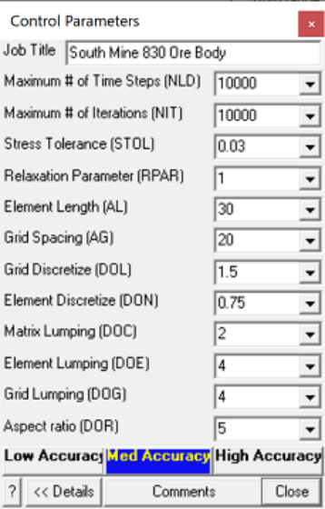
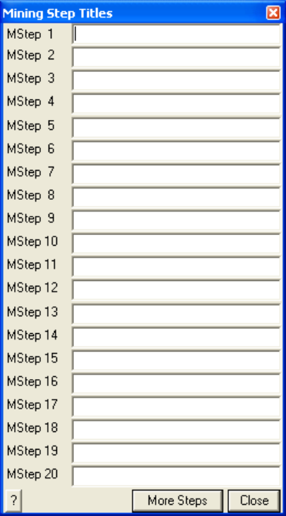

## 5.3.12.1 Parâmetros de controle

Especificação dos parâmetros de controle da análise.

**Job Title** - especifica um título descritivo do projeto.

**Maximum # of Time Steps (** **_NLD_ )** - especifica o número máximo de etapas que serão usadas durante a análise. Este parâmetro só é relevante se você estiver realizando uma análise de fluência não linear

#### Analysis > Options > Creep

na qual ele limita o número real de passos de tempo.

Se este parâmetro for excedido, o programa para e o usuário é solicitado a informar como proceder. Este parâmetro pode ser modificado durante a solução.

A menos que o usuário tenha algum motivo especial para limitar o número de passos de tempo, este parâmetro deve ser definido como um número arbitrariamente grande.

**Maximum # of Iterations (** **_NIT_ )** - especifica o número máximo de iterações que serão usadas durante a solução da matriz.

Se este parâmetro for excedido, o programa para e o usuário é solicitado a informar como proceder. Este parâmetro pode ser modificado durante a solução.

A menos que o usuário tenha algum motivo especial para limitar o número de passos de tempo, este parâmetro deve ser definido como um número arbitrariamente grande.

**Stress Tolerance (** **_STOL_ )** - especifica a precisão exigida da solução da matriz.

Durante a solução da matriz, a precisão é melhorada sucessivamente a cada iteração. Quando o erro máximo de tensão cai abaixo deste valor, a matriz pode ser considerada resolvida.

O valor sugerido para este parâmetro é 0,1% do estado de tensões de campo distante na profundidade de interesse. _STOL_ deve ser especificado nas mesmas unidades do estado de tensões de campo distante (p. ex., MPa ou psi).

**Relaxation Parameter (** **_RPAR_ )** - especifica o valor máximo de relaxação que será usado durante a solução da matriz.

Durante a solução da matriz, o programa modifica continuamente o parâmetro de relaxação na tentativa de obter convergência com o menor número possível de iterações. Este parâmetro limita o valor máximo que será usado.

O valor 1,2 é recomendado para problemas bem condicionados. Para problemas mal condicionados, deve-se usar o valor 0,8.

**Element Length (** **_AL_ )** - especifica o comprimento mínimo de elemento.

Durante o processo de discretização, todas as superfícies do modelo (superfícies de blocos FF e planos DD) são subdivididas em elementos de contorno com comprimento de lado

_Lelem = Delem/DON_

onde o Map3D determina _Delem_ como a menor distância entre superfícies adjacentes do modelo. Como em alguns locais a distância _Delem_ pode ser zero, o comprimento mínimo de lado de elemento _AL_ deve ser especificado.

_AL_ deve ser definido como o dobro da largura do menor pilar ou realce. Devem ser usadas as mesmas unidades usadas para especificar as coordenadas (p. ex., metros ou pés).

Depois de concluída a discretização, a distância _Delem_ pode ser plotada com

Plot > Miscellaneous > Delem distance to nearest element on surfaces.

Observe que, se desejado, esse comportamento pode ser substituído elemento por elemento especificando a largura máxima de cada elemento

#### CAD > Edit > Entity Properties > Maximum Width

Isso permite aos usuários forçar uma discretização fina e uniforme nas superfícies de áreas onde não há planos de grade.

**Grid Spacing (** **_AG_ )** - especifica o espaçamento mínimo de grade.

Durante o processo de discretização, todas as grades de pontos de campo e superfícies do modelo são subdivididas em elementos com comprimento de lado

_Lgrid = Dgrid/DOL_

onde o Map3D determina _Dgrid_ como a menor distância entre as superfícies do modelo e os planos de grade. Como em alguns locais a distância _Dgrid_ pode ser zero, o espaçamento mínimo de grade _AG_ deve ser especificado. Esse mesmo processo é usado para discretizar as superfícies do modelo (superfícies de blocos FF e planos DD) que estão próximas de grades de pontos de campo.

_AG_ deve ser definido como a menor dimensão de interesse. Por exemplo, se o usuário precisa ver a distribuição de tensões através de um pilar de 2 m de largura, um valor de _AG_ de 0,5 daria um número suficiente de pontos de campo para um contorno preciso. Devem ser usadas as mesmas unidades usadas para especificar as coordenadas (p. ex., metros ou pés).

Depois de concluída a discretização, a distância _Dgrid_ pode ser plotada nas superfícies do modelo com

Plot > Surface Components > Dgird distance to nearest grid

ou nas grades com

Plot > Miscellaneous > Delem distance to nearest element on grids.

Observe que, se desejado, esse comportamento pode ser substituído grade por grade especificando o espaçamento máximo de cada grade

#### CAD > Edit > Entity Properties > Maximum Width

Isso permite aos usuários forçar uma discretização fina e uniforme nas grades.

**Grid Discretize (** **_DOL_ ) -** especifica a razão desejada entre distância e comprimento de elemento, usada para determinar o espaçamento de grade a partir de

_Lgrid = Dgrid/DOL_

onde o Map3D determina _Dgrid_ como a menor distância entre as superfícies do modelo e os planos de grade.

Um valor de _DOL_ de 1,0 geralmente é adequado e pode-se esperar que forneça soluções com 10-20% de erro. Se for necessária maior precisão, um valor de _DOL_ de 2,0 deve dar 5-10% de erro. Use um valor de 4,0 para menos de 5% de erro. Embora valores maiores de _DOL_ resultem na geração de mais elementos de contorno e, portanto, em tempos de execução mais longos, isso é necessário para obter maior precisão.

Depois de concluída a discretização, a razão _Dgrid/Lelem_ pode ser plotada nas superfícies do modelo com

Plot > Miscellaneous > Dgrid/Lelem _DOL_ ratio on surfaces

ou a razão _Dgrid/Lgrid_ nas grades com

Plot > Miscellaneous > Dgrid/Lgrid _DOL_ ratio on grids.

**Element Discretize (** **_DON_ ) -** especifica a razão desejada entre distância e comprimento de elemento, usada para determinar o comprimento de lado do elemento

_Lelem = Delem/DON_

onde _Delem_ representa a distância à superfície mais próxima do modelo.

Um valor de _DON_ de 0,5 geralmente é adequado para todos os problemas, exceto aqueles com escavações ou pilares muito estreitos. Neste último caso, recomenda-se um valor de _DON_ de 1,0. Embora valores maiores de _DON_ resultem na geração de mais elementos de contorno e, portanto, em tempos de execução mais longos, isso é necessário para obter um problema bem condicionado e solúvel no caso de escavações ou pilares muito estreitos.

Depois de concluída a discretização, a razão _Delem/Lelem_ pode ser plotada com

Plot > Miscellaneous > Delem/Lelem _DON_ ratio on surfaces.

**Matrix Lumping (** **_DOC_ ) -** especifica a razão desejada entre distância e comprimento de elemento. Durante a montagem da matriz, todos os elementos que cabem dentro da dimensão

#### _Delem/DOC_

serão agrupados (lumping). _Delem_ representa a distância à superfície mais próxima do modelo.

Assim como para _DOL_ , um valor de _DOC_ de 1,0 geralmente é adequado e pode-se esperar que forneça soluções com 10-20% de erro. Se for necessária maior precisão, um valor de _DOC_ de 2,0 deve dar 5-10% de erro. Use um valor de 4,0 para menos de 5% de erro. Embora valores maiores de _DOC_ resultem em matrizes de coeficientes maiores e, portanto, em tempos de execução mais longos, isso é necessário para obter maior precisão.

Depois de concluída a discretização, a distância _Delem_ pode ser plotada com

Plot > Miscellaneous > Delem distance to nearest element on surfaces.

**Element Lumping (** **_DOE_ ) -** especifica a razão desejada entre distância e comprimento de elemento. Durante a montagem da grade, todos os elementos que cabem dentro da dimensão

#### _Dgrid/DOE_

serão agrupados (lumping). _Dgrid_ representa a distância à superfície de grade de pontos de campo mais próxima.

Um valor de _DOE_ de 2,0 geralmente é adequado e pode-se esperar que forneça soluções com 10-20% de erro. Se for necessária maior precisão, um valor de _DOE_ de 4,0 deve dar 5-10% de erro. Use um valor de 8,0 para menos de 5% de erro. Embora valores maiores de _DOE_ resultem em tempos de execução mais longos, isso é necessário para obter maior precisão.

Depois de concluída a discretização, a distância _Dgrid_ pode ser plotada nas grades com

Plot > Miscellaneous > Delem distance to nearest element on grids.

**Grid Lumping (** **_DOG_ ) -** especifica a razão desejada entre distância e comprimento de elemento. Durante a montagem da grade, todos os pontos de grade que cabem dentro da dimensão

#### _Dgrid/DOG_

serão agrupados (lumping). _Dgrid_ representa a distância à superfície de grade de pontos de campo mais próxima.

Um valor de _DOG_ de 2,0 geralmente é adequado e pode-se esperar que forneça soluções com 10-20% de erro. Se for necessária maior precisão, um valor de _DOG_ de 4,0 deve dar 5-10% de erro. Use um valor de 8,0 para menos de 5% de erro. Embora valores maiores de _DOG_ resultem em tempos de execução mais longos, isso é necessário para obter maior precisão.

Depois de concluída a discretização, a distância _Dgrid_ pode ser plotada nas grades com

Plot > Miscellaneous > Delem distance to nearest element on grids.

**Aspect Ratio (** **_DOR_ ) -** especifica a razão de aspecto desejada dos elementos. Um valor de _DOR_ de 5,0 é recomendado para todos os problemas, exceto quando o usuário deseja subdividir elementos estreitos em formas mais uniformes.

Define _DON_ =0,5, _DOL=DOC_ =1, _DOE=DOG_ =2 para 10-20% de erro. Define _DON_ =0,5, _DOL=DOC_ =2, _DOE=DOG_ =4 para 5-10% de erro. Define _DON_ =1, _DOL=DOC_ =4, _DOE=DOG_ =8 para &lt; 5% de erro.

**Comments -** permite especificar comentários que serão salvos com a execução.

#### Summary:

- _STOL_ deve ser definido como 0,1% do estado de tensões de campo distante na profundidade de interesse. Use as mesmas unidades do estado de tensões de campo distante (p. ex., MPa ou psi).

- _AL_ deve ser definido como o dobro da largura do menor pilar ou realce. Use as mesmas unidades usadas para especificar as coordenadas (p. ex., metros ou pés).

- _AG_ deve ser definido como a menor dimensão de interesse. Use as mesmas unidades usadas para especificar as coordenadas (p. ex., metros ou pés).

- Os elementos são discretizados com um comprimento de lado igual ao menor valor entre _Delem/DON_ e _Dgrid/DOL_ , de modo que não pode ser menor que _AL_ nem maior que a largura máxima.

- As grades são discretizadas com um espaçamento determinado a partir de _Dgrid/DOL_ , de modo que não pode ser menor que _AG_ nem maior que o espaçamento máximo.

- Durante a montagem da matriz, todos os elementos que cabem dentro da dimensão _Delem/DOC_ serão agrupados (lumping).

- Durante a montagem da grade, todos os elementos que cabem dentro da dimensão _Dgrid/DOE_ serão agrupados (lumping).

- Durante a montagem da grade, todos os pontos de grade que cabem dentro da dimensão _Dgrid/DOG_ serão agrupados (lumping).

#### Notes:

Para uma discussão mais detalhada sobre discretização e agrupamento (lumping), consulte

- Discretization and Lumping.

## 5.3.12.2 Títulos das etapas de lavra

Especificação de um título descritivo para cada etapa de lavra.

## 5.3.12.3 Propriedades dos materiais

Especificação das propriedades dos materiais.

Várias caixas de diálogo diferentes aparecerão dependendo do tipo de material selecionado: Mohr-Coulomb, Hoek-Brown, Drucker-Prager, Backfill Hyperbolic e None.

Mohr-Coulomb em blocos FF 3D pode ser usado como regra de fluxo para o comportamento não linear de materiais no Map3D Non-Linear e no Map3D Visco-Plastic. Também pode ser usado como critério de ruptura em blocos FF 3D ou no material da rocha encaixante (host) no Map3D Fault-Slip.

Hoek-Brown em blocos FF 3D pode ser usado como critério de ruptura em blocos FF 3D ou no material da rocha encaixante no Map3D Fault-Slip.

Drucker-Prager em blocos FF 3D pode ser usado como critério de ruptura em blocos FF 3D ou no material da rocha encaixante no Map3D Fault-Slip.

Fault-Gouge em planos DD pode ser usado como regra de fluxo em planos DD no Map3D Fault-Slip, no Map3D Non-Linear ou no Map3D Visco-Plastic.

Equilibrated-Gouge em planos DD pode ser usado como regra de fluxo em planos DD no Map3D Fault-Slip, no Map3D Non-Linear ou no Map3D Visco-Plastic.

Yielding-Pillar em planos DD pode ser usado como regra de fluxo em planos DD no Map3D Fault-Slip, no Map3D Non-Linear ou no Map3D Visco-Plastic.

Hyperbolic-Backfill em planos DD pode ser usado como regra de fluxo em planos DD no Map3D Fault-Slip, no Map3D Non-Linear ou no Map3D Visco-Plastic.

Quadratic-Backfill em planos DD pode ser usado como regra de fluxo em planos DD no Map3D Fault-Slip, no Map3D Non-Linear ou no Map3D Visco-Plastic.

Softened Material em blocos FF 3D ou planos DD pode ser usado para amolecer um material elástico e simular o escoamento do terreno e os efeitos de redistribuição de tensões resultantes.

Stress State especifica o estado de tensões pré-lavra.

Nas análises elásticas, o critério de ruptura é usado apenas para o cálculo de fatores de resistência e para as plotagens de contornos e não afeta os resultados da análise.

Nas análises não lineares (blocos FF 3D no Map3D Non-Linear, blocos FF 3D no Map3D Visco-Plastic e planos DD no Map3D Fault-Slip), o critério de ruptura é usado como regra de fluxo para controlar o escoamento e as deformações não lineares.

## 5.3.12.4 Configuração do Map3Di

Configura a análise Map3Di.

O Map3Di permite sobrepor ao modelo do Map3D efeitos de carregamento de campo externo. Para detalhes sobre este recurso, consulte Map3Di.

Ao verificar um arquivo de carregamento Map3Di para uso, você será solicitado a procurar um nome e uma localização de arquivo. Se a busca for bem-sucedida, o arquivo será verificado.

O arquivo de carregamento Map3Di é especificado em formato de arquivo de polilinhas. Para detalhes sobre como gerar um arquivo de carregamento Map3Di, consulte Contour Plane Options.

As linhas de comentário devem começar com um asterisco "*" na coluna 1.

Os planos 2D são armazenados como uma série de polilinhas triangulares ou quadrangulares, da seguinte forma:

x1 y1 z1 3 values1 x2 y2 z2 2 values2 x3 y3 z3 2 values3 x4 y4 z4 2 values4 ...

Os blocos 3D são armazenados como uma série de polilinhas tetraédricas ou hexaédricas, da seguinte forma:

x1 y1 z1 3 values1 x2 y2 z2 2 values2 x3 y3 z3 2 values3 x4 y4 z4 2 values4 x5 y5 z5 1 values5 x6 y6 z6 1 values6

x7 y7 z7 1 values7

x8 y8 z8 1 values8

onde **xi yi zi** representam as coordenadas de cada ponto.

- 3 indica que este ponto é o início de uma nova polilinha.

- 2 indica que este ponto faz parte da base do bloco.

- 1 indica que este ponto faz parte do topo do bloco. Este item só é usado para a definição de formas de blocos 3D.

Polilinhas adicionais são especificadas repetindo a sequência (ou seja, iniciando uma nova polilinha com o número **3** ).

Qualquer um dos pontos pode ser repetido ou omitido para especificar lados triangulares ou tetraedros.

- valuesi especifica a magnitude do carregamento de campo no centro ou em cada canto. Se apenas values1 for especificado (ou seja, values2 … forem deixados em branco), esse valor é aplicado uniformemente a toda a entidade.

- Se valuesi forem especificados para todos os cantos, o carregamento de campo é aplicado segundo uma distribuição polinomial de ordem superior.

Para triângulos de superfície 2D, é usada uma distribuição linear

_a_ + _b x_ + _c y_

Para quadriláteros 2D, é usada a seguinte distribuição

_a_ + _b x_ + _c y_ + _d x y_

Para formas de blocos 3D, são usados tantos termos da distribuição quanto possível

_a_ + _b x_ + _c y_ + _d z_ + _e x y_ + _f y z_ + _g z x_ + _h x y z_

Os efeitos reais do carregamento de campo podem ser especificados de várias formas.

#### 2D Planes

Os planos 2D definem uma descontinuidade de deslocamento com deslocamento normal (fechamento) dn e deslocamento de cisalhamento (ride) ds especificados, de modo que valuesi pode ser especificado como

dn ds ou dn ds1 ds2

Se apenas dn ds forem especificados, o deslocamento de cisalhamento (ride) é aplicado paralelo à tensão de cisalhamento máxima no plano do plano 2D.

Se todos dn ds1 ds2 forem especificados, a componente do deslocamento de cisalhamento (ride) ds1 é aplicada paralela ao primeiro lado (ou seja, o lado definido por x1 y1 z1 – x2 y2 z2). ds2 é aplicada perpendicular a ds1 na direção do segundo lado (ou seja, o lado definido por x2 y2 z2 - x3 y3 z3).

O deslocamento de cisalhamento (ride) e o deslocamento normal (fechamento) são especificados em unidades de deslocamento (ou seja, as mesmas unidades em que a geometria é especificada (metros)).

O deslocamento de cisalhamento (ride) e o deslocamento normal (fechamento) podem ser determinados a partir de medições in situ ou de laboratório de cisalhamento, fechamento e/ou abertura de fissuras, ou a partir de outro programa de modelagem numérica, como um simulador de reservatório ou de fraturamento hidráulico. Também podem ser estimados a partir de dados de monitoramento sísmico.

#### 3D Blocks

Os blocos 3D definem uma zona com deformação e especificada, como

e1 e2 e3 ou exx eyy ezz exy eyz ezx

Se apenas e1 e2 e3 forem especificados, essas deformações principais são aplicadas paralelas às tensões principais. As deformações são usadas para determinar a tensão inicial s° usando

s1° = [ ( _1-_ n) e1 + n ( e2 + e3 ) ] _E_ / [ ( _1+_ n) ( _1-2_ n) ] s2° = [ ( _1-_ n) e2 + n ( e3 + e1 ) ] _E_ / [ ( _1+_ n) ( _1-2_ n) ] s3° = [ ( _1-_ n) e3 + n ( e1 + e2 ) ] _E_ / [ ( _1+_ n) ( _1-2_ n) ]

Se todos exx eyy ezz exy eyz ezx forem especificados, essas deformações são aplicadas como componentes cartesianas. As deformações são usadas para determinar a tensão inicial s° usando

sxx°  = [ ( _1-_ n) exx + n ( eyy + ezz ) ] _E_ / [ ( _1+_ n) ( _1-2_ n) ] syy° = [ ( _1-_ n) eyy + n ( ezz + exx ) ] _E_ / [ ( _1+_ n) ( _1-2_ n) ] szz°  = [ ( _1-_ n) ezz + n ( exx + eyy ) ] _E_ / [ ( _1+_ n) ( _1-2_ n) ] txy° = exy _E_ / ( _1+_ n) tyz° = eyz _E_ / ( _1+_ n) tzx° = ezx _E_ / ( _1+_ n)

As deformações são especificadas em unidades de deformação adimensionais (ou seja, 0,001 especificaria 1000 microdeformações).

_E_ e n representam, respectivamente, o módulo de Young (em escala de maciço rochoso – de deformação) e o coeficiente de Poisson. O Map3D determina automaticamente em qual material o canto do bloco 3D está localizado e usa as propriedades do material correspondente.

As deformações podem ser determinadas a partir de medições in situ ou de laboratório de temperatura ou pressão de fluido, ou a partir de outro programa de modelagem numérica, como um código de análise térmica. Também podem ser estimadas a partir de dados de monitoramento sísmico.

As deformações a aplicar podem ser determinadas a partir da temperatura por meio de um coeficiente de expansão _A_ , em que a variação de temperatura ou a variação de pressão de fluido (em relação ao valor de fundo) induz as tensões iniciais

s1° **=** s2° **=** s3° = _A_ D _T_

Para problemas de fluxo de fluido, o coeficiente de expansão _A_ deve ser definido como a unidade (um positivo) para meios saturados. Para problemas térmicos, o coeficiente de expansão deve ser especificado como uma quantidade negativa dada por

_A_ = a _E /(1-2_ n _)_

onde a representa o coeficiente de expansão térmica (ou seja, a expansividade linear).

#### Notes

Esta função deve ser configurada antes de realizar a análise BEM do Map3D

Analysis > BEM Analysis.

CAD > Properties > Map3Di Setup > View permite visualizar os dados do Map3Di.

## 5.3.12.5 Informações do modelo

Exibe a contagem atual dos seguintes parâmetros do modelo:

- número de superfícies usadas para definir a geometria,

- número de coordenadas usadas para definir as superfícies,

- número de etapas de lavra.

Os parâmetros a seguir só são exibidos depois de concluída a análise de discretização (Analysis > Discretization):

- número de elementos de contorno,

- número de nós de contorno (usado apenas para elementos de ordem superior (Analysis > Options > Linear),

- número de pontos de campo nas grades definidas pelo usuário.
