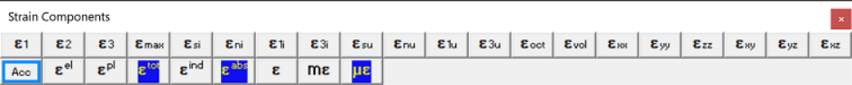
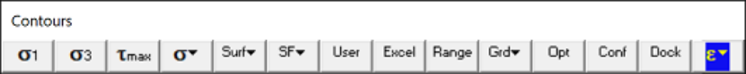
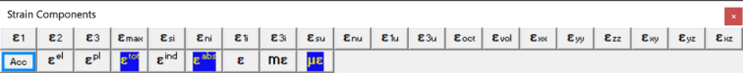
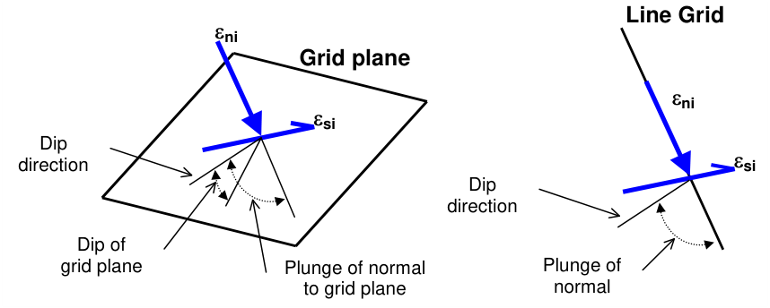
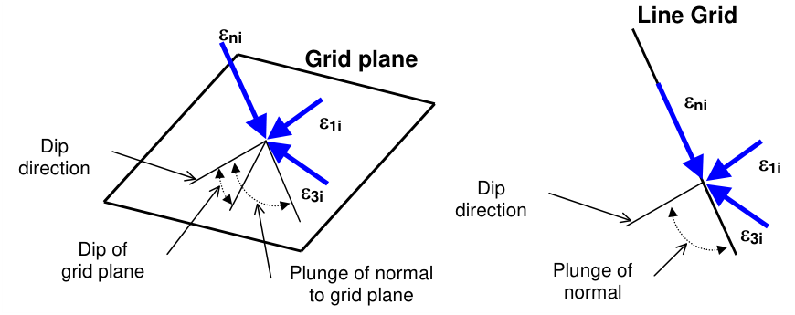
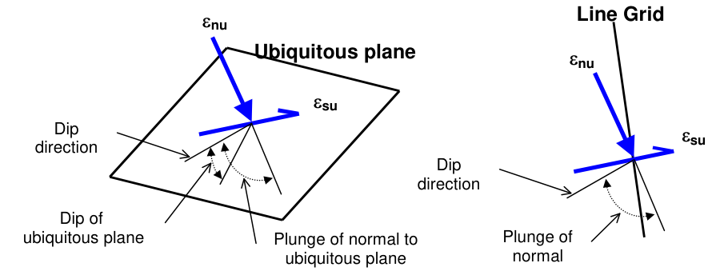
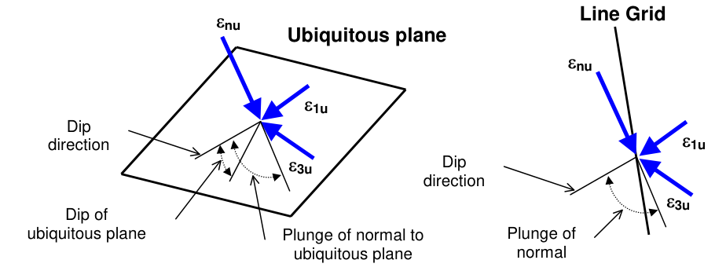

## 5.3.2.1 Deformação principal maior

Gera contornos das deformações principais maior, intermediária e menor. Essas componentes podem ser acessadas pela barra de ferramentas Strain Components, da seguinte forma:

Esta barra de ferramentas pode ser alterada para a orientação vertical arrastando-a contra a borda direita ou esquerda da janela principal.

Ela pode voltar à orientação horizontal arrastando-a contra a borda superior ou inferior da janela principal.

Ao selecionar o botão da barra de ferramentas Contours, a barra de ferramentas Stress Components é ativada.

Esta barra de ferramentas pode ser alterada para a orientação vertical arrastando-a contra a borda direita ou esquerda da janela principal.

Ela pode voltar à orientação horizontal arrastando-a contra a borda superior ou inferior da janela principal.

Ao selecionar o botão da barra de ferramentas Contours, a barra de ferramentas Strain Components é ativada.

Você pode adicionar este botão à barra de ferramentas Contours usando o botão de configuração.

Na análise elástica, a tensão principal maior é normalmente usada com a tensão principal menor e o critério de resistência de Mohr-Coulomb ou de Hoek-Brown para estimar o grau de dano devido à sobretensão. Por outro lado, na análise não linear as tensões nunca podem exceder a resistência, a menos que algum nível de fluência seja usado. Neste último caso, a fluência viscosa pode permitir estados de tensão acima do critério de ruptura, indicando falta de equilíbrio estático. Portanto, na análise não linear normalmente se considera diretamente a quantidade de deformação não linear ou a taxa de deformação prevista pelo modelo

Mohr-Coulomb in 3D FF blocks

#### Accumulated Damage:

No caso da análise plástica, a função de dano acumulado pode ser ativada. Quando Acc não está ativada, é usado o valor atual da deformação plástica. Quando Acc está ativada, o dano é acompanhado da etapa 1 até a etapa atual ao longo de todo o histórico de carregamento do modelo; assim, é plotado o pior caso (máximo) de deformação plástica.

Observe que tanto a etapa em que ocorre o primeiro escoamento, MStep 1st Yield, quanto a etapa em que ocorre a deformação plástica máxima, MStep Max Yield, são acompanhadas e podem ser exibidas como rótulos de trajetória.

#### Strain Components:

Observe que há três componentes de deformação que podem ser contornadas:

Plot > Strain > Value > Elastic Plot > Strain > Value > Plastic Plot > Strain > Value > Total

Há também duas formas diferentes de apresentar a deformação:

Plot > Strain > Value > Induced Strain Plot > Strain > Value > Absolute Strain

A faixa de contornos é definida com

#### Plot > Range

Qualquer uma dessas componentes pode ser adicionada à barra de ferramentas de contornos, se desejado

Tools > Configure Contouring Toolbar > Strain

Pode ser útil adicionar o botão

#### More Strain Components

à barra de ferramentas de contornos para acessar rapidamente todas as componentes de deformação.

## 5.3.2.4 Deformação de cisalhamento máxima

Gera contornos da deformação de cisalhamento máxima ½( e1 - e3 )

Essa componente pode ser acessada pela barra de ferramentas Strain Components, da seguinte forma:

Esta barra de ferramentas pode ser alterada para a orientação vertical arrastando-a contra a borda direita ou esquerda da janela principal.

Ela pode voltar à orientação horizontal arrastando-a contra a borda superior ou inferior da janela principal.

Ao selecionar o botão da barra de ferramentas Contours, a barra de ferramentas Stress Components é ativada.

Você pode adicionar este botão à barra de ferramentas Contours usando o botão de configuração.

Na análise elástica, a tensão principal maior é normalmente usada com a tensão principal menor e o critério de resistência de Mohr-Coulomb ou de Hoek-Brown para estimar o grau de dano devido à sobretensão. Por outro lado, na análise não linear as tensões nunca podem exceder a resistência, a menos que algum nível de fluência seja usado. Neste último caso, a fluência viscosa pode permitir estados de tensão acima do critério de ruptura, indicando falta de equilíbrio estático. Portanto, na análise não linear normalmente se considera diretamente a quantidade de deformação não linear ou a taxa de deformação prevista pelo modelo

Mohr-Coulomb in 3D FF blocks

Observe que há três componentes de deformação que podem ser contornadas:

Plot > Strain > Value > Elastic Plot > Strain > Value > Plastic Plot > Strain > Value > Total

Há também duas formas diferentes de apresentar a deformação:

Plot > Strain > Value > Induced Strain Plot > Strain > Value > Absolute Strain

A faixa de contornos é definida com

#### Plot > Range

Qualquer uma dessas componentes pode ser adicionada à barra de ferramentas de contornos, se desejado

Tools > Configure Contouring Toolbar > Strain

Pode ser útil adicionar o botão

#### More Strain Components

à barra de ferramentas de contornos para acessar rapidamente todas as componentes de deformação.

## 5.3.2.5 Deformação de cisalhamento no plano

Gera contornos da deformação de cisalhamento máxima que atua no plano da grade e da componente de deformação normal ao plano da grade ou paralela a uma grade linear.

Essas componentes podem ser acessadas pela barra de ferramentas Strain Components, da seguinte forma:

Esta barra de ferramentas pode ser alterada para a orientação vertical arrastando-a contra a borda direita ou esquerda da janela principal.

Ela pode voltar à orientação horizontal arrastando-a contra a borda superior ou inferior da janela principal.

Ao selecionar o botão da barra de ferramentas Contours, a barra de ferramentas Stress Components é ativada.

Você pode adicionar este botão à barra de ferramentas Contours usando o botão de configuração.

#### Plot > Grid Selection

Para calcular as deformações no plano, o estado de deformação em cada ponto do plano da grade é reorientado para determinar a deformação de cisalhamento máxima paralela ao plano da grade e a deformação normal ao plano. Observe que eip é orientada normal ao plano da grade e paralela à direção de uma grade linear.

- a direção de mergulho é medida positiva no sentido horário a partir do eixo y.

- o mergulho do plano é medido positivo para baixo a partir da horizontal (ou seja, a direção de mergulho).

- o caimento da normal é medido positivo para baixo (ou seja, negativo para cima) a partir da horizontal.

Na análise elástica, a tensão de cisalhamento máxima no plano é normalmente usada com a tensão normal no plano e o critério de resistência de Mohr-Coulomb

Mohr-Coulomb in 3D FF blocks

para estimar o grau de dano devido à sobretensão. Por outro lado, na análise não linear as tensões nunca podem exceder a resistência, a menos que algum nível de fluência seja usado. Neste último caso, a fluência viscosa pode permitir estados de tensão acima do critério de ruptura, indicando falta de equilíbrio estático. Portanto, na análise não linear normalmente se considera diretamente a quantidade de deformação não linear ou a taxa de deformação prevista pelo modelo

Mohr-Coulomb in DD planes

para estimar a quantidade de deslizamento devido à sobretensão, em uma falha, conjunto de juntas ou plano de acamamento orientado da mesma forma que o plano da grade. Como esses parâmetros dependem da orientação, este critério é representativo da estabilidade de um maciço rochoso anisotrópico.

Observe que há três componentes de deformação que podem ser contornadas:

Plot > Strain > Value > Elastic Plot > Strain > Value > Plastic Plot > Strain > Value > Total

Há também duas formas diferentes de apresentar a deformação:

Plot > Strain > Value > Induced Strain Plot > Strain > Value > Absolute Strain

A faixa de contornos é definida com

#### Plot > Range

Qualquer uma dessas componentes pode ser adicionada à barra de ferramentas de contornos, se desejado

Tools > Configure Contouring Toolbar > Strain

Pode ser útil adicionar o botão

#### More Strain Components

à barra de ferramentas de contornos para acessar rapidamente todas as componentes de deformação.

Tópicos relacionados:

Plot > Strain > e1i In-plane Maximum Plot > Strain > e3i In-plane Minimum Plot > Strain > esu Ubiquitous-plane Shear Plot > Strain > enu Ubiquitous-plane Normal

## 5.3.2.7 Deformação máxima no plano

Gera contornos das deformações máxima e mínima tangenciais ao plano da grade selecionado atualmente ou perpendiculares a uma grade linear.

Essas componentes podem ser acessadas pela barra de ferramentas Strain Components, da seguinte forma:

Esta barra de ferramentas pode ser alterada para a orientação vertical arrastando-a contra a borda direita ou esquerda da janela principal.

Ela pode voltar à orientação horizontal arrastando-a contra a borda superior ou inferior da janela principal.

Ao selecionar o botão da barra de ferramentas Contours, a barra de ferramentas Stress Components é ativada.

Você pode adicionar este botão à barra de ferramentas Contours usando o botão de configuração.

#### Plot > Grid Selection

Para calcular as deformações máxima e mínima no plano, as deformações tangenciais ao plano da grade são determinadas e depois resolvidas para fornecer os valores máximo e mínimo. Observe que eni é orientada normal ao plano da grade e paralela à direção de uma grade linear. Observe também que eni, e1i e e3i são perpendiculares entre si.

- a direção de mergulho é medida positiva no sentido horário a partir do eixo y.

- o mergulho do plano é medido positivo para baixo a partir da horizontal (ou seja, a direção de mergulho).

- o caimento da normal é medido positivo para baixo (ou seja, negativo para cima) a partir da horizontal.

Observe que há três componentes de deformação que podem ser contornadas:

#### Plot > Strain > Value > Elastic

Plot > Strain > Value > Plastic Plot > Strain > Value > Total

Há também duas formas diferentes de apresentar a deformação:

Plot > Strain > Value > Induced Strain Plot > Strain > Value > Absolute Strain

A faixa de contornos é definida com

Plot > Range

Esta componente pode ser adicionada à barra de ferramentas de contornos, se desejado

Tools > Configure Contouring Toolbar > Strain

Pode ser útil adicionar o botão

More Strain Components

à barra de ferramentas de contornos para acessar rapidamente todas as componentes de deformação.

Tópicos relacionados:

Plot > Strain > esi In-plane Shear Plot > Strain > eni In-plane Normal Plot > Strain > e1u Ubiquitous-plane Maximum. Plot > Strain > e3u Ubiquitous-plane Minimum.

## 5.3.2.9 Deformação de cisalhamento no plano ubíquo

Gera contornos da deformação de cisalhamento máxima que atua no plano ubíquo nº 1 e da componente de deformação normal a esse plano.

Essas componentes podem ser acessadas pela barra de ferramentas Strain Components, da seguinte forma:

Esta barra de ferramentas pode ser alterada para a orientação vertical arrastando-a contra a borda direita ou esquerda da janela principal.

Ela pode voltar à orientação horizontal arrastando-a contra a borda superior ou inferior da janela principal.

Ao selecionar o botão da barra de ferramentas Contours, a barra de ferramentas Stress Components é ativada.

Você pode adicionar este botão à barra de ferramentas Contours usando o botão de configuração.

Para calcular as deformações ubíquas, o estado de deformação em cada ponto do plano da grade é reorientado para determinar a deformação de cisalhamento máxima paralela ao plano ubíquo e a deformação normal ao plano ubíquo. Observe que enu é orientada normal ao plano ubíquo e não é paralela à direção de uma grade linear.

- a direção de mergulho é medida positiva no sentido horário a partir do eixo y.

- o mergulho do plano é medido positivo para baixo a partir da horizontal (ou seja, a direção de mergulho).

- o caimento da normal é medido positivo para baixo (ou seja, negativo para cima) a partir da horizontal.

A orientação do plano de cisalhamento ubíquo é definida com

#### Plot > Strength Factors > Ubiquitous Parameters

Observe que há três componentes de deformação que podem ser contornadas:

Plot > Strain > Value > Elastic Plot > Strain > Value > Plastic Plot > Strain > Value > Total

Há também duas formas diferentes de apresentar a deformação:

Plot > Strain > Value > Induced Strain Plot > Strain > Value > Absolute Strain

A faixa de contornos é definida com

#### Plot > Range

Esta componente pode ser adicionada à barra de ferramentas de contornos, se desejado

Tools > Configure Contouring Toolbar > Strain

Pode ser útil adicionar o botão

#### More Strain Components

à barra de ferramentas de contornos para acessar rapidamente todas as componentes de deformação.

Tópicos relacionados:

Plot > Strain > e1u Ubiquitous-plane Maximum. Plot > Strain > e3u Ubiquitous-plane Minimum. Plot > Strain > esi In-plane Shear Plot > Strain > eni In-plane Normal

## 5.3.2.11 Deformação máxima no plano ubíquo

Gera contornos das deformações máxima e mínima tangenciais ao plano ubíquo nº 1. Essas componentes podem ser acessadas pela barra de ferramentas Strain Components, da seguinte forma:

Esta barra de ferramentas pode ser alterada para a orientação vertical arrastando-a contra a borda direita ou esquerda da janela principal.

Ela pode voltar à orientação horizontal arrastando-a contra a borda superior ou inferior da janela principal.

Ao selecionar o botão da barra de ferramentas Contours, a barra de ferramentas Stress Components é ativada.

Você pode adicionar este botão à barra de ferramentas Contours usando o botão de configuração.

Para calcular as deformações ubíquas, o estado de deformação em cada ponto do plano da grade é reorientado para determinar a deformação máxima e mínima paralelas ao plano ubíquo. Observe que enu não é orientada normal ao plano ubíquo e não é paralela à direção de uma grade linear.

- a direção de mergulho é medida positiva no sentido horário a partir do eixo y.

- o mergulho do plano é medido positivo para baixo a partir da horizontal (ou seja, a direção de mergulho).

- o caimento da normal é medido positivo para baixo (ou seja, negativo para cima) a partir da horizontal.

A orientação do plano de cisalhamento ubíquo é definida com

#### Plot > Strength Factors > Ubiquitous Parameters

Observe que há três componentes de deformação que podem ser contornadas:

Plot > Strain > Value > Elastic Plot > Strain > Value > Plastic Plot > Strain > Value > Total

Há também duas formas diferentes de apresentar a deformação:

Plot > Strain > Value > Induced Strain Plot > Strain > Value > Absolute Strain

A faixa de contornos é definida com

#### Plot > Range

Esta componente pode ser adicionada à barra de ferramentas de contornos, se desejado

Tools > Configure Contouring Toolbar > Strain

Pode ser útil adicionar o botão

#### More Strain Components

à barra de ferramentas de contornos para acessar rapidamente todas as componentes de deformação.

Tópicos relacionados:

Plot > Strain > esi Ubiquitous-plane Shear

Plot > Strain > eni Ubiquitous-plane Normal

Plot > Strain > e1u In-plane Maximum.

Plot > Strain > e3u In-plane Minimum.

## 5.3.2.13 Deformação de cisalhamento octaédrica

Gera contornos da deformação de cisalhamento octaédrica

eoct = ¹/3 [ (e1 - e2)² + (e2 - e3)² +(e3 - e1)² ]½

e da deformação volumétrica

evvol = (e1 + e2 + e3)

Essas componentes podem ser acessadas pela barra de ferramentas Strain Components, da seguinte forma:

Esta barra de ferramentas pode ser alterada para a orientação vertical arrastando-a contra a borda direita ou esquerda da janela principal.

Ela pode voltar à orientação horizontal arrastando-a contra a borda superior ou inferior da janela principal.

Ao selecionar o botão da barra de ferramentas Contours, a barra de ferramentas Stress Components é ativada.

Você pode adicionar este botão à barra de ferramentas Contours usando o botão de configuração.

Na análise elástica, a tensão principal maior é normalmente usada com a tensão principal menor e o critério de resistência de Mohr-Coulomb ou de Hoek-Brown para estimar o grau de dano devido à sobretensão.

Por outro lado, na análise não linear as tensões nunca podem exceder a resistência, a menos que algum nível de fluência seja usado. Neste último caso, a fluência viscosa pode permitir estados de tensão acima do critério de ruptura, indicando falta de equilíbrio estático. Portanto, na análise não linear normalmente se considera diretamente a quantidade de deformação não linear ou a taxa de deformação prevista pelo modelo

Mohr-Coulomb in 3D FF blocks

Observe que há três componentes de deformação que podem ser contornadas:

Plot > Strain > Value > Elastic Plot > Strain > Value > Plastic Plot > Strain > Value > Total

Há também duas formas diferentes de apresentar a deformação:

Plot > Strain > Value > Induced Strain Plot > Strain > Value > Absolute Strain

A faixa de contornos é definida com

#### Plot > Range

Esta componente pode ser adicionada à barra de ferramentas de contornos, se desejado

Tools > Configure Contouring Toolbar > Strain

Pode ser útil adicionar o botão

#### More Strain Components

à barra de ferramentas de contornos para acessar rapidamente todas as componentes de deformação.

## 5.3.2.15 Componente de deformação Exx

Gera contornos das componentes cartesianas da deformação. Essas componentes podem ser acessadas pela barra de ferramentas Strain Components, da seguinte forma:

Esta barra de ferramentas pode ser alterada para a orientação vertical arrastando-a contra a borda direita ou esquerda da janela principal.

Ela pode voltar à orientação horizontal arrastando-a contra a borda superior ou inferior da janela principal.

Ao selecionar o botão da barra de ferramentas Contours, a barra de ferramentas Stress Components é ativada.

Você pode adicionar este botão à barra de ferramentas Contours usando o botão de configuração.

Plot > Strain >  exx Cartesian Strain Component   deformação normal na direção do eixo x Plot > Strain >  eyy Cartesian Strain Component   deformação normal na direção do eixo y Plot > Strain >  ezz Cartesian Strain Component   deformação normal na direção do eixo z Plot > Strain >  exy Cartesian Strain Component   deformação normal na direção do plano x-y Plot > Strain >  eyz Cartesian Strain Component   deformação normal na direção do plano y-z Plot > Strain >  exz Cartesian Strain Component   deformação normal na direção do plano x-z

Observe que há três componentes de deformação que podem ser contornadas:

Plot > Strain > Value > Elastic Plot > Strain > Value > Plastic Plot > Strain > Value > Total

Há também duas formas diferentes de apresentar a deformação:

Plot > Strain > Value > Induced Strain Plot > Strain > Value > Absolute Strain

A faixa de contornos é definida com

#### Plot > Range

Esta componente pode ser adicionada à barra de ferramentas de contornos, se desejado

Tools > Configure Contouring Toolbar > Strain

Pode ser útil adicionar o botão

More Strain Components

à barra de ferramentas de contornos para acessar rapidamente todas as componentes de deformação.

## 5.3.2.21 Valor

5.3.2.21.1  Deformação elástica

Seleciona a componente da deformação elástica, plástica ou total. Essas componentes podem ser acessadas pela barra de ferramentas Strain Components, da seguinte forma:

Esta barra de ferramentas pode ser alterada para a orientação vertical arrastando-a contra a borda direita ou esquerda da janela principal.

Ela pode voltar à orientação horizontal arrastando-a contra a borda superior ou inferior da janela principal.

Ao selecionar o botão da barra de ferramentas Contours, a barra de ferramentas Stress Components é ativada.

Você pode adicionar este botão à barra de ferramentas Contours usando o botão de configuração.

Para mais detalhes, consulte

Mohr-Coulomb in 3D FF blocks.

### 5.3.2.21.4 Deformação induzida

Plota a componente da deformação induzida ou da deformação absoluta.

Essa componente pode ser acessada pela barra de ferramentas Strain Components, da seguinte forma:

Esta barra de ferramentas pode ser alterada para a orientação vertical arrastando-a contra a borda direita ou esquerda da janela principal.

Ela pode voltar à orientação horizontal arrastando-a contra a borda superior ou inferior da janela principal.

Ao selecionar o botão da barra de ferramentas Contours, a barra de ferramentas Stress Components é ativada.

Você pode adicionar este botão à barra de ferramentas Contours usando o botão de configuração.

A deformação induzida é a deformação sem a contribuição da deformação pré-lavra. Representa a variação de deformação desde a condição pré-lavra.

A deformação absoluta é a deformação incluindo a contribuição da deformação pré-lavra.

Veja também:

Plot > Stress > Value > Induced Strain Plot > Stress > Value > Absolute Strain

### 5.3.2.21.6 Deformação

Plota a deformação:

- em unidades não escalonadas (deformação/1),

- em milideformação (deformação/1000),

- em microdeformação (deformação/1000000).

Essa componente pode ser acessada pela barra de ferramentas Strain Components, da seguinte forma:

Esta barra de ferramentas pode ser alterada para a orientação vertical arrastando-a contra a borda direita ou esquerda da janela principal.

Ela pode voltar à orientação horizontal arrastando-a contra a borda superior ou inferior da janela principal.

Ao selecionar o botão da barra de ferramentas Contours, a barra de ferramentas Stress Components é ativada.

Você pode adicionar este botão à barra de ferramentas Contours usando o botão de configuração.

