## 5.3.6.1 Parâmetros do maciço rochoso

### 5.3.6.1.1 Parâmetros de resistência do maciço rochoso

Configura os parâmetros de resistência para gerar plotagens de contornos de fatores de resistência em termos das componentes da tensão principal.

Essas componentes podem ser acessadas pela barra de ferramentas Strength Factor Components, da seguinte forma:

Esta barra de ferramentas pode ser alterada para a orientação vertical arrastando-a contra a borda direita ou esquerda da janela principal.

Ela pode voltar à orientação horizontal arrastando-a contra a borda superior ou inferior da janela principal.

Ao selecionar o botão da barra de ferramentas Contours, a barra de ferramentas Strength Factor Components é ativada.

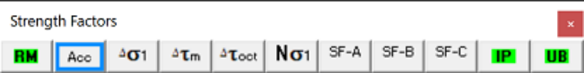

Na análise elástica, as tensões principais maior e menor podem ser usadas com os critérios de resistência de Mohr-Coulomb, Hoek-Brown ou Drucker-Prager para estimar o grau de dano devido à sobretensão. Como nenhum dos parâmetros é sensível à orientação, este critério é representativo da estabilidade de um maciço rochoso homogêneo.

Por outro lado, na análise não linear as tensões nunca podem exceder a resistência, a menos que algum nível de fluência seja usado. Neste último caso, a fluência viscosa pode permitir estados de tensão acima do critério de ruptura, indicando falta de equilíbrio estático. Portanto, na análise não linear normalmente se considera diretamente a quantidade de deformação não linear ou a taxa de deformação prevista pelo modelo

Mohr-Coulomb in 3D FF blocks.

#### Mohr-Coulomb

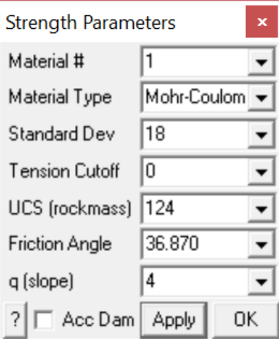

Material # especifica o número do material. O material nº 1 representa o material da rocha encaixante (host). Os demais números de material são usados para definir zonas de material alternativo, como minério, argila de falha (gouge), aterro etc.

Standard Deviation especifica a incerteza do critério de ruptura medida na direção s1.

Material Type especifica o tipo de material: Mohr-Coulomb, Hoek-Brown, Drucker-Prager ou None.

Tension Cutoff, UCS, Friction Angle o critério de Mohr-Coulomb define a resistência em termos de tensões principais da seguinte forma:

#### Mohr-Coulomb

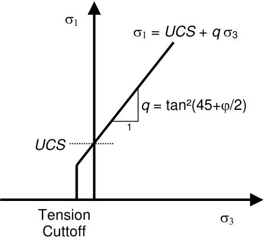

O limite de tração (tension cutoff) e o UCS são especificados em unidades de tensão (MPa ou psi). O ângulo de atrito é especificado em graus.

Apply – regenera a plotagem de contornos.

Acc Dam – plota o dano acumulado. Veja Accumulated Damage

#### Hoek-Brown

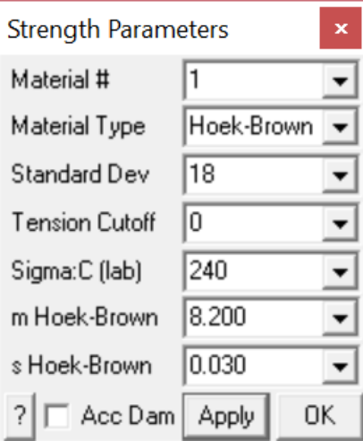

Material # especifica o número do material. O material nº 1 representa o material da rocha encaixante (host). Os demais números de material são usados para definir zonas de material alternativo, como minério, argila de falha (gouge), aterro etc.

Material Type especifica o tipo de material: Mohr-Coulomb, Hoek-Brown, Drucker-Prager ou None.

Standard Deviation especifica a incerteza do critério de ruptura medida na direção s1 (especificada em unidades de tensão, MPa ou psi).

Tension Cutoff, Sigma:C, m and s o critério de Hoek-Brown define a resistência em termos de tensões principais da seguinte forma:

#### Hoek-Brown

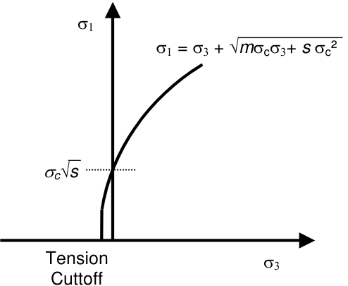

O limite de tração (tension cutoff) e Sigma:C são especificados em unidades de tensão (MPa ou psi).

Apply – regenera a plotagem de contornos.

Acc Dam – plota o dano acumulado. Veja Accumulated Damage

#### Drucker-Prager

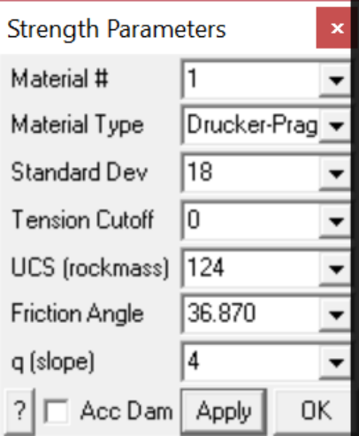

Material # especifica o número do material. O material nº 1 representa o material da rocha encaixante (host). Os demais números de material são usados para definir zonas de material alternativo, como minério, argila de falha (gouge), aterro etc. Material Type especifica o tipo de material: Mohr-Coulomb, Hoek-Brown, Drucker-Prager ou None.

Standard Deviation especifica a incerteza do critério de ruptura medida na direção toct.

Tension Cutoff, UCS, Friction Angle o critério de Drucker-Prager define a resistência em termos de tensões principais da seguinte forma:

#### Drucker-Prager

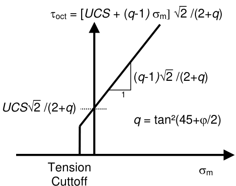

onde

toct = ¹/3 [(s1 - s2)² + (s2 - s3)² +(s3 - s1)²]½

smean = ¹/3 (s1 + s2 + s3)

O limite de tração (tension cutoff) e o UCS são especificados em unidades de tensão (MPa ou psi). O ângulo de atrito é especificado em graus.

Observe que os parâmetros de resistência foram escolhidos de modo que o critério se simplifique ao critério de Mohr-Coulomb quando s2 é igual a s3.

Apply – regenera a plotagem de contornos.

Acc Dam – plota o dano acumulado. Veja Accumulated Damage

#### Tópicos relacionados:

Plot > Strength Factor > Probability N-distribution

Plot > Strength Factor > SF-A - Strength/Stress Plot > Strength Factor > SF-B - Strength/Stress Plot > Strength Factors > SF-C - Strength/Stress Plot > Strength Factors > dS1 - Excess Stress Plot > Strength Factors > dTmax - Excess Stress

Plot > Strength Factors > dToct - Excess Stress

Plot > Strength Factors > In-plane Parameters

Plot > Strength Factors > Ubiquitous Parameters

### 5.3.6.1.2 Dano acumulado

Plota o dano acumulado.

Essa componente pode ser acessada pela barra de ferramentas Strength Factor Components, da seguinte forma:

Esta barra de ferramentas pode ser alterada para a orientação vertical arrastando-a contra a borda direita ou esquerda da janela principal.

Ela pode voltar à orientação horizontal arrastando-a contra a borda superior ou inferior da janela principal.

Ao selecionar o botão da barra de ferramentas Contours, a barra de ferramentas Strength Factor Components é ativada.

Quando Acc não está ativada, a tensão excedente, a probabilidade de ruptura, o fator de resistência e o RCF são plotados para os valores de tensão atuais.

Quando Acc está ativada, o dano é acompanhado da etapa 1 até a etapa atual ao longo de todo o histórico de carregamento do modelo; assim, é plotado o pior caso da tensão excedente, da probabilidade de ruptura, do fator de resistência ou do RCF.

Isso permite usar os resultados da análise elástica de tensões de forma semelhante à deformação acumulada em um modelo de plasticidade.

O acompanhamento do dano é feito separadamente para os 5 casos a seguir:

1. Ruptura do maciço rochoso (tensão S1 excedente, probabilidade, fator de resistência) 2. Ruptura por cisalhamento no plano (tensão de cisalhamento excedente, probabilidade, fator de resistência) 3. Ruptura por cisalhamento no plano ub (tensão de cisalhamento excedente, probabilidade, fator de resistência)

4. Tensão excedente na parede no plano (tensão excedente, RCF)

5. Tensão excedente na parede no plano ub (tensão excedente, RCF)

Observe que tanto a etapa em que ocorre o primeiro escoamento, MStep 1st Yield, quanto a etapa em que ocorre a máxima tensão excedente, MStep Max Yield, são acompanhadas e podem ser exibidas como rótulos de trajetória.

### 5.3.6.1.3 Tensão S1 excedente

Gera contornos da tensão principal maior excedente e do fator de resistência usando o método "A". Essas componentes podem ser acessadas pela barra de ferramentas Strength Factor Components, da seguinte forma:

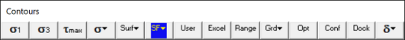

Esta barra de ferramentas pode ser alterada para a orientação vertical arrastando-a contra a borda direita ou esquerda da janela principal.

Ela pode voltar à orientação horizontal arrastando-a contra a borda superior ou inferior da janela principal.

Ao selecionar o

botão da barra de ferramentas Contours, a barra de ferramentas Strength Factor Components é ativada.

Na análise elástica, as tensões principais maior e menor podem ser usadas com os critérios de resistência de Mohr-Coulomb ou de Hoek-Brown

#### Plot > Strength Factors > Strength Parameters

para estimar o grau de dano devido à sobretensão. Como nenhum dos parâmetros é sensível à orientação, este critério é representativo da estabilidade de um maciço rochoso homogêneo.

Por outro lado, na análise não linear as tensões nunca podem exceder a resistência, a menos que algum nível de fluência seja usado. Neste último caso, a fluência viscosa pode permitir estados de tensão acima do critério de ruptura, indicando falta de equilíbrio estático. Portanto, na análise não linear normalmente se considera diretamente a quantidade de deformação não linear ou a taxa de deformação prevista pelo modelo

Mohr-Coulomb in 3D FF blocks.

O método "A" pressupõe que a trajetória de tensões até a ruptura ocorre aumentando s1 sem perda de confinamento. Isso é representativo da ruptura de um pilar, em que s1 é considerada a força motriz.

#### Mohr-Coulomb

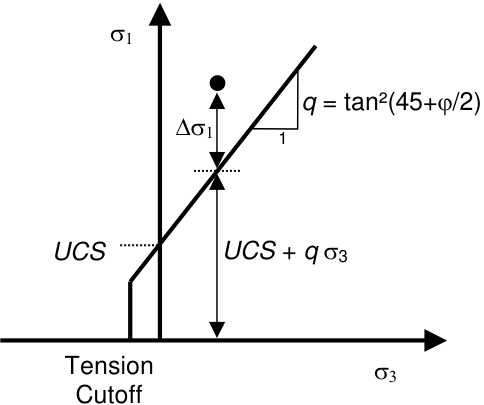

Plot > Strength Factors > SF-A   Strength/Stress pode ser determinado como ( _UCS_ + _q_ s3 )/ s1 Plot > Strength Factors > SF/A   Stress/Strength pode ser determinado como s1 / ( _UCS_ + _q_ s3 ) Plot > Strength Factors > Ds1   a tensão excedente pode ser determinada como Ds1 = s1 - ( _UCS_ + _q_ s3 )

Plot > Strength Factors > N(Ds1 /std)   Probabilidade usando a distribuição normal.

igual ao método "B".

#### Hoek-Brown

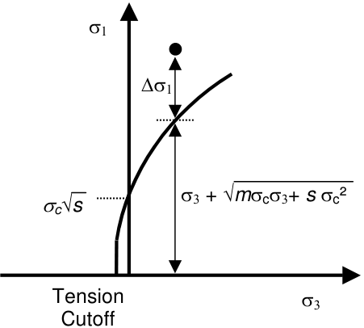

Plot > Strength Factors > SF-A   Strength/Stress pode ser determinado como [ s3 + Ö( _m_ scs3 + _s_ sc²) ] / s1

Plot > Strength Factors > SF/A   Stress/Strength pode ser determinado como s1 / [ s3 + Ö( _m_ scs3 + _s_ sc²) ]

Plot > Strength Factors > Ds1   a tensão excedente pode ser determinada como Ds1 = s1 - [ s3 + Ö( _m_ scs3 + _s_ sc²) ]

Plot > Strength Factors > N(Ds1 /std)   Probabilidade usando a distribuição normal.

igual ao método "B".

Drucker-Prager só é definido usando o método "C".

Os parâmetros de resistência são configurados com

Plot > Strength Factors > Strength Parameters

Tópicos relacionados:

Plot > Strength Factor > SF-B - Strength/Stress Plot > Strength Factors > SF-C - Strength/Stress Plot > Strength Factors > dTmax - Excess Stress Plot > Strength Factors > dToct - Excess Stress Plot > Strength Factors > In-plane Parameters Plot > Strength Factors > Ubiquitous Parameters

### 5.3.6.1.4 Tensão Tmax excedente

Gera contornos da tensão de cisalhamento excedente ou do fator de resistência usando o método "C". Essas componentes podem ser acessadas pela barra de ferramentas Strength Factor Components, da seguinte forma:

Esta barra de ferramentas pode ser alterada para a orientação vertical arrastando-a contra a borda direita ou esquerda da janela principal.

Ela pode voltar à orientação horizontal arrastando-a contra a borda superior ou inferior da janela principal.

Ao selecionar o botão da barra de ferramentas Contours, a barra de ferramentas Strength Factor Components é ativada.

Na análise elástica, as tensões principais maior e menor podem ser usadas com os critérios de resistência de Mohr-Coulomb ou de Hoek-Brown

Plot > Strength Factors > Strength Parameters

para estimar o grau de dano devido à sobretensão. Como nenhum dos parâmetros é sensível à orientação, este critério é representativo da estabilidade de um maciço rochoso homogêneo.

Por outro lado, na análise não linear as tensões nunca podem exceder a resistência, a menos que algum nível de fluência seja usado. Neste último caso, a fluência viscosa pode permitir estados de tensão acima do critério de ruptura, indicando falta de equilíbrio estático. Portanto, na análise não linear normalmente se considera diretamente a quantidade de deformação não linear ou a taxa de deformação prevista pelo modelo

Mohr-Coulomb in 3D FF blocks.

O método "C" pressupõe que a trajetória de tensões até a ruptura ocorre aumentando s1 com perda de confinamento. Isso é representativo da ruptura de um encontro (abutment), em que s1 - s3 é considerada a força motriz.

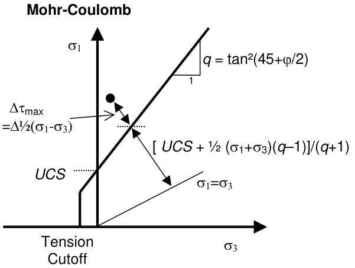

Plot > Strength Factors > SF-C   Strength/Stress pode ser determinado como [ _UCS_ + ½(s1+s3) ( _q_ - 1) ]/[ ½(s1 - s3)( _q_ +1) ]

Plot > Strength Factors > SF/C   Stress/Strength pode ser determinado como [ ½(s1 - s3)( _q_ +1) ]/ [ _UCS_ + ½(s1+s3) ( _q_ -1) ]

Plot > Strength Factors > Dtmax   a tensão excedente pode ser determinada como

Dtmax = ½(s1 - s3) - [ _UCS_ + ½(s1+s3) ( _q_ -1) ]/( _q_ +1)

= [s1 - ( _UCS_ + _q_ s3) ]/( _q_ +1)

#### Hoek-Brown

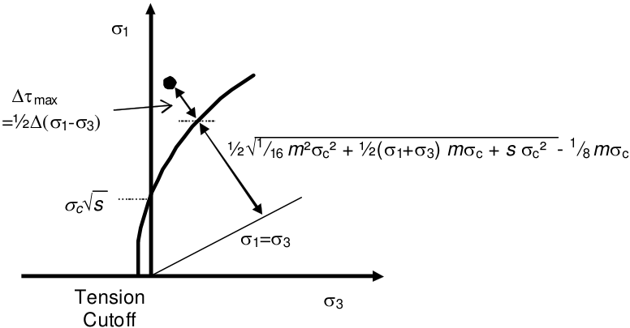

Plot > Strength Factors > SF-C   Strength/Stress pode ser determinado como &#123; Ö[1 /16 _m_ ²sc² + ½(s1 + s3) _m_ sc + _s_ sc²] - ¼ _m_ sc&#125;/(s1 - s3)

Plot > Strength Factors > SF/C   Stress/Strength pode ser determinado como (s1 - s3)/&#123; Ö[1 /16 _m_ ²sc² + ½(s1 + s3) _m_ sc + _s_ sc²] - ¼ _m_ sc &#125;

Plot > Strength Factors > Dtmax   a tensão excedente pode ser determinada como

Dtmax = ½(s1 - s3) - ½&#123; Ö[1 /16 _m_ ²sc² + ½(s1 + s3) _m_ sc + _s_ sc²] - ¼ _m_ sc &#125;

#### Drucker-Prager

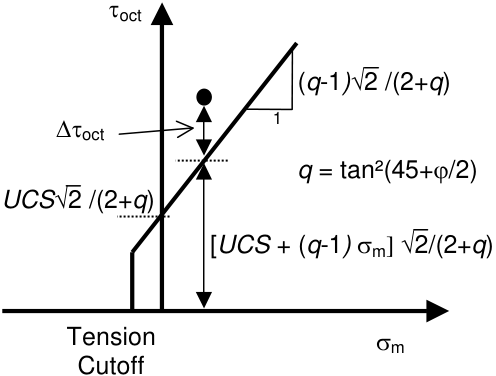

SF-C Strength/Stress   pode ser determinado como [ _UCS_ + ( _q_ –1) smean ] Ö(2) /[ toct ( _q_ +2) ]

SF-C Stress/Strength   pode ser determinado como toct /[ _UCS_ + ( _q_ –1) smean ] Ö(2) /( _q_ +2) Dtoct Excess   pode ser determinado como toct - [ _UCS_ + ( _q_ –1) smean ] Ö(2) /( _q_ +2)

onde

_q_ = tan²(45+j/2) toct = ¹/3 Ö[( s1 - s2 )² + ( s2 - s3 )² +( s3 - s1 )²] smean = ¹/3 ( s1 + s2 + s3 )

Observe que os parâmetros de resistência foram escolhidos de modo que o critério se simplifique ao critério de Mohr-Coulomb quando s2 é igual a s3.

Os parâmetros de resistência são configurados com

Plot > Strength Factors > Strength Parameters

Tópicos relacionados:

Plot > Strength Factor > SF-A - Stress/Strength Plot > Strength Factors > SF-B - Stress/Strength Plot > Strength Factors > dS1 - Excess Stress Plot > Strength Factors > In-plane Parameters Plot > Strength Factors > Ubiquitous Parameters

5.3.6.1.6  NS1 Probabilidade normal

Gera contornos da tensão principal maior excedente e do fator de resistência usando o método "A". Essas componentes podem ser acessadas pela barra de ferramentas Strength Factor Components, da seguinte forma:

Esta barra de ferramentas pode ser alterada para a orientação vertical arrastando-a contra a borda direita ou esquerda da janela principal.

Ela pode voltar à orientação horizontal arrastando-a contra a borda superior ou inferior da janela principal.

Ao selecionar o botão da barra de ferramentas Contours, a barra de ferramentas Strength Factor Components é ativada.

Na análise elástica, as tensões principais maior e menor podem ser usadas com os critérios de resistência de Mohr-Coulomb ou de Hoek-Brown

Plot > Strength Factors > Strength Parameters

para estimar o grau de dano devido à sobretensão. Como nenhum dos parâmetros é sensível à orientação, este critério é representativo da estabilidade de um maciço rochoso homogêneo.

Por outro lado, na análise não linear as tensões nunca podem exceder a resistência, a menos que algum nível de fluência seja usado. Neste último caso, a fluência viscosa pode permitir estados de tensão acima do critério de ruptura, indicando falta de equilíbrio estático. Portanto, na análise não linear normalmente se considera diretamente a quantidade de deformação não linear ou a taxa de deformação prevista pelo modelo

Mohr-Coulomb in 3D FF blocks.

O método "A" pressupõe que a trajetória de tensões até a ruptura ocorre aumentando s1 sem perda de confinamento. Isso é representativo da ruptura de um pilar, em que s1 é considerada a força motriz.

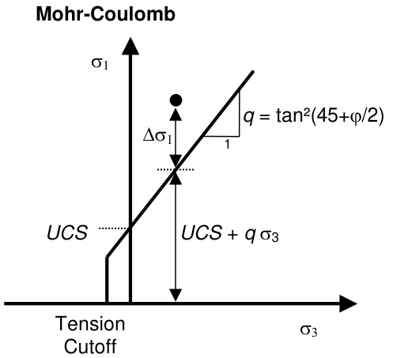

Plot > Strength Factors > SF-A   Strength/Stress pode ser determinado como ( _UCS_ + _q_ s3 )/ s1 Plot > Strength Factors > SF/A   Stress/Strength pode ser determinado como s1 / ( _UCS_ + _q_ s3 ) Plot > Strength Factors > Ds1   a tensão excedente pode ser determinada como Ds1 = s1 - ( _UCS_ + _q_ s3 )

Plot > Strength Factors > N(Ds1 /std)   Probabilidade usando a distribuição normal.

igual ao método "B".

#### Hoek-Brown

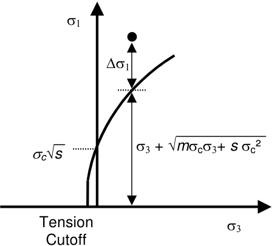

Plot > Strength Factors > SF-A   Strength/Stress pode ser determinado como [ s3 + Ö( _m_ scs3 + _s_ sc²) ] / s1

Plot > Strength Factors > SF/A   Stress/Strength pode ser determinado como s1 / [ s3 + Ö( _m_ scs3 + _s_ sc²) ]

Plot > Strength Factors > Ds1   a tensão excedente pode ser determinada como Ds1 = s1 - [ s3 + Ö( _m_ scs3 + _s_ sc²) ]

Plot > Strength Factors > N(Ds1 /std)   Probabilidade usando a distribuição normal.

igual ao método "B".

Drucker-Prager só é definido usando o método "C".

Os parâmetros de resistência são configurados com

Plot > Strength Factors > Strength Parameters

Tópicos relacionados:

Plot > Strength Factor > SF-B - Strength/Stress Plot > Strength Factors > SF-C - Strength/Stress Plot > Strength Factors > dTmax - Excess Stress Plot > Strength Factors > dToct - Excess Stress Plot > Strength Factors > In-plane Parameters Plot > Strength Factors > Ubiquitous Parameters

### 5.3.6.1.8 SF-B Resistência/Tensão

Gera contornos da tensão principal maior excedente e do fator de resistência usando o método "B". Essas componentes podem ser acessadas pela barra de ferramentas Strength Factor Components, da seguinte forma:

Esta barra de ferramentas pode ser alterada para a orientação vertical arrastando-a contra a borda direita ou esquerda da janela principal.

Ela pode voltar à orientação horizontal arrastando-a contra a borda superior ou inferior da janela principal.

Ao selecionar o

botão da barra de ferramentas Contours, a barra de ferramentas Strength Factor Components é ativada.

Na análise elástica, as tensões principais maior e menor podem ser usadas com os critérios de resistência de Mohr-Coulomb ou de Hoek-Brown

#### Plot > Strength Factors > Strength Parameters

para estimar o grau de dano devido à sobretensão. Como nenhum dos parâmetros é sensível à orientação, este critério é representativo da estabilidade de um maciço rochoso homogêneo.

Por outro lado, na análise não linear as tensões nunca podem exceder a resistência, a menos que algum nível de fluência seja usado. Neste último caso, a fluência viscosa pode permitir estados de tensão acima do critério de ruptura, indicando falta de equilíbrio estático. Portanto, na análise não linear normalmente se considera diretamente a quantidade de deformação não linear ou a taxa de deformação prevista pelo modelo

Mohr-Coulomb in 3D FF blocks.

O método "B" pressupõe que a trajetória de tensões até a ruptura ocorre aumentando s1 sem perda de confinamento. Isso é representativo da ruptura de um pilar, em que s1 - s3 é considerada a força motriz.

#### Mohr-Coulomb

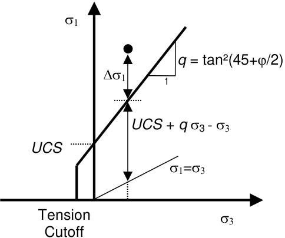

Plot > Strength Factors > SF-B   Strength/Stress pode ser determinado como ( _UCS_ + _q_ s3 - s3 )/(s1 - s3)

Plot > Strength Factors > SF/B   Stress/Strength pode ser determinado como (s1 - s3)/( _UCS_ + _q_ s3 - s3 )

Plot > Strength Factors > Ds1   a tensão excedente pode ser determinada como Ds1 = s1 - ( _UCS_ + _q_ s3 )

Plot > Strength Factors > N(Ds1 /std)   Probabilidade usando a distribuição normal.

igual ao método "A".

#### Hoek-Brown

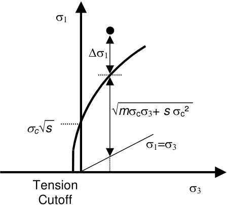

Plot > Strength Factors > SF-B   Strength/Stress pode ser determinado como Ö( _m_ scs3 + _s_ sc²)/(s1 - s3) Plot > Strength Factors > SF/B   Stress/Strength pode ser determinado como (s1 - s3)/Ö( _m_ scs3 + _s_ sc²) Plot > Strength Factors > Ds1   a tensão excedente pode ser determinada como Ds1 = s1 - [ s3 + Ö( _m_ scs3 + _s_ sc²) ]

Plot > Strength Factors > N(Ds1 /std)   Probabilidade usando a distribuição normal.

igual ao método "A".

Drucker-Prager só é definido usando o método "C".

Os parâmetros de resistência são configurados com

Plot > Strength Factors > Strength Parameters

Tópicos relacionados:

Plot > Strength Factor > SF-A - Strength/Stress Plot > Strength Factors > SF-C - Strength/Stress Plot > Strength Factors > dTmax - Excess Stress Plot > Strength Factors > dToct - Excess Stress Plot > Strength Factors > In-plane Parameters Plot > Strength Factors > Ubiquitous Parameters

### 5.3.6.1.9 SF-C Resistência/Tensão

Gera contornos da tensão de cisalhamento excedente ou do fator de resistência usando o método "C". Essas componentes podem ser acessadas pela barra de ferramentas Strength Factor Components, da seguinte forma:

Esta barra de ferramentas pode ser alterada para a orientação vertical arrastando-a contra a borda direita ou esquerda da janela principal.

Ela pode voltar à orientação horizontal arrastando-a contra a borda superior ou inferior da janela principal.

Ao selecionar o botão da barra de ferramentas Contours, a barra de ferramentas Strength Factor Components é ativada.

Na análise elástica, as tensões principais maior e menor podem ser usadas com os critérios de resistência de Mohr-Coulomb ou de Hoek-Brown

#### Plot > Strength Factors > Strength Parameters

para estimar o grau de dano devido à sobretensão. Como nenhum dos parâmetros é sensível à orientação, este critério é representativo da estabilidade de um maciço rochoso homogêneo.

Por outro lado, na análise não linear as tensões nunca podem exceder a resistência, a menos que algum nível de fluência seja usado. Neste último caso, a fluência viscosa pode permitir estados de tensão acima do critério de ruptura, indicando falta de equilíbrio estático. Portanto, na análise não linear normalmente se considera diretamente a quantidade de deformação não linear ou a taxa de deformação prevista pelo modelo

Mohr-Coulomb in 3D FF blocks.

O método "C" pressupõe que a trajetória de tensões até a ruptura ocorre aumentando s1 com perda de confinamento. Isso é representativo da ruptura de um encontro (abutment), em que s1 - s3 é considerada a força motriz.

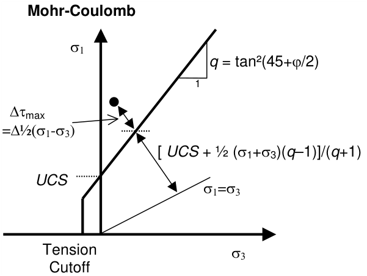

Plot > Strength Factors > SF-C   Strength/Stress pode ser determinado como [ _UCS_ + ½(s1+s3) ( _q_ - 1) ]/[ ½(s1 - s3)( _q_ +1) ]

Plot > Strength Factors > SF/C   Stress/Strength pode ser determinado como [ ½(s1 - s3)( _q_ +1) ]/ [ _UCS_ + ½(s1+s3) ( _q_ -1) ]

Plot > Strength Factors > Dtmax   a tensão excedente pode ser determinada como

Dtmax = ½(s1 - s3) - [ _UCS_ + ½(s1+s3) ( _q_ -1) ]/( _q_ +1)

= [s1 - ( _UCS_ + _q_ s3) ]/( _q_ +1)

#### Hoek-Brown

Plot > Strength Factors > SF-C   Strength/Stress pode ser determinado como &#123; Ö[1 /16 _m_ ²sc² + ½(s1 + s3) _m_ sc + _s_ sc²] - ¼ _m_ sc&#125;/(s1 - s3)

Plot > Strength Factors > SF/C   Stress/Strength pode ser determinado como (s1 - s3)/&#123; Ö[1 /16 _m_ ²sc² + ½(s1 + s3) _m_ sc + _s_ sc²] - ¼ _m_ sc &#125;

Plot > Strength Factors > Dtmax   a tensão excedente pode ser determinada como

Dtmax = ½(s1 - s3) - ½&#123; Ö[1 /16 _m_ ²sc² + ½(s1 + s3) _m_ sc + _s_ sc²] - ¼ _m_ sc &#125;

#### Drucker-Prager

SF-C Strength/Stress   pode ser determinado como [ _UCS_ + ( _q_ –1) smean ] Ö(2) /[ toct ( _q_ +2) ]

SF-C Stress/Strength   pode ser determinado como toct /[ _UCS_ + ( _q_ –1) smean ] Ö(2) /( _q_ +2) Dtoct Excess   pode ser determinado como toct - [ _UCS_ + ( _q_ –1) smean ] Ö(2) /( _q_ +2)

onde

_q_ = tan²(45+j/2) toct = ¹/3 Ö[( s1 - s2 )² + ( s2 - s3 )² +( s3 - s1 )²] smean = ¹/3 ( s1 + s2 + s3 )

Observe que os parâmetros de resistência foram escolhidos de modo que o critério se simplifique ao critério de Mohr-Coulomb quando s2 é igual a s3.

Os parâmetros de resistência são configurados com

Plot > Strength Factors > Strength Parameters

Tópicos relacionados:

Plot > Strength Factor > SF-A - Stress/Strength Plot > Strength Factors > SF-B - Stress/Strength Plot > Strength Factors > dS1 - Excess Stress Plot > Strength Factors > In-plane Parameters Plot > Strength Factors > Ubiquitous Parameters

### 5.3.6.1.10 SF/A Tensão/Resistência

Gera contornos da tensão principal maior excedente e do fator de resistência usando o método "A". Essas componentes podem ser acessadas pela barra de ferramentas Strength Factor Components, da seguinte forma:

Esta barra de ferramentas pode ser alterada para a orientação vertical arrastando-a contra a borda direita ou esquerda da janela principal.

Ela pode voltar à orientação horizontal arrastando-a contra a borda superior ou inferior da janela principal.

Ao selecionar o botão da barra de ferramentas Contours, a barra de ferramentas Strength Factor Components é ativada.

Na análise elástica, as tensões principais maior e menor podem ser usadas com os critérios de resistência de Mohr-Coulomb ou de Hoek-Brown

Plot > Strength Factors > Strength Parameters

para estimar o grau de dano devido à sobretensão. Como nenhum dos parâmetros é sensível à orientação, este critério é representativo da estabilidade de um maciço rochoso homogêneo.

Por outro lado, na análise não linear as tensões nunca podem exceder a resistência, a menos que algum nível de fluência seja usado. Neste último caso, a fluência viscosa pode permitir estados de tensão acima do critério de ruptura, indicando falta de equilíbrio estático. Portanto, na análise não linear normalmente se considera diretamente a quantidade de deformação não linear ou a taxa de deformação prevista pelo modelo

Mohr-Coulomb in 3D FF blocks.

O método "A" pressupõe que a trajetória de tensões até a ruptura ocorre aumentando s1 sem perda de confinamento. Isso é representativo da ruptura de um pilar, em que s1 é considerada a força motriz.

Plot > Strength Factors > SF-A   Strength/Stress pode ser determinado como ( _UCS_ + _q_ s3 )/ s1 Plot > Strength Factors > SF/A   Stress/Strength pode ser determinado como s1 / ( _UCS_ + _q_ s3 ) Plot > Strength Factors > Ds1   a tensão excedente pode ser determinada como Ds1 = s1 - ( _UCS_ + _q_ s3 )

Plot > Strength Factors > N(Ds1 /std)   Probabilidade usando a distribuição normal.

igual ao método "B".

#### Hoek-Brown

Plot > Strength Factors > SF-A   Strength/Stress pode ser determinado como [ s3 + Ö( _m_ scs3 + _s_ sc²) ] / s1

Plot > Strength Factors > SF/A   Stress/Strength pode ser determinado como s1 / [ s3 + Ö( _m_ scs3 + _s_ sc²) ]

Plot > Strength Factors > Ds1   a tensão excedente pode ser determinada como Ds1 = s1 - [ s3 + Ö( _m_ scs3 + _s_ sc²) ]

Plot > Strength Factors > N(Ds1 /std)   Probabilidade usando a distribuição normal.

igual ao método "B".

Drucker-Prager só é definido usando o método "C".

Os parâmetros de resistência são configurados com

Plot > Strength Factors > Strength Parameters

Tópicos relacionados:

Plot > Strength Factor > SF-B - Strength/Stress Plot > Strength Factors > SF-C - Strength/Stress Plot > Strength Factors > dTmax - Excess Stress Plot > Strength Factors > dToct - Excess Stress Plot > Strength Factors > In-plane Parameters Plot > Strength Factors > Ubiquitous Parameters

### 5.3.6.1.11 SF/B Tensão/Resistência

Gera contornos da tensão principal maior excedente e do fator de resistência usando o método "B". Essas componentes podem ser acessadas pela barra de ferramentas Strength Factor Components, da seguinte forma:

Esta barra de ferramentas pode ser alterada para a orientação vertical arrastando-a contra a borda direita ou esquerda da janela principal.

Ela pode voltar à orientação horizontal arrastando-a contra a borda superior ou inferior da janela principal.

Ao selecionar o

botão da barra de ferramentas Contours, a barra de ferramentas Strength Factor Components é ativada.

Na análise elástica, as tensões principais maior e menor podem ser usadas com os critérios de resistência de Mohr-Coulomb ou de Hoek-Brown

#### Plot > Strength Factors > Strength Parameters

para estimar o grau de dano devido à sobretensão. Como nenhum dos parâmetros é sensível à orientação, este critério é representativo da estabilidade de um maciço rochoso homogêneo.

Por outro lado, na análise não linear as tensões nunca podem exceder a resistência, a menos que algum nível de fluência seja usado. Neste último caso, a fluência viscosa pode permitir estados de tensão acima do critério de ruptura, indicando falta de equilíbrio estático. Portanto, na análise não linear normalmente se considera diretamente a quantidade de deformação não linear ou a taxa de deformação prevista pelo modelo

Mohr-Coulomb in 3D FF blocks.

O método "B" pressupõe que a trajetória de tensões até a ruptura ocorre aumentando s1 sem perda de confinamento. Isso é representativo da ruptura de um pilar, em que s1 - s3 é considerada a força motriz.

#### Mohr-Coulomb

Plot > Strength Factors > SF-B   Strength/Stress pode ser determinado como ( _UCS_ + _q_ s3 - s3 )/(s1 - s3)

Plot > Strength Factors > SF/B   Stress/Strength pode ser determinado como (s1 - s3)/( _UCS_ + _q_ s3 - s3 )

Plot > Strength Factors > Ds1   a tensão excedente pode ser determinada como Ds1 = s1 - ( _UCS_ + _q_ s3 )

Plot > Strength Factors > N(Ds1 /std)   Probabilidade usando a distribuição normal.

igual ao método "A".

#### Hoek-Brown

Plot > Strength Factors > SF-B   Strength/Stress pode ser determinado como Ö( _m_ scs3 + _s_ sc²)/(s1 - s3) Plot > Strength Factors > SF/B   Stress/Strength pode ser determinado como (s1 - s3)/Ö( _m_ scs3 + _s_ sc²) Plot > Strength Factors > Ds1   a tensão excedente pode ser determinada como Ds1 = s1 - [ s3 + Ö( _m_ scs3 + _s_ sc²) ]

Plot > Strength Factors > N(Ds1 /std)   Probabilidade usando a distribuição normal.

igual ao método "A".

Drucker-Prager só é definido usando o método "C".

Os parâmetros de resistência são configurados com

Plot > Strength Factors > Strength Parameters

Tópicos relacionados:

Plot > Strength Factor > SF-A - Strength/Stress Plot > Strength Factors > SF-C - Strength/Stress Plot > Strength Factors > dTmax - Excess Stress Plot > Strength Factors > dToct - Excess Stress Plot > Strength Factors > In-plane Parameters Plot > Strength Factors > Ubiquitous Parameters

### 5.3.6.1.12 SF/C Tensão/Resistência

Gera contornos da tensão de cisalhamento excedente ou do fator de resistência usando o método "C". Essas componentes podem ser acessadas pela barra de ferramentas Strength Factor Components, da seguinte forma:

Esta barra de ferramentas pode ser alterada para a orientação vertical arrastando-a contra a borda direita ou esquerda da janela principal.

Ela pode voltar à orientação horizontal arrastando-a contra a borda superior ou inferior da janela principal.

Ao selecionar o botão da barra de ferramentas Contours, a barra de ferramentas Strength Factor Components é ativada.

Na análise elástica, as tensões principais maior e menor podem ser usadas com os critérios de resistência de Mohr-Coulomb ou de Hoek-Brown

#### Plot > Strength Factors > Strength Parameters

para estimar o grau de dano devido à sobretensão. Como nenhum dos parâmetros é sensível à orientação, este critério é representativo da estabilidade de um maciço rochoso homogêneo.

Por outro lado, na análise não linear as tensões nunca podem exceder a resistência, a menos que algum nível de fluência seja usado. Neste último caso, a fluência viscosa pode permitir estados de tensão acima do critério de ruptura, indicando falta de equilíbrio estático. Portanto, na análise não linear normalmente se considera diretamente a quantidade de deformação não linear ou a taxa de deformação prevista pelo modelo

Mohr-Coulomb in 3D FF blocks.

O método "C" pressupõe que a trajetória de tensões até a ruptura ocorre aumentando s1 com perda de confinamento. Isso é representativo da ruptura de um encontro (abutment), em que s1 - s3 é considerada a força motriz.

Plot > Strength Factors > SF-C   Strength/Stress pode ser determinado como [ _UCS_ + ½(s1+s3) ( _q_ - 1) ]/[ ½(s1 - s3)( _q_ +1) ]

Plot > Strength Factors > SF/C   Stress/Strength pode ser determinado como [ ½(s1 - s3)( _q_ +1) ]/ [ _UCS_ + ½(s1+s3) ( _q_ -1) ]

Plot > Strength Factors > Dtmax   a tensão excedente pode ser determinada como

Dtmax = ½(s1 - s3) - [ _UCS_ + ½(s1+s3) ( _q_ -1) ]/( _q_ +1)

= [s1 - ( _UCS_ + _q_ s3) ]/( _q_ +1)

#### Hoek-Brown

Plot > Strength Factors > SF-C   Strength/Stress pode ser determinado como &#123; Ö[1 /16 _m_ ²sc² + ½(s1 + s3) _m_ sc + _s_ sc²] - ¼ _m_ sc&#125;/(s1 - s3)

Plot > Strength Factors > SF/C   Stress/Strength pode ser determinado como (s1 - s3)/&#123; Ö[1 /16 _m_ ²sc² + ½(s1 + s3) _m_ sc + _s_ sc²] - ¼ _m_ sc &#125;

Plot > Strength Factors > Dtmax   a tensão excedente pode ser determinada como

Dtmax = ½(s1 - s3) - ½&#123; Ö[1 /16 _m_ ²sc² + ½(s1 + s3) _m_ sc + _s_ sc²] - ¼ _m_ sc &#125;

#### Drucker-Prager

SF-C Strength/Stress   pode ser determinado como [ _UCS_ + ( _q_ –1) smean ] Ö(2) /[ toct ( _q_ +2) ]

SF-C Stress/Strength   pode ser determinado como toct /[ _UCS_ + ( _q_ –1) smean ] Ö(2) /( _q_ +2) Dtoct Excess   pode ser determinado como toct - [ _UCS_ + ( _q_ –1) smean ] Ö(2) /( _q_ +2)

onde

_q_ = tan²(45+j/2) toct = ¹/3 Ö[( s1 - s2 )² + ( s2 - s3 )² +( s3 - s1 )²] smean = ¹/3 ( s1 + s2 + s3 )

Observe que os parâmetros de resistência foram escolhidos de modo que o critério se simplifique ao critério de Mohr-Coulomb quando s2 é igual a s3.

Os parâmetros de resistência são configurados com

Plot > Strength Factors > Strength Parameters

Tópicos relacionados:

Plot > Strength Factor > SF-A - Stress/Strength Plot > Strength Factors > SF-B - Stress/Strength Plot > Strength Factors > dS1 - Excess Stress Plot > Strength Factors > In-plane Parameters Plot > Strength Factors > Ubiquitous Parameters

## 5.3.6.2 Parâmetros no plano

5.3.6.2.1  Parâmetros no plano

Configura os parâmetros de resistência para gerar plotagens de contornos de fatores de resistência em termos das componentes da tensão no plano.

Essas componentes podem ser acessadas pela barra de ferramentas Strength Factor Components, da seguinte forma:

Esta barra de ferramentas pode ser alterada para a orientação vertical arrastando-a contra a borda direita ou esquerda da janela principal.

Ela pode voltar à orientação horizontal arrastando-a contra a borda superior ou inferior da janela principal.

Ao selecionar o botão da barra de ferramentas Contours, a barra de ferramentas Strength Factor Components é ativada.

Para calcular as tensões de cisalhamento e normal no plano, o estado de tensões em cada ponto do plano da grade é reorientado para determinar a tensão de cisalhamento máxima paralela ao plano da grade e a tensão normal ao plano da grade.

Na análise elástica, as tensões máximas de cisalhamento e normal no plano podem ser usadas com o critério de resistência de Mohr-Coulomb para estimar a quantidade de deslizamento devido à sobretensão, em uma falha, conjunto de juntas ou plano de acamamento orientado da mesma forma que o plano da grade. Como esses parâmetros dependem da orientação, este critério é representativo da estabilidade de um maciço rochoso anisotrópico.

Por outro lado, na análise não linear as tensões nunca podem exceder a resistência, a menos que algum nível de fluência seja usado. Neste último caso, a fluência viscosa pode permitir estados de tensão acima do critério de ruptura, indicando falta de equilíbrio estático. Portanto, na análise não linear normalmente se considera diretamente a quantidade de deformação não linear ou a taxa de deformação prevista pelo modelo

Mohr-Coulomb in DD planes Fault-Gouge in DD planes Backfill-Hyperbolic in DD planes

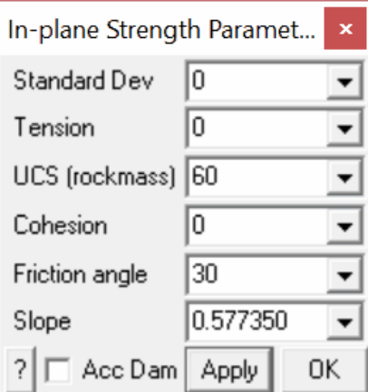

O critério de Mohr-Coulomb define a resistência ao cisalhamento em termos da tensão de cisalhamento e da tensão normal da seguinte forma:

#### Mohr-Coulomb

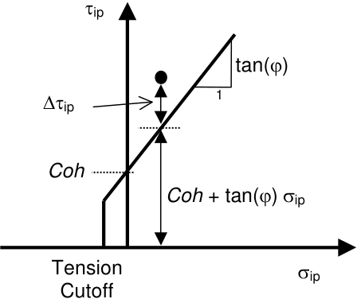

O limite de tração (tension cutoff), o UCS e a coesão são especificados em unidades de tensão (MPa ou psi).

O ângulo de atrito é especificado em graus.

Standard Deviation especifica a incerteza do critério de ruptura medida na direção tip (especificada em unidades de tensão, MPa ou psi).

Acc Dam – plota o dano acumulado. Veja Accumulated Damage

Apply – regenera a plotagem de contornos.

Tópicos relacionados:

Plot > Strength Factor > Probability N-distribution Plot > Strength Factor > SF-ip - Stress/Strength Plot > Strength Factors > SF-ub - Stress/Strength Plot > Strength Factors > dTip - Excess Stress Plot > Strength Factors > dTub - Excess Stress Plot > Strength Factors > Rockmass Strength Parameters Plot > Strength Factors > Ubiquitous Parameters

### 5.3.6.2.2 Dano acumulado

Plota o dano acumulado.

Essa componente pode ser acessada pela barra de ferramentas Strength Factor Components, da seguinte forma:

Esta barra de ferramentas pode ser alterada para a orientação vertical arrastando-a contra a borda direita ou esquerda da janela principal.

Ela pode voltar à orientação horizontal arrastando-a contra a borda superior ou inferior da janela principal.

Ao selecionar o botão da barra de ferramentas Contours, a barra de ferramentas Strength Factor Components é ativada.

Quando Acc não está ativada, a tensão excedente, a probabilidade de ruptura, o fator de resistência e o RCF são plotados para os valores de tensão atuais.

Quando Acc está ativada, o dano é acompanhado da etapa 1 até a etapa atual ao longo de todo o histórico de carregamento do modelo; assim, é plotado o pior caso da tensão excedente, da probabilidade de ruptura, do fator de resistência ou do RCF.

Isso permite usar os resultados da análise elástica de tensões de forma semelhante à deformação acumulada em um modelo de plasticidade.

O acompanhamento do dano é feito separadamente para os 5 casos a seguir:

1. Ruptura do maciço rochoso (tensão S1 excedente, probabilidade, fator de resistência) 2. Ruptura por cisalhamento no plano (tensão de cisalhamento excedente, probabilidade, fator de resistência) 3. Ruptura por cisalhamento no plano ub (tensão de cisalhamento excedente, probabilidade, fator de resistência)

4. Tensão excedente na parede no plano (tensão excedente, RCF)

5. Tensão excedente na parede no plano ub (tensão excedente, RCF)

Observe que tanto a etapa em que ocorre o primeiro escoamento, MStep 1st Yield, quanto a etapa em que ocorre a máxima tensão excedente, MStep Max Yield, são acompanhadas e podem ser exibidas como rótulos de trajetória.

### 5.3.6.2.3 Tensão de cisalhamento excedente no plano

Gera contornos da resistência ao cisalhamento no plano.

Essas componentes podem ser acessadas pela barra de ferramentas Strength Factor Components, da seguinte forma:

Esta barra de ferramentas pode ser alterada para a orientação vertical arrastando-a contra a borda direita ou esquerda da janela principal.

Ela pode voltar à orientação horizontal arrastando-a contra a borda superior ou inferior da janela principal.

Ao selecionar o

botão da barra de ferramentas Contours, a barra de ferramentas Strength Factor Components é ativada.

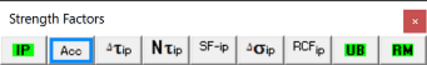

Para calcular as tensões de cisalhamento e normal no plano, o estado de tensões em cada ponto do plano da grade é reorientado para determinar a tensão de cisalhamento máxima paralela ao plano da grade e a tensão normal ao plano da grade.

Na análise elástica, as tensões máximas de cisalhamento e normal no plano podem ser usadas com o critério de resistência de Mohr-Coulomb

#### Plot > Strength Factors > In-plane Parameters

para estimar a quantidade de deslizamento devido à sobretensão, em uma falha, conjunto de juntas ou plano de acamamento orientado da mesma forma que o plano da grade. Como esses parâmetros dependem da orientação, este critério é representativo da estabilidade de um maciço rochoso anisotrópico.

Por outro lado, na análise não linear as tensões nunca podem exceder a resistência, a menos que algum nível de fluência seja usado. Neste último caso, a fluência viscosa pode permitir estados de tensão acima do critério de ruptura, indicando falta de equilíbrio estático. Portanto, na análise não linear normalmente se considera diretamente a quantidade de deformação não linear ou a taxa de deformação prevista pelo modelo

Mohr-Coulomb in DD planes

Fault-Gouge in DD planes

Backfill-Hyperbolic in DD planes

Aqui se pressupõe que a trajetória de tensões até a ruptura ocorre aumentando tip sem perda de confinamento.

#### Mohr-Coulomb

SF-ip Strength/Stress   pode ser determinado como [ Cohesion + sip tan(j) ] / tip SF-ip Stress/Strength   pode ser determinado como tip / [ Cohesion + sip tan(j) ] dTip Excess   pode ser determinado como Dtip = tip - [ Cohesion + sip tan(j) ]

NTip Probability   pode ser determinado como N(Dtip /std)

Os parâmetros de resistência são configurados com

Plot > Strength Factors > In-plane Parameters

Tópicos relacionados:

Plot > Stress > Tip - In-plane Shear Plot > Stress > Sip - In-plane Normal Plot > Strength Factors > SF-ub Strength/Stress Plot > Strength Factors > dTub Excess

Plot > Strength Factors > NSub Probability

### 5.3.6.2.4 Tensão excedente na parede no plano

Gera contornos da resistência à tensão na parede no plano. Essas componentes podem ser acessadas pela barra de ferramentas Strength Factor Components, da seguinte forma:

Esta barra de ferramentas pode ser alterada para a orientação vertical arrastando-a contra a borda direita ou esquerda da janela principal.

Ela pode voltar à orientação horizontal arrastando-a contra a borda superior ou inferior da janela principal.

Ao selecionar o

botão da barra de ferramentas Contours, a barra de ferramentas Strength Factor Components é ativada.

Para calcular a tensão na parede no plano, o estado de tensões em cada ponto do plano da grade é reorientado para determinar as tensões tangenciais máxima e mínima paralelas ao plano da grade.

A tensão máxima na parede de uma escavação circular virtual orientada perpendicularmente ao plano da grade pode então ser determinada como [ 3 s1i - s3i ].

Observe que sip é orientada normal ao plano da grade e paralela à direção de uma grade linear. Observe também que sip, s1i e s3i são perpendiculares entre si.

- a direção de mergulho é medida positiva no sentido horário a partir do eixo y.

- o mergulho do plano é medido positivo para baixo a partir da horizontal (ou seja, a direção de mergulho).

- o caimento da normal é medido positivo para baixo (ou seja, negativo para cima) a partir da horizontal.

dSip Excess   pode ser determinado como Dsip = [ 3 s1i - s3i ] - UCS

RCFip   pode ser determinado como RCFip = [ 3 s1i - s3i ]/UCS

Os parâmetros de resistência são configurados com

Plot > Strength Factors > In-plane Parameters

Tópicos relacionados:

Plot > Stress > Tip - In-plane Shear Plot > Stress > Sip - In-plane Normal Plot > Stress > S1i - In-plane Maximum Plot > Stress > S3i - In-plane Minimum Plot > Strength Factors > SF-ub Strength/Stress Plot > Strength Factors > dTub Excess Plot > Strength Factors > dSub Excess Plot > Strength Factors > NSub Probability

### 5.3.6.2.6 NTip Probabilidade normal

Gera contornos da resistência ao cisalhamento no plano. Essas componentes podem ser acessadas pela barra de ferramentas Strength Factor Components, da seguinte forma:

Esta barra de ferramentas pode ser alterada para a orientação vertical arrastando-a contra a borda direita ou esquerda da janela principal.

Ela pode voltar à orientação horizontal arrastando-a contra a borda superior ou inferior da janela principal.

Ao selecionar o botão da barra de ferramentas Contours, a barra de ferramentas Strength Factor Components é ativada.

Para calcular as tensões de cisalhamento e normal no plano, o estado de tensões em cada ponto do plano da grade é reorientado para determinar a tensão de cisalhamento máxima paralela ao plano da grade e a tensão normal ao plano da grade.

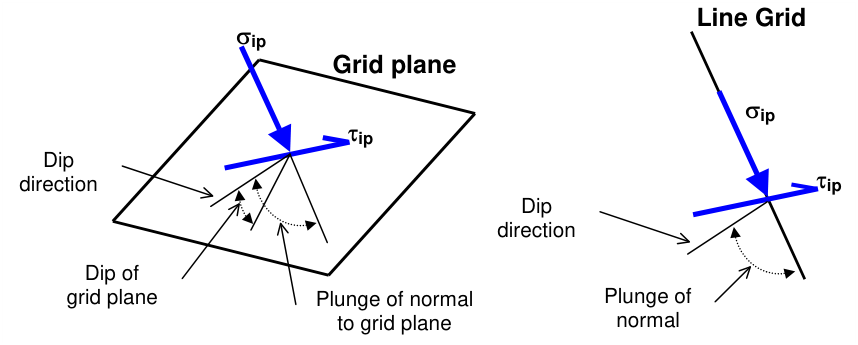

Na análise elástica, as tensões máximas de cisalhamento e normal no plano podem ser usadas com o critério de resistência de Mohr-Coulomb

#### Plot > Strength Factors > In-plane Parameters

para estimar a quantidade de deslizamento devido à sobretensão, em uma falha, conjunto de juntas ou plano de acamamento orientado da mesma forma que o plano da grade. Como esses parâmetros dependem da orientação, este critério é representativo da estabilidade de um maciço rochoso anisotrópico.

Por outro lado, na análise não linear as tensões nunca podem exceder a resistência, a menos que algum nível de fluência seja usado. Neste último caso, a fluência viscosa pode permitir estados de tensão acima do critério de ruptura, indicando falta de equilíbrio estático. Portanto, na análise não linear normalmente se considera diretamente a quantidade de deformação não linear ou a taxa de deformação prevista pelo modelo

Mohr-Coulomb in DD planes

Fault-Gouge in DD planes

Backfill-Hyperbolic in DD planes

Aqui se pressupõe que a trajetória de tensões até a ruptura ocorre aumentando tip sem perda de confinamento.

#### Mohr-Coulomb

SF-ip Strength/Stress   pode ser determinado como [ Cohesion + sip tan(j) ] / tip SF-ip Stress/Strength   pode ser determinado como tip / [ Cohesion + sip tan(j) ] dTip Excess   pode ser determinado como Dtip = tip - [ Cohesion + sip tan(j) ]

NTip Probability   pode ser determinado como N(Dtip /std)

Os parâmetros de resistência são configurados com

Plot > Strength Factors > In-plane Parameters

Tópicos relacionados:

Plot > Stress > Tip - In-plane Shear Plot > Stress > Sip - In-plane Normal Plot > Strength Factors > SF-ub Strength/Stress Plot > Strength Factors > dTub Excess

Plot > Strength Factors > NSub Probability

## 5.3.6.3 Parâmetros do plano UB

5.3.6.3.1  Parâmetros ubíquos

Configura os parâmetros de resistência para gerar plotagens de contornos de fatores de resistência em termos das componentes da tensão no plano ubíquo.

Essas componentes podem ser acessadas pela barra de ferramentas Strength Factor Components, da seguinte forma:

Esta barra de ferramentas pode ser alterada para a orientação vertical arrastando-a contra a borda direita ou esquerda da janela principal.

Ela pode voltar à orientação horizontal arrastando-a contra a borda superior ou inferior da janela principal.

Ao selecionar o

botão da barra de ferramentas Contours, a barra de ferramentas Strength Factor Components é ativada.

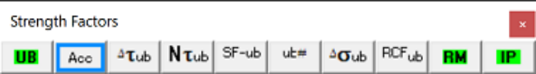

Para calcular as tensões de cisalhamento e normal ubíquas, o estado de tensões em cada ponto do plano da grade é reorientado para determinar a tensão de cisalhamento máxima paralela ao plano de cisalhamento ubíquo e a tensão normal ao plano de cisalhamento ubíquo.

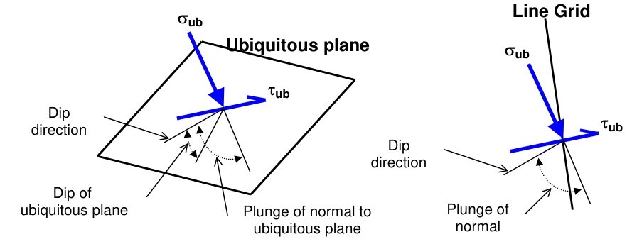

Na análise elástica, as tensões máximas de cisalhamento e normal no plano ubíquo podem ser usadas com o critério de resistência de Mohr-Coulomb para estimar a quantidade de deslizamento devido à sobretensão, em uma falha, conjunto de juntas ou plano de acamamento na orientação especificada. Como esses parâmetros dependem da orientação, este critério é representativo da estabilidade de um maciço rochoso anisotrópico.

Por outro lado, na análise não linear as tensões nunca podem exceder a resistência, a menos que algum nível de fluência seja usado. Neste último caso, a fluência viscosa pode permitir estados de tensão acima do critério de ruptura, indicando falta de equilíbrio estático. Portanto, na análise não linear normalmente se considera diretamente a quantidade de deformação não linear ou a taxa de deformação prevista pelo modelo

Mohr-Coulomb in DD planes

Fault-Gouge in DD planes

Backfill-Hyperbolic in DD planes

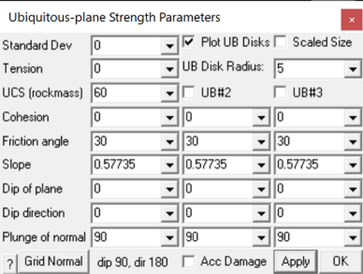

Cohesion e Friction Angle o critério de Mohr-Coulomb define a resistência em termos de tensões principais da seguinte forma:

#### Mohr-Coulomb

O limite de tração (tension cutoff), o UCS e a coesão são especificados em unidades de tensão (MPa ou psi). O ângulo de atrito é especificado em graus.

Standard Deviation especifica a incerteza do critério de ruptura medida na direção tip (especificada em unidades de tensão, MPa ou psi).

Dip of plane – especifica o mergulho do plano ubíquo (em graus). O mergulho da normal é ajustado automaticamente para refletir alterações neste valor.

Dip Direction – especifica a direção de mergulho do plano ubíquo (em graus).

Dip of Normal – especifica o mergulho da normal ao plano ubíquo (em graus). O mergulho do plano é ajustado automaticamente para refletir alterações neste valor.

Grid Normal – define o plano ubíquo paralelo ao plano de grade selecionado atualmente. Nesse caso, todos os resultados no plano serão idênticos aos do plano ubíquo.

Acc Dam – plota o dano acumulado. Veja Accumulated Damage

Plot UB DIsks – alterna a exibição da plotagem de contornos plana ou de discos que representam a orientação do plano UB.

Scaled Size – escalona o tamanho do disco UB pela magnitude.

UB DIsk Radius – especifica o raio dos discos UB.

Apply – regenera a plotagem de contornos.

UB#2 & UB#3 – ativa os parâmetros de resistência para o plano ubíquo nº 2 e/ou nº 3. Quando marcada, o

mínimo de todos os planos ubíquos ativos é apresentado para todos os parâmetros de resistência ( Plot > Strength Factor > Probability N-distribution, Plot > Strength Factors > SF-ub - Stress/Strength e Plot > Strength Factors > dTub - Excess Stress). Para determinar qual plano ubíquo tem a resistência mínima, você pode plotar Plot > Strength Factors > UB# with minimum strength) ou clicar com o botão esquerdo em uma plotagem de parâmetro de resistência.

Tópicos relacionados:

Plot > Strength Factor > Probability N-distribution Plot > Strength Factors > SF-ub - Stress/Strength Plot > Strength Factor > SF-ip - Stress/Strength Plot > Strength Factors > dTub - Excess Stress Plot > Strength Factors > dTip - Excess Stress Plot > Strength Factors > UB# with minimum strength Plot > Strength Factors > Rockmass Strength Parameters

Plot > Strength Factors > In-plane Parameters

### 5.3.6.3.2 Dano acumulado

Plota o dano acumulado. Essa componente pode ser acessada pela barra de ferramentas Strength Factor Components, da seguinte forma:

Esta barra de ferramentas pode ser alterada para a orientação vertical arrastando-a contra a borda direita ou esquerda da janela principal.

Ela pode voltar à orientação horizontal arrastando-a contra a borda superior ou inferior da janela principal.

Ao selecionar o botão da barra de ferramentas Contours, a barra de ferramentas Strength Factor Components é ativada.

Quando Acc não está ativada, a tensão excedente, a probabilidade de ruptura, o fator de resistência e o RCF são plotados para os valores de tensão atuais.

Quando Acc está ativada, o dano é acompanhado da etapa 1 até a etapa atual ao longo de todo o histórico de carregamento do modelo; assim, é plotado o pior caso da tensão excedente, da probabilidade de ruptura, do fator de resistência ou do RCF.

Isso permite usar os resultados da análise elástica de tensões de forma semelhante à deformação acumulada em um modelo de plasticidade.

O acompanhamento do dano é feito separadamente para os 5 casos a seguir:

1. Ruptura do maciço rochoso (tensão S1 excedente, probabilidade, fator de resistência) 2. Ruptura por cisalhamento no plano (tensão de cisalhamento excedente, probabilidade, fator de resistência) 3. Ruptura por cisalhamento no plano ub (tensão de cisalhamento excedente, probabilidade, fator de resistência)

4. Tensão excedente na parede no plano (tensão excedente, RCF)

5. Tensão excedente na parede no plano ub (tensão excedente, RCF)

Observe que tanto a etapa em que ocorre o primeiro escoamento, MStep 1st Yield, quanto a etapa em que ocorre a máxima tensão excedente, MStep Max Yield, são acompanhadas e podem ser exibidas como rótulos de trajetória.

- 5.3.6.3.3  Tensão de cisalhamento ubíqua excedente

Gera contornos da resistência ao cisalhamento no plano ubíquo. Essas componentes podem ser acessadas pela barra de ferramentas Strength Factor Components, da seguinte forma:

Esta barra de ferramentas pode ser alterada para a orientação vertical arrastando-a contra a borda direita ou esquerda da janela principal.

Ela pode voltar à orientação horizontal arrastando-a contra a borda superior ou inferior da janela principal.

Ao selecionar o botão da barra de ferramentas Contours, a barra de ferramentas Strength Factor Components é ativada.

Para calcular as tensões de cisalhamento e normal ubíquas, o estado de tensões em cada ponto do plano da grade é reorientado para determinar a tensão de cisalhamento máxima paralela ao plano de cisalhamento ubíquo e a tensão normal ao plano de cisalhamento ubíquo.

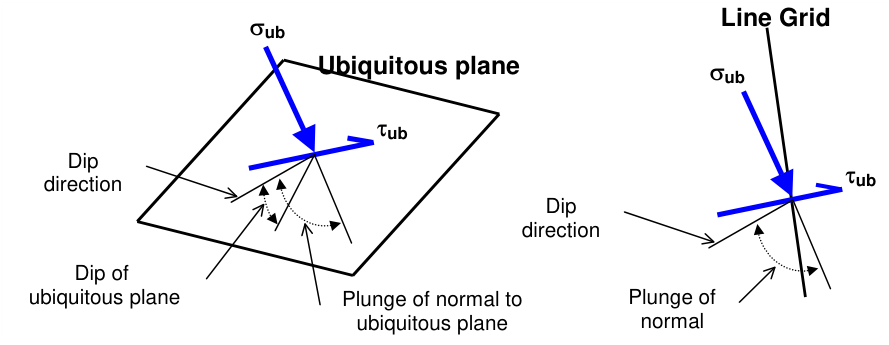

A orientação do plano de cisalhamento ubíquo é definida com

#### Plot > Strength Factors > Ubiquitous Parameters

Na análise elástica, as tensões máximas de cisalhamento e normal no plano ubíquo podem ser usadas com o critério de resistência de Mohr-Coulomb para estimar a quantidade de deslizamento devido à sobretensão, em uma falha, conjunto de juntas ou plano de acamamento na orientação especificada. Como esses parâmetros dependem da orientação, este critério é representativo da estabilidade de um maciço rochoso anisotrópico.

Por outro lado, na análise não linear as tensões nunca podem exceder a resistência, a menos que algum nível de fluência seja usado. Neste último caso, a fluência viscosa pode permitir estados de tensão acima do critério de ruptura, indicando falta de equilíbrio estático. Portanto, na análise não linear normalmente se considera diretamente a quantidade de deformação não linear ou a taxa de deformação prevista pelo modelo

Mohr-Coulomb in DD planes

Fault-Gouge in DD planes

Backfill-Hyperbolic in DD planes

Aqui se pressupõe que a trajetória de tensões até a ruptura ocorre aumentando tub sem perda de confinamento.

#### Mohr-Coulomb

SF-ub Strength/Stress   pode ser determinado como [ Cohesion + sub tan(j) ] / tub SF-ub Stress/Strength   pode ser determinado como tub / [ Cohesion + sub tan(j) ] dTub Excess   pode ser determinado como Dtub = tub - [ Cohesion + sub tan(j) ] NTub Probability   pode ser determinado como N(Dtub /std)

Os parâmetros de resistência são configurados com

Plot > Strength Factors > Ubiquitous Parameters

Tópicos relacionados:

Plot > Stress > Tub - Ubiquitous-plane Shear Plot > Stress > Sub - Ubiquitous-plane Normal Plot > Stress > S1u - Ubiquitous-plane Maximum Plot > Stress > S3u - Ubiquitous-plane Minimum Plot > Strength Factors > SF-ub Strength/Stress Plot > Strength Factors > dTip Excess Plot > Strength Factors > dSip Excess Plot > Strength Factors > NTip Probability

UB#2 & UB#3 – ativa os parâmetros de resistência para o plano ubíquo nº 2 e/ou nº 3. Quando marcada, o mínimo de todos os planos ubíquos ativos é apresentado para todos os parâmetros de resistência ( Plot > Strength Factor > Probability N-distribution, Plot > Strength Factors > SF-ub - Stress/Strength e

Plot > Strength Factors > dTub - Excess Stress). To determine which ubiquitous plane has the minimum strength you can plot Plot > Strength Factors > UB# with minimum strength) or left click on and strength parameter plot.

### 5.3.6.3.4 Tensão excedente na parede do plano ubíquo

Gera contornos da resistência à tensão na parede do plano ub.

Essas componentes podem ser acessadas pela barra de ferramentas Strength Factor Components, da seguinte forma:

Esta barra de ferramentas pode ser alterada para a orientação vertical arrastando-a contra a borda direita ou esquerda da janela principal.

Ela pode voltar à orientação horizontal arrastando-a contra a borda superior ou inferior da janela principal.

Ao selecionar o botão da barra de ferramentas Contours, a barra de ferramentas Strength Factor Components é ativada.

Para calcular a tensão na parede do plano ub, o estado de tensões em cada ponto do plano da grade é reorientado para determinar as tensões tangenciais máxima e mínima paralelas ao plano ub.

A tensão máxima na parede de uma escavação circular virtual orientada perpendicularmente ao plano ub pode então ser determinada como [ 3 s1u - s3u ].

Observe que sub é orientada normal ao plano ub. Observe também que sub, s1 e s3u são perpendiculares entre si.

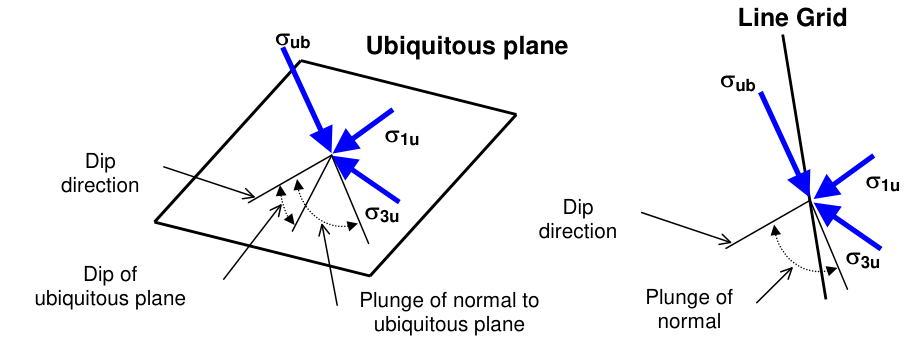

- a direção de mergulho é medida positiva no sentido horário a partir do eixo y.

- o mergulho do plano é medido positivo para baixo a partir da horizontal (ou seja, a direção de mergulho).

- o caimento da normal é medido positivo para baixo (ou seja, negativo para cima) a partir da horizontal.

dSub Excess   pode ser determinado como Dsub = [ 3 s1u - s3u ] - UCS

RCFub   pode ser determinado como RCFub = [ 3 s1u - s3u ]/UCS

A orientação do plano de cisalhamento ubíquo é definida com

Plot > Strength Factors > Ubiquitous Parameters

Tópicos relacionados:

Plot > Stress > Tub - Ubiquitous-plane Shear Plot > Stress > Sub - Ubiquitous-plane Normal Plot > Stress > S1u - Ubiquitous-plane Maximum Plot > Stress > S3u - Ubiquitous-plane Minimum Plot > Strength Factors > SF-ub Strength/Stress Plot > Strength Factors > dTip Excess Plot > Strength Factors > dSip Excess Plot > Strength Factors > NTip Probability

### 5.3.6.3.6 NTub Probabilidade normal

Gera contornos da resistência ao cisalhamento no plano ubíquo. Essas componentes podem ser acessadas pela barra de ferramentas Strength Factor Components, da seguinte forma:

Esta barra de ferramentas pode ser alterada para a orientação vertical arrastando-a contra a borda direita ou esquerda da janela principal.

Ela pode voltar à orientação horizontal arrastando-a contra a borda superior ou inferior da janela principal.

Ao selecionar o botão da barra de ferramentas Contours, a barra de ferramentas Strength Factor Components é ativada.

Para calcular as tensões de cisalhamento e normal ubíquas, o estado de tensões em cada ponto do plano da grade é reorientado para determinar a tensão de cisalhamento máxima paralela ao plano de cisalhamento ubíquo e a tensão normal ao plano de cisalhamento ubíquo.

A orientação do plano de cisalhamento ubíquo é definida com

#### Plot > Strength Factors > Ubiquitous Parameters

Na análise elástica, as tensões máximas de cisalhamento e normal no plano ubíquo podem ser usadas com o critério de resistência de Mohr-Coulomb para estimar a quantidade de deslizamento devido à sobretensão, em uma falha, conjunto de juntas ou plano de acamamento na orientação especificada. Como esses parâmetros dependem da orientação, este critério é representativo da estabilidade de um maciço rochoso anisotrópico.

Por outro lado, na análise não linear as tensões nunca podem exceder a resistência, a menos que algum nível de fluência seja usado. Neste último caso, a fluência viscosa pode permitir estados de tensão acima do critério de ruptura, indicando falta de equilíbrio estático. Portanto, na análise não linear normalmente se considera diretamente a quantidade de deformação não linear ou a taxa de deformação prevista pelo modelo

Mohr-Coulomb in DD planes

Fault-Gouge in DD planes

Backfill-Hyperbolic in DD planes

Aqui se pressupõe que a trajetória de tensões até a ruptura ocorre aumentando tub sem perda de confinamento.

#### Mohr-Coulomb

SF-ub Strength/Stress   pode ser determinado como [ Cohesion + sub tan(j) ] / tub SF-ub Stress/Strength   pode ser determinado como tub / [ Cohesion + sub tan(j) ] dTub Excess   pode ser determinado como Dtub = tub - [ Cohesion + sub tan(j) ] NTub Probability   pode ser determinado como N(Dtub /std)

Os parâmetros de resistência são configurados com

Plot > Strength Factors > Ubiquitous Parameters

Tópicos relacionados:

Plot > Stress > Tub - Ubiquitous-plane Shear Plot > Stress > Sub - Ubiquitous-plane Normal Plot > Stress > S1u - Ubiquitous-plane Maximum Plot > Stress > S3u - Ubiquitous-plane Minimum Plot > Strength Factors > SF-ub Strength/Stress Plot > Strength Factors > dTip Excess Plot > Strength Factors > dSip Excess Plot > Strength Factors > NTip Probability

UB#2 & UB#3 – ativa os parâmetros de resistência para o plano ubíquo nº 2 e/ou nº 3. Quando marcada, o mínimo de todos os planos ubíquos ativos é apresentado para todos os parâmetros de resistência ( Plot > Strength Factor > Probability N-distribution, Plot > Strength Factors > SF-ub - Stress/Strength e

Plot > Strength Factors > dTub - Excess Stress). To determine which ubiquitous plane has the minimum strength you can plot Plot > Strength Factors > UB# with minimum strength) or left click on and strength parameter plot.
