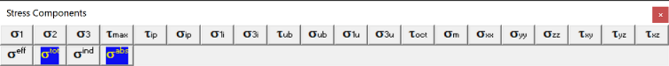
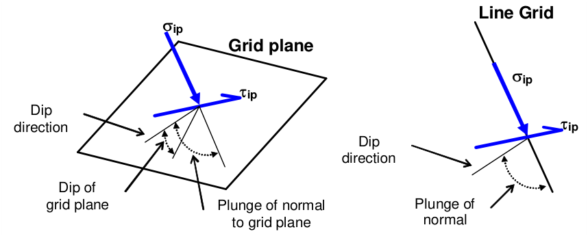
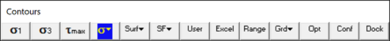
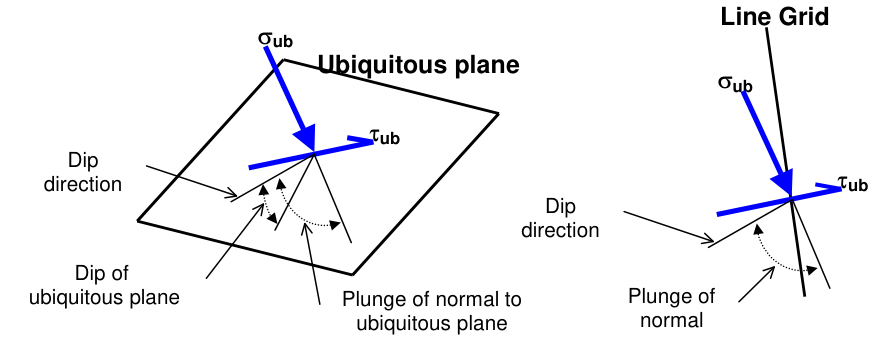
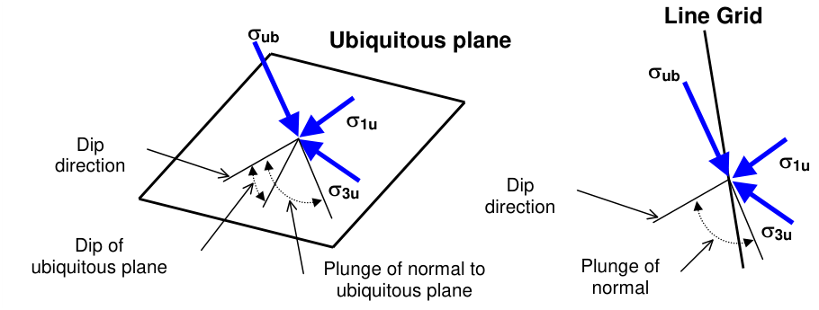

## 5.3.1.1 Tensão principal maior

Permite visualizar as componentes da tensão principal s1 s2 s3. Essas componentes podem ser acessadas pela barra de ferramentas Stress Components, da seguinte forma:

Esta barra de ferramentas pode ser alterada para a orientação vertical arrastando-a contra a borda direita ou esquerda da janela principal.

Ela pode voltar à orientação horizontal arrastando-a contra a borda superior ou inferior da janela principal.

Ao selecionar o botão da barra de ferramentas Contours, a barra de ferramentas Stress Components é ativada.

Na análise elástica, a tensão principal maior é normalmente usada com a tensão principal menor e o critério de resistência de Mohr-Coulomb ou de Hoek-Brown

#### Plot > Strength Factors > Strength Parameters

para estimar o grau de dano no maciço rochoso devido à sobretensão. Como nenhum dos parâmetros é sensível à orientação, este critério é representativo da estabilidade de um maciço rochoso homogêneo.

Por outro lado, na análise não linear as tensões nunca podem exceder a resistência, a menos que algum nível de fluência seja usado. Neste último caso, a fluência viscosa pode permitir estados de tensão acima do critério de ruptura, indicando falta de equilíbrio estático. Portanto, na análise não linear normalmente se considera diretamente a quantidade de deformação não linear ou a taxa de deformação prevista pelo modelo

Mohr-Coulomb in 3D FF blocks.

A sobretensão pode ser apresentada de várias formas, incluindo:

Plot > Strength Factor > SF-A Strength/Stress Plot > Strength Factor > SF-B Strength/Stress Plot > Strength Factors > SF-C Strength/Stress Plot > Strength Factors > dS1 Excess Stress Plot > Strength Factors > dTmax Excess Stress

A faixa de contornos é definida com

#### Plot > Range

Qualquer uma dessas componentes pode ser adicionada à barra de ferramentas de contornos, se desejado

Tools > Configure Contouring Toolbar > Stress

Pode ser útil adicionar o botão

#### More Stress Components

à barra de ferramentas de contornos para acessar rapidamente todas as componentes de tensão.

A tensão principal intermediária é normalmente usada no cálculo da tensão de cisalhamento octaédrica

Plot > Stress > Toct Octahedral shear Stress

ou da tensão média

Plot > Stress > Smean Mean Stress.

## 5.3.1.4 Tensão de cisalhamento máxima

Permite visualizar a componente de tensão tmax=½(s1 - s3). Essa componente pode ser acessada pela barra de ferramentas Stress Components, da seguinte forma:

Esta barra de ferramentas pode ser alterada para a orientação vertical arrastando-a contra a borda direita ou esquerda da janela principal.

Ela pode voltar à orientação horizontal arrastando-a contra a borda superior ou inferior da janela principal.

Ao selecionar o botão da barra de ferramentas Contours, a barra de ferramentas Stress Components é ativada.

Na análise elástica, a tensão de cisalhamento máxima é normalmente usada com a tensão principal menor e o critério de resistência de Mohr-Coulomb ou de Hoek-Brown

#### Plot > Strength Factors > Strength Parameters

para estimar o grau de dano devido à sobretensão. Como nenhum dos parâmetros é sensível à orientação, este critério é representativo da estabilidade de um maciço rochoso homogêneo.

Por outro lado, na análise não linear as tensões nunca podem exceder a resistência, a menos que algum nível de fluência seja usado. Neste último caso, a fluência viscosa pode permitir estados de tensão acima do critério de ruptura, indicando falta de equilíbrio estático. Portanto, na análise não linear normalmente se considera diretamente a quantidade de deformação não linear ou a taxa de deformação prevista pelo modelo

Mohr-Coulomb in 3D FF blocks.

A sobretensão pode ser apresentada de várias formas, incluindo:

Plot > Strength Factor > SF-A Strength/Stress Plot > Strength Factor > SF-B Strength/Stress Plot > Strength Factors > SF-C Strength/Stress Plot > Strength Factors > dS1 Excess Stress Plot > Strength Factors > dTmax Excess Stress

A faixa de contornos é definida com

#### Plot > Range

Qualquer uma dessas componentes pode ser adicionada à barra de ferramentas de contornos, se desejado

Tools > Configure Contouring Toolbar > Stress

Pode ser útil adicionar o botão

#### More Stress Components

à barra de ferramentas de contornos para acessar rapidamente todas as componentes de tensão.

## 5.3.1.5 Tensão de cisalhamento no plano

Permite gerar contornos da tensão de cisalhamento máxima que atua no plano da grade e da componente de tensão normal ao plano da grade ou paralela a uma grade linear. Essas componentes podem ser acessadas pela barra de ferramentas Stress Components, da seguinte forma:

Esta barra de ferramentas pode ser alterada para a orientação vertical arrastando-a contra a borda direita ou esquerda da janela principal.

Ela pode voltar à orientação horizontal arrastando-a contra a borda superior ou inferior da janela principal.

Ao selecionar o botão da barra de ferramentas Contours, a barra de ferramentas Stress Components é ativada.

Para calcular as tensões no plano, o estado de tensões em cada ponto do plano da grade é reorientado para determinar a tensão de cisalhamento máxima paralela ao plano da grade e a tensão normal ao plano. Observe que sip é orientada normal ao plano da grade e paralela à direção de uma grade linear.

- a direção de mergulho é medida positiva no sentido horário a partir do eixo y.

- o mergulho do plano é medido positivo para baixo a partir da horizontal (ou seja, a direção de mergulho).

- o caimento da normal é medido positivo para baixo (ou seja, negativo para cima) a partir da horizontal.

Na análise elástica, a tensão de cisalhamento máxima no plano é normalmente usada com a tensão normal no plano e o critério de resistência de Mohr-Coulomb

Plot > Strength Factors > In-plane Parameters

para estimar a quantidade de deslizamento devido à sobretensão, em uma falha, conjunto de juntas ou plano de acamamento orientado da mesma forma que o plano da grade. Como esses parâmetros dependem da orientação, este critério é representativo da estabilidade de um maciço rochoso anisotrópico.

Por outro lado, na análise não linear as tensões nunca podem exceder a resistência, a menos que algum nível de fluência seja usado. Neste último caso, a fluência viscosa pode permitir estados de tensão acima do critério de ruptura, indicando falta de equilíbrio estático. Portanto, na análise não linear normalmente se considera diretamente a quantidade de deformação não linear ou a taxa de deformação prevista pelo modelo

Mohr-Coulomb in DD planes Fault-Gouge in DD planes Backfill-Hyperbolic in DD planes.

A sobretensão pode ser apresentada de várias formas, incluindo:

Plot > Strength Factors > SF-ip Strength/Stress Plot > Strength Factors > dTip Excess Shear Stress

A faixa de contornos é definida com

#### Plot > Range

Qualquer uma dessas componentes pode ser adicionada à barra de ferramentas de contornos, se desejado

Tools > Configure Contouring Toolbar > Stress

Pode ser útil adicionar o botão

#### More Stress Components

à barra de ferramentas de contornos para acessar rapidamente todas as componentes de tensão.

Tópicos relacionados:

Plot > Stress > S1i In-plane Maximum Plot > Stress > S3i In-plane Minimum Plot > Stress > Tub Ubiquitous-plane Shear Plot > Stress > Sub Ubiquitous-plane Normal

## 5.3.1.7 Tensão máxima no plano

Permite gerar contornos das tensões máxima e mínima tangenciais ao plano da grade selecionado atualmente ou perpendiculares a uma grade linear. Essas componentes podem ser acessadas pela barra de ferramentas Stress Components, da seguinte forma:

Esta barra de ferramentas pode ser alterada para a orientação vertical arrastando-a contra a borda direita ou esquerda da janela principal.

Ela pode voltar à orientação horizontal arrastando-a contra a borda superior ou inferior da janela principal.

Ao selecionar o botão da barra de ferramentas Contours, a barra de ferramentas Stress Components é ativada.

Para calcular as tensões máxima e mínima no plano, as tensões tangenciais ao plano da grade são determinadas e depois resolvidas para fornecer os valores máximo e mínimo. Observe que sip é orientada normal ao plano da grade e paralela à direção de uma grade linear. Observe também que sip, s1i e s3i são perpendiculares entre si.

- a direção de mergulho é medida positiva no sentido horário a partir do eixo y.

- o mergulho do plano é medido positivo para baixo a partir da horizontal (ou seja, a direção de mergulho).

- o caimento da normal é medido positivo para baixo (ou seja, negativo para cima) a partir da horizontal.

A faixa de contornos é definida com

#### Plot > Range

Esta componente pode ser adicionada à barra de ferramentas de contornos, se desejado

#### Tools > Configure Contouring Toolbar > Stress

Pode ser útil adicionar o botão

#### More Stress Components

à barra de ferramentas de contornos para acessar rapidamente todas as componentes de tensão.

Tópicos relacionados:

Plot > Stress > Tip In-plane Shear Plot > Stress > Sip In-plane Normal Plot > Stress > S1u Ubiquitous-plane Maximum. Plot > Stress > S3u Ubiquitous-plane Minimum.

## 5.3.1.9 Tensão de cisalhamento no plano ubíquo

Permite gerar contornos da tensão de cisalhamento máxima que atua no plano ubíquo nº 1 e da componente de tensão normal a esse plano. Essas componentes podem ser acessadas pela barra de ferramentas Stress Components, da seguinte forma:

Esta barra de ferramentas pode ser alterada para a orientação vertical arrastando-a contra a borda direita ou esquerda da janela principal.

Ela pode voltar à orientação horizontal arrastando-a contra a borda superior ou inferior da janela principal.

Ao selecionar o botão da barra de ferramentas Contours, a barra de ferramentas Stress Components é ativada.

Para calcular as tensões ubíquas, o estado de tensões em cada ponto do plano da grade é reorientado para determinar a tensão de cisalhamento máxima paralela ao plano ubíquo e a tensão normal ao plano ubíquo. Observe que sub é orientada normal ao plano ubíquo e não é paralela à direção de uma grade linear.

- a direção de mergulho é medida positiva no sentido horário a partir do eixo y.

- o mergulho do plano é medido positivo para baixo a partir da horizontal (ou seja, a direção de mergulho).

- o caimento da normal é medido positivo para baixo (ou seja, negativo para cima) a partir da horizontal.

A orientação do plano de cisalhamento ubíquo é definida com

#### Plot > Strength Factors > Ubiquitous Parameters

Na análise elástica, a tensão de cisalhamento máxima no plano ubíquo é normalmente usada com a tensão normal ao plano ubíquo e o critério de resistência de Mohr-Coulomb

#### Plot > Strength Factors > Ubiquitous Parameters

para estimar a quantidade de deslizamento devido à sobretensão, em uma falha, conjunto de juntas ou plano de acamamento na orientação especificada. Como esses parâmetros dependem da orientação, este critério é representativo da estabilidade de um maciço rochoso anisotrópico.

Por outro lado, na análise não linear as tensões nunca podem exceder a resistência, a menos que algum nível de fluência seja usado. Neste último caso, a fluência viscosa pode permitir estados de tensão acima do critério de ruptura, indicando falta de equilíbrio estático. Portanto, na análise não linear normalmente se considera diretamente a quantidade de deformação não linear ou a taxa de deformação prevista pelo modelo

Mohr-Coulomb in DD planes Fault-Gouge in DD planes Backfill-Hyperbolic in DD planes.

A sobretensão pode ser apresentada de várias formas, incluindo:

Plot > Strength Factors > SF-ub Strength/Stress. Plot > Strength Factors > dTub Excess Shear Stress.

A faixa de contornos é definida com

#### Plot > Range

Esta componente pode ser adicionada à barra de ferramentas de contornos, se desejado

Tools > Configure Contouring Toolbar > Stress

Pode ser útil adicionar o botão

#### More Stress Components

à barra de ferramentas de contornos para acessar rapidamente todas as componentes de tensão.

Tópicos relacionados:

Plot > Stress > S1u Ubiquitous-plane Maximum Plot > Stress > S3u Ubiquitous-plane Minimum Plot > Stress > Tip In-plane Shear Plot > Stress > Sip In-plane Normal

A orientação do plano ubíquo é especificada em

Plot > Strength Factors > Ubiquitous Parameters

## 5.3.1.11 Tensão máxima no plano ubíquo

Permite gerar contornos das tensões máxima e mínima tangenciais ao plano ubíquo nº 1. Essas componentes podem ser acessadas pela barra de ferramentas Stress Components, da seguinte forma:

Esta barra de ferramentas pode ser alterada para a orientação vertical arrastando-a contra a borda direita ou esquerda da janela principal.

Ela pode voltar à orientação horizontal arrastando-a contra a borda superior ou inferior da janela principal.

Ao selecionar o botão da barra de ferramentas Contours, a barra de ferramentas Stress Components é ativada.

Para calcular as tensões máxima e mínima no plano ubíquo, as tensões tangenciais ao plano são determinadas e depois resolvidas para fornecer os valores máximo e mínimo. Observe que sub é orientada normal ao plano ubíquo e não é paralela à direção de uma grade linear. Observe também que sub, s1u e s3u são perpendiculares entre si.

- a direção de mergulho é medida positiva no sentido horário a partir do eixo y.

- o mergulho do plano é medido positivo para baixo a partir da horizontal (ou seja, a direção de mergulho).

- o caimento da normal é medido positivo para baixo (ou seja, negativo para cima) a partir da horizontal.

A orientação do plano de cisalhamento ubíquo é definida com

Plot > Strength Factors > Ubiquitous Parameters

A faixa de contornos é definida com

#### Plot > Range

Esta componente pode ser adicionada à barra de ferramentas de contornos, se desejado

#### Tools > Configure Contouring Toolbar > Stress

Pode ser útil adicionar o botão

#### More Stress Components

à barra de ferramentas de contornos para acessar rapidamente todas as componentes de tensão.

Tópicos relacionados:

Plot > Stress > Tub In-plane Shear Plot > Stress > Sub In-plane Normal Plot > Stress > S1i In-plane Maximum. Plot > Stress > S3i In-plane Minimum.

## 5.3.1.13 Tensão de cisalhamento octaédrica

Gera contornos da tensão de cisalhamento octaédrica

toct = ¹/3 [ (s1 - s2)² + (s2 - s3)² +(s3 - s1)² ]½

e da tensão média

smean = ¹/3 (s1 + s2 + s3)

Essas componentes podem ser acessadas pela barra de ferramentas Stress Components, da seguinte forma:

Esta barra de ferramentas pode ser alterada para a orientação vertical arrastando-a contra a borda direita ou esquerda da janela principal.

Ela pode voltar à orientação horizontal arrastando-a contra a borda superior ou inferior da janela principal.

Ao selecionar o botão da barra de ferramentas Contours, a barra de ferramentas Stress Components é ativada.

Na análise elástica, a tensão de cisalhamento octaédrica é normalmente usada com a tensão média e o critério de resistência de Drucker-Prager

#### Plot > Strength Factors > Strength Parameters

para estimar o grau de dano devido à sobretensão. Como nenhum dos parâmetros é sensível à orientação, este critério é representativo da estabilidade de um maciço rochoso homogêneo.

Por outro lado, na análise não linear as tensões nunca podem exceder a resistência, a menos que algum nível de fluência seja usado. Neste último caso, a fluência viscosa pode permitir estados de tensão acima do critério de ruptura, indicando falta de equilíbrio estático. Portanto, na análise não linear normalmente se considera diretamente a quantidade de deformação não linear ou a taxa de deformação prevista pelo modelo

Mohr-Coulomb in 3D FF blocks.

A sobretensão pode ser apresentada de várias formas, incluindo:

Plot > Strength Factors > SF-C Strength/Stress Plot > Strength Factors > dToct Excess Stress Plot > Strength Factors > dS1 Excess Stress Plot > Strength Factors > dTmax Excess Stress

A faixa de contornos é definida com

#### Plot > Range

Qualquer uma dessas componentes pode ser adicionada à barra de ferramentas de contornos, se desejado

Tools > Configure Contouring Toolbar > Stress

Pode ser útil adicionar o botão

#### More Stress Components

à barra de ferramentas de contornos para acessar rapidamente todas as componentes de tensão.

## 5.3.1.15 Tensão cartesiana Sxx

Gera contornos das componentes cartesianas da tensão. Essas componentes podem ser acessadas pela barra de ferramentas Stress Components, da seguinte forma:

Esta barra de ferramentas pode ser alterada para a orientação vertical arrastando-a contra a borda direita ou esquerda da janela principal.

Ela pode voltar à orientação horizontal arrastando-a contra a borda superior ou inferior da janela principal.

Ao selecionar o botão da barra de ferramentas Contours, a barra de ferramentas Stress Components é ativada.

Plot > Stress > sxx Cartesian Stress Component   tensão normal na direção do eixo x. Plot > Stress > syy Cartesian Stress Component   tensão normal na direção do eixo y. Plot > Stress > szz Cartesian Stress Component   tensão normal na direção do eixo z. Plot > Stress > txy Cartesian Stress Component   tensão de cisalhamento no plano x-y. Plot > Stress > tyz Cartesian Stress Component   tensão de cisalhamento no plano y-z. Plot > Stress > tzx Cartesian Stress Component   tensão de cisalhamento no plano x-z.

A faixa de contornos é definida com

#### Plot > Range

Qualquer uma dessas componentes pode ser adicionada à barra de ferramentas de contornos, se desejado

Tools > Configure Contouring Toolbar > Stress

Pode ser útil adicionar o botão

#### More Stress Components

à barra de ferramentas de contornos para acessar rapidamente todas as componentes de tensão.

## 5.3.1.21 Valor

### 5.3.1.21.1 Tensão efetiva

Seleciona a componente da tensão efetiva ou da tensão total. Essas componentes podem ser acessadas pela barra de ferramentas Stress Components, da seguinte forma:

Esta barra de ferramentas pode ser alterada para a orientação vertical arrastando-a contra a borda direita ou esquerda da janela principal.

Ela pode voltar à orientação horizontal arrastando-a contra a borda superior ou inferior da janela principal.

Ao selecionar o botão da barra de ferramentas Contours, a barra de ferramentas Stress Components é ativada.

A tensão efetiva é a tensão do esqueleto sólido (ou seja, sem a componente de poropressão). A tensão total é a tensão do esqueleto sólido mais a poropressão (ou a componente térmica).

Esta opção só é usada com o Map3D Thermal-Fluid Flow, a versão do Map3D para análise de tensões térmicas/fluxo de fluidos.

Para mais detalhes, consulte Expansion Coefficient e Conductivity.

### 5.3.1.21.3 Tensão induzida

Plota a componente da tensão induzida ou da tensão absoluta. Essas componentes podem ser acessadas pela barra de ferramentas Stress Components, da seguinte forma:

Esta barra de ferramentas pode ser alterada para a orientação vertical arrastando-a contra a borda direita ou esquerda da janela principal.

Ela pode voltar à orientação horizontal arrastando-a contra a borda superior ou inferior da janela principal.

Ao selecionar o botão da barra de ferramentas Contours, a barra de ferramentas Stress Components é ativada.

A tensão induzida é a tensão sem a contribuição da tensão pré-lavra. Representa a variação de tensão desde a condição pré-lavra.

A tensão absoluta é a tensão incluindo a contribuição da tensão pré-lavra.

Veja também:

Plot > Strain > Value > Induced Strain

Plot > Strain > Value > Absolute Strain
