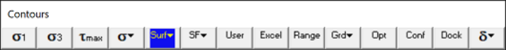
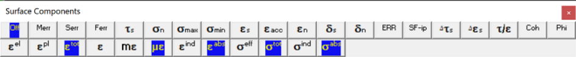
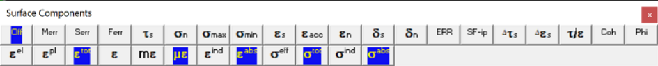
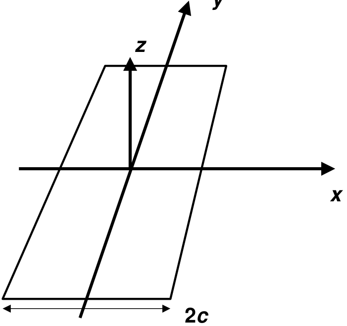
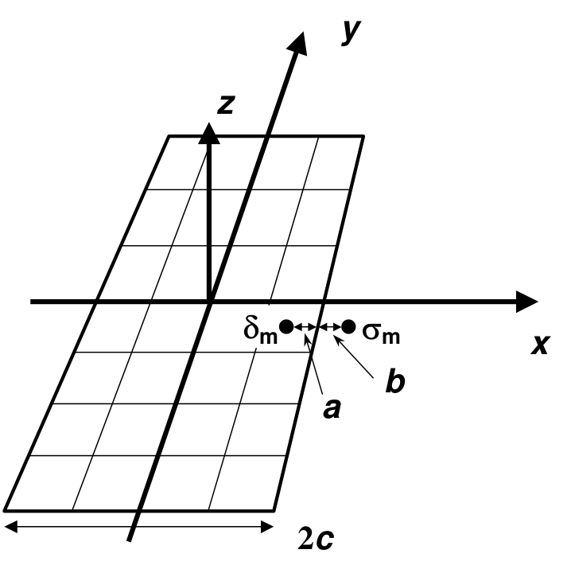
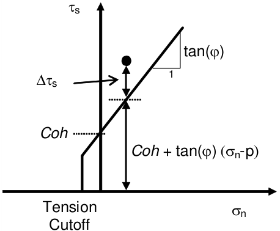
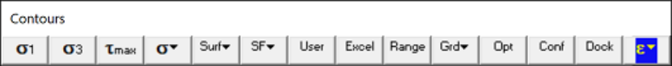

## 5.3.7.1 Contornos de superfície desativados

Desativa os contornos.

Essa componente pode ser acessada pela barra de ferramentas Strength Factor Components, da seguinte forma:

Esta barra de ferramentas pode ser alterada para a orientação vertical arrastando-a contra a borda direita ou esquerda da janela principal.

Ela pode voltar à orientação horizontal arrastando-a contra a borda superior ou inferior da janela principal.

Ao selecionar o botão da barra de ferramentas Contours, a barra de ferramentas Surface Components é ativada.

## 5.3.7.2 Serr Erro de tensão

Gera contornos do erro de tensão superficial.

Essas componentes podem ser acessadas pela barra de ferramentas Strength Factor Components, da seguinte forma:

Esta barra de ferramentas pode ser alterada para a orientação vertical arrastando-a contra a borda direita ou esquerda da janela principal.

Ela pode voltar à orientação horizontal arrastando-a contra a borda superior ou inferior da janela principal.

Ao selecionar o botão da barra de ferramentas Contours, a barra de ferramentas Surface Components é ativada.

Durante a solução da matriz, o Map3D tenta resolver progressivamente as equações simultâneas armazenadas na matriz de coeficientes, junto com quaisquer outras equações que descrevam as zonas de material alternativo, o deslizamento de falhas, a fluência etc. O solucionador iterativo funciona determinando o erro da solução atual de cada equação simultânea (o erro de tensão superficial) e, em seguida, reduzindo esses erros por um processo de aproximações sucessivas.

O Stress Error gera contornos do erro de tensão atual em todas as superfícies.

O Maximum Stress Error gera contornos dos locais onde ocorrem os erros de tensão máximos.

Considera-se que foi obtida uma solução convergente quando o erro máximo de tensão superficial e o erro máximo do critério de ruptura são reduzidos abaixo da tolerância de tensão STOL especificada pelo usuário

Analysis > CParams

#### Related Topics:

Plot > Surface Components > Ferr - Failure Error

Analysis Dialog

## 5.3.7.3 Ferr Erro de ruptura

Gera contornos do erro do critério de ruptura superficial.

Essa componente pode ser acessada pela barra de ferramentas Strength Factor Components, da seguinte forma:

Esta barra de ferramentas pode ser alterada para a orientação vertical arrastando-a contra a borda direita ou esquerda da janela principal.

Ela pode voltar à orientação horizontal arrastando-a contra a borda superior ou inferior da janela principal.

Ao selecionar o botão da barra de ferramentas Contours, a barra de ferramentas Surface Components é ativada.

Durante a solução da matriz, o Map3D tenta resolver progressivamente as equações simultâneas armazenadas na matriz de coeficientes, junto com quaisquer outras equações que descrevam as zonas de material alternativo, o deslizamento de falhas, a fluência etc. O solucionador iterativo funciona determinando o erro da solução atual de cada equação simultânea (o erro de tensão superficial) e, em seguida, reduzindo esses erros por um processo de aproximações sucessivas.

Considera-se que foi obtida uma solução convergente quando o erro máximo de tensão superficial e o erro máximo do critério de ruptura são reduzidos abaixo da tolerância de tensão STOL especificada pelo usuário

Analysis > CParams

O erro do critério de ruptura só é usado em análises de fluência não lineares (incluindo deslizamento de falhas e não linearidade de materiais 3D). Este parâmetro deve estar sempre próximo de zero, a menos que alguma viscosidade tenha sido especificada e o problema se torne não linear. Neste último caso, a fluência viscosa pode permitir estados de tensão acima do critério de ruptura, indicando falta de equilíbrio estático.

#### Related Topics:

Plot > Surface Components > Serr - Stress Error

Analysis > Options > Creep Analysis Dialog

## 5.3.7.4 Tensão de cisalhamento

Gera contornos da tensão de cisalhamento máxima no plano da superfície. Essa componente pode ser acessada pela barra de ferramentas Strength Factor Components, da seguinte forma:

Esta barra de ferramentas pode ser alterada para a orientação vertical arrastando-a contra a borda direita ou esquerda da janela principal.

Ela pode voltar à orientação horizontal arrastando-a contra a borda superior ou inferior da janela principal.

Ao selecionar o botão da barra de ferramentas Contours, a barra de ferramentas Surface Components é ativada.

Na análise elástica, a tensão de cisalhamento máxima no plano é normalmente usada com a tensão normal no plano e o critério de resistência de Mohr-Coulomb para estimar a quantidade de deslizamento devido à sobretensão, em uma falha, conjunto de juntas ou plano de acamamento.

Por outro lado, na análise não linear a tensão de cisalhamento máxima no plano nunca pode exceder a resistência, a menos que algum nível de fluência seja usado. Neste último caso, a fluência viscosa pode permitir estados de tensão acima do critério de ruptura, indicando falta de equilíbrio estático. Portanto, na análise não linear normalmente se considera diretamente a quantidade de deslizamento prevista pelo modelo

Mohr-Coulomb in DD planes

Fault-Gouge in DD planes

Backfill-Hyperbolic in DD planes

A faixa de contornos é definida com

Plot > Range

Esta componente pode ser adicionada à barra de ferramentas de contornos, se desejado

Tools > Configure Contouring Toolbar

#### Related Topics:

Plot > Surface Components > Sn Normal Stress Plot > Surface Components > dTs - Excess Shear Stress Plot > Surface Components > dEs - Incremental Shear Strain Plot > Surface Components > Es - Shear Strain Plot > Surface Components > ds - Shear Displacement (Ride)

## 5.3.7.5 Tensão normal

Gera contornos da tensão normal à superfície.

Essa componente pode ser acessada pela barra de ferramentas Strength Factor Components, da seguinte forma:

Esta barra de ferramentas pode ser alterada para a orientação vertical arrastando-a contra a borda direita ou esquerda da janela principal.

Ela pode voltar à orientação horizontal arrastando-a contra a borda superior ou inferior da janela principal.

Ao selecionar o botão da barra de ferramentas Contours, a barra de ferramentas Surface Components é ativada.

Na análise elástica, a tensão de cisalhamento máxima no plano é normalmente usada com a tensão normal no plano e o critério de resistência de Mohr-Coulomb para estimar a quantidade de deslizamento devido à sobretensão, em uma falha, conjunto de juntas ou plano de acamamento.

Por outro lado, na análise não linear a tensão de cisalhamento máxima no plano nunca pode exceder a resistência, a menos que algum nível de fluência seja usado. Neste último caso, a fluência viscosa pode permitir estados de tensão acima do critério de ruptura, indicando falta de equilíbrio estático. Portanto, na análise não linear normalmente se considera diretamente a quantidade de deslizamento prevista pelo modelo

Mohr-Coulomb in DD planes

Fault-Gouge in DD planes

Backfill-Hyperbolic in DD planes

A faixa de contornos é definida com

Plot > Range

Esta componente pode ser adicionada à barra de ferramentas de contornos, se desejado

Tools > Configure Contouring Toolbar

#### Related Topics:

Plot > Surface Components > Ts Shear Stress

Plot > Surface Components > dTs - Excess Shear Stress

Plot > Surface Components > dEs - Incremental Shear Strain

Plot > Surface Components > Es - Shear Strain

Plot > Surface Components > ds - Shear Displacement (Ride)

## 5.3.7.6 Tensão tangencial máxima

Gera contornos das tensões tangenciais à superfície. Essas componentes podem ser acessadas pela barra de ferramentas Strength Factor Components, da seguinte forma:

Esta barra de ferramentas pode ser alterada para a orientação vertical arrastando-a contra a borda direita ou esquerda da janela principal.

Ela pode voltar à orientação horizontal arrastando-a contra a borda superior ou inferior da janela principal.

Ao selecionar o botão da barra de ferramentas Contours, a barra de ferramentas Surface Components é ativada.

Nas análises elásticas, as tensões tangenciais não são calculadas, a menos que solicitadas. Isso ocorre porque elas não são necessárias para o processo de solução e exigem tempo de análise adicional. Esse cálculo é solicitado marcando Analysis > Options > Calculate Tangential Stress Components.

Esses valores são calculados por padrão durante a análise plástica.

Na análise elástica, a tensão tangencial máxima costuma ser chamada de tensão de fibra extrema. Isso é útil para determinar os locais onde as tensões excedem a resistência à compressão não confinada ou a resistência à tração do maciço rochoso.

A faixa de contornos é definida com

Plot > Range

Esta componente pode ser adicionada à barra de ferramentas de contornos, se desejado

Tools > Configure Contouring Toolbar

## 5.3.7.8 Deformação de cisalhamento

Gera contornos da deformação de cisalhamento que ocorre no material de preenchimento dos elementos DD. Essa componente pode ser acessada pela barra de ferramentas Strength Factor Components, da seguinte forma:

Esta barra de ferramentas pode ser alterada para a orientação vertical arrastando-a contra a borda direita ou esquerda da janela principal.

Ela pode voltar à orientação horizontal arrastando-a contra a borda superior ou inferior da janela principal.

Ao selecionar o botão da barra de ferramentas Contours, a barra de ferramentas Surface Components é ativada.

A deformação de cisalhamento é determinada dividindo o deslocamento de cisalhamento (ride) pela espessura do plano DD.

CAD > Edit > Entity Properties > DDplane Thickess

Observe que há três componentes de deformação que podem ser contornadas:

Plot > Surface Components > Value > Elastic Plot > Surface Components > Value > Plastic Plot > Surface Components > Value > Total

Há também duas formas diferentes de apresentar a deformação:

Plot > Strain > Value > Induced Strain Plot > Strain > Value > Absolute Strain

Observe que este é o nível atual de deformação de cisalhamento atuando nas superfícies DD.

Como o deslocamento pode mudar de direção e até se inverter durante o deslizamento, a deformação de cisalhamento total acumulada pode dar valores diferentes.

A faixa de contornos é definida com

Plot > Range

Esta componente pode ser adicionada à barra de ferramentas de contornos, se desejado

Tools > Configure Contouring Toolbar

#### Related Topics:

Plot > Surface Components > dEs - Incremental Shear Strain

Plot > Surface Components > ds - Shear Displacement (Ride)

## 5.3.7.10 Deformação normal

Gera contornos da deformação normal que ocorre no material de preenchimento dos elementos DD. Essa componente pode ser acessada pela barra de ferramentas Strength Factor Components, da seguinte forma:

Esta barra de ferramentas pode ser alterada para a orientação vertical arrastando-a contra a borda direita ou esquerda da janela principal.

Ela pode voltar à orientação horizontal arrastando-a contra a borda superior ou inferior da janela principal.

Ao selecionar o botão da barra de ferramentas Contours, a barra de ferramentas Surface Components é ativada.

A deformação normal é determinada dividindo o deslocamento normal (fechamento) pela espessura do plano DD

#### CAD > Edit > Entity Properties > DDplane Thickess

Observe que há três componentes de deformação que podem ser contornadas:

Plot > Surface Components > Value > Elastic Plot > Surface Components > Value > Plastic Plot > Surface Components > Value > Total

A faixa de contornos é definida com

Plot > Range

Esta componente pode ser adicionada à barra de ferramentas de contornos, se desejado

Tools > Configure Contouring Toolbar

#### Related Topics:

Plot > Surface Components > dn - Normal Displacement (Closure)

## 5.3.7.11 Deslocamento de cisalhamento (Ride)

Gera contornos do ride ou deslocamento de cisalhamento que ocorre nos elementos DD. Essa componente pode ser acessada pela barra de ferramentas Strength Factor Components, da seguinte forma:

Esta barra de ferramentas pode ser alterada para a orientação vertical arrastando-a contra a borda direita ou esquerda da janela principal.

Ela pode voltar à orientação horizontal arrastando-a contra a borda superior ou inferior da janela principal.

Ao selecionar o botão da barra de ferramentas Contours, a barra de ferramentas Surface Components é ativada.

Observe que há três componentes do deslocamento de cisalhamento que podem ser contornadas:

Plot > Surface Components > Value > Elastic Plot > Surface Components > Value > Plastic Plot > Surface Components > Value > Total

Há também duas formas diferentes de apresentar o deslocamento:

Plot > Strain > Value > Induced Strain Plot > Strain > Value > Absolute Strain

A faixa de contornos é definida com

Plot > Range

Esta componente pode ser adicionada à barra de ferramentas de contornos, se desejado

Tools > Configure Contouring Toolbar

#### Related Topics:

Plot > Surface Components > dEs - Incremental Shear Strain Plot > Surface Components > Es - Shear Strain

## 5.3.7.12 Deslocamento normal (fechamento)

Gera contornos do fechamento ou deslocamento normal que ocorre nos elementos DD. Essa componente pode ser acessada pela barra de ferramentas Strength Factor Components, da seguinte forma:

Esta barra de ferramentas pode ser alterada para a orientação vertical arrastando-a contra a borda direita ou esquerda da janela principal.

Ela pode voltar à orientação horizontal arrastando-a contra a borda superior ou inferior da janela principal.

Ao selecionar o botão da barra de ferramentas Contours, a barra de ferramentas Surface Components é ativada.

Observe que há três componentes do fechamento que podem ser contornadas:

Plot > Surface Components > Value > Elastic Plot > Surface Components > Value > Plastic Plot > Surface Components > Value > Total

A faixa de contornos é definida com

Plot > Range

Esta componente pode ser adicionada à barra de ferramentas de contornos, se desejado

Tools > Configure Contouring Toolbar

#### Related Topics:

Plot > Surface Components > ds - Shear Displacement (Ride)

## 5.3.7.13 ERR

Calcula a taxa de liberação de energia.

Essa componente pode ser acessada pela barra de ferramentas Strength Factor Components, da seguinte forma:

Esta barra de ferramentas pode ser alterada para a orientação vertical arrastando-a contra a borda direita ou esquerda da janela principal.

Ela pode voltar à orientação horizontal arrastando-a contra a borda superior ou inferior da janela principal.

Ao selecionar o botão da barra de ferramentas Contours, a barra de ferramentas Surface Components é ativada.

Esta rotina permite ao usuário calcular a taxa de liberação de energia ( _ERR_ ) à frente de uma frente de escavação. Há um método alternativo com o qual _ERR_ pode ser calculado em qualquer local desejado: Analysis > Options > LERD/LSS

#### Crack-tip Formulation

Considere uma trinca plana em um meio elástico homogêneo infinito. É bem sabido que, perto da ponta da trinca, a abertura d apresenta uma resposta Ö _r_ perto da frente

e a tensão s apresenta uma resposta 1/Ö _r_

onde _r_ representa a distância à ponta da trinca.

A energia total liberada pode ser determinada para um pequeno incremento de avanço da frente a sobrepondo o deslocamento normal (fechamento) com a tensão sobre a região a. Isso requer deslocar o sistema de coordenadas de d pela distância a, resultando em

A energia total liberada pode então ser calculada a partir de (a integral é tomada de 0 a a)

- _W_ = ½ ò s d _dr_

[4] = ½ _p_ d _p_ s ò Ö(a- _r_ )/Ö _r dr_ = ¼ p a _p_ d _p_ s

A taxa de liberação de energia pode agora ser determinada derivando em relação a a, chegando a

Esta expressão apenas pressupõe que d apresenta uma resposta Ö _r_ perto da frente e que s apresenta uma resposta 1/Ö _r_ perto da frente. Nenhuma premissa sobre a geometria foi feita. Não é necessário que _p_ d esteja relacionado a _p_ s de nenhuma forma. Observe que essas premissas só são verdadeiras em um meio elástico homogêneo infinito. Perto de interfaces bimateriais ou de outras superfícies de escavação, essas premissas deixam de valer.

#### Analytical Solution for a Planar Crack

Considere uma trinca plana com largura 2 _c_ e comprimento igual a oito vezes a largura.

Para tal forma, a abertura (deslocamento normal ou fechamento) pode ser determinada analiticamente como (na seção intermediária)

#### d = 4(1-n²)/ _E p_ Ö( _c_ ²- _x_ ²) [6]

onde _E_ e n representam, respectivamente, o módulo de Young (em escala de maciço rochoso – de deformação) e o coeficiente de Poisson, e _p_ representa o estado de tensões homogêneo pré-lavra. A tensão à frente da ponta da trinca também pode ser determinada analiticamente como

O trabalho realizado ao deformar as superfícies da trinca é equivalente à energia total liberada e pode ser determinado da seguinte forma (a integral é tomada de - _c_ a + _c_ )

- _W_ = ½ ò _p_ d _dx_

[8] = 2p (1-n²) _p_ ²/ _E_ ò Ö( _c_ ²- _x_ ²) _dx_

- = p (1-n²) _p_ ² _c_ ²/ _E_

À medida que o comprimento da trinca aumenta, a energia liberada por unidade de comprimento de extensão da trinca pode ser determinada por derivação como

Para a extensão de apenas uma extremidade da trinca, obtemos a taxa de liberação de energia como metade desse valor

_ERR_ = p (1-n²) _p_ ² _c_ / _E_ [10]

#### Comparison with Planar Crack Solution

Se agora compararmos a geometria de trinca plana com a formulação de ponta de trinca, pode-se observar que, para a trinca plana (comparando as equações [1] e [2] com [6] e [7])

_p_ d = 4(1-n²)/ _E p_ Ö(2 _c_ ) [11] _p_ s = _p_ Ö(c/2) [12]

A observação dessas equações revela que esses dois parâmetros podem ser relacionados, no caso de uma geometria de trinca plana, por

_p_ d = 8(1-n²)/ _E p_ s [13]

Substituindo-os na equação [5] para _ERR_ obtém-se

_ERR_ = p (1-n²) _p_ ² _c_ / _E_ [14]

o mesmo resultado determinado para a trinca plana (equação [10]).

Várias substituições de _p_ d e _p_ s podem ser feitas para determinar

_ERR_ = 2p (1-n²) p _p_ s²/ _E_ [15] e _ERR_ = 1/32 p _p_ d² _E_ /(1-n²) [16]

Esta última equação é a mesma expressão deduzida por Ryder e Jager (a equação [11] deles, p. 236, Rock Mechanics for Tabular Hard Rock Mines, 2002). Eles afirmam que essa equação é usada para calcular _ERR_ no MINSIM. Aparentemente também é implementada alguma forma de correção de borda a (Ryder e Napier, Numerical Methods in Geomechanics, Nagoya, 1985), mas os detalhes de exatamente como isso é feito não são claros.

#### _ERR_ Calculation in Map3D

Tanto _p_ d quanto _p_ s podem ser determinados a partir de modelagem numérica.

Por exemplo, dado o deslocamento normal (fechamento) dm determinado a uma distância _a_ atrás da frente em avanço, _p_ d pode ser determinado usando a equação [1] como

Da mesma forma, dada a tensão sm a uma distância _b_ à frente da frente em avanço, _p_ s pode ser determinado usando a equação [2] como

Observe que não há razão para que _a_ seja igual a _b_ e, portanto, não é necessário que os elementos de contorno tenham tamanhos uniformes.

Uma vez determinados _p_ d ou _p_ s, ou ambos, _ERR_ é facilmente calculado a partir da equação [5], [15] ou [16].

Estudos detalhados das distribuições de tensão e deslocamento perto da ponta da trinca revelam que, para elementos DD constantes, tanto a abertura quanto a tensão são consistentemente superestimadas. Felizmente, o grau de superestimação está intimamente relacionado ao tamanho do elemento, e verifica-se que, se _a_ for multiplicado por 3/2 e _b_ for multiplicado por 2/3, resultados muito mais precisos podem ser obtidos. Com essas substituições, e usando as equações [17] e [18], _ERR_ pode ser determinado a partir de

- _ERR_ = 1/6 p dm sm Ö(2/3 _b)_ / Ö(3/2 _a)_

- = 1/6 p dm sm Ö( _b_ / _a)_ [19]

Esta equação é usada para calcular _ERR_ no Map3D.

#### An Example

Com _E_ de 60000 MPa, n de 0,25, _p_ de 100 MPa e _c_ de 100 m, calculamos valores teóricos de _p_ s de 707,11, _p_ d de 0,088388 e 49,1 MN/m para _ERR_

Isso pode ser modelado no Map3D usando elementos uniformes de largura _w_, para obter os seguintes resultados:

|_w_(m)|_b_=_a_(m)|sm (MPa)|dm (m)|_ERR _(MN/m)|error|
|---|---|---|---|---|---|
|50|25|197.567|0.5209|53.9|+9.8%|
|25|12.5|262.669|0.3754|51.6|+5.2%|
|12.5|6.25|358.943|0.2679|50.3|+2.5%|
|10|5|398.56|0.2402|50.1|+2.1%|
|6.25|3.125|498.323|0.1903|49.6|+1.0%|
|5|2.5|554.58|0.1705|49.5|+0.9%|
|3.125|1.5625|697.764|0.1349|49.3|+0.4%|

Observe que a tensão sm e o deslocamento normal (fechamento) dm são determinados nos centros dos elementos. Como foram usadas larguras de elemento uniformes, _a_ é igual a _b_ e igual a ½ _w_

## 5.3.7.14 SF-D Resistência/Tensão

Gera contornos da razão resistência/tensão nos elementos DD. Essa componente pode ser acessada pela barra de ferramentas Strength Factor Components, da seguinte forma:

Esta barra de ferramentas pode ser alterada para a orientação vertical arrastando-a contra a borda direita ou esquerda da janela principal.

Ela pode voltar à orientação horizontal arrastando-a contra a borda superior ou inferior da janela principal.

Ao selecionar o botão da barra de ferramentas Contours, a barra de ferramentas Surface Components é ativada.

Na análise elástica, a tensão de cisalhamento máxima no plano é normalmente usada com a tensão normal no plano e o critério de resistência de Mohr-Coulomb para estimar a quantidade de deslizamento devido à sobretensão, em uma falha, conjunto de juntas ou plano de acamamento.

Por outro lado, na análise não linear a tensão de cisalhamento máxima no plano nunca pode exceder a resistência, a menos que algum nível de fluência seja usado. Neste último caso, a fluência viscosa pode permitir estados de tensão acima do critério de ruptura, indicando falta de equilíbrio estático. Portanto, na análise não linear normalmente se considera diretamente a quantidade de deslizamento prevista pelo modelo

Mohr-Coulomb in DD planes

Fault-Gouge in DD planes

Backfill-Hyperbolic in DD planes

#### Mohr-Coulomb

Strength/Stress   pode ser determinado como  [ Cohesion + (sn-p) tan(j) ] / ts

dTs   Excess Shear Stress  pode ser determinado como Dts = ts - [ Cohesion + (sn-p) tan(j) ]

Se a pressão de fluido for especificada como parte do Stress State, é usada a tensão normal efetiva (sn-p) (aqui p é a pressão de fluido).

A faixa de contornos é definida com

Plot > Range

Esta componente pode ser adicionada à barra de ferramentas de contornos, se desejado

Tools > Configure Contouring Toolbar

#### Related Topics:

Plot > Surface Components > dTs - Excess Shear Stress

## 5.3.7.15 Tensão de cisalhamento excedente

Gera contornos da tensão excedente Dts nos elementos DD.

Essa componente pode ser acessada pela barra de ferramentas Strength Factor Components, da seguinte forma:

Esta barra de ferramentas pode ser alterada para a orientação vertical arrastando-a contra a borda direita ou esquerda da janela principal.

Ela pode voltar à orientação horizontal arrastando-a contra a borda superior ou inferior da janela principal.

Ao selecionar o botão da barra de ferramentas Contours, a barra de ferramentas Surface Components é ativada.

Este recurso é usado apenas em análises não lineares (blocos FF 3D no Map3D Non-Linear e planos DD no Map3D Fault-Slip). Para detalhes, consulte

CAD > Properties > Material Properties

A cada passo de fluência, o estado de tensões de todos os elementos em escoamento (elementos em que a tensão excede a resistência) é calculado como a resistência mais a resistência à fluência. Isso limita o tamanho do incremento de fluência plástica Deplastic em cada elemento em escoamento

- ts = Strength + _C_ Deplastic /D _t_

- _C_ = _G_ D _t_

onde a resistência à fluência é determinada como o coeficiente de fluência _C_ vezes a taxa de deformação plástica. Observe que o usuário deve selecionar tanto o coeficiente de fluência _C_ quanto o tamanho do passo de tempo D _t_ e, em seguida, especificar o quociente deles como módulo viscoso _G_ . A contribuição para a tensão ts feita pelo incremento de fluência é a tensão excedente dada por

Dts   = _C_ Deplastic /D _t_

A deformação plástica acumulada eplastic é determinada como a soma dos incrementos de fluência plástica Deplastic de todos os passos de fluência.

#### Related Topics:

Plot > Surface Components > dEs - Incremental Shear Strain Plot > Surface Components > Ts - Shear Stress Plot > Surface Components > Es - Shear Strain

Analysis > Options > Creep

## 5.3.7.16 Deformação de cisalhamento incremental

Gera contornos do incremento de fluência plástica Deplastic nos elementos DD.

Essa componente pode ser acessada pela barra de ferramentas Strength Factor Components, da seguinte forma:

Esta barra de ferramentas pode ser alterada para a orientação vertical arrastando-a contra a borda direita ou esquerda da janela principal.

Ela pode voltar à orientação horizontal arrastando-a contra a borda superior ou inferior da janela principal.

Ao selecionar o botão da barra de ferramentas Contours, a barra de ferramentas Surface Components é ativada.

Este recurso é usado apenas em análises não lineares (blocos FF 3D no Map3D Non-Linear e planos DD no Map3D Fault-Slip). Para detalhes, consulte

CAD > Properties > Material Properties

A cada passo de fluência, o estado de tensões de todos os elementos em escoamento (elementos em que a tensão excede a resistência) é calculado como a resistência mais a resistência à fluência. Isso limita o tamanho do incremento de fluência plástica Deplastic em cada elemento em escoamento

- ts = Strength + _C_ Deplastic /D _t_

- _C_ = _G_ D _t_

onde a resistência à fluência é determinada como o coeficiente de fluência _C_ vezes a taxa de deformação plástica. Observe que o usuário deve selecionar tanto o coeficiente de fluência _C_ quanto o tamanho do passo de tempo D _t_ e, em seguida, especificar o quociente deles como módulo viscoso _G_ . A contribuição para a tensão ts feita pelo incremento de fluência é a tensão excedente dada por

Dts   = _C_ Deplastic /D _t_

A deformação plástica acumulada eplastic é determinada como a soma dos incrementos de fluência plástica Deplastic de todos os passos de fluência.

Observe que, como o usuário deve selecionar o tamanho do passo de tempo D _t_ para definir o módulo viscoso _G_ , a taxa de deformação de cisalhamento é facilmente determinada a partir da deformação de cisalhamento incremental Deplastic, simplesmente dividindo pelo tamanho do passo de tempo.

#### Related Topics:

Plot > Surface Components > dTs - Excess Shear Stress

Plot > Surface Components > Ts - Shear Stress

Plot > Surface Components > Es - Shear Strain

Analysis > Options > Creep

## 5.3.7.17 Razão tensão/taxa de deformação

Gera contornos da tensão excedente dividida pelo incremento de fluência plástica Dts / Deplastic nos elementos DD. Essa componente pode ser acessada pela barra de ferramentas Strength Factor Components, da seguinte forma:

Esta barra de ferramentas pode ser alterada para a orientação vertical arrastando-a contra a borda direita ou esquerda da janela principal.

Ela pode voltar à orientação horizontal arrastando-a contra a borda superior ou inferior da janela principal.

Ao selecionar o botão da barra de ferramentas Contours, a barra de ferramentas Surface Components é ativada.

Este recurso é usado apenas em análises não lineares (blocos FF 3D no Map3D Non-Linear e planos DD no Map3D Fault-Slip). Para detalhes, consulte

CAD > Properties > Material Properties

A cada passo de fluência, o estado de tensões de todos os elementos em escoamento (elementos em que a tensão excede a resistência) é calculado como a resistência mais a resistência à fluência. Isso limita o tamanho do incremento de fluência plástica Deplastic em cada elemento em escoamento

- ts = Strength + _C_ Deplastic /D _t_

- _C_ = _G_ D _t_

onde a resistência à fluência é determinada como o coeficiente de fluência _C_ vezes a taxa de deformação plástica. Observe que o usuário deve selecionar tanto o coeficiente de fluência _C_ quanto o tamanho do passo de tempo D _t_ e, em seguida, especificar o quociente deles como módulo viscoso _G_ . A contribuição para a tensão ts feita pelo incremento de fluência é a tensão excedente dada por

Dts   = _C_ Deplastic /D _t_

A deformação plástica acumulada eplastic é determinada como a soma dos incrementos de fluência plástica Deplastic de todos os passos de fluência.

#### Related Topics:

Plot > Surface Components > dTs - Excess Shear Stress Plot > Surface Components > dEs - Incremental Shear Strain Plot > Surface Components > Ts - Shear Stress Plot > Surface Components > Es - Shear Strain

#### Analysis > Options > Creep

## 5.3.7.18 Coesão

Gera contornos da coesão e do ângulo de atrito do material de argila de falha (gouge). Essas componentes podem ser acessadas pela barra de ferramentas Strength Factor Components, da seguinte forma:

Esta barra de ferramentas pode ser alterada para a orientação vertical arrastando-a contra a borda direita ou esquerda da janela principal.

Ela pode voltar à orientação horizontal arrastando-a contra a borda superior ou inferior da janela principal.

Ao selecionar o botão da barra de ferramentas Contours, a barra de ferramentas Surface Components é ativada.

Isso é de particular interesse quando você usa o tipo de material Equilibrated-Gouge, já que a coesão e o ângulo de atrito podem variar de um lugar para outro.

## 5.3.7.20 Temperatura/Carga hidráulica

Gera contornos da temperatura ou da carga hidráulica.

O Map3D Thermal-Fluid Flow pode ser usado para resolver simultaneamente o fluxo permanente de calor/fluido acoplado à análise de tensões. O programa é configurado de modo que o usuário precise apenas especificar as condições de contorno de temperatura/carga hidráulica; o problema acoplado de tensões e fluxo térmico/de fluido é então resolvido simultaneamente. Este recurso é útil para simular efeitos de aquecimento ou resfriamento e a resposta drenada ou não drenada de solos.

Para mais detalhes, consulte

#### Expansion Coefficient and Conductivity

A faixa de contornos é definida com

Plot > Range

Esta componente pode ser adicionada à barra de ferramentas de contornos, se desejado

Tools > Configure Contouring Toolbar

## 5.3.7.21 Fluxo normal

Gera contornos da vazão normal à superfície.

O Map3D Thermal-Fluid Flow pode ser usado para resolver simultaneamente o fluxo permanente de calor/fluido acoplado à análise de tensões. O programa é configurado de modo que o usuário precise apenas especificar as condições de contorno de temperatura/carga hidráulica; o problema acoplado de tensões e fluxo térmico/de fluido é então resolvido simultaneamente. Este recurso é útil para simular efeitos de aquecimento ou resfriamento e a resposta drenada ou não drenada de solos.

Para mais detalhes, consulte

Expansion Coefficient and Conductivity

A faixa de contornos é definida com

Plot > Range

Esta componente pode ser adicionada à barra de ferramentas de contornos, se desejado

Tools > Configure Contouring Toolbar

## 5.3.7.22 Valor

5.3.7.22.1  Deformação elástica

Seleciona a componente da deformação elástica, plástica ou total. Essas componentes podem ser acessadas pela barra de ferramentas Strain Components, da seguinte forma:

Esta barra de ferramentas pode ser alterada para a orientação vertical arrastando-a contra a borda direita ou esquerda da janela principal.

Ela pode voltar à orientação horizontal arrastando-a contra a borda superior ou inferior da janela principal.

Ao selecionar o botão da barra de ferramentas Contours, a barra de ferramentas Stress Components é ativada.

Você pode adicionar este botão à barra de ferramentas Contours usando o botão de configuração.

Para mais detalhes, consulte

Mohr-Coulomb in 3D FF blocks.

### 5.3.7.22.4 Deformação absoluta

Plota a componente da deformação induzida ou da deformação absoluta.

Essa componente pode ser acessada pela barra de ferramentas Strain Components, da seguinte forma:

Esta barra de ferramentas pode ser alterada para a orientação vertical arrastando-a contra a borda direita ou esquerda da janela principal.

Ela pode voltar à orientação horizontal arrastando-a contra a borda superior ou inferior da janela principal.

Ao selecionar o botão da barra de ferramentas Contours, a barra de ferramentas Stress Components é ativada.

Você pode adicionar este botão à barra de ferramentas Contours usando o botão de configuração.

A deformação induzida é a deformação sem a contribuição da deformação pré-lavra. Representa a variação de deformação desde a condição pré-lavra.

A deformação absoluta é a deformação incluindo a contribuição da deformação pré-lavra.

Veja também:

Plot > Stress > Value > Induced Strain Plot > Stress > Value > Absolute Strain

### 5.3.7.22.6 Tensão induzida

Plota a componente da tensão induzida ou da tensão absoluta. Essas componentes podem ser acessadas pela barra de ferramentas Stress Components, da seguinte forma:

Esta barra de ferramentas pode ser alterada para a orientação vertical arrastando-a contra a borda direita ou esquerda da janela principal.

Ela pode voltar à orientação horizontal arrastando-a contra a borda superior ou inferior da janela principal.

Ao selecionar o botão da barra de ferramentas Contours, a barra de ferramentas Stress Components é ativada.

A tensão induzida é a tensão sem a contribuição da tensão pré-lavra. Representa a variação de tensão desde a condição pré-lavra.

A tensão absoluta é a tensão incluindo a contribuição da tensão pré-lavra.

Veja também:

Plot > Strain > Value > Induced Strain

Plot > Strain > Value > Absolute Strain
