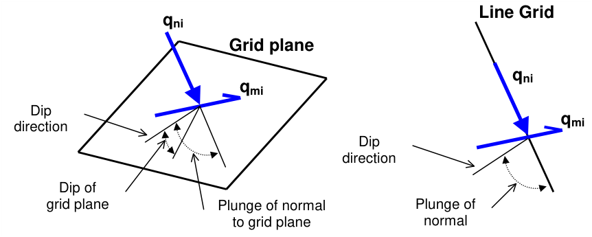
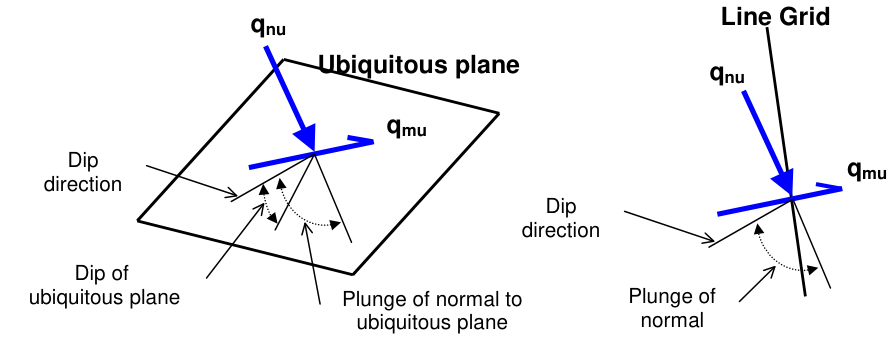

## 5.3.5.1 Plot > Thermal/Flux

Ativa a barra de ferramentas Thermal/Flux, após uma análise BEM de fluxo termo-fluido do Map3D.

Os parâmetros da análise térmica/de fluxo são descritos em Expansion Coefficient e Conductivity.

Esta barra de ferramentas oferece acesso rápido às componentes térmicas e de fluxo.

Plot > Flux > t/h   Temperatura/Carga hidráulica

Plot > Flux > qtotal = ( qx² + qy² + qz² )½ Fluxo total   gera contornos do fluxo total

Plot > Flux > qx Fluxo X   gera contornos da componente x do fluxo

Plot > Flux > qy Fluxo Y   gera contornos da componente y do fluxo

Plot > Flux > qz Fluxo Z   gera contornos da componente z do fluxo

Para calcular o fluxo no plano, o estado de fluxo em cada ponto do plano da grade é reorientado para determinar o fluxo máximo paralelo ao plano da grade e o fluxo normal ao plano. Observe que qni é orientado normal ao plano da grade e paralelo à direção de uma grade linear.

Plot > Flux > qni Normal no plano   gera contornos da componente do fluxo normal ao plano da grade.

Plot > Flux > qmi Máximo no plano   gera contornos do fluxo máximo tangencial ao plano da grade.

Para calcular o fluxo do plano ubíquo nº 1, o estado de fluxo em cada ponto do plano da grade é reorientado para determinar o fluxo máximo paralelo ao plano ubíquo nº 1 e o fluxo normal ao plano. Observe que dmi não é orientado normal ao plano da grade.

Plot > Flux > qnu Normal ao plano ubíquo   gera contornos da componente do fluxo normal ao plano ubíquo.

Plot > Flux > qmu Máximo no plano ubíquo   gera contornos do fluxo máximo tangencial ao plano ubíquo.

- a direção de mergulho é medida positiva no sentido horário a partir do eixo y.

- o mergulho do plano é medido positivo para baixo a partir da horizontal (ou seja, a direção de mergulho).

- o caimento da normal é medido positivo para baixo (ou seja, negativo para cima) a partir da horizontal.

#### Notas:

A barra de ferramentas de fluxo só pode ser ativada após a etapa de construção do modelo (CAD)

#### Etapas de análise do Map3D.

A orientação do plano de cisalhamento ubíquo é definida com

Plot > Strength Factors > Ubiquitous Parameters

A faixa de contornos é definida com

#### Plot > Range

Esta componente pode ser adicionada à barra de ferramentas de contornos, se desejado

Tools > Configure Contouring Toolbar > Displacement

Pode ser útil adicionar o botão

#### More Flow Components

à barra de ferramentas de contornos para acessar rapidamente todas as componentes de fluxo.
