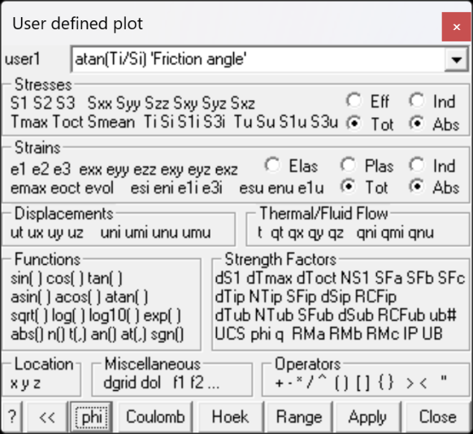

Gera contornos de uma componente de tensão definida pelo usuário.

#### Stresses:

- S1 S2 S3 componentes de tensão principal s1 s2 s3

- Sxx Syy Szz Sxy Syz Sxz componentes cartesianas da tensão sxx syy szz txy tyz tzx

- Tmax tensão de cisalhamento máxima ½(s1 - s3)

- Toct tensão de cisalhamento octaédrica toct = ¹/3 [(s1 - s2)² + (s2 - s3)² +(s3 - s1)²]½

- Smean tensão média smean = ¹/3 (s1 + s2 + s3)

- Ti Si tensão de cisalhamento máxima e tensão normal no plano da grade tip sip

- S1i S3i tensões máxima e mínima tangenciais ao plano da grade s1i s3i

- Tu Su tensão de cisalhamento máxima e tensão normal no plano ubíquo tub sub. A orientação do plano de cisalhamento ubíquo é definida com

- S1u S3u tensões máxima e mínima tangenciais ao plano ubíquo s1u s3u \]

- Effective/Total componentes da tensão efetiva ou da tensão total. Estas opções só são usadas no Map3D Thermal-Fluid Flow, pois esse código permite calcular distribuições de poropressão em regime permanente.

- Induced/Absolute componentes da tensão induzida ou da tensão absoluta (ou seja, a tensão sem a contribuição da tensão pré-lavra).

#### Strains:

- e1 e2 e3 deformação principal maior e1 e2 e3

- exx eyy ezz exy eyz exz componentes cartesianas da deformação exx eyy ezz exy eyz ezx

- emax deformação de cisalhamento máxima ½(e1 - e3)

- eoct deformação de cisalhamento octaédrica eoct = ¹/3 [(e1 - e2)² + (e2 - e3)² +(e3 - e1)²]½

- evol deformação volumétrica evol = (e1 + e2 + e3)

- esi eni deformação de cisalhamento máxima e deformação normal no plano da grade esi eni

- e1i e3i deformações máxima e mínima tangenciais ao plano da grade e1i e3i

- esu enu deformação de cisalhamento máxima e deformação normal no plano ubíquo esu enu

- e1u e3u deformações máxima e mínima tangenciais ao plano ubíquo e1u e3u

- Elastic/Plastic/Total componentes da deformação elástica, plástica ou total. Estas opções só são usadas no Map3D Non-Linear, pois esse código permite calcular deformações não lineares.

- Induced/Absolute componentes da deformação induzida ou da deformação absoluta (ou seja, sem a contribuição da tensão pré-lavra).

#### Displacements:

- ut deslocamento total, sua direção e seu caimento dt

- · ux uy uz componentes cartesianas do deslocamento dx dy dz

- uni deslocamento normal ao plano da grade dni

- umi deslocamento máximo tangencial ao plano da grade dmi

- unu deslocamento normal ao plano ubíquo dnu

- umu deslocamento máximo tangencial ao plano ubíquo dmu

#### Thermal/Fluid Flow:

- t temperatura/carga hidráulica

- qt fluxo total, sua direção e seu caimento.

- qx qy qz componentes cartesianas do fluxo.

- qni deslocamento normal ao plano da grade.

- qmi deslocamento máximo tangencial ao plano da grade.

- qnu deslocamento normal ao plano ubíquo.

- qmu deslocamento máximo tangencial ao plano ubíquo.

#### Functions:

- sin() cos() tan()   funções trigonométricas seno, cosseno e tangente.

- asin() acos() atan()   funções trigonométricas inversas.

- sqrt()   função raiz quadrada.

- log()   função logaritmo natural.

- log10()   função logaritmo na base 10.

- exp()   função exponencial (antilogaritmo).

- abs()   valor absoluto.

- n() an()   distribuição de probabilidade normal e normal inversa. O argumento usado com a distribuição normal é (Ds1/ _s_ ), que representa a tensão principal maior excedente dividida pelo desvio padrão (veja ).

- t(,) at(,)   distribuição de probabilidade t e t inversa. O argumento usado com a distribuição t é (Ds1/ ( _sg),n_ -2), onde Ds1 representa a tensão principal maior excedente, _s_ representa o desvio padrão, _n_ representa o número de dados e _g_ representa o fator  [1 + 1/ _n_ + (s3 - sm) ²/s3²/( _n_ -1)]½, onde sm representa o valor médio de s3 e s3 representa o desvio padrão de s3.

- sgn()   função sinal: retorna +1 para valores positivos, -1 para valores negativos e 0 para valores com magnitude menor que 10-12 .

#### Strength:

- ds1 tensão principal maior excedente Ds1 = s1 - ( _UCS_ + _q_ s3 )

- dtmax tensão de cisalhamento máxima excedente Dtmax = ½(s1 - s3) - [ _UCS_ + ½(s1+s3) ( _q_ -1) ]/( _q_ +1) = [s1 - ( _UCS_ + _q_ s3) ]/( _q_ +1)

- dtoct tensão de cisalhamento octaédrica excedente Dtoct = toct - [ _UCS_ + ( _q_ –1) smean ] Ö(2) /( _q_ +2)

- NS1 probabilidade usando a distribuição normal N(Ds1 /std)

- SFA Resistência/Tensão pode ser determinado para Mohr-Coulomb como ( _UCS_ + _q_ s3 )/ s1

- ou para Hoek-Brown como [ s3 + Ö( _m_ scs3 + _s_ sc²) ] / s1

- SFB Resistência/Tensão pode ser determinado para Mohr-Coulomb como ( _UCS_ + _q_ s3 - s3 )/(s1 - s3) ou para Hoek-Brown como [ s3 + Ö( _m_ scs3 + _s_ sc²) ] / (s1 - s3)

- SFC Resistência/Tensão pode ser determinado para Mohr-Coulomb como [ _UCS_ + ½(s1+s3) ( _q_ -1) ]/[ ½(s1 - s3)( _q_ +1) ]

ou para Hoek-Brown como &#123;Ö[1 /16 _m_ ²sc² + ½(s1 + s3) _m_ sc + _s_ sc²] - ¼ _m_ sc&#125;/(s1 - s3)

- dTip tensão de cisalhamento excedente no plano Dtip = tip - [ Cohesion + sip tan(j) ]

- NTip probabilidade usando a distribuição normal N(Dtip /std)

- SFip Resistência/Tensão pode ser determinado como [ Cohesion + sip tan(j) ] / tip

- dSip tensão excedente na parede no plano Dsip = [ 3 s1i - s3i ] - UCS

- RCFip fator de condição da rocha (Rock Condition Factor) para a tensão na parede no plano RCFip = [ 3 s1i - s3i ]/UCS

- dTub tensão de cisalhamento excedente no plano ubíquo Dtub

- NTub probabilidade usando a distribuição normal N(Dtub /std)

- SFub Resistência/Tensão pode ser determinado como [ Cohesion + sub tan(j) ] / tub

- dSub tensão excedente na parede no plano ub Dsub = [ 3 s1ub - s3ub ] - UCS

- RCFub fator de condição da rocha para a tensão na parede no plano ub RCFip = [ 3 s1ub - s3ub ]/UCS

- UB# Plota o número do conjunto UB (1, 2 ou 3) que tem o maior valor de Dtub

- _UCS phi q_ Parâmetros de resistência de Mohr-Coulomb definidos com Plot > Strength Factors > Rockmass Strength Parameters; observe que esses parâmetros só estão definidos se você especificou o critério de resistência de Mohr-Coulomb ou de Drucker-Prager

- _RMa_ Resistência do maciço rochoso definida para Mohr-Coulomb como ( _UCS_ + _q_ s3 )

ou para Hoek-Brown como [ s3 + Ö( _m_ scs3 + _s_ sc²) ]

- _RMb_ Resistência do maciço rochoso definida para Mohr-Coulomb como ( _UCS_ + _q_ s3 - s3 )

- ou para Hoek-Brown como [ Ö( _m_ scs3 + _s_ sc²) ]

- _RMc_ Resistência do maciço rochoso definida para Mohr-Coulomb como [ _UCS_ + ½(s1+s3) ( _q_ -1) ]/( _q_ +1) ou para Hoek-Brown como &#123;Ö[1 /16 _m_ ²sc² + ½(s1 + s3) _m_ sc + _s_ sc²] - ¼ _m_ sc&#125;/2

- _IP_ Resistência no plano definida usando Mohr-Coulomb como [ Cohesion + sip tan(j) ]

- _UB_ Resistência ubíqua definida usando Mohr-Coulomb como [ Cohesion + sub tan(j) ]

- _sc_ Parâmetro de resistência de Hoek-Brown definido com Plot > Strength Factors > Rockmass Strength Parameters; observe que esse parâmetro só está definido se você especificou o critério de resistência de Hoek-Brown

#### Location:

- x y z   coordenada do ponto de grade.

#### Miscellaneous:

- Dgrid distância à superfície mais próxima a partir de cada ponto de grade.

- Dol distância à grade mais próxima _Dgrid_ dividida pelo espaçamento da grade _Lgrid_ .

- f1 f2... parâmetros de material definidos pelo usuário. Podem ser definidos com Plot > Properties > Material Properties > User defined Parameters.

#### Operators:

- + - * / ^   operadores de adição, subtração, multiplicação, divisão e exponenciação. Observe que as exponenciais são calculadas primeiro, seguidas de multiplicação e divisão e, por fim, adição e subtração.

- () [] &#123;&#125;   tipos de parênteses. Os pares de parênteses devem corresponder.

- >   valor máximo. Por exemplo, se a equação de plotagem for especificada como s1 > 10, será plotado o maior entre s1 e 10.

- &lt;   valor mínimo. Por exemplo, se a equação de plotagem for especificada como s1 &lt; 10, será plotado o menor entre s1 e 10.

- " "   comentário.

#### Other:

- phi:   atan(Ti/Si) plota o ângulo de atrito necessário para resistir ao deslizamento em uma falha, conjunto de juntas ou plano de acamamento orientado da mesma forma que o plano da grade.

- Mohr-Coulomb:   60 + S3*tan(45+30/2)^2   plota a resistência para um critério de Mohr-Coulomb com UCS de 60 e ângulo de atrito de 30°. A equação _UCS_ + S3* _q_ ou, alternativamente, _UCS_ +S3*tan(45+ _phi_ /2)^2 também pode ser usada aqui, se os parâmetros de resistência tiverem sido

- definidos anteriormente com Plot > Strength Factors > Rockmass Strength Parameters.

- Hoek:     S3 + sqrt( 0.1*60*S3 + 0.005*60^2 )   plota a resistência para um critério de Hoek-Brown com sc de 60, m de 0.1 e s de 0.005.

- Range – define a faixa de contornos.

- Plot – regenera a plotagem de contornos.

A janela suspensa permite armazenar até 20 equações diferentes. Elas são mantidas entre sessões do Map3D no arquivo map3d.ini.
