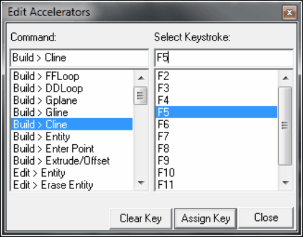

Permite definir teclas de atalho personalizadas.

Por exemplo, para atribuir a tecla F5 à função Build > Cline, atribua a tecla de função da seguinte forma:

- Observe que as atribuições de teclas de função são mantidas de uma sessão para outra no arquivo Map3D.cfg.
