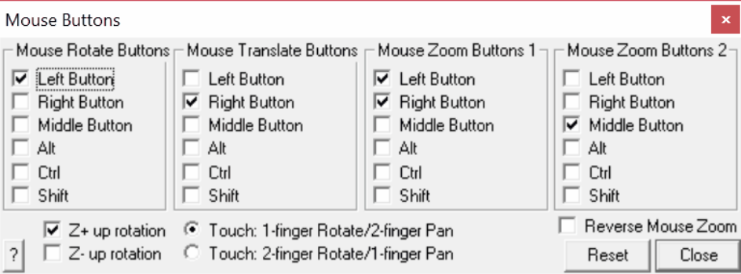

## 5.6.1.1 Botões do mouse

Permite especificar funções personalizadas de rotação, translação e zoom com o mouse.

Observe que no máximo dois botões podem ser especificados para cada função. Esses botões são salvos de uma sessão para outra.

Z+ up rotation: especifica que o eixo Z+ fica restrito a apontar verticalmente, de modo que, quando o eixo Z+ aponta para cima, arrastar o mouse para a esquerda gira o modelo para a esquerda.

Z- up rotation: inverte a suposição acima. Neste caso, o eixo Z+ fica restrito a apontar verticalmente, de modo que, quando o eixo Z+ aponta para cima, arrastar o mouse para a esquerda gira o modelo para a direita.

Touch: 1-finger Rotate/2-finger Pan: controles de tela sensível ao toque configurados para que arrastar com 1 dedo gire o modelo e arrastar com 2 dedos o desloque.

Touch: 2-finger Rotate/1-finger Pan: controles de tela sensível ao toque configurados para que arrastar com 2 dedos gire o modelo e arrastar com 1 dedo o desloque.

Touch Zoom: o movimento de pinça com dois dedos aplica zoom no modelo.

Reverse Mouse Wheel: inverte a ação da roda do mouse, de modo que girá-la para frente aproxima o modelo em vez de afastá-lo.

## 5.6.1.2 Tempo de clique duplo

Especifica o tempo (em milissegundos) entre os dois cliques de um clique duplo.

Os cliques duplos são usados para ativar as funções de edição

CAD > Edit

## 5.6.1.3 Tempo de espera para arrastar

Especifica o tempo (em milissegundos) que você deve manter pressionado um botão do mouse antes que o ponteiro de arrastar apareça.

O ponteiro de arrastar é usado para girar, transladar e aplicar zoom no modelo.
