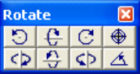
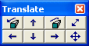
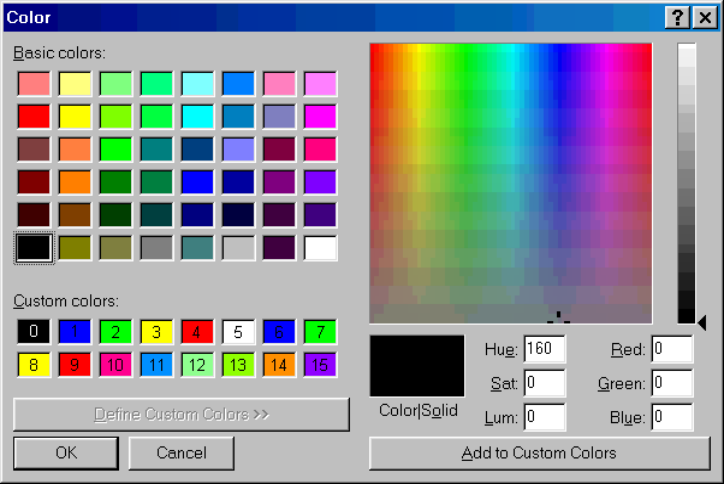

## 5.6.2.1 Barra de ferramentas de rotação

Ativa a barra de ferramentas de rotação.

O modelo pode ser girado usando estes botões ou arrastando o ícone de orientação até a posição desejada.

Rotate Counter clockwise (tecla Insert)

Rotate Up (tecla Home ou shift+seta para cima)

Rotate Clockwise (tecla Page Up)

Rotate Left (tecla Delete ou shift+seta para a esquerda)

Rotate Down (tecla End ou shift+seta para baixo)

Rotate Right (tecla Page Down ou shift+seta para a direita)

View > Centre of Rotation

View > Rotation Increment

Notas:

Se a barra de ferramentas de rotação não estiver visível, ela pode ser ativada com

Tools > Rotation Toolbar

Antes de girar o modelo, você deve definir o centro de rotação desejado

View > Centre of Rotation

## 5.6.2.2 Barra de ferramentas de translação

Ativa a barra de ferramentas de translação.

O modelo pode ser transladado usando estes botões ou arrastando o modelo até a posição desejada.

Zoom In (tecla Enter ou "+") Translate Up (seta para cima) Zoom Out (Ctrl+Enter ou tecla "-") Translate Left (seta para a esquerda) Translate Down (seta para baixo) Translate Right (seta para a direita) View > Zoom Factor

View > Translation Increment

Notas:

Se a barra de ferramentas de translação não estiver visível, ela pode ser ativada com

Tools > Translation Toolbar

Antes de aproximar com zoom

Zoom In

você deve definir o centro de rotação desejado

View > Centre of Rotation

## 5.6.2.3 Barra de ferramentas de contornos

Ativa a barra de ferramentas de contornos, após uma análise BEM do Map3D.

A configuração padrão desta barra de ferramentas é a seguinte:

Esta barra de ferramentas oferece acesso rápido aos parâmetros de tensão mais usados.

Plot > Stress > S1 Major Principal Stress

Plot > Stress > S3 Minor Principal Stress

Plot > Stress > Tmax Maximum Shear Stress

Plot > Stress ativa a barra de ferramentas de tensões. Esta barra contém todas as componentes de tensão.

Plot > Surface Components ativa a barra de ferramentas de superfície. Esta barra contém todas as componentes de superfície.

Plot > Strength Factors ativa a barra de ferramentas de fatores de resistência. Esta barra contém todas as componentes de parâmetros de resistência.

Plot > Stress > User Plotagem de tensões definida pelo usuário.

Plot > Range especifica a faixa de contornos (mínimo, máximo, intervalo...) do contorno plotado atualmente.

Plot > Grid Selection Ativa a barra de ferramentas de seleção de grades.

Plot > Surface Components > Options especifica as opções da plotagem de contornos (trajetórias, linhas de contorno...).

Tools > Contouring Toolbar Configure adiciona ou remove botões da barra de ferramentas de contornos.

Notas:

Os botões podem ser reposicionados na barra de ferramentas simplesmente mantendo pressionado o botão esquerdo do mouse e arrastando o botão até o local desejado.

A barra de ferramentas de contornos só pode ser ativada após a etapa de construção do modelo (CAD)

Etapas de análise do Map3D.

## 5.6.2.4 Configurar a barra de ferramentas de contornos

Adiciona ou remove botões da barra de ferramentas de contornos.

Basta marcar ou desmarcar o item desejado para adicioná-lo à barra de ferramentas ou removê-lo dela.

Notas:

A barra de ferramentas de contornos só pode ser ativada

#### Tools > Contouring toolbar

após a etapa de construção do modelo (CAD)

Etapas de análise do Map3D.

Os botões podem ser reposicionados na barra de ferramentas simplesmente mantendo pressionado o botão esquerdo do mouse e arrastando o botão até o local desejado.

A configuração da barra de ferramentas é salva entre análises no arquivo map3d.ini.

## 5.6.2.5 Barra de ferramentas de solução

Ativa a barra de ferramentas de solução, durante a análise BEM do Map3D.

A configuração padrão desta barra de ferramentas é a seguinte:

Esta barra de ferramentas oferece acesso rápido a parâmetros importantes durante a etapa de solução da análise BEM do Map3D

#### Analysis > BEM Analysis

Plot > Surface Components > Serr Stress Error Plot > Surface Components > Ferr Failure Error Plot > Surface Components > Shear Stress Plot > Surface Components > Normal Stress Plot > Surface Components > Shear Displacement (Ride)

Plot > Surface Components ativa a barra de ferramentas de superfície com todas as componentes de superfície. Plot > Range especifica a faixa de contornos (mínimo, máximo, intervalo...) do contorno plotado atualmente.

Plot > Surface Components > Options especifica as opções da plotagem de contornos (trajetórias, linhas de contorno...).

Tools > Solve Toolbar Configure adiciona ou remove botões da barra de ferramentas de solução.

Notas:

Durante a análise, a barra de ferramentas de solução é exibida quando você suspende a análise

#### Analysis > Suspend.

Se esta opção não estiver marcada, a barra de ferramentas de solução não será ativada ao suspender a análise BEM do Map3D.

Os botões podem ser reposicionados na barra de ferramentas simplesmente mantendo pressionado o botão esquerdo do mouse e arrastando o botão até o local desejado.

A barra de ferramentas de solução só pode ser ativada após a etapa de construção do modelo (CAD)

#### Etapas de análise do Map3D.

Tópicos relacionados:

Analysis > Auto Plot.

Analysis > Auto Range.

## 5.6.2.6 Configurar a barra de ferramentas de solução

Adiciona ou remove botões da barra de ferramentas de solução.

Basta marcar ou desmarcar o item desejado para adicioná-lo à barra de ferramentas ou removê-lo dela.

Notas:

A barra de ferramentas de solução só pode ser ativada

#### Tools > Solve toolbar

após a etapa de construção do modelo (CAD)

#### Etapas de análise do Map3D

Durante a análise, a barra de ferramentas de solução é exibida quando você suspende a análise

#### Analysis > Suspend

Os botões podem ser reposicionados na barra de ferramentas simplesmente mantendo pressionado o botão esquerdo do mouse e arrastando o botão até o local desejado.

A configuração da barra de ferramentas é salva entre análises no arquivo map3d.ini.

## 5.6.2.7 Barra de ferramentas de visualização

Ativa a barra de ferramentas de visualização.

A configuração padrão desta barra de ferramentas é a seguinte

Esta barra de ferramentas oferece acesso rápido a diversas funções de visualização.

View > Centre of Rotation   Define o centro de rotação. Este ponto permanece fixo enquanto você gira e aplica zoom na exibição.

View > Zoom   ativa uma janela de zoom gráfica. Você será solicitado a selecionar os dois cantos da janela clicando uma vez com o mouse em cada um.

View > Pan   ativa um deslocamento gráfico. Você será solicitado a selecionar as duas extremidades do vetor de deslocamento clicando uma vez com o mouse em cada uma.

View > Length   ativa uma ferramenta gráfica de medição de comprimento. Você será solicitado a selecionar as duas extremidades do vetor de comprimento clicando uma vez com o mouse em cada uma. Esses pontos devem ser selecionados no modelo ou em um contorno. O comprimento, o mergulho e a direção de mergulho do vetor selecionado são informados. Se você mantiver pressionada a tecla Shift ao selecionar os pontos, poderá definir uma linha composta por vários segmentos e obter o comprimento total. Se você definir uma forma poligonal fechada (mantendo pressionada a tecla Shift ao selecionar os pontos) em uma plotagem de contornos, será informado o valor médio do contorno dentro do polígono (veja Plot > Polygon Box). Janelas retangulares simples podem ser definidas mantendo pressionada a tecla Shift e arrastando para abrir uma janela.

View > Hide ativa a barra de ferramentas de ocultar.

View > Hide Block Colours ativa a barra de ferramentas para ocultar cores de blocos.

View > Hide CLine Colours ativa a barra de ferramentas para ocultar cores de linhas de construção.

File > Mining Step ativa a barra de ferramentas de seleção da etapa de lavra.

Tools > View Toolbar Configure adiciona ou remove botões da barra de ferramentas de visualização.

Notas:

Os botões podem ser reposicionados na barra de ferramentas simplesmente mantendo pressionado o botão esquerdo do mouse e arrastando o botão até o local desejado.

## 5.6.2.8 Configurar a barra de ferramentas de visualização

Adiciona ou remove botões da barra de ferramentas de visualização.

Basta marcar ou desmarcar o item desejado para adicioná-lo à barra de ferramentas ou removê-lo dela.

Notas:

Os botões podem ser reposicionados na barra de ferramentas simplesmente mantendo pressionado o botão esquerdo do mouse e arrastando o botão até o local desejado.

A configuração da barra de ferramentas é salva entre análises no arquivo map3d.ini.

## 5.6.2.9 Barra de ferramentas CAD

Ativa a barra de ferramentas CAD.

A configuração padrão desta barra de ferramentas é a seguinte:

Esta barra de ferramentas oferece acesso rápido às funções CAD usadas na etapa de construção e edição do modelo da análise BEM do Map3D

#### Analysis > Go to CAD

CAD > Build Ativa a barra de ferramentas de construção para criar novas entidades do modelo.

CAD > Snap Ativa a barra de ferramentas de snap (captura de objetos) para definir o modo de snap. CAD > Edit Ativa a barra de ferramentas de edição para modificar entidades do modelo. CAD > Grid Selection Ativa a barra de ferramentas de seleção de grades para exibir grades. Tools > CAD Toolbar > Configure Adiciona ou remove botões.

Notas:

A barra de ferramentas CAD só é exibida durante a etapa de construção e edição do modelo da análise

#### Analysis > Go to CAD

Se esta opção não estiver marcada, a barra de ferramentas CAD não será ativada durante a etapa de construção e edição do modelo.

Os botões podem ser reposicionados na barra de ferramentas simplesmente mantendo pressionado o botão esquerdo do mouse e arrastando o botão até o local desejado.

Tópicos relacionados:

Map3D Analysis Stages

## 5.6.2.10 Configurar a barra de ferramentas CAD

Adiciona ou remove botões da barra de ferramentas CAD.

Basta marcar ou desmarcar o item desejado para adicioná-lo à barra de ferramentas ou removê-lo dela.

Notas:

A barra de ferramentas CAD só pode ser ativada

#### Tools > CAD toolbar

durante a etapa de construção do modelo (CAD)

#### Etapas de análise do Map3D

Os botões podem ser reposicionados na barra de ferramentas simplesmente mantendo pressionado o botão esquerdo do mouse e arrastando o botão até o local desejado.

A configuração da barra de ferramentas é salva entre análises no arquivo map3d.ini.

## 5.6.2.11 Cores dos blocos

Atribui cores personalizadas para a renderização dos blocos.

O Map3D usa 16 cores base para a renderização.

O usuário pode atribuir qualquer cor desejada às cores base, e o Map3D gera automaticamente tonalidades delas para a renderização.

As cores são usadas da seguinte forma:

- Colour 0 - cor de fundo da tela.

- Colour 1-4 – cores do retângulo de seleção elástico e dos marcadores.

- Colour 5 – cor de primeiro plano, usada para texto, contornos de blocos, símbolos de trajetórias e linhas de grade.

- Colour 6 – blocos com número de cor 1, 11, 21, 31, ...

- Colour 7 - blocos com número de cor 2, 12, 22, 32, ...

- Colour 8 - blocos com número de cor 3, 13, 23, 33, ...

- Colour 9 - blocos com número de cor 4, 14, 24, 34, ...

- Colour 10 - blocos com número de cor 5, 15, 25, 35, ...

- Colour 11 - blocos com número de cor 6, 16, 26, 36, ...

- Colour 12 - blocos com número de cor 7, 17, 27, 37, ...

- Colour 13 - blocos com número de cor 8, 18, 28, 38, ...

- Colour 14 - blocos com número de cor 9, 19, 29, 39, ...

- Colour 15 - blocos com número de cor 10, 20, 30, 40, ...

Reatribuir uma cor é um processo de três etapas:

1. Escolha a cor que deseja redefinir em uma das "Custom Colors:".

2. Defina a nova cor desejada escolhendo em "Basic Colors:", na "Color Matrix" ou ajustando "Hue: Sat: Lum: Red: Green: Blue:".

3. Clique no botão "Add to Custom Colors".

Todas as cores podem ser restauradas aos valores padrão originais do Map3D selecionando

#### Tools > Set Default Block Colours

As cores personalizadas são salvas entre análises no arquivo map3d.ini.

## 5.6.2.12 Cores dos contornos

Atribui cores personalizadas para a renderização dos contornos.

O Map3D usa 16 cores base para o contorno.

As cores são usadas da seguinte forma:

- Colour 0 - cor de fundo da tela.

- Colour 1 – cor de contorno abaixo da faixa.

- Colour 2 a 11 – cores de contorno.

- Colour 12 cor de contorno acima da faixa.

- Colour 13 – cor do limite de tração.

- Colour 15 – cor de primeiro plano, usada para texto, contornos de blocos, símbolos de trajetórias e linhas de grade.

Reatribuir uma cor é um processo de três etapas:

1. Escolha a cor que deseja redefinir em uma das "Custom Colors:".

2. Defina a nova cor desejada escolhendo em "Basic Colors:", na "Color Matrix" ou ajustando "Hue: Sat: Lum: Red: Green: Blue:".

3. Clique no botão "Add to Custom Colors".

As cores personalizadas são salvas entre análises no arquivo map3d.ini.

As cores de contorno podem ser restauradas aos valores padrão do Map3D selecionando

Tools > Set Contour Colours

## 5.6.2.13 Restaurar as cores de blocos padrão

Restaura todas as cores aos valores padrão originais do Map3D.

Cores personalizadas podem ser definidas com

Tools > Custom Colours

## 5.6.2.14 Restaurar as cores de contornos 1

Restaura todas as cores aos valores padrão originais do Map3D.

Cores personalizadas podem ser definidas com

#### Tools > Contour Colours

## 5.6.2.18 Configurar a fonte dos botões

Atribui uma fonte, tamanho, cor etc. personalizados aos botões.

O Map3D usa a "Windows System Font" para desenhar todos os botões.

O usuário pode redefinir essa fonte e suas características de exibição.

A fonte pode ser restaurada ao valor padrão original do Map3D selecionando

#### Tools > Reset Default Font

A fonte personalizada é salva entre análises no arquivo map3d.ini.

## 5.6.2.19 Restaurar a fonte padrão

Restaura a fonte dos botões ao valor padrão original do Map3D.

Uma fonte personalizada pode ser definida com

Tools > Configure Button Font

## 5.6.2.20 Botões de tamanho pequeno

Permite definir o tamanho dos botões da barra de ferramentas.
