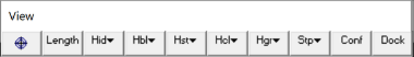
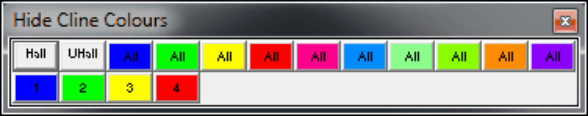

## 5.2.4.1 Ocultar tudo

Permite ocultar todas as linhas de construção com a cor selecionada.

Essa barra de ferramentas pode ser colocada na orientação vertical arrastando-a contra a borda direita ou esquerda da janela principal.

Ela pode voltar à orientação horizontal arrastando-a contra a borda superior ou inferior da janela principal.

Selecionar o botão na barra de ferramentas de visualização ativa a barra de ferramentas Hide Cline Colours.

View > Hide Cline Colours > Hide All   Oculta todas as linhas de construção.

View > Hide Cline Colours > Unhide All   Exibe todas as linhas de construção ocultas.

A primeira linha oculta e exibe todas as linhas de construção da cor associada.

Os botões restantes trazem o número de cor de linha de construção associado e são usados para ocultá-las.

Observe que a barra de ferramentas pode ser rolada e redimensionada.

Para alterar o tamanho, basta pegar qualquer borda ou canto e arrastá-lo até o tamanho e a forma desejados. As barras de rolagem só aparecem se houver botões demais para exibir com o tamanho e a forma atuais.
