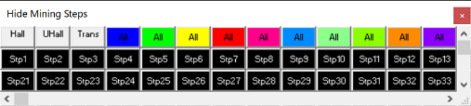

## 5.2.3.1 Ocultar tudo

Permite ocultar todos os blocos escavados na etapa especificada.

Essa barra de ferramentas pode ser colocada na orientação vertical arrastando-a contra a borda direita ou esquerda da janela principal.

Ela pode voltar à orientação horizontal arrastando-a contra a borda superior ou inferior da janela principal.

#### Selecionar o

botão na barra de ferramentas de visualização ativa a barra de ferramentas Hide Excavation Steps.

View > Hide Block Colours > Hide All   Oculta todas as superfícies de blocos.

View > Hide Block Colours > Unhide All   Exibe todas as superfícies ocultas.

A primeira linha oculta e exibe todos os blocos da cor associada.

Os botões restantes trazem números de etapas de escavação e são usados para ocultar essas etapas.

Observe que a barra de ferramentas pode ser rolada e redimensionada.

Para alterar o tamanho, basta pegar qualquer borda ou canto e arrastá-lo até o tamanho e a forma desejados. As barras de rolagem só aparecem se houver botões demais para exibir com o tamanho e a forma atuais.
