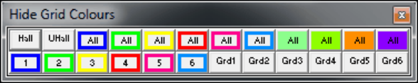

## 5.2.5.1 Ocultar tudo

Permite ocultar todas as grades com a cor selecionada.

Essa barra de ferramentas pode ser colocada na orientação vertical arrastando-a contra a borda direita ou esquerda da janela principal.

Ela pode voltar à orientação horizontal arrastando-a contra a borda superior ou inferior da janela principal.

Selecionar o botão ativa a barra de ferramentas Hide Grid Colours.

View > Hide Grid Colours > Hide All   Oculta todas as grades.

View > Hide Grid Colours > Unhide All   Exibe todas as grades ocultas.

A primeira linha oculta e exibe todas as grades da cor associada.

Os botões que trazem o número de cor de grade associado são usados para ocultá-las. O nome de grade associado a cada número de cor é exibido na dica de ferramenta e na lista do menu.

Os botões restantes são usados para ocultar grades individuais, assim como em Grid Selection.

Observe que a barra de ferramentas pode ser rolada e redimensionada.

Para alterar o tamanho, basta pegar qualquer borda ou canto e arrastá-lo até o tamanho e a forma desejados. As barras de rolagem só aparecem se houver botões demais para exibir com o tamanho e a forma atuais.
