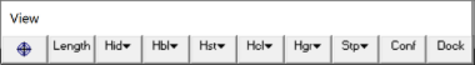
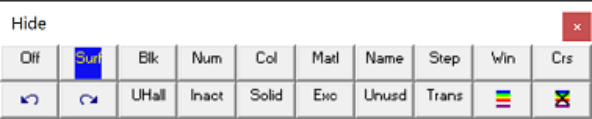

- **5.2.1.1** **Off**

Essas ferramentas facilitam ocultar diferentes partes da geometria.

Ao selecionar o botão da barra de ferramentas View, a barra de ferramentas Hide é ativada

Observe que, se o botão não estiver na barra de ferramentas View, ele pode ser adicionado usando o botão e selecionando Hide > Hide More.

View > Hide > Off   Desativa a função de ocultar.

View > Hide > Surfaces   Oculta superfícies selecionando uma de cada vez.

View > Hide > Blocks   Oculta todas as superfícies que compõem o bloco selecionado.

View > Hide > Numbers   Oculta todas as superfícies com o número de cor de bloco selecionado.

View > Hide > Colour   Oculta todas as superfícies com a cor selecionada.

View > Hide > Materials   Oculta todas as superfícies com o número de material selecionado. Um mesmo bloco pode ter materiais diferentes dependendo da etapa de lavra ativa no momento.

Ao usar esta última função, certifique-se de selecionar a etapa de lavra apropriada

File > Mining Step

View > Hide > Names   Oculta todas as superfícies com o nome de bloco selecionado.

View > Hide > Steps   Oculta todas as superfícies que são lavradas na etapa selecionada.

View > Hide > Window   Oculta todas as superfícies dentro da janela selecionada. As entidades só serão selecionadas se estiverem inteiramente contidas na janela.

View > Hide > Crossing   Oculta todas as superfícies dentro da janela de interseção. As entidades serão selecionadas mesmo que apenas uma parte delas esteja dentro da janela.

View > Hide > Undo last Hide   Desfaz a última operação de ocultar (atualmente são salvas no máximo 10).

View > Hide > Redo last Hide   Refaz a operação de ocultar anterior (atualmente são salvas no máximo 10).

View > Hide > Unhide All   Reexibe todas as superfícies atualmente ocultas.

View > Hide > Inactive   Quando ativada, os elementos inativos são exibidos. As superfícies inativas são usadas para exibir feições incluídas apenas para fins de visualização e que não devem ser usadas na análise de tensões propriamente dita

#### CAD > Edit > Entity Properties

View > Hide > Solids   Quando ativada, os sólidos são ocultados. Sólidos são blocos 3D ou planos DD que não são escavados.

À medida que a sequência de lavra avança

#### File > Mining Step

diferentes blocos serão escavados. Para exibir apenas as escavações, ative esta opção.

View > Hide > Excavations   Quando ativada, as escavações são ocultadas.

View > Hide > Unused   Quando ativada, os elementos não usados são ocultados. Elementos não usados são superfícies de blocos 3D ou planos DD que não são usados na análise. Esses elementos existem onde uma falha corta uma escavação, ou onde um material com número de material menor está dentro de uma zona com número de material maior (p. ex., um dique cortando uma zona de minério).

À medida que a sequência de lavra avança

#### File > Mining Step

isso pode mudar. Para ocultar as superfícies não usadas, ative esta opção. Para discussão adicional, consulte

Analysis > Options > Closure

#### Constructing Alternate Material Zones

View > Hide > Translucent   Quando ativada, as superfícies ocultas são exibidas de forma translúcida.

View > Hide > Show Errors   Oculta/exibe erros (quando ativada, mostra apenas os erros de elementos). Observe que esta opção pode ser usada com a opção View > Hide > Translucent.

View > Hide > Hide Errors   Oculta/exibe erros (quando ativada, não mostra os

#### erros de elementos).

Na etapa CAD, as diferentes cores indicam os seguintes problemas:

- Roxo: foram encontradas lacunas e elas foram preenchidas, corrigindo o problema. Esta mensagem não indica um erro e é fornecida apenas como informação ao usuário.

- Verde: foram encontrados blocos duplicados e eles foram excluídos, corrigindo o problema. Esta mensagem não indica um erro e é fornecida apenas como informação ao usuário.

- Azul: foram detectadas lacunas estreitas. Essas lacunas não indicam um erro e não são necessariamente um problema; porém, se surgirem problemas durante a análise de interseções ou a análise BEM, esses locais são as causas mais prováveis. Esta mensagem não indica um erro e é fornecida como aviso ao usuário.

- Branco: foram detectadas arestas que se ligam no sentido errado. Blocos fechados devem ter todas as arestas ligadas de forma consistente, para que o interior e o exterior de um bloco possam ser determinados sem ambiguidade. Arestas brancas não atendem a esse requisito. Esta mensagem indica um erro, que deve ser corrigido antes de prosseguir com a análise.

- Laranja: foram detectadas arestas que não se ligam a outras arestas. Blocos fechados devem ter todas as arestas ligadas a outra aresta para formar um bloco fechado. Arestas laranja não atendem a esse requisito. Esta mensagem indica um erro, que deve ser corrigido antes de prosseguir com a análise.

- Amarelo: foram detectadas arestas que se ligam a mais de uma outra aresta. Blocos fechados devem ter todas as arestas ligadas a apenas uma outra aresta para formar um bloco fechado. Arestas amarelas não atendem a esse requisito. Esta mensagem indica um erro, que deve ser corrigido antes de prosseguir com a análise.

- Vermelho: destaca zonas visco-plásticas com formas hexaédricas inválidas. No Map3D Visco-Plastic, as zonas plásticas só podem ter forma de hexaedro (4 cantos na parte superior e 4 cantos na parte inferior) ou alguma degeneração dessa forma, como um tetraedro.

Na etapa INTERSECTION, as diferentes cores indicam os seguintes problemas:

- Roxo: uma superfície foi desabilitada devido a um contato irresolúvel. Ao analisar os contatos entre as várias superfícies de blocos, não foi possível resolver a maneira como esta superfície se relaciona com outra superfície; assim, a superfície foi desabilitada e não será usada na análise de tensões BEM. A causa mais provável deste problema é uma forma muito estranha, como um triângulo extremamente estreito. Embora seja um erro, normalmente pode ser ignorado, pois formas extremamente estreitas contribuem muito pouco para os resultados da análise.

- Verde: uma superfície foi desabilitada devido a um fechamento irresolúvel. Ao analisar o fechamento de um bloco, não foi possível resolver a maneira como esta superfície se relaciona com o bloco; assim, a superfície foi desabilitada e não será usada na análise de tensões BEM. A causa mais provável deste problema é uma forma muito estranha, como um triângulo extremamente estreito. Embora seja um erro, normalmente pode ser ignorado, pois formas extremamente estreitas contribuem muito pouco para os resultados da análise.

- Azul: foram detectadas lacunas estreitas. Essas lacunas não indicam um erro e não são necessariamente um problema; porém, se surgirem problemas durante a análise de interseções ou a análise BEM, esses locais são as causas mais prováveis. Esta mensagem não indica um erro e é fornecida como aviso ao usuário.

- Branco: foram detectadas superfícies não fechadas. Ao analisar o fechamento de um bloco, constatou-se que não era possível determinar de forma consistente o interior e o exterior do bloco. Esta mensagem indica um erro, que deve ser corrigido antes de prosseguir com a análise.

- Laranja: foram detectadas arestas que não se ligam a outras arestas. Blocos fechados devem ter todas as arestas ligadas a outra aresta para formar um bloco fechado. Arestas laranja não atendem a esse requisito. Esta mensagem indica um erro, que deve ser corrigido antes de prosseguir com a análise.

- Amarelo: uma superfície foi desabilitada devido a uma forma irresolúvel. A causa mais provável deste problema é uma forma muito estranha, como um triângulo extremamente estreito. Embora seja um erro, normalmente pode ser ignorado, pois formas extremamente estreitas contribuem muito pouco para os resultados da análise.
