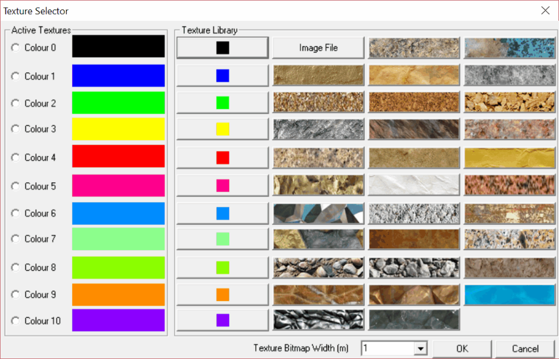

## 5.2.6.1 Block Outlines

Configura as opções de renderização do modelo.

View > Render > Block Outlines - os blocos são desenhados com contornos mostrando suas arestas.

View > Render > Grid Lines - os blocos são desenhados com linhas em intervalos regulares da grade. O intervalo da grade é solicitado quando você ativa este recurso.

View > Render > Block Colours - os blocos são desenhados com sombreamento de cor. Desative este recurso para obter uma vista de estrutura de arame.

View > Render > Material Numbers - os blocos são coloridos conforme a propriedade de material atribuída ao bloco. Um mesmo bloco pode ter materiais diferentes dependendo da etapa de lavra ativa no momento.

Ao usar esta função, certifique-se de selecionar a etapa de lavra apropriada

#### File > Mining Step

View > Render > Mining Step Numbers - os blocos são coloridos conforme a etapa de lavra em que são escavados.

View > Render > Dark Shading - os blocos são desenhados com um modelo de sombreamento de fonte de luz escuro. Um raio de aresta é solicitado quando você ativa este recurso. O raio de aresta é usado para sombrear arestas e cantos, dando-lhes aparência arredondada. O raio de aresta deve ser especificado como uma fração da espessura do bloco. O sombreamento pode reduzir consideravelmente a taxa de atualização.

View > Render > Bright Shading - os blocos são desenhados com um modelo de sombreamento de fonte de luz brilhante. Um raio de aresta é solicitado quando você ativa este recurso. O raio de aresta é usado para sombrear arestas e cantos, dando-lhes aparência arredondada. O raio de aresta deve ser especificado como uma fração da espessura do bloco. O sombreamento pode reduzir consideravelmente a taxa de atualização.

View > Render > Texture Rendering - ativa ou desativa a renderização de texturas. A renderização de texturas permite colorir as superfícies com uma imagem bitmap em vez de uma cor sólida. Veja Assign Bock Textures

View > Render > Block Numbers - os blocos são desenhados com números em suas superfícies. Esses números correspondem ao modo de renderização atualmente selecionado: Block Colours, Material Numbers ou Mining Step Numbers.

View > Render > Block Names - os blocos são desenhados com os nomes dos blocos em suas superfícies.

View > Render > Coordinate Numbers - os blocos são desenhados com os nomes dos blocos em suas superfícies.

View > Render > Backfacing Surfaces - quando ativada, as faces posteriores dos blocos FF 3D são desenhadas. Em geral, o usuário não precisa nem deseja ver essas superfícies.

View > Render > Fixed With Spacing - quando ativada, as superfícies com discretização de largura fixa especificada são renderizadas mostrando a discretização.

View > Render > Discretize - alterna a exibição do modelo discretizado e não discretizado. View > Render > Perspective - alterna entre a visualização em perspectiva e a ortogonal. No modo ortogonal, todas as dimensões são desenhadas em escala real. Na vista em perspectiva, as entidades mais distantes do observador são desenhadas menores.

View > Render > Clines Dot Radius - especifica o raio dos pontos que serão desenhados em todos os vértices das linhas de construção. Isso reduz significativamente a velocidade de desenho e só deve ser usado se necessário. Um valor zero indica que nenhum ponto será desenhado.

View > Render > Point Size - especifica o raio dos pontos que serão desenhados em todos os vértices durante a seleção.

View > Render > Line Width - especifica a largura dos contornos dos blocos e das linhas de contorno.

## 5.2.6.9 Assign Block Textures

A renderização de texturas permite colorir as superfícies com uma imagem bitmap em vez de uma cor sólida. Para isso, faça o seguinte:

1. selecione o número de cor ao qual deseja atribuir a textura (p. ex., Colour 0, Colour 1 ...)

2. selecione um dos bitmaps predefinidos ou escolha o seu próprio bitmap com "Image File".

3. Para mapear a imagem bitmap em cada superfície, é preciso especificar o "Texture Bitmap With". O "Texture Bitmap With" escalona o bitmap especificado de modo que o padrão se repita na largura geométrica indicada.

Por exemplo, se você especificar 1 m como largura, o bitmap será escalonado de modo a ser desenhado com 1 m de largura nas superfícies dos seus blocos.

## 5.2.6.10 Small Block Numbers

Configura as opções de renderização do modelo.

View > Render > Block Outlines - os blocos são desenhados com contornos mostrando suas arestas.

View > Render > Grid Lines - os blocos são desenhados com linhas em intervalos regulares da grade. O intervalo da grade é solicitado quando você ativa este recurso.

View > Render > Block Colours - os blocos são desenhados com sombreamento de cor. Desative este recurso para obter uma vista de estrutura de arame.

View > Render > Material Numbers - os blocos são coloridos conforme a propriedade de material atribuída ao bloco. Um mesmo bloco pode ter materiais diferentes dependendo da etapa de lavra ativa no momento.

Ao usar esta função, certifique-se de selecionar a etapa de lavra apropriada

#### File > Mining Step

View > Render > Mining Step Numbers - os blocos são coloridos conforme a etapa de lavra em que são escavados.

View > Render > Dark Shading - os blocos são desenhados com um modelo de sombreamento de fonte de luz escuro. Um raio de aresta é solicitado quando você ativa este recurso. O raio de aresta é usado para sombrear arestas e cantos, dando-lhes aparência arredondada. O raio de aresta deve ser especificado como uma fração da espessura do bloco. O sombreamento pode reduzir consideravelmente a taxa de atualização.

View > Render > Bright Shading - os blocos são desenhados com um modelo de sombreamento de fonte de luz brilhante. Um raio de aresta é solicitado quando você ativa este recurso. O raio de aresta é usado para sombrear arestas e cantos, dando-lhes aparência arredondada. O raio de aresta deve ser especificado como uma fração da espessura do bloco. O sombreamento pode reduzir consideravelmente a taxa de atualização.

View > Render > Texture Rendering - ativa ou desativa a renderização de texturas. A renderização de texturas permite colorir as superfícies com uma imagem bitmap em vez de uma cor sólida. Veja Assign Bock Textures

View > Render > Block Numbers - os blocos são desenhados com números em suas superfícies. Esses números correspondem ao modo de renderização atualmente selecionado: Block Colours, Material Numbers ou Mining Step Numbers.

View > Render > Block Names - os blocos são desenhados com os nomes dos blocos em suas superfícies.

View > Render > Coordinate Numbers - os blocos são desenhados com os nomes dos blocos em suas superfícies.

View > Render > Backfacing Surfaces - quando ativada, as faces posteriores dos blocos FF 3D são desenhadas. Em geral, o usuário não precisa nem deseja ver essas superfícies.

View > Render > Fixed With Spacing - quando ativada, as superfícies com discretização de largura fixa especificada são renderizadas mostrando a discretização.

View > Render > Discretize - alterna a exibição do modelo discretizado e não discretizado. View > Render > Perspective - alterna entre a visualização em perspectiva e a ortogonal. No modo ortogonal, todas as dimensões são desenhadas em escala real. Na vista em perspectiva, as entidades mais distantes do observador são desenhadas menores.

View > Render > Clines Dot Radius - especifica o raio dos pontos que serão desenhados em todos os vértices das linhas de construção. Isso reduz significativamente a velocidade de desenho e só deve ser usado se necessário. Um valor zero indica que nenhum ponto será desenhado.

View > Render > Point Size - especifica o raio dos pontos que serão desenhados em todos os vértices durante a seleção.

View > Render > Line Width - especifica a largura dos contornos dos blocos e das linhas de contorno.
