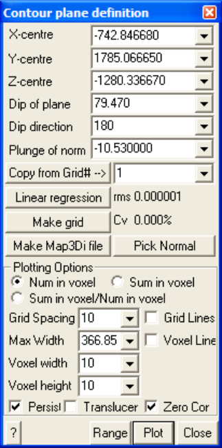
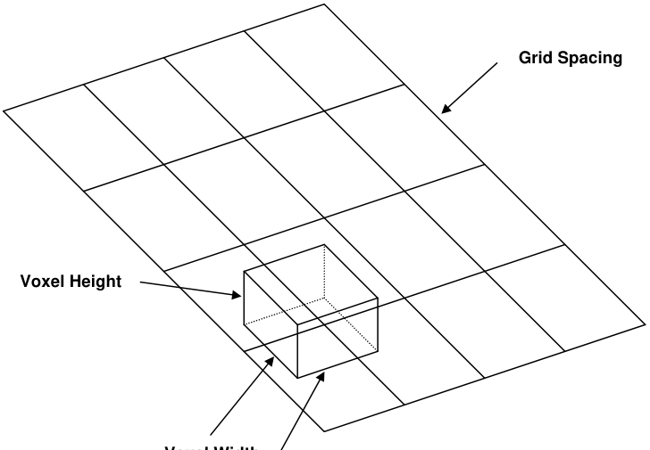
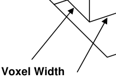

Permite configurar o plano usado para contornar os dados de pontos de visualização (veja Visualization).

**X-centre** – o valor da coordenada x do centro do plano de contornos.

**Y-centre** – o valor da coordenada y do centro do plano de contornos. **Z-centre** – o valor da coordenada z do centro do plano de contornos. **Dip of plane** – o mergulho do plano de contornos.

**Dip direction** – a direção de mergulho do plano de contornos.

**Dip of normal** – o mergulho da normal ao plano de contornos (este valor está a 90° do mergulho do plano).

**Pick Normal** - ativa o cursor para selecionar uma superfície de forma interativa. O centro, o mergulho e a direção de mergulho do plano de contornos serão ajustados paralelos à superfície selecionada.

**Copy from Grid#** – copia os parâmetros de localização e orientação de um plano de grade do modelo. **Linear regression** – encontra o plano de melhor ajuste através dos dados sísmicos minimizando a distância normal

de todos os pontos ao plano.

**Make Grid** – cria um plano de grade do modelo a partir do plano de contornos.

**Make Map3Di file** – gera, a partir dos dados contornados, um arquivo de dados a ser usado para o carregamento sísmico em uma análise **Map3Di** (mais detalhes abaixo).

#### Contour Plane Options:

**Num in voxel** – é contornada a contagem do número de pontos dentro de cada voxel. **Sum in voxel** – é contornada a soma dos valores da equação de plotagem de todos os pontos localizados no voxel.

**Sum/Num in voxel** – é contornado o quociente dos dois valores.

- **Grid spacing** – o espaçamento de grade usado para contornar os dados sísmicos. Como o voxel é centrado em cada canto da grade, este parâmetro controla a densidade dos voxels. Observe que, se o espaçamento da grade for menor que a largura do voxel, voxels adjacentes se sobreporão.

**Voxel width** – a largura do voxel é medida paralela às bordas do plano da grade.

**Voxel height** – a altura do voxel é medida perpendicular ao plano da grade. Isso permite ao usuário

limitar a distância ao plano da grade dentro da qual os dados serão incluídos no contorno.

**Outlines** – desenha os contornos reais dos voxels.

- **Persist** – quando marcada, os pontos são replotados cada vez que o modelo é reorientado, transladado ou ampliado/reduzido com zoom. Como isso pode demorar em modelos grandes, nem sempre essa opção é desejável.

**Translucent** - desenha os pontos como esferas translúcidas.

**Zero Contour** - quando desmarcada, os contornos abaixo do mínimo da faixa de contornos não são desenhados. Isso

é útil para exibir contornos em que apenas a parte superior da faixa é importante. **Range** – especifica o mínimo, o máximo e o intervalo para o escalonamento do raio e para os contornos.

- Plot regenera a plotagem. Este botão pode ser colocado na barra de ferramentas de visualização (Tools >

- View Toolbar Configure) ou na barra de ferramentas de contornos (Tools > Contour Toolbar Configure).

#### Linear Regression:

A regressão linear é realizada encontrando o plano que tem o menor valor de **_rms_** (a raiz do valor quadrático médio, ou distância média de todos os pontos ao plano ajustado).

A teoria padrão do coeficiente de correlação não é adequada como medida de qualidade do ajuste neste caso. Isso porque não nos interessa a "medida do grau de associação entre variáveis", mas sim uma medida de quão bem o plano ajustado representa nossos dados. Observe que, se todos os dados estiverem em um único plano horizontal, o ajuste do plano é perfeito. No entanto, por definição a correlação é zero

(e portanto o coeficiente de correlação é igual a zero), porque o valor de z não depende dos valores de x ou de y. Isso não é o que queremos.

Aqui é definido um parâmetro semelhante a um coeficiente de variação (uma medida da variabilidade dividida pela magnitude). **_Cv_** é definido simplesmente como o valor **_rms_** (a distância média de todos os pontos ao plano ajustado) dividido pela distância média de todos os pontos ao centroide. Isso mede quão bem o plano representa os dados. Essa razão costuma ser expressa em porcentagem. Definido assim, dados aleatórios resultam em **Cv** =100% (100% de variabilidade). Um ajuste perfeito resulta em **_Cv_** =0 (0% de variabilidade). Observe que é possível que **_Cv_** ultrapasse 100%. Você pode pensar nesse parâmetro como a razão entre a variabilidade em torno do plano e a largura física do conjunto de dados.

Isso é muito semelhante à definição formal de coeficiente de variação, que é o desvio padrão dividido pela média. A maioria dos materiais geológicos tem propriedades com **_Cv_** da ordem de 20 a 30%. **_Cv_** poderia ser convertido em um coeficiente de correlação equivalente usando

**_r_ = (1-** **_Cv_ ²)****½**

mas esse não é realmente o parâmetro correto e há problemas de definição nos casos em que **_Cv_** excede 1.

Tanto **rms** quanto **_Cv_** são exibidos para o plano atual sempre que os dados são plotados.

#### Make Map3Di file:

Para criar um arquivo de carregamento Map3Di, é preciso determinar a distribuição do deslocamento de cisalhamento (ride) indicada pela sismicidade. Isso requer várias premissas (consulte A. McGarr, "Some Applications of Seismic Source Mechanism Studies to Assessing Underground Hazard", Proc. 1st International Symposium on Rockbursts and Seismicity in Mines, SAIMM, Johannesburg, 1984, pp. 199-208, e Hoffman, G, R. Sewjee and G. van Aswegan, "First steps in the integration of numerical modelling and seismic monitoring", 5th International Symposium on Rockburst and Seismicity in Mines, SAIMM, Johannesburg, 2000, pp. 397-404.), resumidas aqui:

1) Assumir um modelo de deslizamento. Aqui é possível considerar um modelo de trinca elíptica (Brune) ou um modelo de asperidade com bordas macias devido à fluência (Walsh, J.J. and J. Waterson, "Distribution of cumulative displacements and seismic slip on a single normal fault surface", J. Struct. Geol., V. 9, 1987, pp. 1039-1046). Em geral, será usada uma forma circular (tipo moeda), a menos que o usuário tenha alguma forma de definir uma forma alternativa.

2) O valor médio do deslizamento pode ser determinado a partir do momento sísmico **_Mo_ =** m **_AD_**, onde m é o módulo de rigidez, **_A_** é a área da fonte (determinada a partir do raio da fonte) e **_D_** é o deslizamento médio ao longo da falha. Também pode ser determinado a partir da "queda de deformação sísmica" (Seismic Strain Drop).

3) O raio da superfície de deslizamento pode ser estimado a partir do raio de Brune, sendo b a velocidade da onda cisalhante e **_fo_** a frequência de canto. Para um modelo de asperidade, o raio **_a_ = 2.34** b **/(2** p **_fo_ )**, onde b é determinado a partir do raio do "volume aparente" (Apparent Volume), é provavelmente mais apropriado.

4) A orientação do deslizamento pode ser determinada a partir do tensor de momento sísmico, se disponível, ou a partir do estado de tensões obtido na modelagem.

A partir desses 4 itens é possível determinar o perfil de deslizamento indicado pelo evento sísmico.

Para um perfil elíptico, a distribuição do deslocamento de cisalhamento (ride) é dada por

**1.50** **_D_ (1-** **_r_ ²/** **_a_ ²)****½**

Para um perfil de asperidade, a distribuição do deslocamento de cisalhamento (ride) é dada por

#### 2.89 _D_ (1- _r_ / _a_ )(1+2 _r_ / _a_ -3 _r_ ²/ _a_ ²)½

Um arquivo de carregamento sísmico para o Map3Di pode ser gerado da seguinte forma:

- 1) Construa um arquivo de dados sísmicos como uma série de pontos:

**x1 y1 z1 f1 f2 … x2 y2 z2 f1 f2 … x3 y3 z3 f1 f2 … ...**

onde **xi yi zi** representam as coordenadas de cada ponto,

**f1** indica o deslizamento médio **_D_** e **f2** indica o raio da fonte **_a_** .

- 2) Usando a rotina Visualization, para um perfil elíptico especifique a equação de plotagem como

   - **1.50*f1*sqrt(1-rip^2/f2^2)**

Para um perfil de asperidade use

#### 2.89*f1*(1-rip/f2)*sqrt(1+2*rip/f2-3*rip^2/f2^2)

3) Escolha o plano desejado e o espaçamento de grade e defina a altura e a largura de voxel desejadas. A altura do voxel pode ser usada para recortar eventos fora do plano. É importante escolher a largura do voxel igual ao maior raio de evento desejado, para distribuir o deslocamento de cisalhamento (ride) por todos os voxels afetados.

- 4) Defina as opções de plotagem como "Sum in Voxel" e plote (Plot).

- 5) Make Map3Di file.

- 6) Visualize o arquivo Map3Di com CAD > Properties > Map3Di Setup e veja o parâmetro f2.

Para detalhes sobre o formato dos dados, veja **CAD > Properties > Map3Di**.
