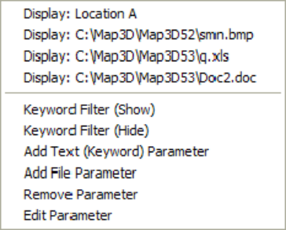

Este recurso pode ser usado para exibir um banco de dados com informações geológicas úteis, como teor, qualidade do maciço rochoso etc.

Cada ponto pode ser marcado com uma série de:

- valores numéricos (p. ex., cor, magnitude, orientação etc.)

- palavras-chave

- mensagens de texto

- nomes de arquivos (p. ex., arquivos gráficos, documentos, planilhas etc.)

Para ativar este recurso, clique com o botão direito em um ponto de dados de visualização (veja Visualization).

Se não houver pontos de visualização, é possível criar um com Make Point, que adiciona um novo ponto.

Ao clicar com o botão direito, será exibido um menu de contexto com as seguintes opções:

Os itens "Display" na seção superior deste menu são dados associados ao ponto de dados (respectivamente, uma cadeia de texto, um bitmap, uma planilha e um documento). Ao selecionar qualquer um deles, esse item é exibido.

Os itens da seção inferior do menu são funções que acessam o banco de dados:

- **Keyword Filter (Show)** – usado para especificar uma série de filtros de palavras-chave de exibição. Somente os dados de pontos que tenham uma dessas palavras-chave associadas serão visíveis; todos os demais ficarão ocultos. Isso permite filtrar a exibição das entradas desejadas do banco de dados.

- **Keyword Filter (Hide)** – usado para especificar uma série de filtros de palavras-chave de ocultação. Os dados de pontos que tenham uma dessas palavras-chave associadas ficarão ocultos; todos os demais serão visíveis. Isso permite filtrar a exibição das entradas indesejadas do banco de dados.

- **Add Text (Keyword) Parameter** - usado para adicionar uma cadeia de texto a um ponto de dados. Esse texto é usado para a filtragem por palavras-chave e será adicionado à lista de exibição.

- **Add File Parameter** - usado para adicionar um parâmetro de arquivo a um ponto de dados. O nome do arquivo é usado para a filtragem por palavras-chave e o arquivo será adicionado à lista de exibição. Qualquer nome de arquivo pode ser especificado aqui (p. ex., arquivos gráficos, planilhas, documentos etc.). Se o tipo de arquivo estiver associado a um aplicativo, esse aplicativo será iniciado automaticamente para exibir o arquivo especificado.

**Remove Parameter** - usado para remover um parâmetro do ponto de dados.

**Edit Parameter** - usado para editar ou modificar um parâmetro.
