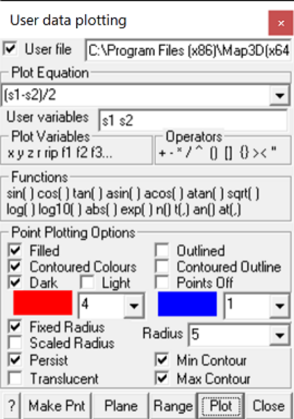

Esta opção permite visualizar dados de pontos em formato de arquivo de texto. Os pontos podem ser exibidos como esferas com sombreamento de fonte de luz, cujo diâmetro e/ou cor variam conforme a magnitude, e podem ser contornados em um plano para mostrar densidade etc.

O Map3D também suporta a visualização de arquivos no formato EVP.

Cada ponto pode ser marcado com uma série de:

- valores numéricos (p. ex., cor, magnitude, orientação etc.)

- mensagens de texto

- nomes de arquivos (p. ex., arquivos gráficos, documentos, planilhas etc.)

Ao clicar com o botão esquerdo em um ponto, a localização, a magnitude e a mensagem de texto são exibidas na barra de status.

Clicar com o botão direito em um ponto ativa o banco de dados visual (Visual Database). Este recurso pode ser usado para exibir um banco de dados com informações geológicas úteis, como teor, qualidade do maciço rochoso etc. Cada ponto pode ser marcado com uma série de:

- valores numéricos (p. ex., cor, magnitude, orientação etc.)

- mensagens de texto

- nomes de arquivos (p. ex., arquivos gráficos, documentos, planilhas etc.)

#### Event File:

O arquivo de eventos é simplesmente um arquivo de texto (*.txt).

Este formato é útil para trocar dados brutos de modelo com outros softwares CAD.

As linhas de comentário devem começar com um asterisco "*" ou com o sinal de jogo da velha "#".

Os dados sísmicos são armazenados como uma série de pontos, da seguinte forma:

**x1 y1 z1 f1 f2 f3 … "text message" "file name"... x2 y2 z2 f1 f2 f3 … "text message" "file name"... x3 y3 z3 f1 f2 f3 … "text message" "file name"...**

onde **xi yi zi** representam as coordenadas de cada ponto,

**f1 f2 f3…** indica uma série opcional de valores numéricos (p. ex., cor, magnitude, orientação etc.), **text message** indica uma série opcional de cadeias de texto que devem estar entre aspas duplas. **file name** indica uma série opcional de nomes de arquivos que devem estar entre aspas duplas.

- A mensagem de texto e o nome do arquivo são exibidos na barra de status, na parte inferior da tela, ao selecionar um evento com o botão esquerdo do mouse.

- Eles também podem ser editados ao selecionar um evento com o botão direito do mouse.

- Selecionar com o botão direito do mouse também permite exibir o arquivo, se o nome do arquivo estiver associado a um aplicativo (consulte a documentação do Windows sobre como "Associar um arquivo a um programa").

#### Mesclar vários arquivos em um único banco de dados

Você pode selecionar vários arquivos ao mesmo tempo mantendo pressionadas as teclas padrão do Windows "shift" ou "ctrl" para seleções múltiplas.

Esses arquivos serão mesclados em um único banco de dados.

Isso permite manter partes separadas dos dados de visualização em arquivos diferentes e depois mesclá-las facilmente em um único banco de dados.

#### Plot Equation:

Define o parâmetro que será plotado, p. ex., **(f1-f2)/2** ou, de forma equivalente, **(sig1-sig3)/2**

- A janela suspensa permite armazenar até 20 equações diferentes. Elas são mantidas entre sessões do Map3D no arquivo map3d.ini.

#### Plot Variables:

**f1 f2 f3…** campos de dados do arquivo de eventos.

Variáveis definidas pelo usuário (por exemplo, **sig1 sig3 …** ) podem ser definidas para indicar os cabeçalhos de coluna correspondentes a **f1 f2 f3…**

Elas podem ser definidas na linha de comentário, ou seja, qualquer linha que comece com "*" ou "#" **.** Basta informar as variáveis de plotagem definidas pelo usuário, por exemplo, da seguinte forma:

*** x y z sig1 sig2 ...**

#### Functions:

**sin() cos() tan()** funções trigonométricas seno, cosseno e tangente **asin() acos() atan()** funções trigonométricas inversas **sqrt()** função raiz quadrada **log()** função logaritmo natural **log10()** função logaritmo na base 10 **abs()** valor absoluto **exp()** função exponencial (antilogaritmo) **n() t(,)** distribuição normal e distribuição t **an() at(,)** distribuição normal inversa e distribuição t inversa

#### Location:

**x y z** coordenada do ponto de grade.

#### Operators:

- **+ - * /** ^   operadores de adição, subtração, multiplicação, divisão e exponenciação. Observe que as exponenciais são calculadas primeiro, seguidas de multiplicação e divisão e, por fim, adição e subtração.

- **() [] &#123;&#125;** tipos de parênteses. Os pares de parênteses devem corresponder.

- valor máximo. Por exemplo, se a equação de plotagem for especificada como f1 > 10, será plotado o maior entre f1 e 10.

- **&lt;** valor mínimo. Por exemplo, se a equação de plotagem for especificada como f1 &lt; 10, será plotado o menor entre f1 e 10.

#### Point Plotting Options:

**Filled** – os pontos são preenchidos com a cor especificada, com cor de contorno e/ou sombreados.

**Contoured Colours** – a cor de preenchimento é ajustada conforme a magnitude determinada a partir de **Plot Equation** .

**Dark** – a cor de preenchimento é sombreada para parecer esferas com sombreamento de fonte de luz, usando um esquema de cores escuras e intensas.

**Light** – a cor de preenchimento é sombreada para parecer esferas com sombreamento de fonte de luz, usando um esquema de cores claras e brilhantes.

**Outlined** – os pontos são delineados com a cor especificada ou com a cor de contorno.

**Contoured Outline** – os pontos são desenhados com cores de contorno ajustadas conforme a magnitude determinada a partir de **Plot Equation** .

**Contour Plane** – habilita ou desabilita a exibição de um plano de contornos (veja **Plane** ).

**Fixed Radius** – os pontos serão plotados como esferas com o parâmetro **Radius:** especificado.

**Scaled Radius** – os pontos serão plotados como esferas com raio escalonado pela magnitude (determinada

a partir de **Plot Equation** ), de modo que, se a magnitude for menor que o mínimo da faixa de contornos, a esfera é desenhada com raio zero. Se a magnitude for igual ao máximo da faixa de contornos, o vetor é desenhado com o raio especificado pelo parâmetro **Radius:**.

#### Other:

**Persist** – quando marcada, os pontos são replotados cada vez que o modelo é reorientado, transladado ou ampliado/reduzido com zoom. Como isso pode demorar em modelos grandes, nem sempre essa opção é desejável.

**Translucent** - desenha os pontos como esferas translúcidas.

**Zero Contour** - quando desmarcada, os contornos abaixo do mínimo da faixa de contornos não são desenhados. Isso

é útil para exibir contornos em que apenas a parte superior da faixa é importante.

**Make Point** - adiciona um novo ponto.

**Plane** – permite configurar o plano de contornos.

**Range** – especifica o mínimo, o máximo e o intervalo para o escalonamento do raio e para os contornos.

Plot regenera a plotagem. Este botão pode ser colocado na barra de ferramentas de visualização (Tools > View Toolbar Configure) ou na barra de ferramentas de contornos (Tools > Contour Toolbar Configure).
