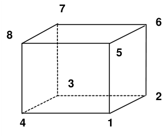
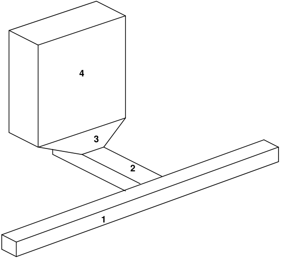

Em muitos problemas, os detalhes da forma exata das superfícies de escavação não são importantes, pois se busca uma avaliação mais global da estabilidade, como as condições de pilares, encontros ou capa. Como é muito trabalhoso descrever a localização e as conexões de cada superfície, no Map3D os modelos também podem ser montados a partir de blocos tridimensionais.

CAD > Build > Block

CAD > Build > DD Loop CAD > Build > FF Loop

#### CAD > Build > Tunnel

Esses blocos são usados para construir escavações tridimensionais, zonas de materiais alternativos e zonas preenchidas. Eles são definidos por uma face superior e uma inferior, cada uma com 4 vértices. Os vértices podem ser inseridos no sentido horário ou anti-horário, desde que as faces superior e inferior estejam alinhadas entre si (ou seja, o vértice 5 deve ficar oposto ao vértice 1, o 2 oposto ao 6 etc.). Os lados não precisam ser paralelos nem planos, e qualquer vértice pode ser repetido para definir formas de 3 lados e cunhas.

Esses blocos podem ser empilhados para criar formas de escavação complexas ou contornos de zonas de minério. Eles são ligados entre si compartilhando vértices comuns ou pelo fato de se interceptarem. Os lados comuns a mais de um bloco ou que penetram em outros blocos são automaticamente cortados e excluídos. O volume contido na estrutura de blocos define uma escavação, zona de minério, zona de plastificação, zonas preenchidas etc.

Para ilustrar, considere uma configuração simples de ponto de carregamento montada a partir de 4 blocos. O bloco 1 representa a galeria de extração, o bloco 2 o travessão, o bloco 3 o ponto de carregamento e o bloco 4 o realce. O pré-processador do Map3D identifica as conexões entre esses blocos, corta-os e exclui as superfícies comuns a blocos adjacentes.
