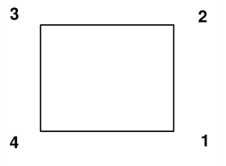
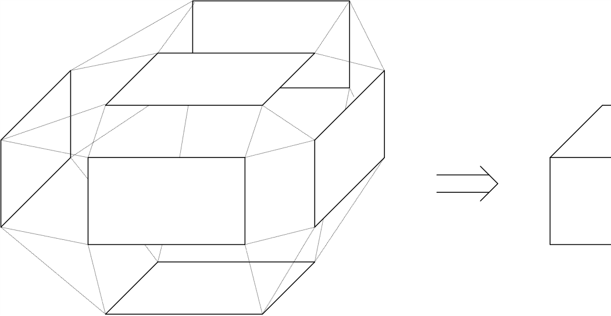
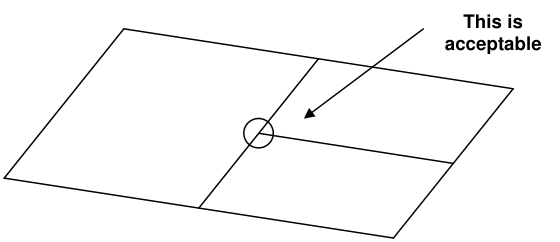

Os modelos podem ser construídos a partir de retalhos de superfície individuais.

CAD > Build > Block

#### CAD > Build > DD Loop

Eles são definidos por polígonos de 3 ou 4 lados que não precisam ser planos. Os vértices podem ser inseridos no sentido horário ou anti-horário. Qualquer vértice pode ser repetido para definir formas de 3 lados e cunhas.

Se desejado, os retalhos de superfície também podem ser usados para construir superfícies de escavação e contornos de minério complexos. A rotina

#### CAD > Build > FF Loop

pode ajudar você a construir com facilidade layouts as-built complexos. A rotina funciona contornando várias plantas de nível ou seções e, em seguida, ligando-as automaticamente.

Essa costuma ser a melhor abordagem, principalmente ao construir modelos as-built de estruturas cuja forma exata é bem conhecida. Ela é útil para análises muito detalhadas de diversas estruturas do tipo civil, nas quais as concentrações de tensões e a avaliação de instabilidades locais são a principal preocupação.

Essas formas podem ser construídas com as funções CAD integradas ao Map3D ou importadas de outros pacotes CAD em um dos seguintes formatos:

- Formato AutoCAD-DXF. É um formato popular de intercâmbio de desenhos com a extensão ".DXF".

- O formato de arquivo de pontos é um arquivo de dados ASCII universal com a extensão ".PNT".

Mesmo para formas simples, esse procedimento de construção pode rapidamente sair do controle. Como é necessário criar uma série de retalhos de superfície que, em conjunto, formem uma pele contínua, sem emendas e sem sobreposições, não é possível deixar lacunas ou furos.

Quando os modelos são construídos dessa forma, o Map3D verifica se são formadas superfícies fechadas

#### Analysis > Options > Closure

Além disso, todas as superfícies são renumeradas de maneira consistente para garantir que formem volumes positivos

#### Analysis > Options > Renumber

Essa renumeração pode falhar se as superfícies não estiverem fechadas, ou seja, se houver furos na escavação devido a partes faltantes.

Ao contrário de outros programas de análise (métodos de elementos de contorno isoparamétricos e métodos de elementos finitos ou de diferenças finitas), não é necessário que essas placas compartilhem vértices comuns. Os usuários podem definir elementos com subdivisões no meio de suas arestas, desde que não haja lacunas. Embora os modelos possam ser construídos com essa técnica de modelagem de superfícies, uma técnica mais fácil e confiável é a modelagem sólida

Construção de modelos a partir de blocos
