Nesta seção são descritos alguns erros de construção comuns, com sugestões de como evitá-los e corrigi-los.

#### Conexão de um travessão a uma galeria reta

Neste exemplo, o travessão é facilmente construído encaixando seus vértices na borda da galeria de acesso. Use o modo de encaixe "aresta mais próxima" para selecionar os pontos indicados

#### CAD > Snap > Nearest Edge

Os recursos de interseção booleana integrados ao Map3D criarão automaticamente a interseção entre os dois blocos durante o estágio 2 da análise. Essa construção funcionará bem.

Embora isso funcione bem para geometrias simples, em muitas situações essa conexão não é tão simples.

Vamos considerar uma geometria mais complexa, em que os segmentos da galeria de acesso da lapa não coincidem com os locais desejados dos travessões.

#### Conexão de um travessão a uma galeria complexa

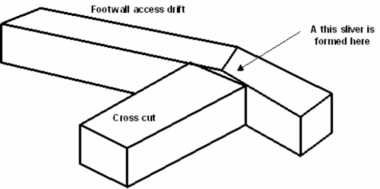

Neste exemplo, o travessão não se une corretamente à galeria de acesso da lapa. Forma-se um pilar delgado na extremidade do travessão. O Map3D detectará esse pilar e tentará analisá-lo, provavelmente sem sucesso. Assim como essa feição seria fisicamente instável na realidade, ela também é numericamente instável. O Map3D pode, de fato, analisá-la com sucesso, mas somente se as faces adjacentes do pilar forem discretizadas com elementos de contorno de tamanho semelhante à espessura do pilar. No entanto, essa abordagem não é desejável, pois exigiria um grande número de elementos, e esse pilar na verdade não existe.

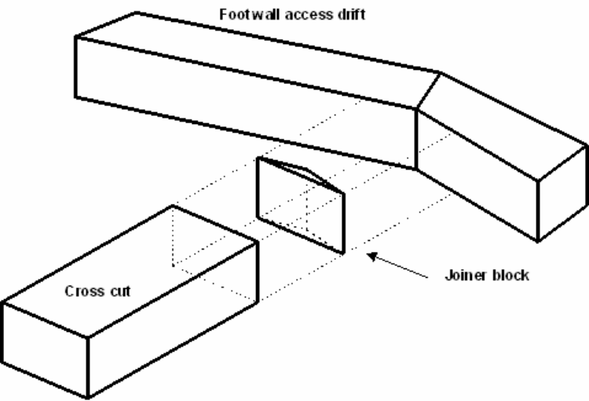

Para evitar esse problema, é possível construir um bloco de ligação adicional, como mostrado na vista explodida ao lado. Use o modo de encaixe "vértice mais próximo" para que esse novo bloco se ligue corretamente à galeria e ao travessão. Esse bloco de ligação efetivamente lavra o pilar indesejado, conectando corretamente o travessão à galeria de acesso da lapa.

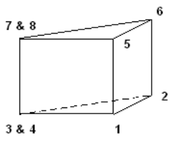

Observe que o bloco de ligação tem apenas três pontos nas faces superior e inferior. Isso é facilmente construído selecionando duas vezes um dos vértices no mesmo local (por exemplo, os pontos 3 e 4 e os pontos 7 e 8).

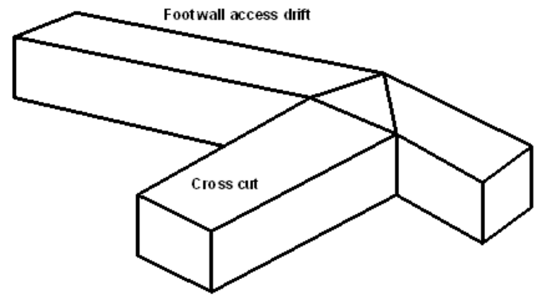

Esse problema pode ser totalmente evitado se os segmentos da galeria de acesso da lapa forem construídos de modo a coincidir com os locais desejados dos travessões. Isso é feito facilmente subdividindo a galeria de acesso como mostrado. Muitas vezes, um pouco de planejamento prévio facilita a construção.

#### Conexão de blocos de realce desencontrados

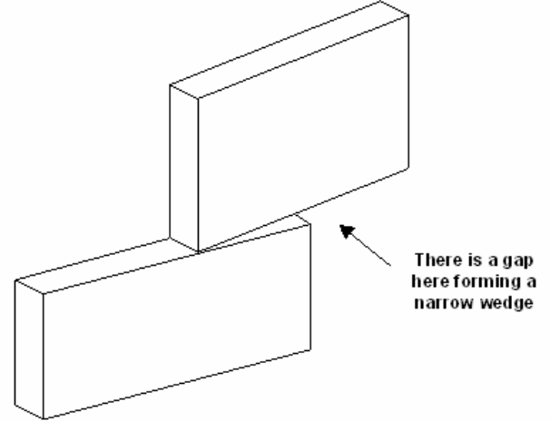

Muitas vezes é preciso unir vários blocos de realce ao longo de suas arestas comuns.

Neste exemplo, se a base do bloco superior e o topo do bloco inferior estivessem na mesma cota, os recursos de interseção booleana integrados ao Map3D criariam automaticamente a interseção entre os dois blocos durante o estágio 2 da análise. Essa construção funcionará bem.

O problema ocorre durante a construção, quando se tenta encaixar os vértices de um bloco na lateral do outro. Neste exemplo, o bloco superior foi encaixado na aresta superior do bloco inferior, deixando uma lacuna.

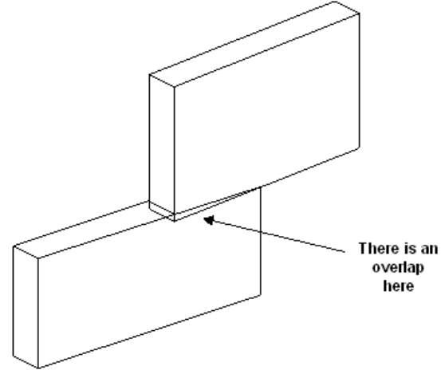

Para eliminar essa lacuna, seria possível encaixar os vértices do bloco inferior na aresta inferior do bloco superior usando a função de estiramento. Mas isso criaria uma sobreposição e, portanto, não resolve o problema.

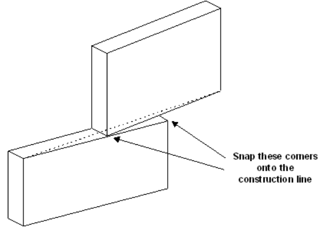

A alternativa é criar um bloco de ligação, como descrito acima. No entanto, uma alternativa mais simples é criar linhas de construção que atravessem a área problemática e encaixar nelas os vértices dos blocos superior e inferior. Esse procedimento teria de ser feito tanto na face posterior quanto na frontal dos blocos de realce.

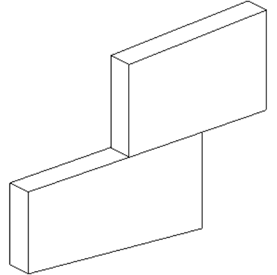

Esse método tem a desvantagem de alterar a forma dos blocos de realce, possivelmente de maneira indesejada.

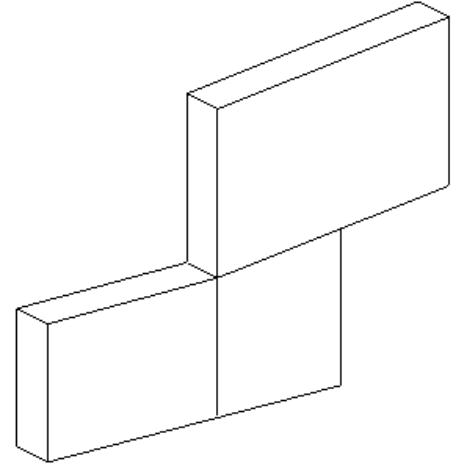

A melhor alternativa provavelmente é subdividir um ou ambos os blocos de realce. Essa é a técnica mais eficaz para eliminar lacunas e unir blocos desencontrados.

#### Conexão de blocos de realce deslocados

Muitas vezes, a forma de um bloco de realce não coincide com a do bloco adjacente.

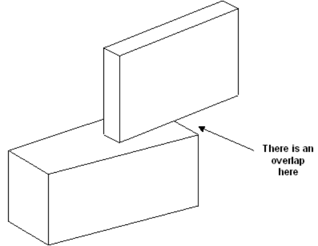

Essa situação é facilmente resolvida pelos recursos de interseção booleana integrados ao Map3D. O programa criará automaticamente a interseção entre os dois blocos durante o estágio 2 da análise.

Essas rotinas funcionam melhor se todos os pontos da face inferior do bloco superior e todos os pontos da face superior do bloco inferior estiverem na mesma cota. Isso pode ser feito com

#### CAD > Edit > Move Vertices to Z

As rotinas funcionam mesmo que a face inferior do bloco superior e a face superior do bloco inferior não sejam planas e estejam em cotas diferentes, desde que de fato se interceptem. Nesse caso, porém, a interseção resultante pode conter muitos elementos complexos. Embora essas formas funcionem bem, elas podem tornar a análise mais lenta devido ao seu grande número e ao fato de muitas vezes precisarem ser discretizadas de forma muito fina.

#### Conexão de uma galeria a um bloco de realce

Muitas vezes se deseja interceptar uma galeria com um bloco de realce.

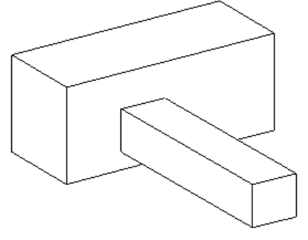

Como acima, essa situação é facilmente resolvida pelos recursos de interseção booleana integrados ao Map3D. O programa criará automaticamente a interseção entre a galeria e o bloco de realce durante o estágio 2 da análise.

Essas rotinas funcionam melhor se as faces que se interceptam forem planas e paralelas. Elas funcionam mesmo que essas faces não sejam planas nem paralelas, desde que de fato se interceptem. Nesse caso, porém, a interseção resultante pode conter muitos elementos complexos. Embora essas formas funcionem bem, elas podem tornar a análise consideravelmente mais lenta devido ao seu grande número e ao fato de muitas vezes precisarem ser discretizadas de forma muito fina.
