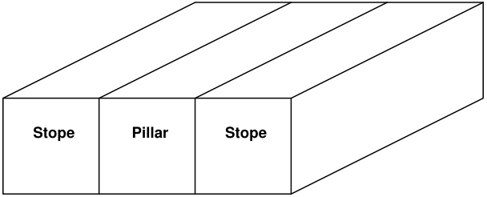
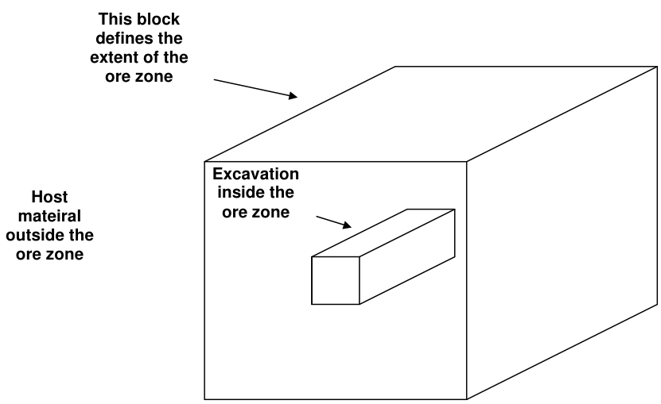
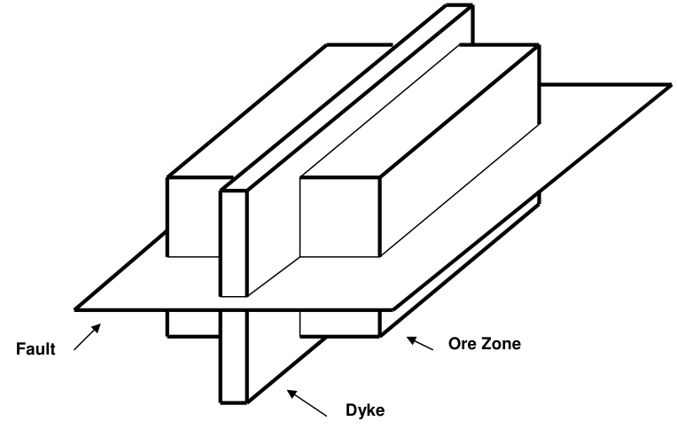

Os modelos que usam múltiplos materiais são construídos com princípios semelhantes aos dos modelos de escavação normais. Em vez de definir o interior de um bloco como escavado (ou seja, código de material zero), basta especificar o número do material existente dentro do bloco.

Por padrão, a rocha encaixante é o material número 1. Qualquer região com um conjunto diferente de propriedades (tensão inicial, resposta elástica ou resistência) deve ser definida da mesma forma que uma escavação, usando elementos de contorno do tipo força fictícia. Em vez de atribuir a esses blocos um código de material zero (para indicar tensões superficiais nulas) ou negativo (para indicar um estado de tensões especificado), basta atribuir a eles um código de material positivo que indique as propriedades associadas a cada grupo de blocos.

Lembre-se de que formas de escavação complexas são construídas combinando vários blocos com o mesmo número de bloco para formar a forma desejada. Exatamente da mesma maneira, regiões separadas, cada uma com um conjunto diferente de propriedades de material, são formadas construindo a forma desejada a partir de muitos blocos com o mesmo número de bloco.

Um ponto importante é usar o menor número possível de números de bloco, pois todas as superfícies entre grupos de blocos com números de bloco diferentes serão mantidas no banco de dados.

Há dois métodos para definir regiões às quais será atribuído o material número 2 ou superior (ou seja, um número de material diferente do da rocha encaixante).

No primeiro método, as regiões com números de material diferentes são construídas a partir de blocos que aparecem exatamente como escavações.

Essa técnica é útil para definir detalhes, por exemplo, de zonas de baixo módulo na periferia das escavações. Também é o melhor método para definir feições isoladas, como diques rígidos ou pilares danificados por desmonte.

O segundo método é uma abordagem mais global, na qual todo um sistema de escavações (ou parte dele) é envolvido por um conjunto de blocos que definem, por exemplo, a zona de minério. É permitido envolver uma envoltória com outra (como as camadas de uma cebola) e sobrepor envoltórias. As galerias, por exemplo, podem atravessar a zona de minério e avançar para a rocha encaixante. O Map3D constrói as interseções necessárias.

Esses dois métodos podem ser usados simultaneamente. É permitido usar blocos que definam uma região global pelo segundo método. Esses blocos podem envolver total ou parcialmente outras escavações definidas pelo primeiro método.

A única consideração que deve ser rigorosamente observada ao definir múltiplas zonas de material é a convenção de que números de material mais altos têm prioridade sobre os mais baixos. Essa convenção foi adotada para resolver a ambiguidade ao considerar a interseção de duas feições diferentes, como uma falha com um dique. Quando uma falha e um dique se interceptam, não está claro se a falha deve ser considerada contínua através do dique ou vice-versa. Outro exemplo é o caso em que um dique intercepta uma zona de minério. O dique deve ser considerado contínuo, cortando o minério, ou o minério deve ser considerado contínuo, interrompendo o dique?

Em qualquer desses casos, a feição contínua é aquela à qual foi atribuído o número de material mais alto. Se a falha recebesse o material número 4, o dique o número 3 e o minério o número 2, a falha seria contínua em todo o modelo. Por ter o número de material mais alto, a falha seria contínua através do minério e do dique, mas naturalmente não através das escavações. Como o minério tem o número de material mais baixo, ele não cortaria o dique; ao contrário, o dique cortaria o minério.

Você pode usar as seguintes funções de ocultação para determinar qual material corta os demais:

#### View > Hide > Solids

#### View > Hide > Unused

Foi incorporada uma lógica que permite a interseção simultânea de até cinco feições (ou seja, a interseção de blocos com cinco números de bloco diferentes). Um número ilimitado de blocos pode se interceptar, mas no máximo cinco no mesmo local. Isso permite especificar, por exemplo, zonas de minério com várias camadas, com escavações em ambos os lados do contato e uma falha ao longo do contato. O Map3D detecta automaticamente os blocos parcial ou totalmente contidos em outros blocos, bem como os blocos adjacentes a outros blocos, o que permite considerar em qualquer análise um número praticamente ilimitado de regiões com diferentes tipos de material.

Ao visualizar a geometria de escavação no modo gráfico, o usuário pode mover o cursor do mouse sobre um bloco de interesse. Ao pressionar um botão do mouse, o número e o nome do bloco serão exibidos. Também serão exibidos o código de material atribuído a esse bloco e o código de material da região adjacente ou que envolve essa superfície do bloco. Por exemplo, para superfícies de bloco adjacentes à rocha encaixante, o "código de material adjacente" será um (lembre-se de que o material um representa o maciço rochoso encaixante). Se a superfície do bloco for adjacente a uma escavação à qual foi atribuído o código de material 2, o "código de material adjacente" será 2.

Durante a análise, os resultados são gerados em grades de pontos de campo. O Map3D detecta automaticamente se os pontos da grade estão dentro de escavações ou em regiões com propriedades de material diferentes. Quando os resultados de contornos são exibidos, o usuário pode mover o cursor do mouse sobre o ponto de campo de interesse. Ao pressionar um botão do mouse, será exibido o código de material atribuído à região onde esse ponto de campo está localizado, juntamente com as coordenadas, os deslocamentos e as informações do estado de tensões. Observe que os fatores de resistência serão calculados com as propriedades de material especificadas para essa região. Esse recurso permite avaliar uma resistência que pode variar de uma região para outra.
