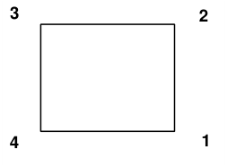
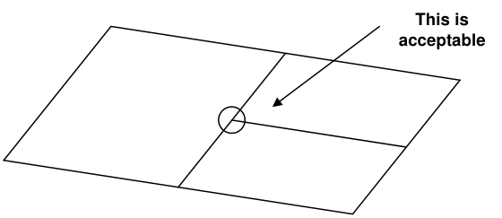
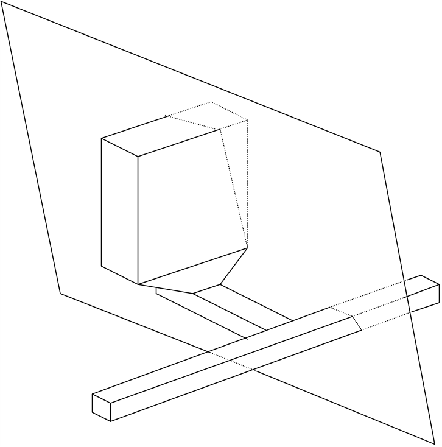
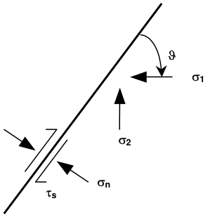

Os modelos podem ser construídos a partir de retalhos de superfície individuais. Eles são definidos por polígonos de 3 ou 4 lados que não precisam ser planos. Os vértices podem ser inseridos no sentido horário ou anti-horário. Qualquer vértice pode ser repetido para definir formas de 3 lados e cunhas.

#### CAD > Build > DD Loop

Essas formas podem ser construídas com as funções CAD integradas ao Map3D ou importadas de outros pacotes CAD em um dos seguintes formatos:

- Formato AutoCAD-DXF. É um formato popular de intercâmbio de desenhos com a extensão ".DXF".

- O formato de arquivo de pontos é um arquivo de dados ASCII universal com a extensão ".PNT".

Ao contrário de outros programas de análise (métodos de elementos de contorno isoparamétricos e métodos de elementos finitos ou de diferenças finitas), não é necessário que essas placas compartilhem vértices comuns. Os usuários podem definir elementos com subdivisões no meio de suas arestas, desde que não haja lacunas.

Os planos de falha e a lavra tabular são construídos com os mesmos princípios dos modelos de escavação normais. Essas feições são simplesmente especificadas junto com outras escavações e múltiplas zonas de material, e podem ser usadas simultaneamente com todos os outros recursos do Map3D.

Os planos de falha e as zonas de lavra tabular são definidos com elementos de descontinuidade de deslocamento. Eles só podem ser especificados por meio de definições de placas. Os quatro vértices da placa definem as extremidades da descontinuidade de deslocamento. As descontinuidades de deslocamento podem interceptar escavações em qualquer local, pois o Map3D constrói internamente as interseções de arestas.

Assim como na seção anterior, a única consideração que deve ser rigorosamente observada ao definir planos de falha é a convenção de que números de material mais altos têm prioridade sobre os mais baixos. Ao considerar a interseção de duas feições diferentes, como uma falha com um dique, a feição à qual foi atribuído o número de material mais alto é a que persiste através da outra.

Uma questão a ser tratada ao usar modelagem não linear (seja deslizamento de falhas ou plastificação generalizada no Map3D Non-Linear) é que a tensão de campo distante não deve exceder a resistência. Se as tensões de campo distante excederem a resistência do maciço rochoso, o próprio maciço será instável. Embora isso possa ser admissível em alguns problemas de fluência, em geral não é aceitável, e não é possível obter soluções em regime permanente (ou seja, sem fluência).

Essa limitação é mais severa ao simular falhas. Qualquer falha pode estar em equilíbrio estático, ou muito perto dele (ou seja, com tensões iguais à resistência), com o estado de tensões de campo distante. Em falhas fracas sob razões de tensão elevadas, as tensões principais devem estar orientadas quase perpendiculares ou paralelas ao plano de falha; caso contrário, a falha será instável e deslizará mesmo sem lavra. Em geral, essa condição não é aceitável, pois não é possível obter soluções em regime permanente (ou seja, sem fluência).

Para o caso em que s1 forma o ângulo J com o plano de falha, a tensão de cisalhamento e a tensão normal que atuam na falha são dadas por

ts = ( s1 - s2 ) sin(J) cos(J)

sn = s1 sin² (J) +  s2 cos² (J)

substituindo essas expressões na relação de resistência ao cisalhamento

|ts| = Cohesion + sn tan(j)

verifica-se que o estado de tensões deve satisfazer

|( s1 - s2 ) sin(J) cos(J)| = Cohesion + [ s1 sin² (J) +  s2 cos² (J) ] tan(j)

Por exemplo, com

s1 = 32 MPa s2 = 16 MPa Cohesion = 0 j = 10°

J deve ser menor que 11° ou estar entre 69° e 90°.

Com

s1 = 60 MPa s2 = 16 MPa Cohesion = 0 j = 30°

J deve ser menor que 15° ou estar entre 45° e 90°.
