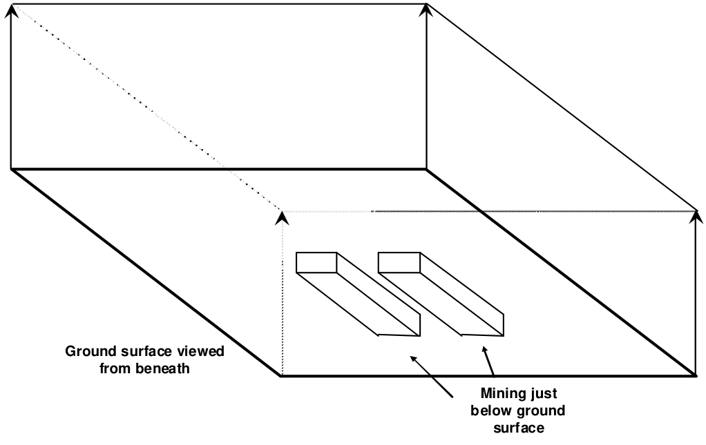

A melhor forma de definir a superfície do terreno é usar uma grande zona FF cuja face inferior seja a superfície do terreno. Ao atribuir um código de material zero a esses elementos, o Map3D garante tensões normais e de cisalhamento nulas ao longo dessas superfícies, simulando assim uma superfície livre.

Só é necessário definir a superfície do terreno quando as escavações de lavra são relativamente rasas (ou seja, quando a profundidade da lavra é inferior a aproximadamente o dobro da extensão lateral da lavra). Nesses casos, a superfície livre deve se estender por pelo menos o dobro da extensão lateral da lavra em todas as direções.

Não estenda grades de pontos de campo perto da superfície livre ou através dela, a menos que seja absolutamente necessário, pois isso fará com que a superfície livre seja discretizada em um grande número de elementos de contorno.
