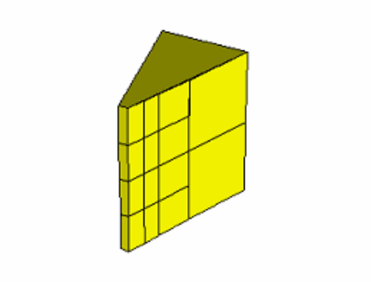
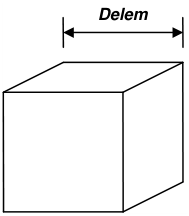
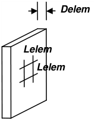
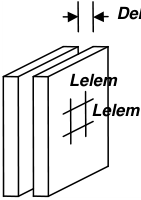
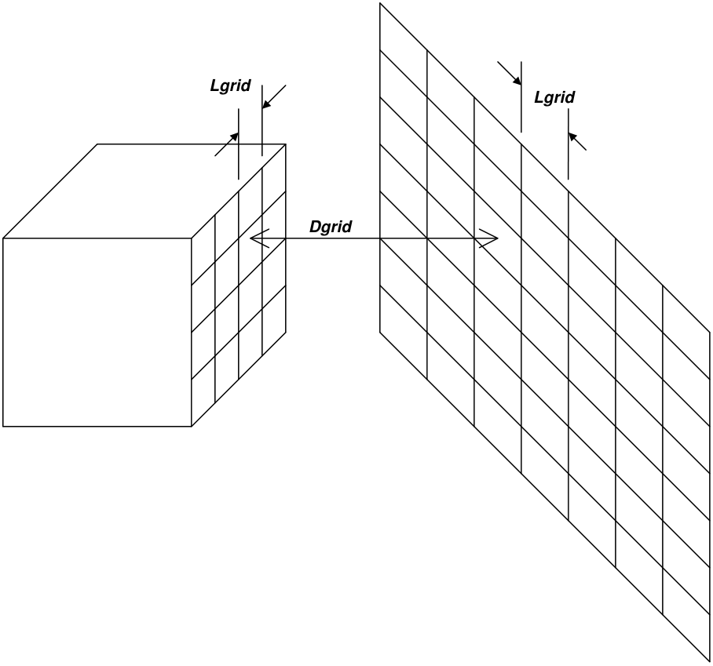
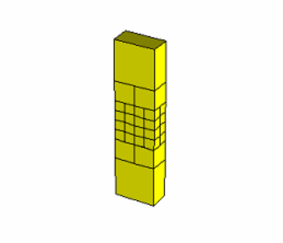
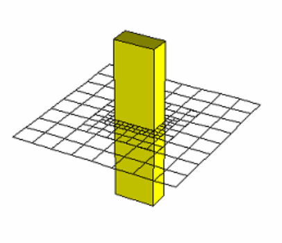
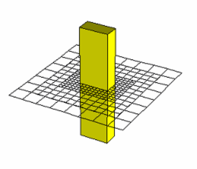
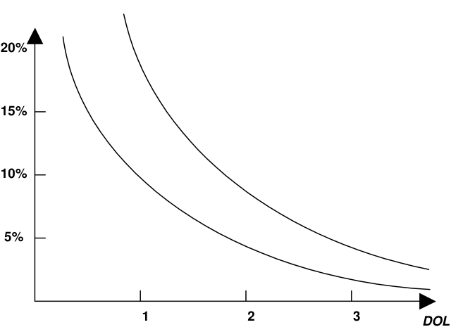
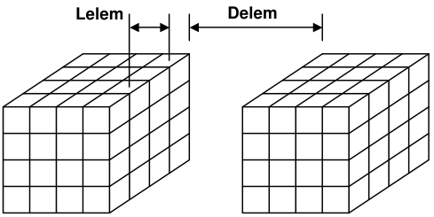

O Map3D usa várias estratégias diferentes, mas complementares, para permitir a análise de problemas de tamanho muito grande. A discretização é controlada de modo que os elementos de contorno sejam usados apenas onde são necessários. Em seguida, várias formas de agrupamento são usadas para reduzir o tempo de análise e o espaço em disco necessário. Juntos, esses recursos permitem ao Map3D tratar problemas muito grandes (mais de 2.000.000 de elementos) em computadores pessoais.

Sem agrupamento, um problema de 64000 elementos ocuparia 147 GB de espaço em disco. Com agrupamento, isso pode ser reduzido para menos de 1 GB. O tempo de análise diminui aproximadamente na mesma proporção. Isso permite especificar em detalhe a geometria de lavra existente e acrescentar novas lavras conforme necessário. Assim, o esforço para preparar e executar análises é muito reduzido, e a mina inteira pode ser considerada quando necessário.

Todos os parâmetros de discretização e agrupamento são expressos como uma razão entre distância e comprimento. Em todos os casos, a distância é medida entre dois pontos de interesse (por exemplo, de um elemento a outro, ou de um elemento ao ponto de grade mais próximo). Nessa razão, o comprimento é o tamanho do elemento ou o espaçamento da grade em um dos pontos de interesse.

Os valores sugeridos para os parâmetros de discretização e agrupamento são os seguintes:

- _AL_ deve ser igual ao dobro da menor largura de pilar ou realce. Use as mesmas unidades das coordenadas (por exemplo, metros ou pés).

- _AG_ deve ser igual à menor dimensão de interesse. Use as mesmas unidades das coordenadas (por exemplo, metros ou pés).

- _DON_ =0.5, _DOL_ = _DOC_ =1, _DOE_ = _DOG_ =2 para erro de 10-20%

- _DON_ =0.5, _DOL_ = _DOC_ =2, _DOE_ = _DOG_ =4 para erro de 5-10%

- _DON_ =1.0, _DOL_ = _DOC_ =4, _DOE_ = _DOG_ =8 para erro &lt; 5%

Esses parâmetros são definidos na caixa de diálogo CAD > Properties > Control Parameters.

O uso desses parâmetros para controlar a discretização e o agrupamento é descrito em detalhe a seguir.

**_DON_ e** **_AL_: condicionamento da matriz**

Durante o processo de discretização, todas as superfícies do modelo (superfícies de blocos FF e planos DD) são subdivididas em elementos de contorno com comprimento de lado

_Lelem_ = _Delem_ / _DON_

onde _Delem_ é a menor distância entre superfícies adjacentes do modelo, determinada pelo Map3D. Como em alguns locais a distância _Delem_ pode ser zero, é necessário especificar o comprimento mínimo de lado dos elementos _AL_.

_AL_ deve ser igual ao dobro da menor largura de pilar ou realce. Devem ser usadas as mesmas unidades das coordenadas (por exemplo, metros ou pés).

Um valor de _DON_ de 0,5 geralmente é adequado para todos os problemas, exceto aqueles com escavações ou pilares muito estreitos. Nesse caso, recomenda-se um valor de _DON_ de 1,0.

Embora valores mais altos de _DON_ gerem mais elementos de contorno e, portanto, tempos de processamento mais longos, isso é necessário para obter um problema bem condicionado e solucionável quando há escavações ou pilares muito estreitos.

_DON_ controla a forma como as superfícies dos blocos são discretizadas em elementos de contorno. Esse parâmetro, junto com _AL_, é usado para garantir que a análise de elementos de contorno gere uma matriz de coeficientes bem condicionada e solucionável.

O condicionamento da matriz está diretamente relacionado à magnitude de _DON_. Uma matriz bem condicionada e fácil de resolver pode ser garantida usando valores maiores de _DON_ (próximos de um).

_DON_ = 0.5

#### _DON_ = 1.0

Esses parâmetros controlam o quão fina será a discretização de superfícies que passam perto umas das outras. Por exemplo, comparando os casos com _DON_ de 0,5 e 1,0, observa-se que valores maiores de _DON_ produzem elementos de contorno menores onde o realce está localizado.

Do ponto de vista da análise, há três tipos básicos de problemas. Os mais fáceis de resolver são os que usam formas tridimensionais volumosas, com superfícies bem afastadas entre si.

Para esse tipo de problema, sempre será gerada uma matriz de coeficientes bem condicionada, e o efeito de _DON_ e _AL_ não é importante.

O próximo tipo de problema, mais difícil de resolver, é aquele em que são definidos realces estreitos. Nesse caso, a distância _Delem_ (a menor distância de um elemento a outro) é simplesmente a largura do realce. Como o comprimento de lado do elemento _Lelem_ pode ser calculado a partir da razão _DON_ como

#### _Lelem_ = _Delem_ / _DON_

de modo que _Lelem_ não seja menor que _AL_, valores pequenos de _DON_ gerarão elementos pequenos apenas perto dos locais onde os realces são estreitos. À medida que se afasta dessas áreas, o tamanho dos elementos aumenta muito rapidamente. O uso de elementos de força fictícia para criar esse tipo de escavação tabular pode resultar em uma matriz mal condicionada, a menos que se use um valor de _DON_ de aproximadamente meio. Naturalmente, isso deve ser acompanhado de um valor de _AL_ suficientemente pequeno para permitir a geração de elementos pequenos.

Normalmente, _AL_ deve ser igual à largura do pilar ou realce mais estreito, ou à menor distância entre capa e lapa. Isso permitirá que a rotina de discretização use elementos tão pequenos quanto necessário para garantir um condicionamento adequado da matriz.

O tipo de problema mais difícil de resolver é aquele em que são definidos pilares estreitos ou usadas juntas pouco espaçadas. Como acima, _Delem_ é a largura do realce ou do pilar. O comprimento de lado do elemento também pode ser calculado a partir da razão _DON_; no entanto, nesse tipo de problema, em que as escavações estão muito próximas umas das outras e criam pilares estreitos, será gerada uma matriz mal condicionada e insolúvel, a menos que se use um valor de _DON_ de aproximadamente um. Naturalmente, isso deve ser acompanhado de um valor de _AL_ suficientemente pequeno para permitir a geração de elementos pequenos.

O valor recomendado de _DON_ é 0,5 para problemas de realces estreitos e 1 para problemas de pilares estreitos.

Normalmente, _AL_ deve ser igual à largura do pilar mais estreito ou à menor distância entre capa e lapa. Isso permitirá que a rotina de discretização use elementos tão pequenos quanto necessário para garantir um condicionamento adequado da matriz.

Em resumo, _AL_ deve ser igual à largura do pilar mais estreito ou à menor distância entre capa e lapa. Valores maiores podem ser necessários se forem gerados elementos demais. _DON_ deve ser 0,5 para problemas normais e 1,0 para problemas em que são definidos pilares estreitos.

Durante a discretização, o Map3D tentará atender à razão _DON_ especificada para todos os elementos. Ao discretizar, o número máximo de elementos de contorno em que qualquer aresta de bloco ou placa pode ser dividida é 256. Se esse número de subdivisões for atingido e a razão _DON_ especificada ainda não tiver sido alcançada, o Map3D emitirá uma mensagem de aviso instruindo o usuário a subdividir o bloco ou a placa em partes menores.

Após a conclusão da discretização, a distância _Delem_ pode ser plotada com

Plot > Miscellaneous > Delem Distance to nearest element on surfaces

A razão _Delem/Lelem_ pode ser plotada com

Plot > Miscellaneous > Delem/Lelem _DON_ ratio on surfaces

Locais onde _DON_ é pequeno (menor que 0,5) podem resultar em um processo de solução que não converge.

Observe que, se desejado, esse comportamento pode ser substituído elemento a elemento especificando a largura máxima de cada elemento

#### CAD > Edit > Entity Properties > Maximum Width

#### _DOL_ e _AG_: precisão da solução

Durante o processo de discretização, blocos e planos DD são subdivididos em elementos de contorno com comprimento de lado _Lgrid_. O tamanho do elemento é determinado a partir da distância mínima _Dgrid_ ao plano de grade de pontos de campo mais próximo, de acordo com a relação

_Lgrid_ = _Dgrid_ / _DOL_

Como em alguns locais a distância _Dgrid_ pode ser zero, também é necessário especificar um comprimento mínimo de lado dos elementos _AG_.

Essa mesma relação também é usada para subdividir os planos de grade em pontos onde são calculados tensões, deformações e deslocamentos de campo. Será usado um espaçamento mínimo de grade igual à metade de _AG_.

O parâmetro _AG_ deve ser igual à menor dimensão de interesse. Para obter resultados razoavelmente precisos, _AG_ deve ser aproximadamente um quarto da largura do realce ou do pilar. Por exemplo, se o usuário quiser ver a distribuição de tensões ao longo de um pilar de 2 m de largura, um valor de 0,5 para _AG_ forneceria um número suficiente de pontos de campo para uma plotagem de contornos precisa.

Devem ser usadas as mesmas unidades das coordenadas (por exemplo, metros ou pés).

Recomenda-se um valor de _DOL_ de 1,0 para todos os problemas, exceto aqueles em que se exige maior precisão. Com um valor de 1,0, pode-se esperar um erro de 10-20%. Um valor de 2,0 deve fornecer erro de 5-10%. Um valor de 4,0 deve fornecer erro inferior a 2%.

Embora valores mais altos de _DOL_ gerem mais elementos, isso é necessário para obter maior precisão.

_DOL_ controla a forma como as grades e as superfícies dos blocos são subdivididas. Esse parâmetro, junto com _AG_, é usado para controlar o nível de detalhe e precisão exigido nos resultados.

_AG_ deve ser escolhido de modo a refletir o tamanho de interesse. Por exemplo, se os detalhes da distribuição de tensões só forem necessários com resolução de um metro em relação às superfícies de escavação, _AG_ deve ser igual a um metro.

O espaçamento dos pontos de campo e o comprimento de lado dos elementos _Lgrid_ são determinados a partir da razão _DOL_ especificada. _Dgrid_ é determinado como a distância mínima de um dado elemento até a grade mais próxima. Como _Lgrid_ pode ser calculado a partir da razão _DOL_ como

_Lgrid_ = _Dgrid_ / _DOL_

de modo que _Lgrid_ não seja menor que _AG_, valores pequenos de _DOL_ gerarão elementos e espaçamentos de grade pequenos apenas perto dos locais onde as grades passam perto dos realces. À medida que se afasta dessas áreas, o tamanho dos elementos aumenta muito rapidamente.

_DOL_ = 1

_DOL_ = 2

_DOL_ = 1

#### _DOL_ = 2

Valores pequenos de _DOL_ (um ou menos) gerarão espaçamentos de pontos de campo e elementos pequenos apenas perto dos locais onde a grade intercepta o bloco ou passa muito perto dele. À medida que se afasta dessas áreas, o espaçamento dos pontos de campo e o comprimento de lado dos elementos aumentam muito rapidamente. Valores maiores de _DOL_ (dois ou mais) aumentarão a distância ao longo da qual o espaçamento dos pontos de campo e o comprimento de lado dos elementos são mantidos pequenos.

#### Erro

A precisão dos resultados está diretamente relacionada à magnitude de _DOL_. Os erros ficam limitados a aproximadamente 10-20% para _DOL_ próximo de um, e a 5-10% para _DOL_ próximo de dois. Esses valores são apenas aproximados; por isso, recomenda-se usar valores de _DOL_ próximos de quatro em problemas que exigem alta precisão. Em problemas em que baixa precisão é suficiente, _DOL_ próximo de um é adequado. Não se recomenda definir _DOL_ abaixo de um.

Observe que valores grandes de _DOL_ e valores pequenos de _AG_ aumentam o número de elementos e os tempos de processamento, mas também a precisão.

Em resumo, _AG_ deve ser igual à resolução de interesse (uma fração da largura do realce). _DOL_ deve ser 1 para resultados de análise grosseiros, 2 para resultados detalhados e 4 quando for necessária precisão muito alta.

Durante a discretização, o Map3D tentará atender à razão _DOL_ especificada para todos os elementos e grades. Ao discretizar, o número máximo de elementos de contorno em que qualquer aresta de bloco ou placa pode ser dividida é 256. O número máximo de pontos de campo em que qualquer aresta de grade pode ser dividida também é 256. Se esse número de subdivisões for atingido e a razão _DOL_ especificada ainda não tiver sido alcançada, o Map3D emitirá uma mensagem de aviso instruindo o usuário a subdividir o bloco, a placa ou a grade em partes menores.

Após a conclusão da discretização, a distância _Dgrid_ pode ser plotada nas superfícies do modelo com

Plot > Miscellaneous > Dgird Distance to nearest grid on surfaces

ou nas grades com

Plot > Miscellaneous > Dgrid Distance to nearest element on grids

A razão _Dgrid_ / _Lgrid_ pode ser plotada nas superfícies do modelo com

Plot > Miscellaneous > Dgrid/Lgrid _DOL_ ratio on surfaces

ou nas grades com

Plot > Miscellaneous > Dgrid/Lgrid _DOL_ ratio on grids

Observe que, se desejado, esse comportamento pode ser substituído grade a grade especificando a largura máxima de cada grade

CAD > Edit > Entity Properties > Maximum Width

#### _DOR_: razão de aspecto dos elementos

_DOR_ controla a razão de aspecto máxima dos elementos. Se a razão entre os comprimentos de lado de um elemento exceder _DOR_, esse elemento é subdividido. O valor recomendado de _DOR_ é 5. Se forem detectados resultados erráticos, _DOR_ deve ser reduzido para 2. Observe que valores menores de _DOR_ geram mais elementos e tempos de processamento mais longos, mas maior precisão.

Durante a discretização, o Map3D tentará atender à razão _DOR_ especificada para todos os elementos. Ao discretizar, o número máximo de elementos de contorno em que qualquer aresta de bloco ou placa pode ser dividida é 256. Se esse número de subdivisões for atingido e a razão _DOR_ especificada ainda não tiver sido alcançada, o Map3D emitirá uma mensagem de aviso instruindo o usuário a subdividir o bloco ou a placa em partes menores.

#### _DOC_: agrupamento da matriz

Durante a montagem da matriz, a distância _Delem_ entre grupos de blocos e planos DD é examinada para verificar se eles podem ser agrupados para fins de cálculo e armazenamento. O grau de agrupamento depende de quantos elementos cabem em uma zona com comprimento de lado _Lelem_, determinado pela relação

#### _Lelem_ = _Delem_ / _DOC_

Recomenda-se um valor de _DOC_ de 1,0 para todos os problemas, exceto aqueles em que se exige maior precisão. Com um valor de 1,0, pode-se esperar um erro de 10-20%. Um valor de 2,0 deve fornecer erro de 5-10%. Um valor de 4,0 deve fornecer erro inferior a 5%.

Embora valores mais altos de _DOC_ resultem em problemas maiores, isso é necessário para obter maior precisão.

_DOC_ controla a forma como os elementos são agrupados durante a montagem da matriz. Elementos com comprimento de lado combinado _Lelem_ são agrupados se a distância _Delem_ ao elemento afetado exceder a razão _DOC_ exigida. Se as distâncias entre realces forem grandes, muitos elementos podem ser agrupados.

Valores pequenos de _DOC_ (um ou menos) proporcionarão o máximo de agrupamento; no entanto, a precisão das tensões perto das superfícies de escavação se deteriorará e o condicionamento da matriz será reduzido. Valores maiores de _DOC_ (dois ou mais) proporcionarão menos agrupamento, mas a precisão e um bom condicionamento da matriz serão mantidos.

_DOC_ deve ser 1 para resultados de análise grosseiros, 2 para resultados detalhados e 4 quando for necessária precisão muito alta. Observe que valores grandes de _DOC_ aumentam o tamanho da matriz e os tempos de processamento, mas também a precisão.

#### _DOE_: agrupamento de elementos

Durante o cálculo dos pontos de campo (ou seja, a montagem das grades), a distância _Dgrid_ entre esses pontos e os grupos de blocos e planos DD é examinada para verificar se esses grupos podem ser agrupados para fins de cálculo. O grau de agrupamento depende de quantos elementos cabem em uma zona com comprimento de lado _Lgrid_, determinado pela relação

#### _Lgrid_ = _Dgrid_ / _DOE_

Recomenda-se um valor de _DOE_ de 2,0 para todos os problemas, exceto aqueles em que se exige maior precisão. Com um valor de 2,0, pode-se esperar um erro de 10-20%. Um valor de 4,0 deve fornecer erro de 5-10%. Um valor de 8,0 deve fornecer erro inferior a 5%.

Embora valores mais altos de _DOE_ resultem em tempos de análise maiores, isso é necessário para obter maior precisão.

_DOE_ controla a forma como os elementos são agrupados durante o cálculo dos pontos de campo. Elementos com comprimento de lado combinado _Lgrid_ são agrupados se a distância _Dgrid_ ao ponto de campo exceder a razão _DOE_ exigida. Valores pequenos de _DOE_ (dois ou menos) proporcionarão o máximo de agrupamento; no entanto, a precisão das distribuições de tensões perto das superfícies de escavação se deteriorará e elas se tornarão erráticas. Valores maiores de _DOE_ (quatro ou mais) proporcionarão menos agrupamento, mas garantirão precisão e distribuições de tensões suaves.

_DOE_ deve ser 2 para resultados de análise grosseiros, 4 para resultados detalhados e 8 quando for necessária precisão muito alta. Observe que valores grandes de _DOE_ aumentam o tamanho da matriz e os tempos de processamento, mas também a precisão.

#### _DOG_: agrupamento de grades

Durante o cálculo dos pontos de campo (ou seja, a montagem das grades), a distância _Dgrid_ entre esses pontos e os grupos de blocos e planos DD é examinada para verificar se esses pontos de campo podem ser agrupados para fins de cálculo. O grau de agrupamento depende de quantos pontos de campo cabem em uma zona com comprimento de lado _Lgrid_, determinado pela relação

_Lgrid_ = _Dgrid_ / _DOG_

Recomenda-se um valor de _DOG_ de 2,0 para todos os problemas, exceto aqueles em que se exige maior precisão. Com um valor de 2,0, pode-se esperar um erro de 10-20%. Um valor de 4,0 deve fornecer erro de 5-10%. Um valor de 8,0 deve fornecer erro inferior a 5%.

Embora valores mais altos de _DOG_ resultem em tempos de análise maiores, isso é necessário para obter maior precisão.

_DOG_ controla a forma como os pontos de campo são agrupados durante seu cálculo. Pontos de campo com comprimento de espaçamento combinado _Lgrid_ são agrupados se a distância _DOG_ ao elemento que os afeta exceder a razão _DOG_ exigida. Valores pequenos de _DOG_ (dois ou menos) proporcionarão o máximo de agrupamento; no entanto, a precisão das distribuições de tensões perto das superfícies de escavação se deteriorará e elas se tornarão erráticas. Valores maiores de _DOG_ (quatro ou mais) proporcionarão menos agrupamento, mas garantirão precisão e distribuições de tensões suaves.

_DOG_ deve ser 2 para resultados de análise grosseiros, 4 para resultados detalhados e 8 quando for necessária precisão muito alta. Observe que valores grandes de _DOG_ aumentam o tamanho da matriz e os tempos de processamento, mas também a precisão.
