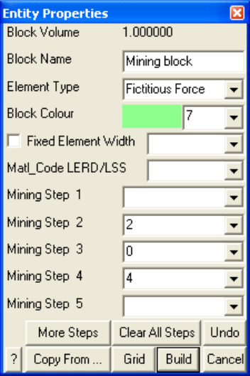

A sequência de etapas de lavra é especificada simplesmente atribuindo os códigos de material adequados na etapa de lavra desejada. O código de material representa o número do material existente dentro do bloco. Por padrão, a rocha encaixante é o material número 1. Qualquer região com propriedades (tensão inicial, resposta elástica ou resistência) diferentes das da rocha encaixante deve simplesmente receber um código de material positivo que indique as propriedades associadas a cada grupo de blocos.

O código de material 0 especifica que o elemento terá tensões superficiais nulas. É o padrão e normalmente é usado para superfícies de escavação, a superfície do terreno e paredes de cava.

O código de material -M (por exemplo, -2) especifica que o elemento terá tensões superficiais iguais ao estado de tensões associado ao material número M. Isso é útil para modelar aberturas pressurizadas ou tensões que variam com a profundidade (por exemplo, enchimento).

O código de material +M (por exemplo, 2) especifica que a região delimitada se comportará com as propriedades associadas ao material número M. Esse código é usado para especificar regiões com propriedades diferentes das da rocha encaixante (por exemplo, minério, dique, enchimento etc.).

Os códigos de material são atribuídos durante a construção do modelo usando

CAD > Build > Block CAD > Build > DD Loop CAD > Build > FF Loop

Os códigos de material podem ser atribuídos a qualquer momento usando

CAD > Edit > Entity Properties

Será exibido o seguinte

Neste exemplo, o bloco selecionado não é usado na etapa 1. Na etapa de lavra 2, recebe as propriedades do material número 2. Na etapa de lavra 3, o bloco é escavado. Por fim, na etapa de lavra 4, o bloco é preenchido com o material número 4.

Esse procedimento pode ser usado com elementos do tipo força fictícia para definir zonas tridimensionais com diferentes tensões e propriedades de material (por exemplo, diques rígidos, zonas de minério brandas ou zonas de plastificação). Também pode ser usado com elementos do tipo descontinuidade de deslocamento para definir zonas planas com diferentes tensões e propriedades de material (por exemplo, falhas preenchidas ou pilares em plastificação na lavra tabular).

É possível especificar um código de material diferente em cada etapa de lavra. Se nenhum código de material for atribuído (ou seja, se o campo ficar em branco), o bloco permanecerá inativo.

É importante lembrar a convenção de que números de material (códigos de material) mais altos têm prioridade sobre os mais baixos. Essa convenção foi adotada para resolver a ambiguidade ao considerar a interseção de várias feições diferentes, como uma falha com um dique ou um enchimento colocado em parte de um realce. Para evitar problemas, recomenda-se usar os números de material mais altos para o enchimento.

Ao simular sistemas de suporte rígidos, como arcos, cambotas de aço, escoras, revestimentos espessos, fogueiras de madeira, enchimento resistente etc., é necessário modelar o movimento do terreno até o momento da instalação do suporte e, em seguida, inserir os elementos de suporte em um estado livre de tensões e deformações ou com uma protensão prescrita. Para isso, primeiro escave o elemento de suporte desejado (um bloco FF 3D ou um plano DD) até o estado de protensão desejado (use um código de material zero para tensões nulas ou um número de material negativo para um estado de tensões prescrito) e, em uma etapa de lavra posterior, insira o material de suporte (use um número de material positivo para isso). Com a opção Analysis > Options > Zero Strain Support Placement marcada, o Map3D realiza os cálculos necessários para instalar os elementos de suporte em um estado livre de tensões e deformações ou com uma protensão prescrita na etapa de lavra atual. A escavação até um estado de tensões nulo ou prescrito, seguida da inserção de um material alternativo, sinaliza ao Map3D que ele deve realizar os cálculos necessários.

Esse procedimento é especialmente útil para simular elementos de suporte estrutural e permite sua instalação, a modificação de suas propriedades e sua remoção posterior, se desejado. Essa opção está disponível para blocos FF 3D e/ou planos DD.

Sem essa opção, todos os materiais são colocados no estado de deformação pré-lavra. Isso pode gerar tensões erroneamente altas, principalmente em elementos de suporte rígidos.

A sequência de lavra obtida pode ser visualizada no modo gráfico do Map3D simplesmente alternando entre as etapas de lavra com

File > Mining Step
