Para demonstrar a construção de modelos a partir de plantas de mina digitalizadas, vamos construir uma geometria simples de lavra em massa por VRM.

As linhas de construção são usadas para definir a localização detalhada de feições subterrâneas, como escavações, contatos, estruturas etc. Normalmente, um modelo do Map3D é construído sobre esses dados de linhas de construção.

As plantas de mina foram previamente digitalizadas com o Map3D

#### CAD > Digitizer Setup

ou com outro programa CAD. Essas plantas podem ser salvas em um dos seguintes formatos:

O formato de arquivo de pontos é um arquivo de dados ASCII universal com a extensão ".PNT". Esse formato é útil para trocar dados brutos de linhas de construção com outros softwares CAD.

O formato AutoCAD-DXF é um formato popular de intercâmbio de desenhos com a extensão ".DXF". Esse formato é útil para trocar dados de linhas de construção com outros softwares CAD.

Queremos começar do zero, então selecionaremos

#### File > New (Model)

Antes de começar, observe que você pode passar o cursor sobre qualquer botão para ver uma dica que identifica sua função. Também é possível clicar com o botão direito em qualquer item para obter ajuda detalhada sobre essa função.

#### Importação das plantas de mina digitalizadas

Primeiro precisamos abrir um arquivo com as plantas de mina digitalizadas. Isso é feito com

#### File > Open (Construction Lines)

Neste caso, as linhas de construção foram salvas no formato DXF; então altere "Files of Type" para *.dxf

O arquivo "BULK.dxf" está incluído na instalação do Map3D e deve estar disponível para importação.

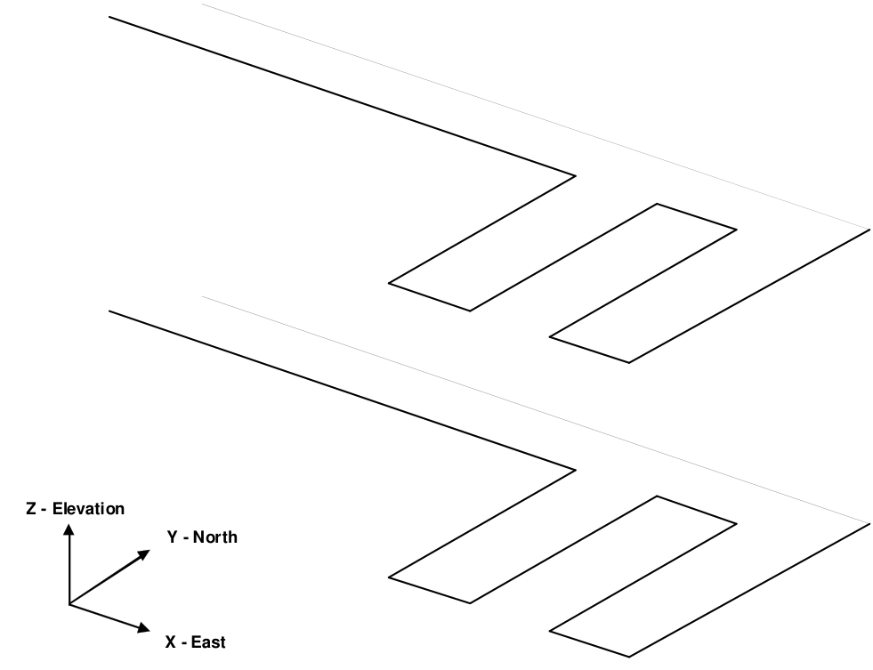

As galerias de acesso medem aproximadamente 5 m de largura por 5 m de altura, e a distância entre níveis é de 25 m.

#### Reposicionamento da vista

Durante a construção de blocos, ou a qualquer momento, você pode reposicionar (transladar, girar ou aplicar zoom) a geometria para facilitar a visualização. Isso pode ser feito de várias formas (consulte Rotação do modelo e Translação do modelo). A forma mais fácil de girar é manter pressionado o botão esquerdo do mouse enquanto arrasta o cursor pela tela. A translação é feita mantendo pressionado o botão direito. Para aproximar ou afastar o modelo, mantenha pressionados os dois botões do mouse.

Posicione a vista de modo que as linhas de construção fiquem bem visíveis.

#### Construção das galerias de acesso da lapa e dos travessões

Há vários métodos para construir essas entidades. Neste tutorial, algumas técnicas diferentes serão demonstradas.

#### Construção de blocos um a um

A abordagem mais simples (embora a mais demorada) é construir uma série de blocos de 8 vértices, um de cada vez.

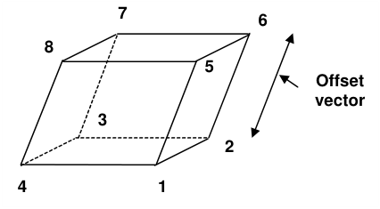

Para construir o primeiro bloco, use CAD > Build > FFLoop. Essa função pode ser selecionada na barra de ferramentas CAD da seguinte forma (se a barra de ferramentas CAD não estiver visível, ative-a com Tools > CAD Toolbar):

Selecione CAD > Build na barra de ferramentas CAD

Será exibido o submenu de funções de construção

Agora selecione

#### CAD > Build > FFLoop

Como queremos encaixar nas linhas de construção, precisamos definir o modo de encaixe. Isso é feito com CAD > Snap > Nearest Edge. Essa função pode ser selecionada na barra de ferramentas Build Entity

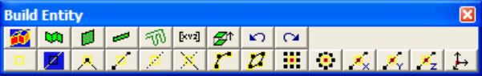

Para ativar o encaixe na aresta mais próxima, selecione

#### CAD > Snap > Nearest Edge

(isso só é necessário se o botão de encaixe na aresta mais próxima ainda não estiver destacado).

Nesse modo, uma caixa de seleção será exibida na interseção da mira.

**Será selecionado o ponto mais próximo desta aresta**

Embora as coordenadas da posição atual do cursor sejam indicadas na barra de status, se a caixa de seleção estiver sobre o vértice de uma linha de construção, esse vértice será selecionado; caso contrário, será selecionado o ponto mais próximo na aresta da linha de construção sob a caixa de seleção. Em ambos os casos, os 3 valores de coordenadas (x, y e z) ficam definidos de forma única.

Você verá que a rotina de construção FFLoop solicita, na barra de status, o primeiro vértice do bloco

Input: Select Point 1

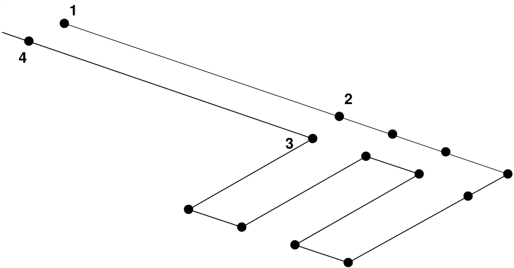

Mova o cursor até localizar o ponto nº 1. Selecione esse ponto clicando uma vez com o botão esquerdo do mouse.

Agora será solicitado o próximo vértice do bloco

#### Input: Select Point 2

Ao mover o cursor, você verá que, no canto inferior esquerdo da tela, é indicada não apenas a posição atual do cursor, mas também o deslocamento do ponto atual em relação ao último selecionado (ou seja, o vetor de deslocamento do ponto 1 ao ponto 2). Selecione o ponto nº 2. Repita esse processo para os pontos nº 3 e nº 4.

Se você selecionar o local errado para um ponto, basta desfazer essa seleção com o botão desfazer

CAD > Build > Undo Point e tentar novamente.

Por fim, selecione novamente o primeiro ponto (ou seja, o ponto nº 1).

Quando o primeiro ponto é selecionado novamente, a base do bloco está completamente formada. Será exibida a mensagem

Loop complete: Start next loop.

Para concluir o bloco, geraremos os 4 pontos restantes a partir dos 4 primeiros vértices, somando um deslocamento a eles. Para isso, selecione a função de deslocamento na barra de ferramentas Build Entity

#### CAD > Build > Extrude/Offset Remaining

O vetor de deslocamento será solicitado da seguinte forma

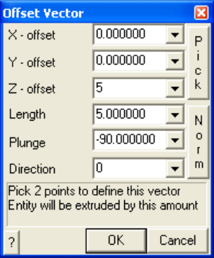

Informe o deslocamento:

X-offset > 0 Y-offset > 0 Z-offset > 5

Os pontos 5, 6, 7 e 8 serão gerados a partir dos pontos 1, 2, 3 e 4, respectivamente, somando os valores de deslocamento às suas coordenadas.

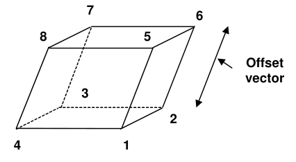

Ao concluir a construção do bloco, você será automaticamente solicitado a informar as propriedades do bloco (CAD > Build > FFLoop)

Informe o seguinte:

Block Name: Intersection Element Type: Fictitious Force Block Colour: 1

Esse bloco de interseção deve ser escavado na etapa de lavra 1. Isso é indicado especificando Mining Step 1: 0

Terminamos e podemos construir esse bloco pressionando o

botão.

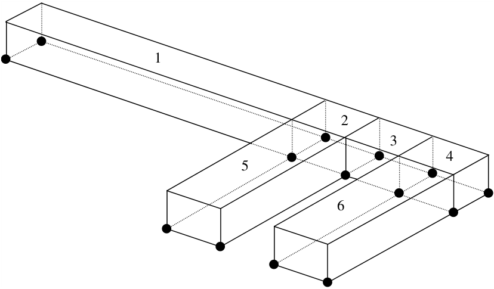

Repetindo o procedimento de construção FFLoop acima, é possível construir todo o nível como uma série de blocos.

#### Construção de blocos complexos

Vamos agora construir blocos de forma mais complexa.

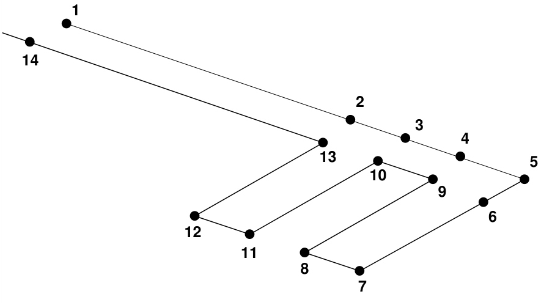

Isso pode ser feito com a mesma técnica FFLoop descrita acima, exceto que selecionaremos todos os 14 pontos da planta. Depois de selecionar o ponto nº 14, selecione novamente o ponto nº 1 para concluir a base do bloco. Será exibida a mensagem

#### Loop complete: Start next loop.

Para concluir o bloco, selecione a função de deslocamento na barra de ferramentas Build Entity, como antes.

#### CAD > Build > Extrude/Offset Remaining

Esse procedimento criará um grande bloco contínuo cobrindo toda a planta. Se desejar, é possível construir um bloco com a sequência de pontos 1-2-3-4-5-6-9-10-13-14-1 para a galeria da capa e depois 13-10-11-12 e 9-6-7-8 para construir os travessões como blocos separados. Esse último procedimento seria conveniente se os travessões fossem lavrados em uma etapa de lavra diferente da galeria da capa.

Agora construa as galerias de acesso do nível inferior com o mesmo procedimento.

#### Construção dos painéis VRM

Agora os painéis VRM podem ser construídos, usando blocos FFLoop com 8 vértices.

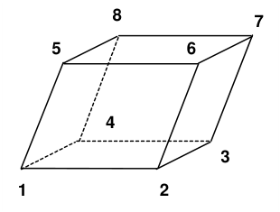

Para começar a construção, selecione

#### CAD > Build > FFLoop

Como queremos encaixar nos vértices de blocos construídos anteriormente, precisamos definir o modo de encaixe como CAD > Snap > Nearest Corner. Essa função pode ser selecionada na barra de ferramentas Build Entity

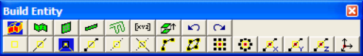

Para ativar o encaixe no vértice mais próximo, selecione

#### CAD > Snap > Nearest Corner

(isso só é necessário se o botão correspondente ainda não estiver destacado).

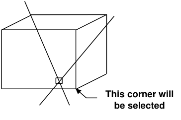

No modo de encaixe em vértices, uma caixa de seleção será exibida na interseção da mira. O vértice mais próximo da entidade ou linha de construção sob a caixa de seleção será selecionado (encaixado), de modo que os 3 valores de coordenadas (x, y e z) ficam definidos de forma única.

Na verdade, poderíamos usar aqui o modo de encaixe em arestas

#### CAD > Snap > Nearest Edge

já que os vértices dos blocos seriam selecionados de qualquer forma (desde que o vértice esteja dentro da caixa de seleção). No entanto, o encaixe em vértices permite uma seleção menos precisa, pois apenas vértices são selecionados.

Selecione os 4 primeiros pontos como mostrado abaixo. Lembre-se de selecionar novamente o ponto nº 1 para fechar o laço da planta inferior.

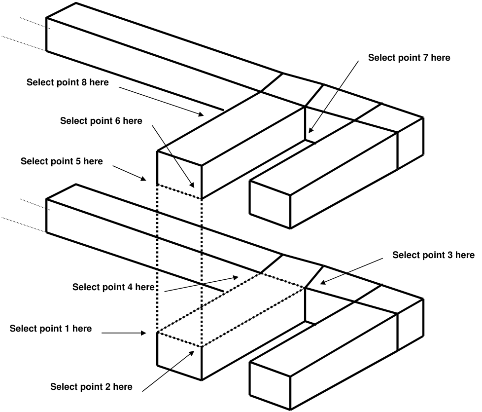

Para selecionar os pontos 5 a 8, precisaremos girar o modelo para vê-lo de baixo para cima. Isso é feito facilmente mantendo pressionado o botão esquerdo do mouse enquanto arrasta o cursor para cima na tela.

Selecione os pontos 5 a 8 como mostrado abaixo. Lembre-se de selecionar novamente o ponto nº 5 para fechar o laço da planta superior.

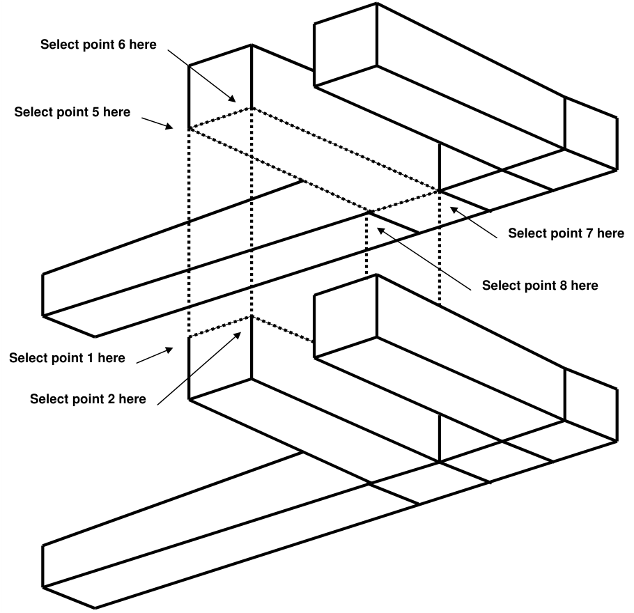

Como antes, será exibida a mensagem

Loop complete: Start next loop.

Para concluir o bloco, selecione o botão de construção na barra de ferramentas Build Entity

Ao concluir a construção do bloco, você será automaticamente solicitado a informar as propriedades do bloco (CAD > Build > FFLoop)

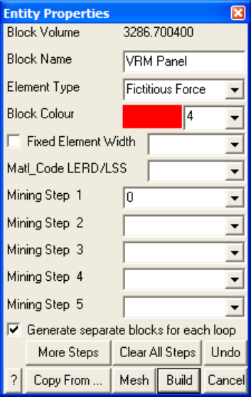

Informe o seguinte:

Block Name: VRM Panel Element Type: Fictitious Force Block Colour: 4

Deixaremos esse bloco sem lavra na etapa 1 e escavado na etapa 2. Isso é indicado deixando

Mining Step 1: (deixe este campo em branco) Mining Step 2: 0

Terminamos e podemos construir esse bloco. O painel adjacente pode ser construído com o mesmo procedimento, resultando na geometria final.

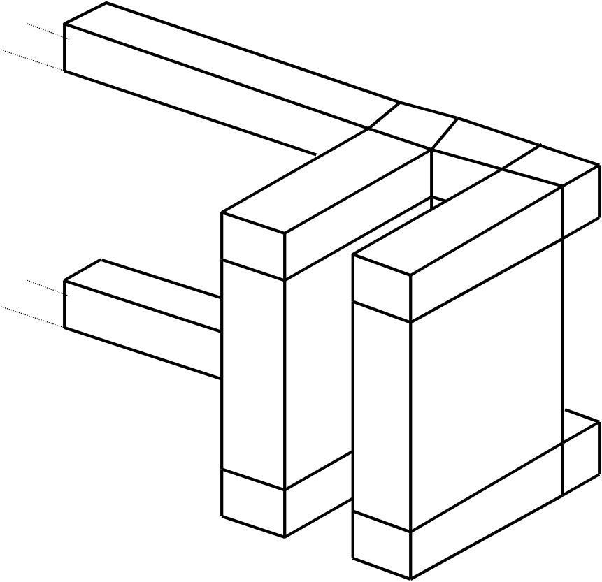

#### Salvar a geometria

Neste ponto, construímos as galerias de acesso da lapa e dois painéis VRM. Antes de continuar, é uma boa ideia salvar o modelo construído até agora. Para isso, selecionamos

File > Save Model As

Vamos salvá-lo com o nome "VRM.INP"

#### Construção de planos de grade

Agora precisamos decidir onde queremos que os resultados sejam calculados. Neste exemplo, interessa-nos a tensão no pilar formado entre os dois painéis VRM. Por isso, definiremos um plano de grade horizontal que passe à meia altura do pilar.

Usaremos a função de grade de encaixe. Ela pode ser configurada agora ou depois de iniciar a função de construção do plano de grade. Para configurá-la agora, selecione o botão na barra de ferramentas CAD

Como vamos desenhar à mão livre, precisamos configurar a grade de encaixe. Isso é feito com CAD > Snap > Rectangular Grid Snap. Essa função pode ser selecionada na barra de ferramentas Snap

Para ativar a grade de encaixe, selecione

#### CAD > Snap > Rectangular Grid Snap

(isso só é necessário se o botão de encaixe na grade ainda não estiver destacado).

As coordenadas da posição atual do cursor são indicadas na barra de status. Você notará que os valores x e y mudam ao mover o cursor, mas o valor z não. Para definir o valor z atual, clique em CAD > Snap > Cursor/Grid Setup; será exibido o seguinte:

Vamos selecionar essa posição graficamente com a função Pick.

Como queremos a base de encaixe à meia altura dos painéis VRM, altere o modo de encaixe para o ponto médio da linha

#### CAD > Snap > Midpoint of Line

Antes de prosseguir, verifique se o modo de encaixe correto foi definido: o item de menu CAD > Snap > Midpoint of Line deve estar marcado ou o botão de encaixe no ponto médio deve estar destacado

Selecione a origem da base de encaixe do cursor (Cursor/Snap Base Origin) na aresta vertical do painel VRM.

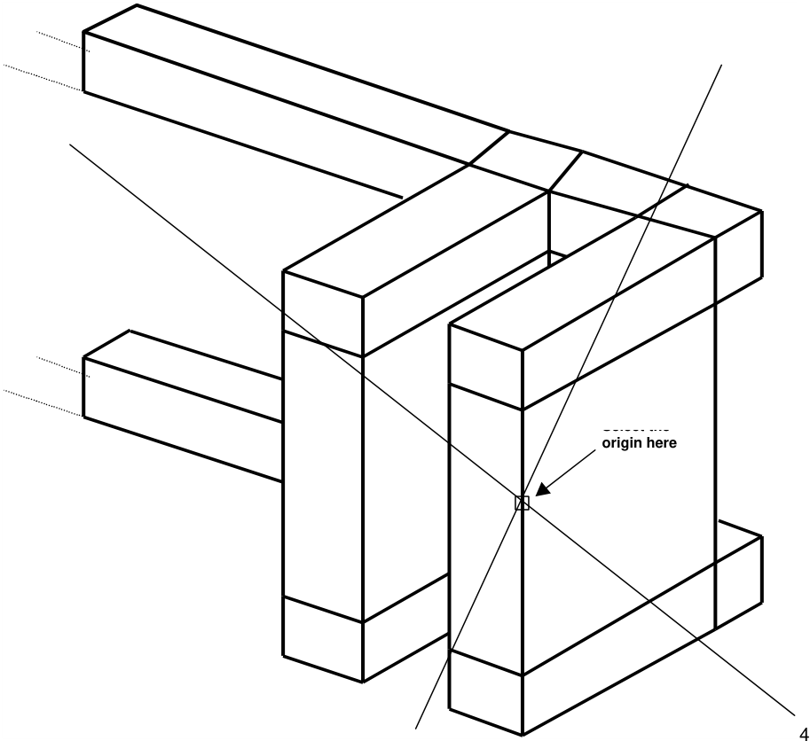

Será selecionado o ponto à meia altura dessa aresta. O valor z deve ser

Z Origin: 1012.5

Também devemos definir

Snap Spacing: 10

para facilitar a seleção de pontos.

Se a mira do cursor não estiver se movendo no plano x-y, selecione o

botão.

Antes de começar a construir o plano de grade, devemos reorientar a geometria para uma vista em planta. Isso pode ser feito com

#### View > View XY Plane

Agora vamos construir o plano de grade.

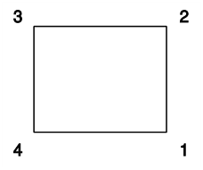

Ele será construído como um plano de 4 vértices. Para construí-lo, selecione a função de menu de construção de grades

#### CAD > Build > Grid Plane

Essa função também pode ser selecionada na barra de ferramentas CAD da seguinte forma:

Selecione CAD > Build na barra de ferramentas CAD

Será exibido o submenu de funções de construção

Agora selecione

#### CAD > Build > Grid Plane

Como vamos desenhar à mão livre, precisamos garantir que CAD > Snap > Rectangular Grid Snap esteja ativado. Essa função pode ser selecionada na barra de ferramentas Build Entity

Para ativar a grade de encaixe, selecione

#### CAD > Snap > Rectangular Grid Snap

(isso só é necessário se o botão de encaixe na grade ainda não estiver destacado).

Você verá que a rotina de construção do plano de grade solicita o primeiro vértice do plano

Input: Select Point 1

Selecione os quatro vértices do plano.

**3**

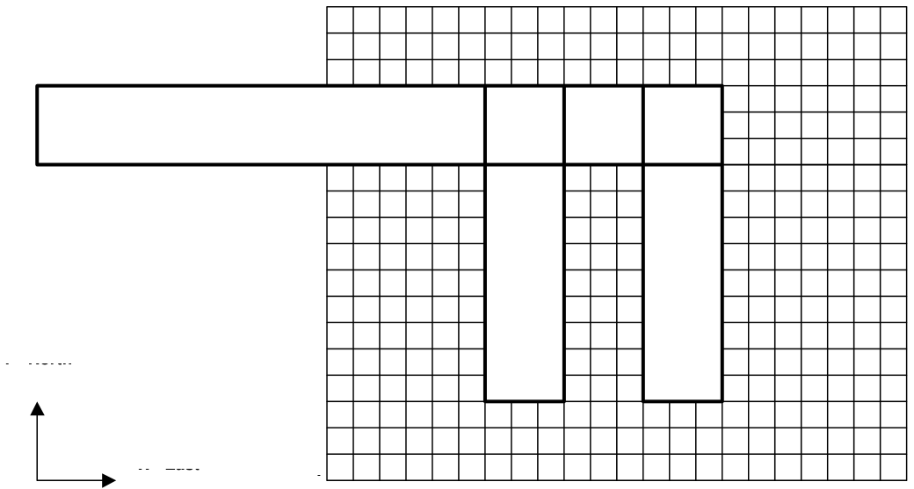

Ao selecionar o 4º ponto, você será automaticamente solicitado a especificar as propriedades do plano de grade (

#### CAD > Build > Grid Plane).

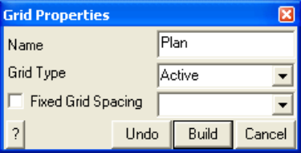

Informe um nome descritivo (Name) para o plano de grade, verifique se Grid Type está como Active e deixe a caixa Fixed Grid Spacing desmarcada.

#### Especificação das propriedades de material da rocha encaixante

Agora precisamos especificar as propriedades do material encaixante. Elas são informadas com a função de propriedades de material

#### CAD > Properties > Material Properties

Esse item abre um submenu relacionado à edição das propriedades de material. Observe que o material número 1 é, por definição, o material encaixante. Os outros números de material são usados para definir zonas de materiais alternativos, como minério, preenchimento de falha, enchimento etc. Primeiro será solicitado o número do material a ser editado. Vamos definir primeiro as propriedades do material encaixante

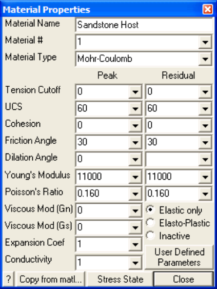

Informe o seguinte:

Material Name: Sandstone Host Material # : 1 Young's (deformation) Modulus: 60000 MPa Poisson's Ratio: 0.25

Os módulos viscosos podem ser definidos como zero, pois só são usados para simular fluência na análise não linear.

Queremos usar aqui o critério de Mohr-Coulomb. Para isso, defina

Material Type: Mohr-Coulomb UCS: 60 MPa

O parâmetro de coesão não é usado neste caso e, portanto, pode ser definido como zero.

Friction Angle: 30°

O ângulo de dilatância não é usado neste caso e, portanto, pode ser definido como zero.

Agora é possível especificar o estado de tensões pré-lavra

CAD > Properties > Material Properties > Stress State

O estado de tensões de campo distante adequado para este modelo é

sa constant:  30 MPa sb constant:  20 MPa sc constant:  20 MPa

Definiremos a variação das tensões com a profundidade como

Dsa variation:  -0.027 MPa/m Dsb variation:  -0.013 MPa/m Dsc variation:  -0.013 MPa/m

Além disso, as orientações das tensões (direção e caimento) devem ser definidas como zero, o que define sa e sb como horizontais e sc como vertical.

O datum pode ser definido como 1000 metros para definir a variação com a profundidade como

s + Ds ( _z_ - _Datum_ )

Assim definida, a tensão sa é igual a 30 MPa na profundidade z de 1000 m e aumenta à taxa de 0,027 MPa por metro de profundidade.

#### Especificação dos parâmetros de controle

Agora precisamos especificar os parâmetros que controlam a discretização e a solução do modelo. Eles são informados com a função de parâmetros de controle

#### CAD > Properties > Control Parameters

Esse item abre uma caixa de diálogo com os itens relacionados aos parâmetros de controle

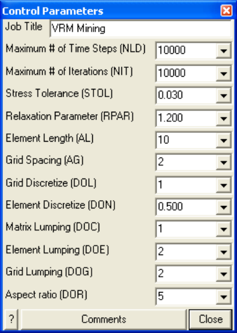

Informe o seguinte:

Job Title: VRM Mining

Todos os parâmetros podem ficar com seus valores padrão, exceto a tolerância de tensão, o comprimento de elemento e o espaçamento de grade.

Stress Tolerance: 0.03 MPa

deve ser aproximadamente 0,1% do estado de tensões de campo distante. Isso garante que, durante a solução, as tensões superficiais sejam calculadas com precisão numérica de 0,03 MPa.

#### Element Length: 10

deve ser igual ao dobro da altura da galeria ou ao dobro da largura do pilar. Esse parâmetro controla o tamanho mínimo dos elementos de contorno usados em locais com camadas ou pilares estreitos. Isso garante a formulação de um problema bem condicionado e fácil de resolver.

#### Grid Spacing: 2

deve ser aproximadamente metade da largura do pilar. Esse parâmetro controla o tamanho mínimo dos elementos de contorno e o espaçamento mínimo no plano de grade nos locais onde ele passa perto do modelo ou o intercepta. É possível obter resultados precisos até uma distância de metade desse espaçamento das superfícies do modelo. Esse parâmetro também garante que um número suficiente de pontos de tensão seja calculado dentro do pilar para gerar contornos suaves.

O usuário pode escolher um valor maior para o espaçamento de grade. Isso resultará em um problema menor e, portanto, em tempos de processamento mais curtos. No entanto, com elementos de contorno maiores, os resultados serão menos precisos, especialmente perto das superfícies do modelo; além disso, com espaçamento de grade maior, não é possível gerar contornos suaves.

Os valores sugeridos para os parâmetros de discretização e agrupamento são os seguintes:

_DON_ =0.5, _DOL_ = _DOC_ =1, _DOE_ = _DOG_ =2 para erro de 10-20%

_DON_ =0.5, _DOL_ = _DOC_ =2, _DOE_ = _DOG_ =4 para erro de 5-10% _DON_ =1.0, _DOL_ =DOC=4, _DOE_ = _DOG_ =8 para erro &lt; 5%

As configurações para resultados de análise grosseiros são recomendadas para todos os problemas, exceto aqueles que exigem maior precisão. Com essa configuração, pode-se esperar erros numéricos de 10-20% nas previsões de tensão. As configurações para resultados detalhados fornecem erro numérico de 5-10%, e as de alta precisão, erro inferior a 5%. O usuário pode especificar configurações de maior precisão, mas isso resultará em um problema maior e, portanto, em tempos de processamento mais longos.

#### Execução de uma análise no Map3D

Neste ponto, concluímos a construção do modelo e estamos prontos para iniciar uma análise. Se você estiver usando o Map3D Fault-Slip, obterá uma solução elástica para este problema. Se estiver usando o Map3D NonLinear, será realizada uma análise não linear completa.

A análise é executada a partir do menu principal.

Você pode executar a análise completa selecionando

#### BEM Analysis

Aqui faremos isso por etapas. Então, primeiro selecione

#### Discretization

Se você tiver modificado o modelo desde a última vez que salvou, será solicitado a salvar as modificações.

Quando as análises de interseção e discretização estiverem concluídas, selecione

#### Analysis > Graphics

No modo gráfico, selecione a opção de vista discretizada

#### View > Render > Discretize

Isso permitirá ver como as superfícies dos blocos foram discretizadas em elementos de contorno. Os contornos dos blocos precisam estar ativados para ver os elementos individuais

#### View > Render > Block Outlines

Para ver como a grade foi discretizada (se a barra de ferramentas de contornos não estiver visível, ative-a com Tools > CAD Toolbar), selecione

#### Plot > Grid Selection > Grid #1

na barra de ferramentas de contornos

A análise de discretização pode ser repetida quantas vezes desejar, com diferentes valores de espaçamento de grade e de parâmetros de discretização e agrupamento, até obter a densidade desejada de elementos de contorno e pontos de grade.

Quando estiver satisfeito, prossiga para a análise BEM (montagem e solução da matriz) selecionando

#### Analysis

no menu principal e depois

#### BEM Analysis

Quando a análise terminar, selecione

#### Analysis > Graphics

No modo gráfico, é possível gerar contornos de qualquer parâmetro desejado. Por exemplo, para exibir os contornos da tensão principal maior, selecione

#### Plot > Stress > S1 Major Principal Stress

Isso gerará uma plotagem de contornos no plano de grade.

A interpretação dos resultados não será discutida aqui.
