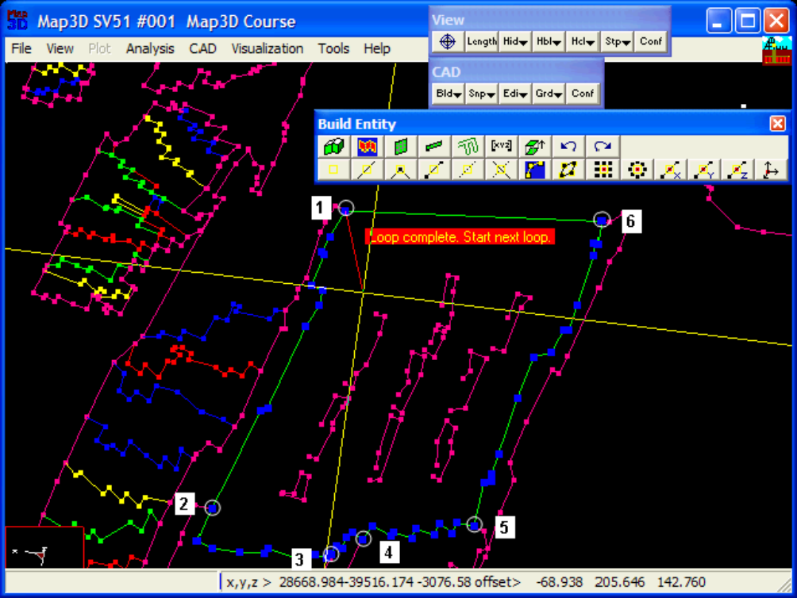
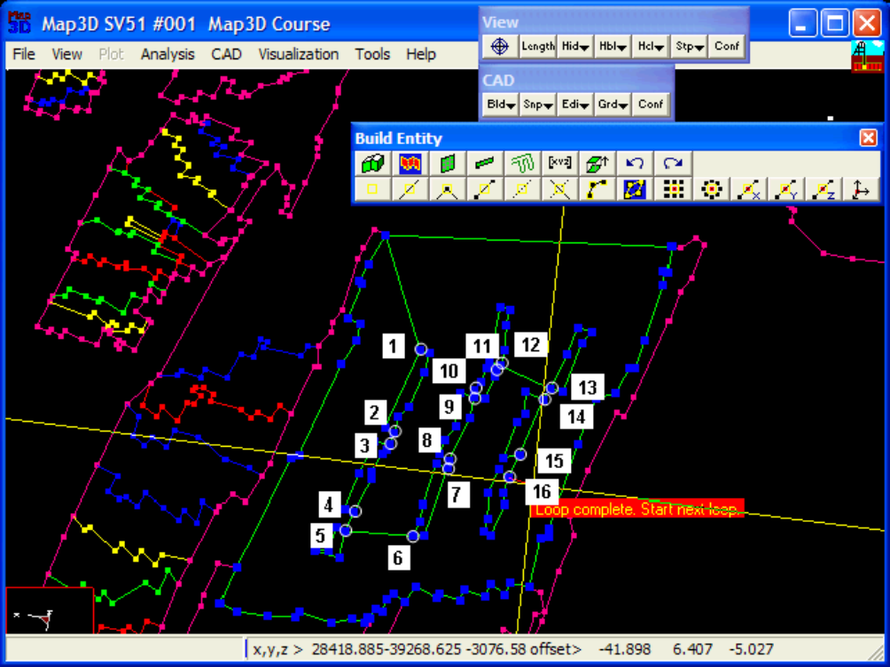
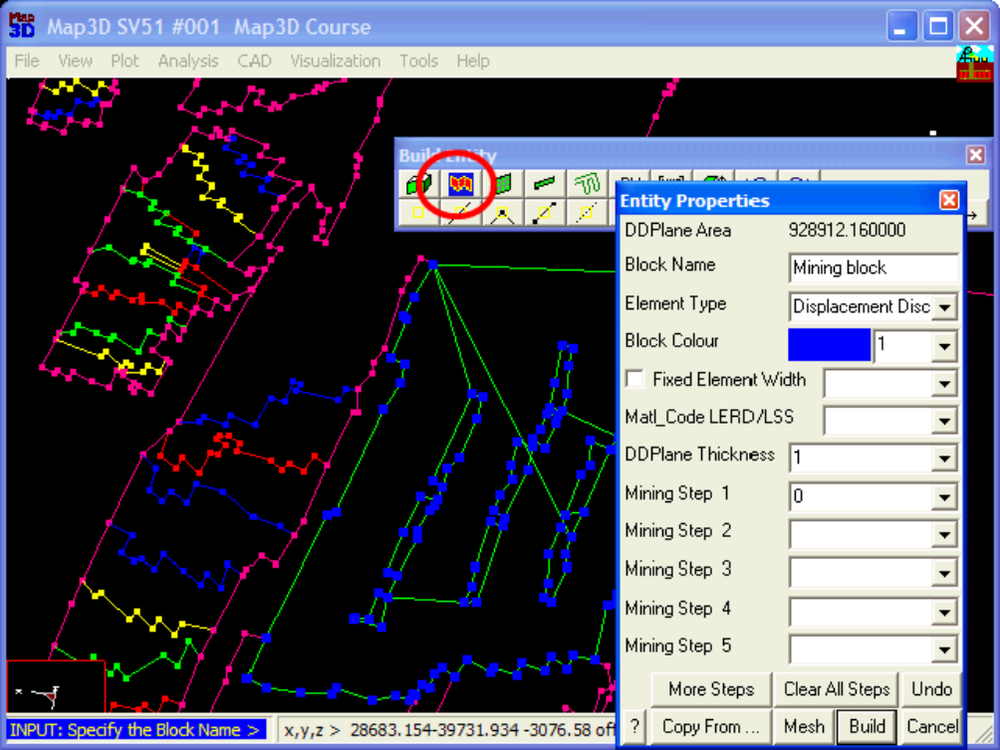
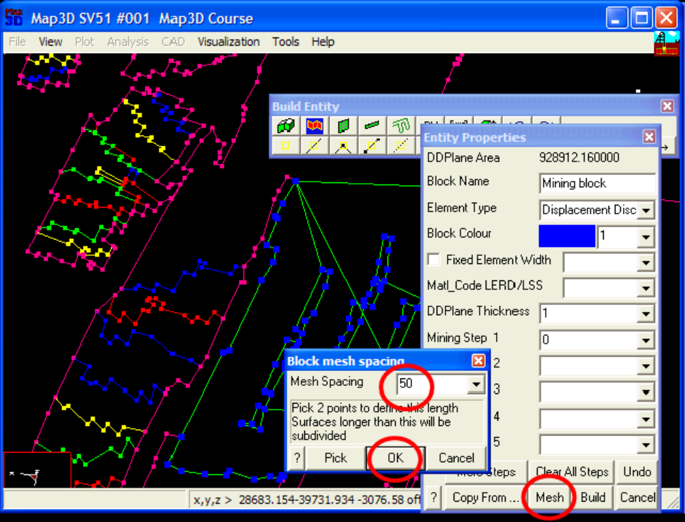
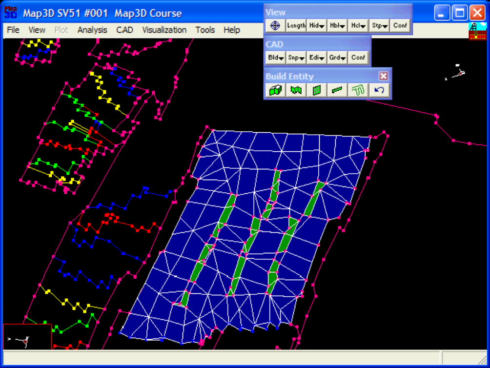

**Passo 1: Importar as plantas de mina digitalizadas.**

- As plantas deste exemplo estão em um arquivo chamado "t.pnt".

- Elas são importadas com o comando File > Open Construction Lines.

**Passo 2: Iniciar a rotina DDLoop e definir o modo de encaixe Cline.**

- O DDLoop é iniciado selecionando (CAD > Build > DDLoop).

- O modo de encaixe Cline é definido selecionando (CAD > Snap > Trace Cline).

**Passo 3: Construir o laço externo.**

- O laço externo é construído selecionando as extremidades dos segmentos de linha de construção desejados.

- Aqui selecionamos os pontos 1-2-3-4-5-6-1

- O ponto 1 é selecionado no fim dessa sequência para fechar o laço, concluindo a construção do laço externo.

**Passo 4: Definir o modo de encaixe CLoop e construir os laços internos.**

- O modo de encaixe CLoop é definido selecionando (CAD > Snap > Trace CLoop).

- Os laços internos são definidos selecionando os pontos de entrada e saída de cada laço.

- O 1º laço é definido pelos pontos 1 e 2.

- O 2º laço é definido pelos pontos 3 e 4.

- O 3º laço é definido pelo ponto 5.

- O 4º laço é definido pelos pontos 6 e 7.

- O 5º laço é definido pelos pontos 8 e 9.

- O 6º laço é definido pelos pontos 10 e 11.

- O 7º laço é definido pelo ponto 12.

- O 8º laço é definido pelo ponto 13.

- O 9º laço é definido pelos pontos 14 e 15.

- O 10º laço é definido pelo ponto 16.

**Passo 5: Sinalizar a conclusão da construção.**

- Depois de definir todos os laços, selecione novamente (CAD > Build > DDLoop) para sinalizar a conclusão da construção.

- Isso também pode ser sinalizado selecionando o último ponto (ou seja, o ponto 16) uma segunda vez.

**Passo 6: Construir os DDLoops.**

- Embora pudéssemos construir os DDLoops com a função, aqui usaremos a função.

- Esta última função gera elementos com formato melhor.

- Será solicitado o espaçamento de malha desejado.

- Defina-o como 50 metros.

#### Passo 7: Construção concluída.

- Isso conclui a construção da lavra tabular com os pilares.

- Provavelmente você vai querer editar as propriedades de entidade dos pilares para atribuir as propriedades e a sequência de lavra adequadas.

