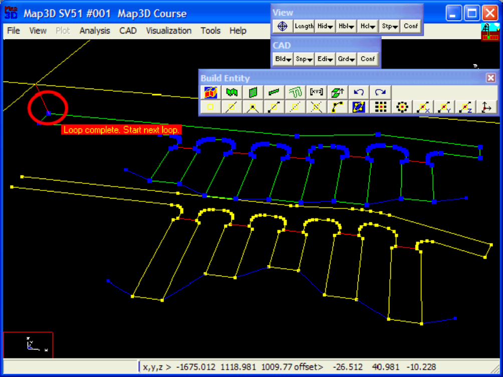
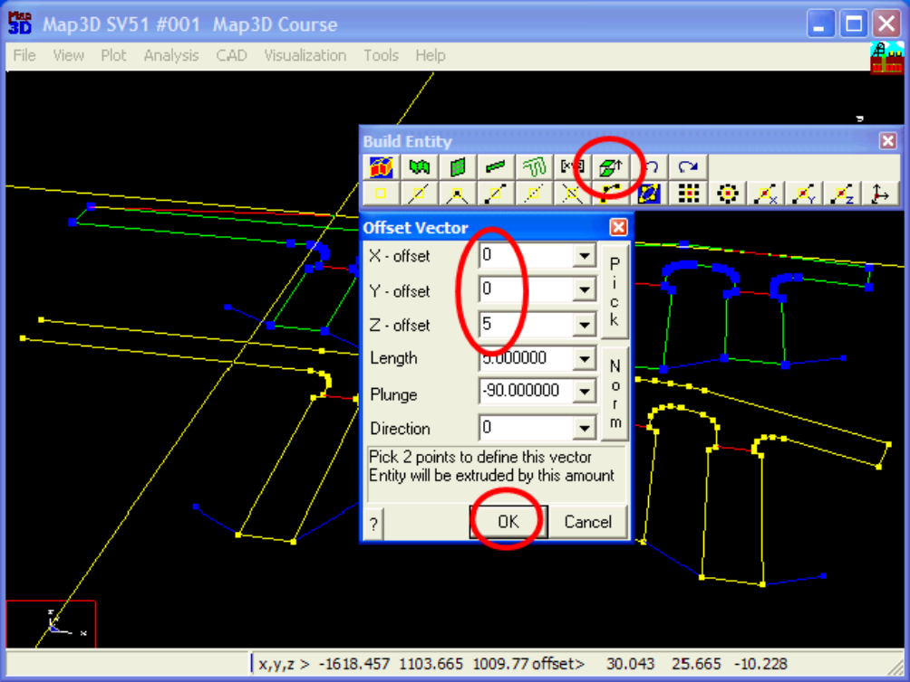
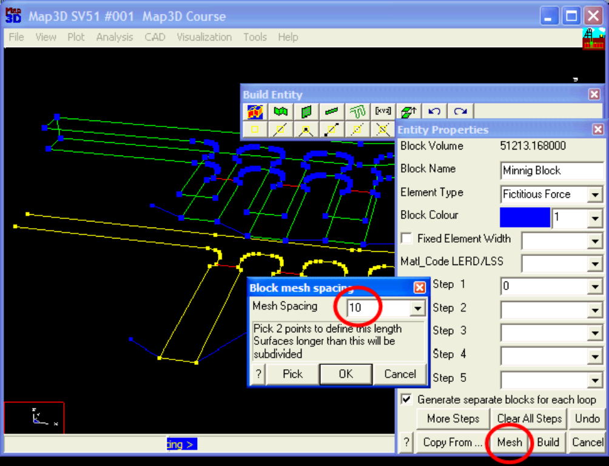
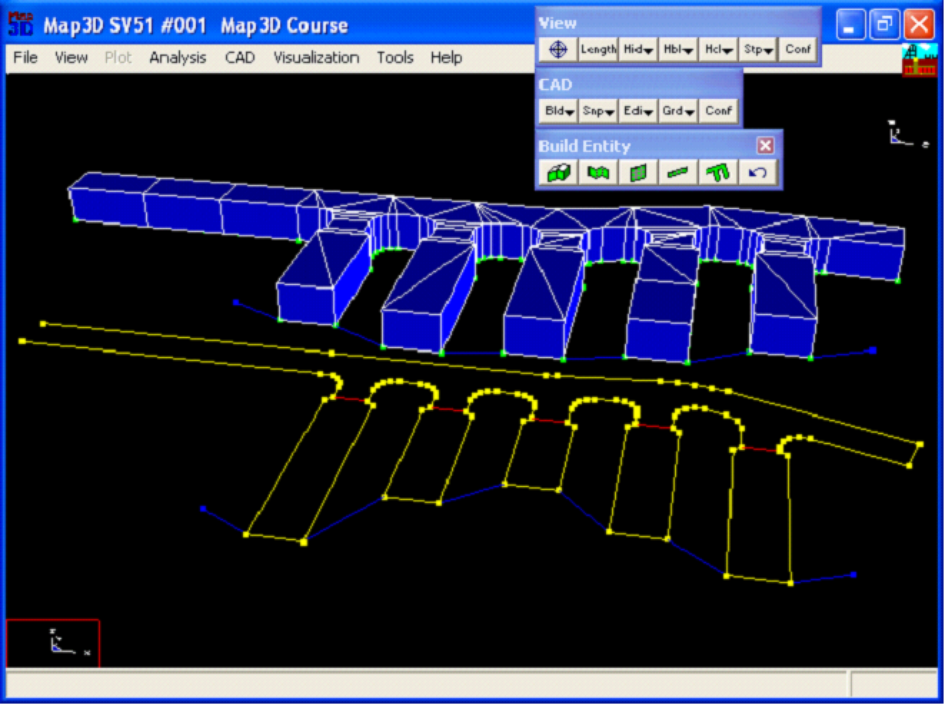

#### Passo 1: Importar as plantas de mina digitalizadas.

- As plantas deste exemplo estão em um arquivo chamado "bulk.dxf".

- Elas são importadas com o comando File > Open Construction Lines.

#### Passo 2: Iniciar a rotina FFLoop e definir o modo de encaixe CLoop.

- O FFLoop é iniciado selecionando (CAD > Build > FFLoop).

- O modo de encaixe CLoop é definido selecionando (CAD > Snap > Trace CLoop).

**Passo 3: Construir o FFLoop.**

- O FFLoop é construído selecionando um dos pontos da linha de construção desejada.

**Passo 4: Extrudar a planta em uma galeria 3D.**

- Neste ponto, construímos a planta da galeria.

- Agora ela pode ser extrudada em uma forma 3D selecionando (CAD > Build > Offset/Extrude).

- Defina o vetor de deslocamento como (0 0 5).

**Passo 5: Construir a galeria.**

- Agora o FFLoop pode ser construído com a função.

- Especifique 10 como espaçamento de malha (Mesh Spacing) e pressione OK.

**Passo 6: Construção concluída.**

- Isso conclui a construção da galeria.

