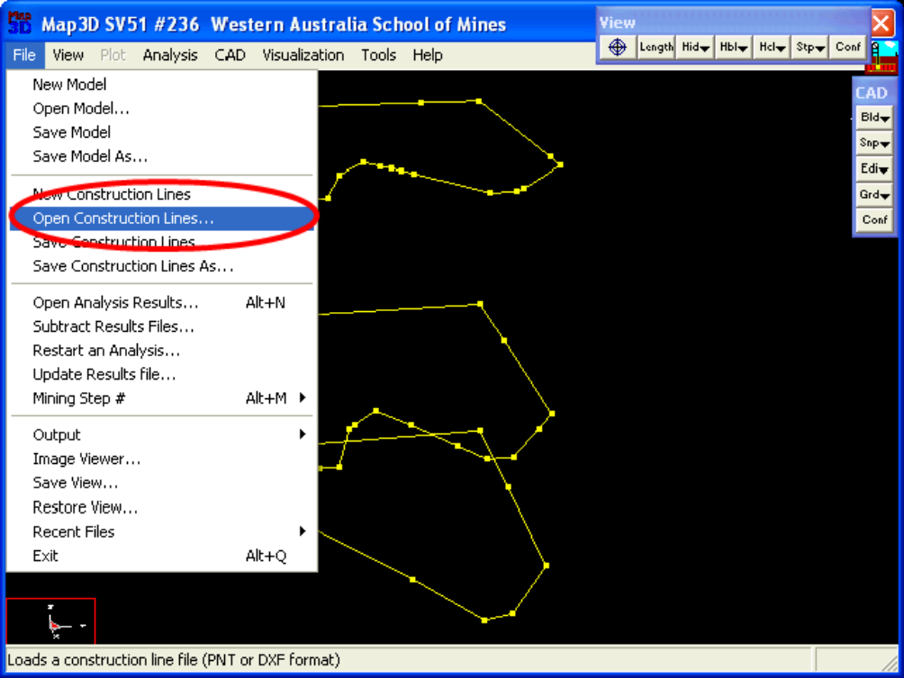
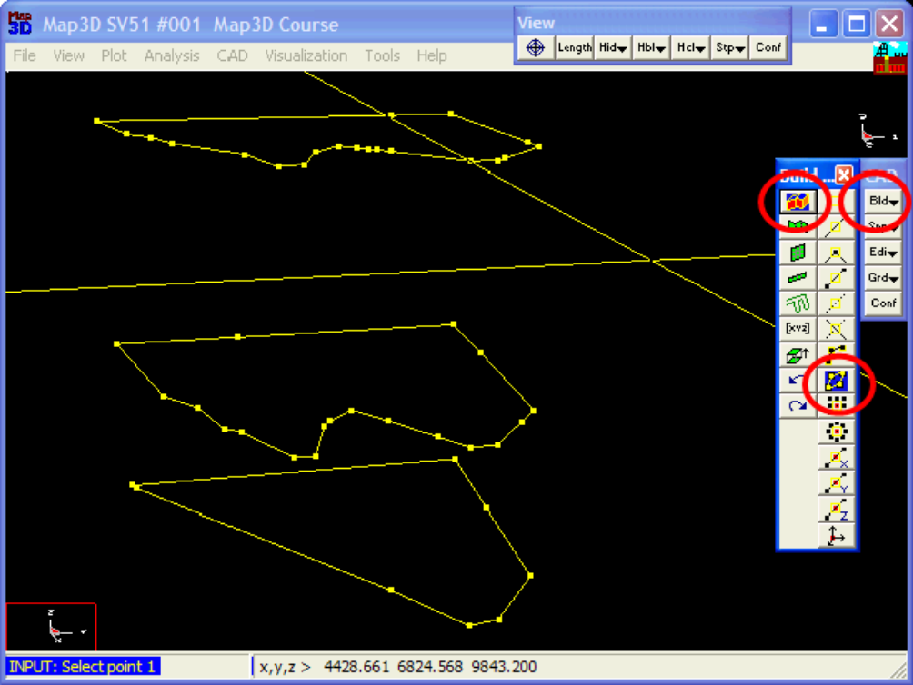
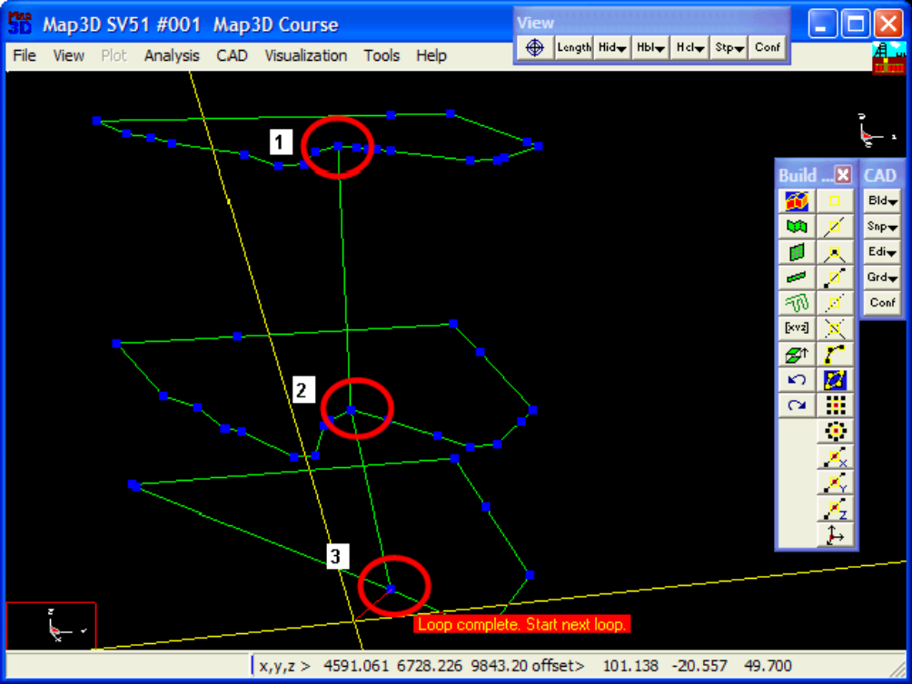
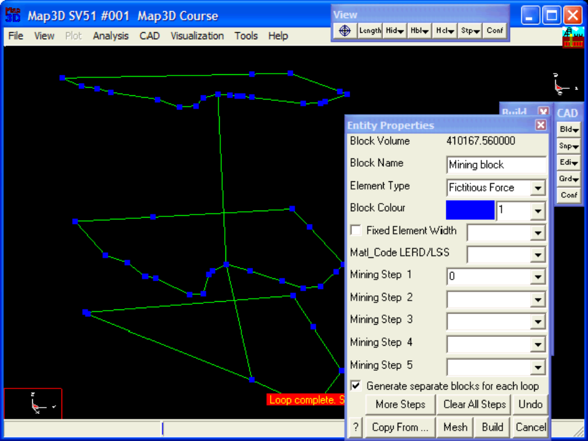
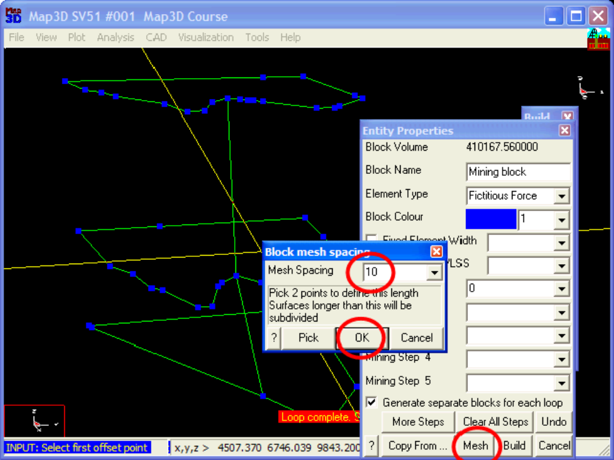
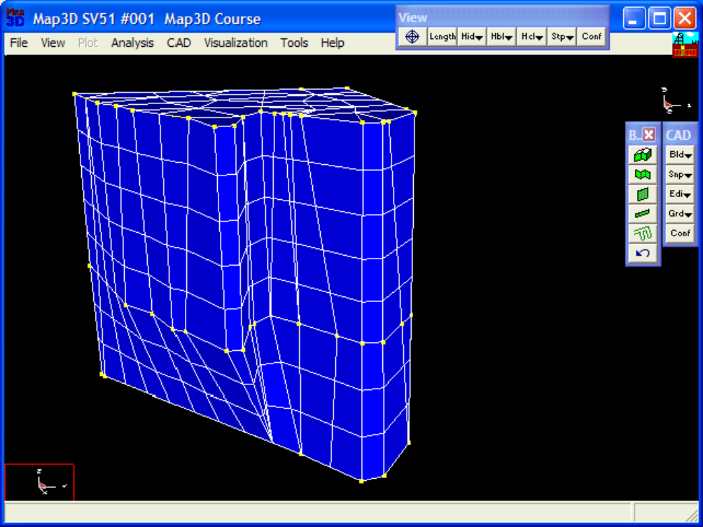

#### Passo 1: Importar as plantas de mina digitalizadas.

- As plantas deste exemplo estão em um arquivo chamado "bulk.dxf".

- Elas são importadas com o comando File > Open Construction Lines.

**Passo 2: Iniciar a rotina FFLoop e definir o modo de encaixe CLoop.**

- O FFLoop é iniciado selecionando (CAD > Build > FFLoop).

- O modo de encaixe CLoop é definido selecionando (CAD > Snap > Trace CLoop).

#### Passo 3: Construir o FFLoop.

- O FFLoop é construído selecionando um ponto em cada linha de construção.

- Observe que pontos são gerados automaticamente a intervalos de 10 m ao longo dos lados longos

- É melhor selecionar pontos em cantos vivos ou dobras, pois a linha entre os laços orientará o processo de construção.

#### Passo 4: Sinalizar a conclusão da construção.

- Depois de definir todos os laços, selecione novamente (CAD > Build > FFLoop) para sinalizar a conclusão da construção.

- Isso também pode ser sinalizado selecionando o último ponto (ou seja, o ponto 3) uma segunda vez.

**Passo 5: Construir o realce.**

- Agora o FFLoop pode ser construído com a função.

- Especifique 10 como espaçamento de malha (Mesh Spacing) e selecione OK.

**Passo 6: Construção concluída.**

- Isso conclui a construção do realce.

